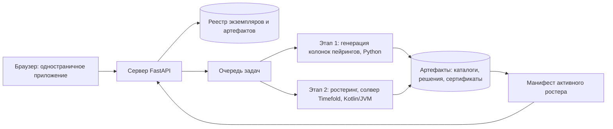

# COSMOS — Руководство. Часть 1. Введение и устройство системы

| Поле | Значение |
|---|---|
| Версия приложения | `92d14a4` (2026-07-24) |
| Дата документа | 2026-07-20 |
| Аудитория | Планировщик · Администратор · ИТ-служба авиакомпании |
| Связанные части | [Часть 2 — Подготовка данных](02-podgotovka-dannyh-RU.md), [Часть 3 — Оптимизация](03-optimizaciya-RU.md), [Часть 9 — Справочник](09-spravochnik-RU.md) |

---

## 1. О чём эта часть

Эта часть отвечает на вопросы «что такое COSMOS», «из чего система состоит», «кто и с какими правами в ней работает» и «где какие данные разрешено обрабатывать». Прочитайте её первой: все остальные части опираются на введённые здесь понятия и на карту разделов интерфейса.

## 2. Что такое COSMOS

COSMOS — система оптимизационного планирования лётных экипажей. Она решает две классические задачи планирования:

- **Пейринг** (pairing) — построение цепочек рейсов для одного экипажа. Цепочка включает рейсы, наземные стыковки, отдых и, при необходимости, дедхеды (deadhead — перелёт члена экипажа пассажиром для позиционирования). Обязательный возврат на базу зависит от правила постановки: в контракте Б набора H0 открытые цепочки разрешены (часть 3, [раздел 12с](03-optimizaciya-RU.md#12с-одна-цена-цепочки-и-сверка-по-мерам-внешний-аудит-04092026-a6)).
- **Ростеринг** (rostering) — назначение конкретных людей на построенные пейринги с соблюдением правил труда и отдыха: минимальный отдых, месячный предел налёта, ограничения смены и т. д.

Ростеринг «на пейринге» связан с пейрингом явным идентификатором выбранного прогона (часть 3, «Ростеринг на утверждённом пейринге»). База приписки человека, его известное местоположение и аэропорт старта цепочки — разные вещи и друг друга не подменяют; нормативная смена не тождественна цепочке. Итог расчёта разделяет допустимость, проверенность стоимости и качество поиска: отсутствие найденного нарушения при непроверенных обязательных окнах не подтверждает допустимость, а известный подытог цены не становится полной стоимостью.

Отличительная идея COSMOS — **самоусовершенствование**: у приложения есть собственный конвейер улучшений, в котором программные агенты ищут улучшения алгоритмов, разбирают отзывы пользователей, следят за регуляторикой и внешними аудитами, а человек-администратор утверждает каждое продвижение изменений (подробно — [Часть 7](07-samousovershenstvovanie-RU.md)).

Технически система состоит из четырёх слоёв:

1. **Веб-интерфейс** — одностраничное приложение (вкладки описаны в разделе 6).
2. **Сервер приложения** — FastAPI (веб-фреймворк на Python); отвечает за данные, задачи, проверки и все экраны.
3. **Оптимизационный конвейер** — этап 1 (генерация колонок пейрингов, Python) и этап 2 (ростеринг, солвер Timefold на Kotlin/JVM; JVM — Java Virtual Machine, виртуальная машина Java). «Солвер» — программа-решатель оптимизационной задачи.
4. **Артефакты** — неизменяемые JSON-файлы результатов (каталоги пейрингов, решения ростеринга, сертификаты проверок), из которых строятся все экраны результатов.

## 3. Роли и ответственность

| Действие | Кто выполняет | Кто утверждает |
|---|---|---|
| Вход в систему, просмотр своих данных | любой авторизованный пользователь | — |
| Загрузка данных, запуск расчётов, правки доски | Планировщик (роль «пользователь» или «администратор») | — |
| Управление пользователями, журнал активности, Студия, ИИ-контур | Администратор | — |
| Конвейер самоусовершенствования (раздел «Автоулучшение») | Администратор | Администратор (каждое продвижение) |
| Раздел «Установки» (API-ключ, выбор моделей ИИ) | Только супер-администратор | Супер-администратор |
| Кабинет экипажа | Член экипажа с привязкой email → табельный номер | Привязку делает администратор или владелец данных |

### 3.1 Уровни доступа

- **Пользователь** («пользователь» в списке ролей) — рабочая роль планировщика: данные, расчёты, результаты, доска, свои загрузки.
- **Администратор** («администратор») — дополнительно видит группы «Автоулучшение» и «Админ» (вкладки «Пользователи», «Журнал», «ИИ-контур», «Студия»), колонку «Владелец» в списке экземпляров и админ-формы (ставки, параметры сайзинга и т. п.).
- **Супер-администратор** — определяется по адресу, а не по записи в базе; адреса задаются при установке (поле `super_admin_email` анкеты установщика) либо переменной окружения `CREW_SUPER_ADMIN` (список через запятую: первый адрес — супер-администратор «Установок», весь список — администраторы по умолчанию) — вшитых адресов нет; без заданных адресов супер-администратор не назначается. Только ему видна группа «Установки»; сервер дополнительно перепроверяет каждый запрос `/api/settings*`.

### 3.2 Как выдаётся доступ

Вход защищён **Cloudflare Access**: пользователь получает одноразовый код на свой email; пароль не используется. Внутри приложения доступ определяется так:

1. **Явная запись** — администратор добавляет email на вкладке «Пользователи» (форма «Добавить пользователя», поля «Email» и «Роль»: «пользователь» / «администратор»).
2. **Доменная авторизация (allow-list)** — email с доменов из настроенного списка (например, `partner.example.com`), а также отдельные адреса из того же списка, автоматически получают роль администратора при первом входе (авто-провижининг: запись создаётся сама с пометкой источника «allow-list»). Конкретный перечень доменов и адресов задаётся конфигурацией контура.
3. **Отзыв доступа** — статус «revoked» (отозван) сильнее любого allow-list: отозванный пользователь не входит, даже если его домен в списке.

## 4. Контуры: Prod, Stage, Test и контуры заказчиков

COSMOS развёрнута в изолированных контурах на одном производственном сервере. У каждого контура своя копия кода, своих данных и свой порт.

| Контур | Порт | Назначение | Тип контура |
|---|---|---|---|
| **Prod** | 8090 | Рабочая эксплуатация с данными заказчиков | Внутренний |
| **Stage** | 8091 | Предпродакшн: проверка изменений на данных, близких к боевым | Внутренний |
| **Test** | 8092 | Полигон агентов самоусовершенствования и новых функций | Внешний |
| **Контур заказчика** | 8093 и далее | Отдельная площадка одной авиакомпании: её правила, её данные, её расчёты | Внутренний |

**Три службы пакета.** В контуре работает не одно приложение, а три
самостоятельные службы, у каждой свой порт: веб-приложение COSMOS
(порты выше), панель CDPM — модуля обработки данных авиакомпании
([Часть 10](10-cdpm-formalizaciya-RU.md)) и служба каталога шаблонов
([Часть 13](13-katalog-shablonov-RU.md), раздел 13.9). Номера службы
каталога — ряд «+10» к панели CDPM.

| Контур | Веб-приложение | Панель CDPM | Служба каталога |
|---|---|---|---|
| Prod | 8090 | 8097 | **8107** |
| Stage | 8091 | 8096 | **8106** |
| Test | 8092 | 8095 | **8105** |
| Контур заказчика | 8093 и далее | 8095 | **8105** |

Служба каталога всюду слушает петлевой адрес и наружу выходит только
туннелем; на всех контурах, кроме рабочего места владельца, она
поднимается в режиме просмотра — правки, заявки и выпуск версий
делаются на рабочем месте владельца.

**Контур заказчика** разворачивается по образцу Test (полноценное приложение, все экраны), но с двумя намеренными изъятиями: он не видит каталогов Prod и Stage — площадка заказчика не управляет чужими контурами — и не несёт очередей самоусовершенствования, поскольку это внутренний конвейер разработки. На таком контуре добавлена загрузка **документа постановки**: свод правил авиакомпании читается расчётом напрямую из загруженного документа, а не из настроек приложения.

Чтобы вкладки разных контуров различались на глаз, контур заказчика помечается **меткой контура**: переменная окружения `CREW_CONTOUR_LABEL` (например, `DEMO`) добавляет суффикс к заголовку приложения — «COSMOS — конвейер пейринг–ростеринг/DEMO» — во вкладке браузера и в шапке, на всех языках интерфейса. Без переменной заголовок остаётся общим.

Ключевое различие — **политика внешних ИИ-вызовов**:

- **Внутренний контур** (Prod, Stage) — здесь живут данные заказчиков; обращения к внешним (облачным) языковым моделям с данными заказчика запрещены. Все ИИ-функции над такими данными выполняет локальная модель (Ollama — сервер локальных открытых моделей), не покидающая машину.
- **Внешний контур** (Test) — только публичные данные; облачные модели разрешены. Именно здесь работают агенты самоусовершенствования, пишущие код.

Важно понимать природу правила «на Test — только публичные данные»: это организационная политика, а не программный запрет. Сервер доверяет декларации «Области данных» (см. раздел 5), которую выставляет владелец набора при загрузке. Технических смягчений два: безопасное значение по умолчанию «Только локально» для всех загрузок и обязательное маскирование значений образца при отправке в облачную модель на импорте. Ответственность за то, чтобы данные заказчика не попали на Test, лежит на людях и процессе — проверяйте контур и «Область данных» перед загрузкой набора; технический гейт предусмотрен в дорожной карте строгого режима.

Полный перечень мест, где приложение обращается к языковым моделям, опубликован на вкладке «ИИ-контур» (группа «Админ») — это аудируемый реестр: «какой механизм решает „локальная или облачная“ и какие данные попадают в запрос». Реестр охраняется автотестом — новая точка вызова без записи в реестре роняет тесты.

## 5. Типы данных: C и L

Каждый набор данных (экземпляр) несёт признак **«Область данных»** (колонка в списке экземпляров, поле «Область данных» при импорте):

- **«Только локально (данные заказчика)»** (тип **L**, `local-only`) — данные не покидают сервер: любые ИИ-подсказки по ним готовит только локальная модель. Это значение по умолчанию (безопасный дефолт).
- **«Любая модель (открытые данные)»** (тип **C**, `any`) — публичные или согласованные к передаче данные; допускается облачная модель.

Правило распространяется на все функции: например, в «Ask AI» (см. [Часть 8](08-administrirovanie-RU.md)) действует принцип «затронут хотя бы один набор типа L — отвечает локальная модель».

## 6. Карта интерфейса

Верхняя навигация — два ряда: **разделы** (группы) и **страницы** внутри раздела. Ниже — полный перечень с назначением каждой страницы.

### Язык интерфейса

В шапке, рядом с email пользователя, — переключатель языка: русский, английский, узбекский, казахский и арабский (отображается справа налево). Выбор запоминается в браузере и не зависит от роли; вместе с текстами локализуются числа и даты. Язык первого захода задаётся при установке (первый вопрос установщика, настройка `CREW_DEFAULT_LANG`); если установка его не задала, действует русский.

### Тур по интерфейсу

При первом входе автоматически запускается обзорный тур — карточки поверх живого интерфейса, по одной на раздел навигации (отметка о просмотре хранится в профиле на сервере, поэтому тур не навязывается повторно). Пункты списка внутри карточки кликабельны: каждый открывает свою страницу прямо под карточкой, не прерывая тур. Кнопки «Назад» / «Далее» листают карточки, «Пропустить тур» завершает; карточки административных разделов показываются и обычным пользователям, но без переключения экрана. Повторный запуск — кнопка «Тур» в шапке.

### Раздел «Конвейер» (главный экран)
| Страница | Что на ней |
|---|---|
| «Конвейер» | Блок-схема всего конвейера от постановки (ВМП) до решений: вход, единая проверка соответствия, пейринг (пул → эскалация → отбор → арбитраж с возвратными связями), приёмка, ростеринг, выход, «Сбой». Активный этап пульсирует и несёт живые показатели хода (включая процент близости к оптимуму); блоки, завершившие свою работу в прогоне, обведены зелёным контуром. Блоки перетаскиваются (раскладка запоминается, в шапке — «Сбросить раскладку»), масштаб — кнопками «+ / − / ⌂» или Ctrl+колесо. Щелчок по блоку — карточка с состоянием и переходом на рабочий экран; щелчок по блоку «ВМП» — панель постановки (ввод данных прямо со схемы); шестерёнка на блоках «Отбор» и «Ростеринг» — выбор движка. Подробно — [Часть 3, раздел 12л](03-optimizaciya-RU.md). |

### Раздел «Данные»
| Страница | Что на ней |
|---|---|
| «Экземпляры» | Список наборов данных (рейсы, сотрудники, слоты, вердикт последней проверки); загрузка канонического JSON («Загрузить и проверить»); «Импорт SSIM» (Standard Schedules Information Manual — стандарт IATA обмена расписаниями); «Импорт из произвольных файлов» (CSV/Excel/JSON с ИИ-маппингом); «Дельта-обновления (эксплуатация)». Подробно — [Часть 2](02-podgotovka-dannyh-RU.md). |
| «Формат и правила» | «Параметры авиакомпании (уровень 1)» — правила расчётов; «Стоимостные параметры (ставки)»; «Параметры оплаты труда (pay-and-credit)»; «Канонический формат данных (JSON Schema)». |
| «Пакеты правил» | Rule Pack: правило как объект с происхождением от документа до тестов и утверждения. |

### Раздел «Оптимизация»
| Страница | Что на ней |
|---|---|
| «Расчёты» | Запуск этапов: «Этап 1 — генерация колонок», «Достройка каталога», «Этап 2 — ростеринг», «Валидация», «Мультироль»; «Советник по решателям». Подробно — [Часть 3](03-optimizaciya-RU.md). |
| «Прогоны» | Текущая задача с живым журналом, история задач, «Сравнение прогонов (расширенный вид)» (только администраторам). |
| «Результаты» | Вердикт, карточки этапов, «Стоимость и гостиницы», «Оплата и кредитные часы», визуализация ростера и пейрингов, валидаторы, выгрузки (roster.csv и артефакты). |
| «Сценарии» | Сценарии «что если»: изолированная копия набора со своими правилами и ставками, сравнение с базой. |
| «Операция» | План-факт дня операции: импорт факта (BTS — Bureau of Transportation Statistics, публичная статистика полётов США), ключевые показатели (KPI), срез по времени, «Сгенерировать события Сбоя», «Сравнение ростеров (историческая репликация)». Подробно — [Часть 5](05-den-operacii-RU.md). |

### Раздел «Экипаж»
| Страница | Что на ней |
|---|---|
| «Доска» | «Доска планирования» — ростер как лента «экипаж × дни», ручные правки с проверкой законности, режим «Сбой…». Подробно — [Часть 4](04-rabota-s-rosterom-RU.md) и [Часть 6](06-sboj-i-remont-RU.md). |
| «Отпуска» | «Торги отпусков»: заявки, квота, присуждение по стажу, применение в производный экземпляр. |
| «Квалификации» | «Квалификации и свежесть»: календарь соответствия допусков, тревоги, заземление просроченных. |
| «Базы» | «Балансировка баз»: спрос/предложение по базам, утилизация, рекомендации по переброскам. |

### Раздел «Кабинет»
Личный кабинет члена экипажа («Мой кабинет»): мой график, мои допуски, отпускная заявка, подтверждение ознакомления. Доступ по привязке email → табельный номер.

### Раздел «Автоулучшение» (только администратор)
| Страница | Что на ней |
|---|---|
| «Контуры» | «Контуры наблюдения»: обзорная таблица всех контуров самоусовершенствования — что каждый наблюдает, когда наблюдал в последний раз, какова метрика сейчас и сколько его предложений ждёт решения. Экран только для чтения. Подробно — [Часть 7](07-samousovershenstvovanie-RU.md). |
| «Изменения» | Очередь запросов на изменение (CR) от контуров «Отзывы», «Регуляторика», «Идеи UI/UX», «Аудит», «Здоровье данных», «Отклик планировщика», «Надёжность стенда»; запуск агентов; «Реализовать на Тест». Подробно — [Часть 7](07-samousovershenstvovanie-RU.md). |
| «Алгоритмы» | «Алгоритмы — агент-исследователь»: находки ночного агента-исследователя и их путь Test → Stage → Prod. |
| «База знаний» | «База знаний по выбору решателей» — документ-«скилл», строится на Test из публичных бенчмарков. |

### Раздел «Демо»
Готовые демонстрационные сюжеты («Демонстрации») — сквозные сценарии для показа системы; раздел виден всем пользователям. На странице — карточки одиннадцати сюжетов: «Демо 1 — сквозной процесс», «Демо 2 — сравнение решателей», «Демо 3 — саморазвитие (Алгоритмы)», «Демо 4 — база знаний и контуры ИИ», «Стоимость и what-if», «Доска планирования», «Кабинет и торги отпусков», «Автоулучшение (CR)», «Сбой и оперативный ремонт», сквозной сюжет «Автоулучшение» и «Круг с системой авиакомпании» (импорт выгрузки со структурой, входной аудит, возврат решения в формат источника и сверка по меркам заказчика). Кнопка «Смотреть» открывает сюжет; шаги листаются кнопками «Назад» / «Далее» или точками-индикаторами, выход — кнопка «← К списку демонстраций». Красная нить всех сюжетов — самоусовершенствование системы по пяти направлениям (см. [Часть 7](07-samousovershenstvovanie-RU.md)).

### Раздел «Помощь»
| Страница | Что на ней |
|---|---|
| «Ask AI» | Вопросы о программе и своих данных; выбор модели «честен к контуру» данных. |
| «Предложения» | «Предложения разработчикам» — свободная форма; очередь для агента «Отзывы». |
| «Обучение» | Интерактивные уроки: «Автопилот» (программа показывает сама) и «Интерактив» (вы выполняете шаги, программа проверяет). Подробнее — ниже. |

Страница «Обучение» подробнее. Двенадцать глав-уроков поверх живого интерфейса: «Экземпляры: данные задач», «Формат и правила», «Расчёты и Прогоны», «Результаты», «Сценарии „что если“», «Доска планирования», «Сбой: оперативный ремонт», «Отпуска, Допуски, Базы», «Кабинет», «Помощь и Демо» и две главы администратора — «Автоулучшение» и «Админ и контуры» (остальным видны, но заблокированы). У каждой главы две кнопки запуска: «Автопилот» — программа сама выполняет шаги и подсвечивает элементы; «Интерактив» — шаг с действием не продвигается, пока вы не выполните его сами (выполнение проверяется автоматически; кнопка «Сделать за меня» страхует, если шаг не даётся). Кнопка «Стоп» прерывает урок; по завершении или прерывании программа возвращает вас на страницу «Обучение».

### Раздел «Админ» (только администратор)
| Страница | Что на ней |
|---|---|
| «Пользователи» | Список пользователей со статистикой, форма «Добавить пользователя». |
| «Журнал» | «Журнал активности»: вход/выход/переходы, фильтр по email и типу события. |
| «ИИ-контур» | Реестр всех точек вызова языковых моделей (артефакт для аудита заказчика). |
| «Студия» | «Студия формализации» — онбординг заказчика: опросник, глоссарий, пакет маппинга. Подробно — [Часть 2](02-podgotovka-dannyh-RU.md). |

### Раздел «Установки» (только супер-администратор)
API-ключ Claude, извлечение списка актуальных моделей, назначение модели на каждое использование. Подробно — [Часть 8](08-administrirovanie-RU.md).

## 7. Главные понятия (мини-глоссарий)

Полный глоссарий — в [Части 9](09-spravochnik-RU.md); здесь минимум для чтения остальных частей.

- **Экземпляр** — загруженный набор данных (аэропорты, сотрудники, рейсы, слоты экипажа) с собственным именем, владельцем и областью данных. Все расчёты, доска, отпуска и т. д. привязаны к конкретному экземпляру.
- **Этап 1** — построение **каталога пейрингов** генерацией колонок (column generation — метод оптимизации, в котором варианты-«колонки» порождаются по мере надобности, а задача покрытия выбирает лучшие).
- **Этап 2** — **ростеринг**: назначение сотрудников на пейринги из каталога солвером Timefold с соблюдением правил.
- **Вердикт** — итог проверки результата: `OK` или один из кодов невозможности (см. [Часть 3](03-optimizaciya-RU.md), раздел «Сертификаты и вердикты»).
- **Артефакт** — неизменяемый файл результата в каталоге данных (`<репозиторий>-data/final-report/`; переопределяется переменной окружения `CREW_DATA_DIR`). Каталог данных отделён от репозитория кода: результаты расчётов не под контролем версий и не мешают обновлениям. Экраны читают артефакты; ручные правки доски хранятся отдельным слоем поверх артефакта.
- **Активный ростер** — последнее опубликованное решение этапа 2 или ремонта (либо явно промотированный мультироль), прошедшее проверку целостности по отпечаткам входных данных. С 2026-07-20 вердикт сертификации — **барьер промоции**: активным становится только решение с вердиктом `OK`, поэтому активный ростер годен по построению. Прогон с любым другим вердиктом не подменяет рабочее решение: он остаётся диагностической записью, а активным продолжает быть прежний годный ростер (см. [Часть 3](03-optimizaciya-RU.md)).
- **flightLegId** — устойчивый идентификатор конкретного **вхождения** рейса (одного вылета). Обязателен, когда один номер рейса летает несколько раз в наборе.

## 8. Частые ошибки и что они означают

| Сообщение | Причина | Действие |
|---|---|---|
| «Ваш email пока не привязан к члену экипажа. Обратитесь к администратору или владельцу данных.» (вкладка «Кабинет») | Для вашего email нет привязки к табельному номеру | Попросите администратора сделать привязку в блоке «Привязки экипажа (планировщик)» |
| «У этого экземпляра ещё нет ростера (этап 2). Запустите этап 2 во вкладке „Расчёты“.» (вкладка «Доска») | Доска строится по решению этапа 2, а его ещё нет | Запустите «Этап 2 — ростеринг» на странице «Расчёты» |
| Вкладок «Автоулучшение», «Админ», «Установки» не видно | У вас роль «пользователь» (или вы не супер-администратор) | Это норма: разделы скрыты по роли, а не сломаны |
| Вход не проходит, хотя домен в allow-list | Пользователь отозван (статус «revoked») | Отзыв сильнее allow-list; восстановить может администратор |

## 9. Как проверить

1. Откройте систему в браузере и войдите по коду Cloudflare Access на ваш email. Ожидаемо: открывается раздел «Данные», страница «Экземпляры» со списком наборов.
2. Посмотрите на верхнюю навигацию. Ожидаемо для роли «пользователь»: разделы «Данные», «Оптимизация», «Экипаж», «Кабинет», «Демо», «Помощь»; для администратора добавляются «Автоулучшение» и «Админ»; «Установки» — только у супер-администратора.
3. Откройте «Данные» → «Экземпляры» и найдите колонку «Область данных». Ожидаемо: у демонстрационных наборов и наборов заказчика указаны разные области; у наборов заказчика — «Только локально».
4. Администратором откройте «Админ» → «ИИ-контур». Ожидаемо: таблица с колонками «Назначение», «Модуль», «Маршрутизация», «Модели», «Данные в запросе» — это и есть реестр точек вызова ИИ.
5. Нажмите кнопку «Тур» в шапке. Ожидаемо: поверх интерфейса появляется карточка тура с подсветкой раздела навигации; «Назад» / «Далее» листают карточки, «Пропустить тур» закрывает.
6. Откройте «Помощь» → «Обучение» и запустите любую главу кнопкой «Автопилот». Ожидаемо: пузырь урока с текстом шага и подсветкой элементов, шаги идут сами; «Стоп» возвращает к списку глав.

## 10. Связанные части

- [Часть 2 — Подготовка данных](02-podgotovka-dannyh-RU.md)
- [Часть 3 — Оптимизация: пейринг и ростеринг](03-optimizaciya-RU.md)
- [Часть 7 — Самоусовершенствование](07-samousovershenstvovanie-RU.md)
- [Часть 8 — Администрирование](08-administrirovanie-RU.md)
- [Часть 9 — Справочник](09-spravochnik-RU.md)
