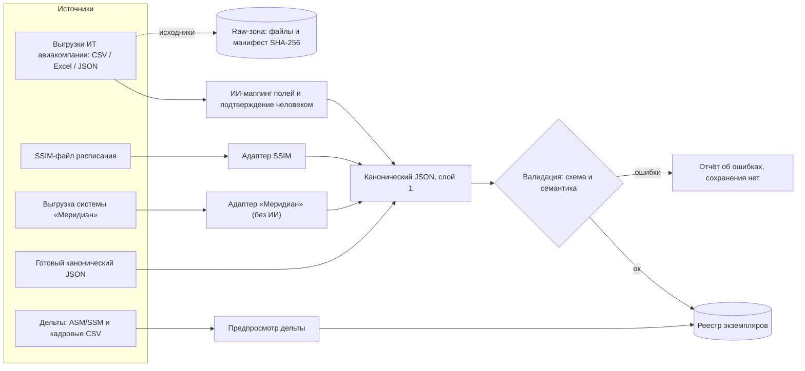

# COSMOS — Руководство. Часть 2. Подготовка данных

| Поле | Значение |
|---|---|
| Версия приложения | `7f4787a` (2026-07-24) |
| Дата документа | 2026-07-24 |
| Аудитория | ИТ-служба авиакомпании · Планировщик · Администратор |
| Связанные части | [Часть 1 — Введение](01-vvedenie-i-ustrojstvo-RU.md), [Часть 3 — Оптимизация](03-optimizaciya-RU.md), [Часть 9 — Справочник](09-spravochnik-RU.md) |

---

## 1. О чём эта часть

Здесь описан весь путь данных до первого расчёта: какие данные нужны, в какой форме, кто их готовит, как они загружаются, как проверяются и как поддерживаются в актуальном состоянии (дельты). Отдельно описаны инструменты формализации: Студия формализации и Пакеты правил.

Главный принцип COSMOS: **все адаптеры импорта обязаны выдавать один и тот же канонический формат** (слой 1). Что бы ни было на входе — JSON, CSV, Excel, SSIM (Standard Schedules Information Manual — стандарт обмена расписаниями IATA, International Air Transport Association — Международной ассоциации воздушного транспорта) — внутрь конвейера попадает только канонический JSON, прошедший схемную и семантическую проверку.



ASM/SSM на диаграмме — стандартные телеграммы об изменении расписания (расшифровка и поддержанное подмножество — в разделе 7.1).

## 2. Роли и ответственность

Матрица «кто за что отвечает» в процессе подготовки данных:

| № | Действие | Кто выполняет | Кто утверждает / проверяет |
|---|---|---|---|
| 1 | Инвентаризация источников данных (какие системы, какие выгрузки, какая периодичность) | ИТ-служба а/к (а/к — авиакомпания) вместе с вендором | Администратор — фиксирует в опроснике Студии формализации |
| 2 | Подготовка выгрузки расписания (SSIM или CSV/Excel с рейсами) | ИТ-служба а/к | Планировщик — сверяет объём (число рейсов, диапазон дат) |
| 3 | Подготовка кадровой выгрузки (сотрудники, базы, квалификации, стаж) | Отдел кадров / ИТ-служба а/к | Планировщик |
| 4 | Присвоение области данных (L «только локально» / C «любая модель») | Владелец данных (планировщик) | Администратор — контроль контурной дисциплины |
| 5 | Загрузка файлов и подтверждение ИИ-маппинга полей | Планировщик | Планировщик (маппинг сохраняется только после явного подтверждения) |
| 6 | Разбор ошибок валидации | Планировщик; при системных ошибках формата — ИТ-служба а/к | — |
| 7 | Настройка правил уровня 1 (отдых, налёт, стыковки…) | Администратор | Утверждённый Пакет правил (Rule Pack) — если ведётся |
| 8 | Формализация правил из документов (коллективный договор, нормативы) | Администратор в Студии формализации | Человек подтверждает каждое решение; ИИ решений не принимает |
| 9 | Регулярные дельты (изменения расписания, кадровые изменения) | ИТ-служба а/к готовит, планировщик применяет | Журнал дельт; повтор отклоняется по отпечатку |

## 3. Канонический формат (слой 1)

Схема опубликована в приложении: «Данные» → «Формат и правила» → «Канонический формат данных (JSON Schema)». Корневой объект обязан содержать четыре массива: `airports`, `employees`, `flights`, `flightAssignments`; остальные секции необязательны.

### 3.1 `airports` — аэропорты

| Поле | Тип | Обязательное | Смысл |
|---|---|---|---|
| `code` | строка | да | Код аэропорта (например, IATA) — на него ссылаются рейсы и базы |
| `name` | строка | нет | Название |
| `latitude`, `longitude` | число | нет | Координаты (для карт и оценок) |
| `taxiTimeInMinutes` | объект | нет | Время руления |
| `languages` | массив строк | нет | Языки станции — используются правилом состава «языковой микс» |

### 3.2 `employees` — сотрудники

| Поле | Тип | Обязательное | Смысл |
|---|---|---|---|
| `id` | строка | да | Табельный номер — единый идентификатор во всех секциях |
| `homeAirport` | строка | да | База (код аэропорта; должен существовать в `airports`) |
| `skills` | массив строк | да | Роли/квалификации, например `Captain`, `FirstOfficer` |
| `name` | строка | нет | Имя |
| `languages` | массив строк | нет | Языки сотрудника |
| `unavailableDays` | массив | нет | Жёсткая недоступность по дням (отпуска, болезни, заземление) |
| `typeRatings` | массив строк | нет | Допуски по типам воздушных судов |
| `seniority` | число | нет | Стаж (меньше = старше); используется в торгах отпусков и правилах состава |
| `isReserve` | логическое | нет | Резервист |
| `preferredDaysOff`, `undesiredAirports`, `preferredFlights` | массивы | нет | Предпочтения — участвуют в мягкой целевой функции ростеринга |

### 3.3 `flights` — рейсы

| Поле | Тип | Обязательное | Смысл |
|---|---|---|---|
| `flightNumber` | строка | да | Номер рейса |
| `departureAirport`, `arrivalAirport` | строка | да | Коды аэропортов (должны существовать в `airports`) |
| `departureUTCDateTime`, `arrivalUTCDateTime` | строка | да | Времена вылета/прилёта в UTC (всемирное координированное время) |
| `flightLegId` | строка | см. 3.5 | Устойчивый идентификатор конкретного вхождения рейса |
| `aircraftType` | строка | нет | Тип воздушного судна |
| `tailNumber` | строка | нет | Бортовой номер — нужен для события «Снятие борта» в режиме «Сбой» |

Канон требует времена строками в «наивном» ISO-формате `YYYY-MM-DDTHH:MM:SS` (ISO 8601 — международный стандарт записи даты и времени), **уже приведёнными к UTC**. Схема при этом проверяет только тип «строка», но не формат — произвольная строка пройдёт валидацию, поэтому ответственность за корректность времён лежит на поставщике данных. Учтите также: при импорте файлов ISO-времена со смещением часового пояса принимаются, но смещение отбрасывается **без пересчёта в UTC** — подавайте времена сразу в UTC (суффикс `Z` допустим).

### 3.4 `flightAssignments` — места экипажа (слоты)

Каждая запись — одно место в экипаже одного рейса («на рейс X нужен один `Captain`»).

| Поле | Тип | Обязательное | Смысл |
|---|---|---|---|
| `id` | строка | да | Идентификатор записи |
| `flight` | строка | да | Номер рейса (должен существовать в `flights`) |
| `indexInFlight` | целое | да | Порядковый номер места в экипаже рейса |
| `requiredSkill` | строка | да | Требуемая роль (`Captain`, `FirstOfficer`, …) |
| `crewSlotId` | строка | см. 3.5 | Устойчивый идентификатор места |
| `flightLegId` | строка | см. 3.5 | Привязка места к конкретному вхождению рейса |
| `employee` | строка или null | нет | Исторический исполнитель (если загружается готовый ростер — используется сравнением ростеров, см. [Часть 5](05-den-operacii-RU.md)) |

### 3.5 Идентичности: `flightLegId` и `crewSlotId`

Ключевой практический вопрос: **что делать, когда один номер рейса выполняется несколько раз** в наборе (обычная ситуация: F100 летает каждый день месяца)?

- Если каждый номер рейса встречается в наборе **один раз** — `flightLegId` не обязателен: номер сам однозначен.
- Если номер **повторяется**, каждое вхождение обязано нести уникальный `flightLegId`, а каждое место экипажа — `flightLegId` своего вхождения. Без этого конвейер не сможет отличить «F100 от 1 марта» от «F100 от 2 марта»: расчёт остановится с диагностикой, а операционные события (отмена, факт) потребуют указания конкретного вхождения.
- `crewSlotId` — аналогичный устойчивый идентификатор места экипажа; обязателен при повторных номерах, полезен всегда (устойчивые ссылки при дельтах).

Требование к ИТ-службе а/к: **идентификаторы должны быть устойчивыми между выгрузками** — одно и то же вхождение рейса в понедельничной и вторничной выгрузке должно иметь один и тот же `flightLegId`. Проверки при загрузке: дубль `flightLegId` у разных рейсов — ошибка; одинаковый «сырой» `id` места при разных `crewSlotId` — ошибка. Символ `@` в номере рейса зарезервирован для внутренних имён вида `F100@1`: при **повторяющемся** номере рейса он блокирует не загрузку, а последующий расчёт — диагностика выдаётся на входе в солвер (построение внутренних имён, re-key).

### 3.6 Дополнительные секции (канон v2)

| Секция | Обязательные поля | Смысл |
|---|---|---|
| `qualifications` | `employee`, `kind`, `code` | Допуски со сроками: `validFrom`/`validTo`, а для свежести (recency) — `requiredEvents`, `recentEvents`, `withinDays`. Питают «Квалификации и свежесть» ([Часть 4](04-rabota-s-rosterom-RU.md)) |
| `contracts` | `employee` | Контракт: `monthlyGuaranteeHours` (месячная гарантия), `blockHourRate` (ставка блок-часа), `dutyRig`/`tripRig` (риги), `currency`. Питают «Оплату и кредитные часы» |
| `dutyHistory` | `employee`, `month` | История налёта по месяцам: `blockMinutes`, `dutyMinutes`, `creditMinutes`, `carryInMinutes` |
| `costComponents` | `code`, `amount`, `unit` | Компоненты стоимости |
| `provenance` | — | Происхождение: `adapter`, `source`, `convertedAt`, `conversionCheck` — заполняется адаптерами автоматически |

## 4. Пути загрузки данных

С 2026-07-24 вкладка «Данные» разделена на две зоны. **Зона 1 — импорт данных задачи** (все пути этого раздела: канонический JSON, произвольные файлы, SSIM, «Меридиан», дельты). **Зона 2 — импорт правил**: файл правил внешней системы конвертируется рамкой приёмников (детерминированно, без ИИ) в черновой Пакет правил с происхождением; утверждение — вручную на вкладке «Пакеты правил».

Порядок работы в зоне 2 продуман против длинных форм: выбираете файл — приложение по первым килобайтам **само определяет формат** и показывает чип «Формат определён: …» (при неудаче — «выберите вручную»). Чип только информирует: список форматов он не переключает и ручной выбор никогда не затирает; при значении «автоопределение» решение принимает сервер по полному файлу. Список форматов сгруппирован («Авиационные», «Таблицы и контейнеры», «Формат COSMOS», «Ожидают образцов»), краткие описания собраны в свёрнутом блоке «Подробнее о форматах».

Реализованные приёмники (все — детерминированные, без ИИ):

| Формат | Вход | Что даёт |
|---|---|---|
| `solver-format5` | JSON оптимизатора вендора | параметры и веса правил (как в наборе заказчика) |
| `meridian-limits` | выгрузка «Меридиана» (format:1) | лимиты на сотрудниках, переопределения отдыха |
| `jeppesen-rave` | текст на языке Rave | разбор **подмножества** языка по открытым источникам: правила `rule…end` с условием `valid`, параметры со значением и границами, сравнения в теле; всё неразобранное честно считается и показывается образцами — семантика не угадывается, совместимость с полным закрытым языком не заявляется |
| `norm-table` | CSV или JSON «имя / значение / единица / окно» | самый быстрый путь: канонические имена (`min_rest`, `max_monthly_block`, …) ложатся на шаблоны и — при совместимом окне — сразу на исполняемые параметры уровня 1; единицы (часы/минуты/дни) переводятся автоматически, но **обязательны** — «голое» число без единицы принимается только в записи Ч:ММ; строки с противоречиями (например, часы у счётного предела посадок) не угадываются, а честно перечисляются в записи «Строки, не принятые приёмником» |
| `roster-xml` | XML-контейнеры смежных областей (конкурсы графиков медсестёр, сменный ростеринг) | инвентаризация числовых ограничений контрактов записями «ресурса» с сохранением исходного пути |
| `cosmos-rules-json` | нейтральный обменный JSON COSMOS | импорт без кода с любой стороны |

Закрытые форматы платформ (Sabre, Lufthansa Systems NetLine/Crew, AIMS) зарегистрированы и до получения образцов отвечают честным описанием недостающих материалов; разбор по догадкам не выполняется.

**Вид правила «ресурс» (Ярус 2б, с 2026-07-24).** Помимо исполняемых правил уровня 1 и структурных заметок, Пакет правил принимает записи в формализме «ресурса»: имя ресурса, окно допустимых значений (снизу и/или сверху), единица (минуты/штуки/дни), уровень применения (участок/наряд/цепочка/день/неделя/месяц/скользящие 28 дней/год) и словесная функция продления — как ресурс накапливается вдоль последовательности активностей. Это принятая в отрасли семантика машинной записи норм; такие правила хранятся как данные, решателем пока не исполняются и в сводке компиляции честно показываются «вне уровня 1». Встроенная библиотека шаблонов покрывает типовые нормы (отдых, длительности, месячный/скользящий/годовой налёт, рабочее время, посадки).

Все пути начинаются на странице «Данные» → «Экземпляры».

### 4.1 Готовый канонический JSON **[Планировщик]**

1. Блок «Загрузка нового экземпляра»: заполните «Название» (например, `тест-август`).
2. Выберите «Файл .json» или вставьте текст в поле «…или вставьте JSON».
3. Нажмите «Загрузить и проверить».
4. Ожидаемо: при успехе экземпляр появляется в таблице «Экземпляры задач» с числами «Рейсы», «Сотрудники», «Слоты»; при ошибках — список конкретных проблем, ничего не сохраняется.

### 4.2 Импорт из произвольных файлов (CSV / Excel / JSON / текст) **[Планировщик]**, готовит **[ИТ а/к]**

Это основной путь для выгрузок авиакомпании «как есть». Блок «Импорт из произвольных файлов»:

1. Заполните «Название» (например, `март-2026`).
2. В поле «Файлы» выберите один или несколько файлов (`.csv`, `.tsv`, `.txt`, `.json`, `.xlsx`) — например, рейсы и экипажи по отдельности.
3. Выберите «Область данных»: «Только локально (данные заказчика)» или «Любая модель (открытые данные)». Модель ИИ для маппинга выбирается по этой области: для данных заказчика — только локальная модель, данные не покидают сервер.
4. Нажмите «Проанализировать». Если формат не канонический, модель ИИ предложит соответствие колонок полям канона; в предпросмотре показывается образец данных.
5. Проверьте предложенный маппинг и подтвердите его. **Сохранение происходит только после вашего подтверждения** — ИИ ничего не решает сам.
6. Обратите внимание на предупреждения предпросмотра. Важное: если в файлах нет назначений мест экипажа, система синтезирует их по ролям — предпросмотр честно предупреждает об этом синтезе.
7. Отдельный блок предпросмотра «Аномалии» показывает статистические странности исторической выгрузки (выбросы налёта, дубликаты, «мёртвые души»). Они не блокируют сохранение — решение о данных принимает их владелец.

Требования к выгрузкам (памятка для ИТ-службы а/к):
- кодировка UTF-8; первая строка — заголовки колонок;
- времена — UTC в ISO-формате (`2026-03-01T09:00:00Z`) либо в явно оговорённом формате, который подтверждается на шаге маппинга;
- рейсы и сотрудники могут быть отдельными файлами — загружайте их вместе одним импортом;
- при повторных номерах рейсов — обязательная колонка устойчивого идентификатора вхождения (см. 3.5).

### 4.3 Импорт SSIM **[Планировщик]**, готовит **[ИТ а/к]**

Импорт расписания в формате SSIM (см. раздел 1) — блок «Импорт SSIM»:

1. «Название» (например, `ssim-август`); файл SSIM либо вставка содержимого.
2. «Диапазон дат (необязательно)» — по умолчанию берётся весь период файла.
3. «Базы экипажей (аэропорт и число пилотов)» — SSIM не содержит экипажей, поэтому базы задаются вручную кнопкой «+ добавить базу».
4. «Импортировать и проверить».

Поддерживаются записи типа 3 (глава 7 стандарта) — регулярные рейсы с периодичностью по дням недели.

### 4.4 Импорт из «Меридиана» **[Планировщик]**, готовит **[ИТ а/к]**

Импорт выгрузки системы производственного планирования «Меридиан» (постановка задачи ростеринга: рейсы, кандидатные наряды, экипажи с допусками, наземные активности) — блок «Импорт из „Меридиана“»:

1. «Название» (например, `meridian-август`); файл выгрузки «Меридиана» (JSON, format:1, type:pairing).
2. «Файл решения солвера (необязательный справочник)» — если рядом с выгрузкой есть файл решения во внутреннем формате оптимизатора (format:5), он используется **только как справочник**: типы воздушных судов по участкам, координаты и часовые пояса станций, резервный источник состава мест. Задача при этом всегда берётся из первого файла.
3. «Диапазон дат (необязательно)» — по умолчанию плановое окно файла (planSince…planUntil); участки с вылетом вне окна не импортируются (считаются в отчёте конвертации).
4. «Импортировать и проверить».

Ключевые свойства адаптера:

- **Конвертация детерминированная, без ИИ** — модель не вызывается вовсе, данные не покидают сервер. Это штатный путь для данных заказчика (строгий режим «Трек-С»): область данных загруженного экземпляра по умолчанию `local-only`.
- **Минимизация персональных данных**: ФИО (поле squadron), дата рождения, пол, гражданство, наставники и список «не летать с» отбрасываются при конвертации; именем сотрудника в каноне становится табельный номер. Точный исходник при этом сохраняется в Raw-зоне (раздел 5) — она неизменяемая и остаётся внутри контура.
- **Времена**: в выгрузке «Меридиана» времена наивные и уже в UTC (единое время по Гринвичу). Адаптер не принимает это на веру: при наличии файла солвера каждый общий участок сверяется с его зонированными временами («UTC-страж»), любое расхождение — громкий отказ.
- **Состав мест экипажа** выводится по приоритету: комплекты кандидатных нарядов «Меридиана» → карта «участок→наряд» солвера → мода по типу воздушного судна (для хвоста участков без нарядов; каждый такой случай считается в отчёте; флаг `--no-fill` в командной строке делает такие участки ошибкой).
- **Идентичности**: номер рейса синтезируется уникальным по участку (`ZZ092-20260908-1`, кириллические перевозчики транслитерируются в латиницу), `flightLegId` и `crewSlotId` материализуются; исходный идентификатор участка сохраняется в поле `sourceLegId` для трассировки.
- **Вид юнита в каталоге структуры** (отметка «Сохранить структуру», с 2026-07-26). Каждая запись каталога помечается полем `kind`: `chain` — целая командировка исходной структуры (пейринг «Меридиана» либо восстановленная ротация решателя), `fill` — достройка самого адаптера (одиночный участок по моде типа воздушного судна, наряд без ротации). У каждой цепочки есть счётчик `sourceLegsMissing` — сколько участков её командировки в юнит не попало: участок может числиться сразу в нескольких пейрингах, а владелец у него один, плюс часть участков отсекает окно конверсии. Ноль означает целую цепочку. Замкнутость на базу и размах законно судить только по целым цепочкам: у достройки нет ни начала, ни конца командировки, а урезанная цепочка теряет привязку к базе при стыковке, а не по вине заказчика. Отчёт конвертации считает и то и другое: `catalog_chains_complete`, `catalog_chains_truncated`, `catalog_units_fill`.
- **Перелёты пассажиром** (экипаж добирается до работы и возвращается в базу пассажирским местом) входят в командировку юнита — поле `fns`, — но не в её рабочую структуру (`active_fns`): спрос такого участка обслуживает его собственный юнит-владелец. Именно эти перелёты держат цепочку привязанной к базе, поэтому терять их нельзя. Материализованные перегоны файла решателя ссылаются на участок с приставкой `dh%`; адаптер её снимает и находит тот же самый участок.
- **Допуски с окнами действия** переносятся в секцию `qualifications` канона v2 (просроченные до начала окна — пропускаются со счётчиком) и работают с календарём соответствия (см. [Часть 4](04-rabota-s-rosterom-RU.md)).

Отчёт конвертации (артефакт `*.conversion_check.json`) пишется всегда, даже при отказе: счётчики участков и исключений, источники состава мест, итог UTC-стража, словари навыков и типов, список отброшенных полей персональных данных.

Практическое замечание: файлы выгрузки — десятки мегабайт, и браузер читает их в память целиком перед отправкой; импорт рассчитан на настольный компьютер, не на телефон. Размер тела запроса на сервере ограничен (по умолчанию 256 МБ).

### 4.5 Выгрузка авиакомпании и документ постановки (контур заказчика)

На контуре заказчика (см. [Часть 1](01-vvedenie-i-ustrojstvo-RU.md), раздел 4) добавлены две возможности, которых нет на общих контурах.

**Выбор формата данных при загрузке.** Поле «Формат данных» предлагает два значения: «Канонический набор COSMOS» (файл уже в каноническом формате) и «Выгрузка авиакомпании (преобразуется)» — тогда преобразование в канонический формат выполняет сервер и показывает отчёт: сколько участков было в выгрузке, сколько отклонено и по какой причине, сколько рейсов, сотрудников, аэропортов и мест получилось. Отчёт заканчивается гейтом приёма — проверками уникальности адреса рейса, отсутствия задвоения по маршруту и времени вылета и укомплектованности мест. Набор, не прошедший гейт, не сохраняется.

Персональные ограничения выгрузки переносятся в **исполняемые поля решателя** (обновление 2026-08-12): запреты станций — в `stationsDenied` (жёсткое правило: сотрудник не назначается на цепочку через запрещённую станцию), допуски со сроками действия — в датированные окна `qualificationWindows` для кодов, на которые ссылаются требования участков, требования участков — в `requiredQualifications`. Записи, чей срок действия не пересекает месяц горизонта, отбрасываются со счётчиком «вне срока»; коды запретов, не являющиеся станциями (страновые, цифровые), сохраняются и считаются по классам. Отчёт преобразования показывает и требования, не имеющие ни одного носителя среди сотрудников, — такой спрос не может быть укомплектован, и молчать об этом нельзя.

Переносятся и **цены цели** (обновление 2026-08-12, вторая ревизия): цена перегона — от строки перегона системы-источника её оригиналу (по совпадению идентификатора участка); рейсу без своей цены назначается тариф-допущение (мода цен источника, значение и счётчики — в отчёте преобразования, подтверждение — за авиакомпанией). Гостиничная ставка станции переносится на аэропорт с признаком «ставка известна»; сторожевое число «неизвестная станция» ставкой не считается — такая стоянка в стоимость не входит и считается отдельно. Благодаря этому целевая функция пейринга — деньги источника, а не условные веса.

**Документ постановки (.md).** Отдельный блок принимает формализованный свод правил авиакомпании одним файлом. Правила читаются расчётом **напрямую из этого документа**, а не из параметров установки: после загрузки показывается таблица прочитанных правил — что именно система поняла. Документ, который не разбирается, не сохраняется. Пока документ загружен, он имеет приоритет над снимком параметров прогона.

Ключ машинной формы `monthly_flight_time_limit_min` (обновление 2026-08-12) задаёт месячный предел налёта контингента набора в минутах: на этапе 2 значение проставляется персональными пределами тем сотрудникам, у кого предела нет в данных (персональное значение из данных документ не перетирает). Документ без ключа не меняет набор — действует общий порог правил расчёта, и это видно в отпечатке прогона.

Смысл механизма: значение, которого нет в документах авиакомпании, не должно попасть в расчёт из умолчаний программы. Неопознанный документ вызывает отказ, а не молчаливый переход на умолчания.

### 4.6 Что не является путём загрузки

- **BTS** (Bureau of Transportation Statistics — публичная статистика полётов США) в интерфейсе служит источником **факта дня операции** («Операция» → «Импорт факта (BTS)») — см. [Часть 5](05-den-operacii-RU.md), а не способом создать плановый экземпляр.
- **Сценарии** («Оптимизация» → «Сценарии») создают производные копии существующего экземпляра, а не новые данные.

### 4.7 Атрибуты уже загруженного экземпляра

В таблице «Экземпляры задач» у каждого экземпляра два кликабельных чипа:

- **«Область данных» (L/C)** — меняется кликом по чипу (владелец данных или администратор): ослабление до «C» («любая модель») запрашивает подтверждение, ужесточение до «L» применяется сразу. Действует контурная дисциплина раздела 11.
- **«Страна»** (по умолчанию `INTL`) — кликом задаётся юрисдикция экземпляра для агента «Регуляторика» (см. [Часть 7](07-samousovershenstvovanie-RU.md), раздел 3.1).

## 5. Raw-зона: неизменяемые исходники

Каждый импорт произвольных файлов сохраняет **исходные файлы без изменений** в raw-зону вместе с манифестом контрольных сумм SHA-256 (криптографический отпечаток файла). Это даёт:

- воспроизводимость: всегда можно доказать, из чего именно собран канонический экземпляр;
- аудируемость: отпечаток исходника фиксируется до любых преобразований;
- диагностику: при споре о данных сравнивается именно исходник, а не результат маппинга.

Raw-зона неизменяема: файлы в ней не редактируются и не удаляются при обновлениях экземпляра.

Кроме манифеста, у каждого экземпляра постоянно доступен отчёт аномалий — детерминированная (без ИИ) проверка исторических данных на статистические странности (выбросы налёта, дубликаты, «мёртвые души»), та же, что показывается в предпросмотре импорта; адрес API — в [Части 9](09-spravochnik-RU.md).

## 6. Валидация: что именно проверяется

Проверка двухступенчатая; выполняется при каждой загрузке и повторяется при каждом открытии экземпляра. Отдельная задача «Валидация» на странице «Расчёты» проверяет другое — покрытие и траектории уже посчитанных результатов (см. [Часть 3](03-optimizaciya-RU.md)).

**Проверка 1 — схема.** Канонический JSON проверяется по JSON Schema: типы и обязательные поля. Ошибки имеют вид `schema: <путь>: <сообщение>`, например `schema: flights/3/departureUTCDateTime: 123 is not of type 'string'`.

**Проверка 2 — семантика (ссылочная целостность).** Реальные тексты ошибок:

| Ошибка (вид) | Смысл |
|---|---|
| `flights[i] (F100): departureAirport 'XYZ' not in airports` | Рейс ссылается на аэропорт, которого нет в `airports` |
| `employees[i] (EMP7): homeAirport 'XYZ' not in airports` | База сотрудника не существует |
| `flightAssignments[i] (id=...): flight 'F999' not in flights` | Место экипажа ссылается на несуществующий рейс |
| дубль `flightLegId` у разных рейсов | Нарушение уникальности идентичности вхождения |
| одинаковый «сырой» `id` при разных `crewSlotId` | Конфликт идентичностей мест — загрузка отклоняется |

Число сообщений ограничено разумным максимумом — при массовой ошибке формата исправьте причину и загрузите заново, а не разбирайте сотни одинаковых строк.

Обратите внимание: формат строк времени не проверяет ни схема, ни семантическая проверка (см. раздел 3.3) — корректность времён остаётся на поставщике данных.

## 7. Дельта-обновления (эксплуатация)

Регулярные изменения **без повторного полного импорта** — блок «Дельта-обновления (эксплуатация)» на странице «Экземпляры». Правила общие для обоих видов дельт: сначала «Предпросмотр», затем «Применить»; повтор той же дельты отклоняется по отпечатку SHA-256; каждое применение пишется в журнал (кнопка «Журнал»).

### 7.1 Дельта расписания **[ИТ а/к готовит, Планировщик применяет]**

Поддержанное подмножество сообщений ASM/SSM (Ad hoc Schedule Message / Standard Schedule Message — стандартные телеграммы об изменении расписания): `NEW` (новый рейс), `CNL` (отмена), `TIM` (изменение времени), `EQT` (замена типа воздушного судна). Пример содержимого поля «Дельта расписания»:

```
CNL
SU100/01MAR26

TIM
SU100/02MAR26
0900 1030
```

1. Выберите «Экземпляр».
2. Вставьте текст дельты, нажмите «Предпросмотр» — система покажет, какие рейсы будут добавлены/отменены/изменены. При повторных номерах отмена адресуется конкретной дате (конкретному вхождению), а не всем рейсам с этим номером.
3. Нажмите «Применить».

Два предупреждения к дельте расписания:

- **`NEW` создаёт и места экипажа** (исправлено 2026-07-20): состав нового рейса синтезируется по образцу мест других вхождений того же номера (при расхождении образцов — громкий отказ), а для нового номера — по самому частому составу мест экземпляра; предпросмотр показывает «мест создано». При размножении номера обязательны идентичности: новому вхождению ставится `flightLegId`, уникальному существующему без идентичности он доштамповывается (счётчик «flightLegId: +N» в предпросмотре), а неоднозначные случаи (номер уже повторяется без идентичностей, коллизия идентификаторов, пустой состав экземпляра) отклоняются с понятной ошибкой.
- **Адресация дельт — номер рейса + дата вылета.** Если в наборе несколько рейсов одного номера с одной датой вылета, действие применяется к первому по порядку следования в данных, без предупреждения — различайте такие рейсы номерами либо применяйте дельты до размножения. Сопоставление даты выполняется по текстовому префиксу строки времени, без пересчёта часовых поясов.

### 7.2 Кадровая дельта (CSV) **[Отдел кадров/ИТ а/к готовит, Планировщик применяет]**

CSV с каноническими колонками сотрудников. Логика применения — **диф по табельному номеру**: изменённые записи обновляются, новые добавляются, отсутствие сотрудника в файле **не** означает его удаления (никаких молчаливых удалений). Процедура: «Кадровая дельта (CSV)» → «Предпросмотр» → «Применить».

## 8. Студия формализации **[Администратор]**

«Админ» → «Студия». Студия ведёт онбординг заказчика как управляемый процесс:

1. **Создание сессии**: поля «название (заказчик)» и «страна», кнопка «Создать сессию».
2. **Опросник инвентаризации источников** — какие системы, выгрузки, форматы, периодичность (колонка «Опросник» показывает заполненность).
3. **Глоссарий семантики** — фиксация решений о смысле полей заказчика («что считается блок-временем», «как кодируются резервы»), каждое решение фиксируется за человеком.
4. **Связки** — привязка сессии к сессии маппинга импорта и к Пакету правил.
5. Итог — версионируемый **«Пакет маппинга заказчика»**: переносимый JSON со всей формализацией, переиспользуемый как шаблон для заказчиков той же страны.

Принцип Студии: **смысл подтверждает только человек — ИИ в Студии решений не принимает.**

## 9. Пакеты правил (Rule Pack) **[Администратор]**

«Данные» → «Пакеты правил». Правило — объект с полной цепочкой происхождения:


Процедура:
1. «Создать пакет» (поля «название пакета», «страна») или «Импорт JSON…» готового пакета.
2. Внутри пакета создавайте правила: источник (документ, страница/пункт) → утверждение → привязка к параметру уровня 1 → тесты.
3. Пакет утверждается, когда **утверждено каждое правило** (колонка «Правила (утв./всего)»).
4. Утверждённый пакет можно «применить к конфигурации правил» (значения параметров уровня 1 устанавливаются из пакета) или экспортировать как страновой шаблон для другого экземпляра.

**Область действия пакета** (с 2026-07-27). У каждого пакета есть область:

| Область | Кого касается | Когда выбирать |
|---|---|---|
| «Норма страны» (`regulatory`) | все наборы данных этой страны; пакет без указанной страны — все наборы | требование регулятора, одинаковое для всех заказчиков страны |
| «Только этот набор» (`instance:<набор>`) | ровно один набор данных | коллективный договор, соглашение с профсоюзом, внутренний стандарт конкретной авиакомпании |

Прежде отбор шёл только по стране, и пакет одного заказчика попадал в постановку задачи другого заказчика той же страны; при несовпадении значений одноимённого ресурса он ещё и блокировал тому запуск. Пакеты, созданные до 2026-07-27, поля области не имеют и остаются нормой страны — их поведение не изменилось.

Область меняет только администратор. **Смена области снимает утверждение пакета**: изменилась постановка, к которой прежнее утверждение относилось, — правила придётся утвердить заново.

## 10. Параметры авиакомпании (уровень 1) **[Администратор]**

«Данные» → «Формат и правила» → «Параметры авиакомпании (уровень 1)». Девять параметров:

| Параметр (подпись в форме) | Встроенное значение | Смысл |
|---|---|---|
| «Минимальная стыковка, мин» | 30 | Минимальное наземное время между рейсами внутри смены |
| «Максимум посадок за смену» | 5 | Предел посадок в одной смене |
| «Максимальная длительность смены, мин» | 840 | Смена не длиннее 14 часов |
| «Минимальный отдых, мин» | 600 | Отдых ≥ 10 часов разделяет смены |
| «Максимальный месячный налёт, мин» | 5100 | Месячный операционный налёт ≤ 85 часов |
| «Максимальная длительность пейринга, мин» | 5760 | Пейринг не длиннее 4 суток |
| «Состав: не два резервиста в экипаже (1=вкл, 0=выкл)» | 0 (выкл) | Правило состава экипажа |
| «Состав: мин. сумма веса стажа пары (0=выкл, до 22)» | 0 (выкл) | Каждая пара членов экипажа участка должна иметь сумму «весов стажа» не ниже порога (что такое вес стажа — ниже) |
| «Состав: экипаж покрывает языки участка (1=вкл, 0=выкл)» | 0 (выкл) | Хотя бы один член экипажа владеет языками аэропортов участка |

**Что такое «вес стажа».** Поле `seniority` сотрудника — это порядковый номер по старшинству, где **меньше значит старше** (1 — самый заслуженный). Для правила состава оно переводится в «вес» по обратной шкале: вес тем больше, чем старше сотрудник. Диапазон веса — от 2 до 11: `seniority` 1–100 даёт вес 11, 101–200 — вес 10, и так далее до 901–1000 — вес 2. Значения вне 1–1000 подтягиваются к границам, отсутствующее или нечитаемое — считается средним.

Отсюда и потолок порога 22: это сумма двух максимальных весов (11 + 11). Порог 12, например, означает «в паре не должно быть двух самых младших сразу».

### 10.1 Ищется правило или только проверяется (с 2026-07-20)

Правила добываются двумя разными способами, и разница практическая.

Большинство правил **ищутся**: движок построения пейрингов и решатель второго этапа знают о них и подбирают решение, в котором правило соблюдено. Включение такого правила меняет результат расчёта.

Одно правило — **«Состав: экипаж покрывает языки участка»** — сейчас только **проверяется**. Решатель о нём не знает и продолжает выдавать ростеры, которые ему не удовлетворяют; проверка ловит нарушение уже после расчёта и уводит вердикт мимо «OK». Практически это значит: включив его, вы можете получать отказ вердикта раз за разом, и автоматического пути к легальному ростеру у системы нет — она не умеет искать по этому правилу.

В форме такое правило помечено чипом **«только проверка»** с подсказкой; признак приходит с сервера, а не зашит в экран, поэтому пометка исчезнет сама, как только правило появится в решателе.

### 10.2 Правила принадлежат НАБОРУ, а не установке (с 2026-07-26)

Экран «Параметры авиакомпании» — это **шаблон установки**, то есть значения по умолчанию для **новых** наборов. Правила самого расчёта живут у набора.

**Как это работает.** При появлении набора действующие значения копируются в него и дальше живут с ним. Правка шаблона после этого уже созданные наборы **не затрагивает**. Иначе один и тот же набор, посчитанный в июле и в августе, считался бы по разным нормам, и по артефакту этого было бы не видно; а администратор, меняющий норму под свою авиакомпанию, менял бы её и для чужого набора.

**Где смотреть и править.** Таблица «Экземпляры задач», столбец **«Правила набора»**. Происхождение подписано чипом **у каждой строки сразу**, без открытия; кнопка «Открыть» показывает сами значения и позволяет их править. Происхождение — одно из четырёх состояний:

| Состояние | Что означает |
|---|---|
| встроенные значения | нет ни шаблона установки, ни правил набора |
| взяты из шаблона установки | набору ещё не выдана своя конфигурация |
| правила набора | у набора свои значения; рядом перечислено, чем они отличаются от шаблона |
| правила сценария | набор — сценарий «что если», у него свой, более частный уровень |

Кнопка **«Сбросить к шаблону установки»** переписывает правила набора сегодняшним шаблоном — именно переписывает, а не подключает набор к шаблону навсегда.

**Право на правку** — у владельца набора или администратора. Чужой набор отвечает «нет такого набора», а не «нет прав»: сам факт его существования наружу не выдаётся.

**Ставки — так же.** Ставки стоимости и договор оплаты подчиняются тому же порядку и правятся точкой входа `PUT /api/instances/<id>/rates`. Это не удобство: ставки — коммерческая тайна авиакомпании, и считать стоимость одного набора по ставкам, введённым для другого, нельзя.

### 10.3 Снимок конфигурации на прогон

Каждый расчёт читает не живой файл, а **снимок**, снятый в момент старта (`<каталог данных>/final-report/runs/config/<личность прогона>/`). Правку, сделанную между первым и вторым этапом, половины системы иначе увидели бы по-разному: цепочки построены по одним нормам, люди рассажены по другим, и расхождение было бы тихим.

Снимок берут **все** прогоны, без разрядов на «пробные» и «настоящие», и он охватывает не только правила, но и ставки: отчёт, чьи денежные числа невозможно воспроизвести, хуже отчёта с невоспроизводимыми правилами.

Отпечаток правил и личность прогона попадают в артефакты **обоих** этапов. Если каталог посчитан под одним отпечатком, а второй этап запускают под другим, расчёт **отказывает громко, до старта решателя**. Каталоги прежних выпусков отпечатка не несут и работают по-старому.

Практическое следствие: смена правил **не портит** уже посчитанные результаты — новые расчёты просто ведутся в отдельном пространстве артефактов.

## 11. Контурная дисциплина

- Данные заказчика загружаются **только** во внутренний контур (Prod/Stage) и **только** с областью «Только локально».
- На Test (внешний контур) допускаются только публичные данные — там работают облачные модели агентов самоусовершенствования.
- Проверить, куда какие данные могут попасть в ИИ-запросы, можно в реестре «Админ» → «ИИ-контур».

## 12. Частые ошибки и что они означают

| Симптом | Причина | Действие |
|---|---|---|
| `schema: (root): 'airports' is a required property` | В JSON нет одного из четырёх обязательных массивов | Дополните файл; минимум: `airports`, `employees`, `flights`, `flightAssignments` |
| `... not in airports` / `... not in flights` | Ссылочная целостность нарушена (см. раздел 6) | Исправьте коды/номера в исходной выгрузке |
| Ошибка про дубль `flightLegId` (при загрузке) или про `@` в повторном номере рейса (при запуске расчёта) | Нарушены требования идентичности (раздел 3.5) | Исправьте идентификаторы; `@` в номерах рейсов недопустим |
| Импорт предупреждает о синтезе назначений | В файлах не было мест экипажа | Это допустимо для оценочных расчётов; для боевых — выгрузите реальные назначения |
| «Применить» дельту повторно ничего не делает | Повтор той же дельты отклонён по отпечатку SHA-256 | Это защита от двойного применения; смотрите «Журнал» |
| После смены правил «пропали» результаты | Отпечаток задачи включает правила — вы смотрите пространство нового набора правил | Верните прежние значения параметров или пересчитайте заново |

## 13. Как проверить

1. Возьмите маленький канонический JSON (2 аэропорта, 2 сотрудника, 2 рейса, 2 места) и загрузите через «Загрузить и проверить» с названием `smoke-манул`. Ожидаемо: экземпляр появился в таблице, «Рейсы» = 2, «Сотрудники» = 2, «Слоты» = 2.
2. Испортите в том же файле код аэропорта одного рейса и загрузите снова. Ожидаемо: отказ со строкой вида `flights[...]: departureAirport '...' not in airports`; экземпляр не создан.
3. Для экземпляра с повторными номерами рейсов уберите `flightLegId` у одного вхождения. Ожидаемо: загрузка или последующий расчёт останавливается с диагностикой идентичности (а не молча считает неверно).
4. Примените к экземпляру дельту `CNL` на один рейс через «Предпросмотр» → «Применить», затем повторите «Применить» той же дельтой. Ожидаемо: первый раз рейс отменён и применение записано в «Журнал»; второй раз — отказ по отпечатку SHA-256 (в журнале остаётся только запись первого применения — отклонённые повторы не журналируются).

## 14. Связанные части

- [Часть 1 — Введение и устройство](01-vvedenie-i-ustrojstvo-RU.md)
- [Часть 3 — Оптимизация: пейринг и ростеринг](03-optimizaciya-RU.md)
- [Часть 5 — День операции](05-den-operacii-RU.md)
- [Часть 8 — Администрирование](08-administrirovanie-RU.md)
- [Часть 9 — Справочник](09-spravochnik-RU.md)
