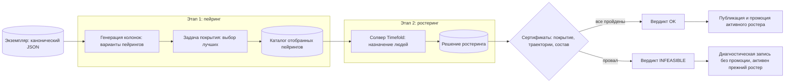

# COSMOS — Руководство. Часть 3. Оптимизация: пейринг и ростеринг

| Поле | Значение |
|---|---|
| Версия приложения | `c29885d` (2026-07-26) |
| Дата документа | 2026-07-20 |
| Аудитория | Планировщик · Администратор |
| Связанные части | [Часть 2 — Подготовка данных](02-podgotovka-dannyh-RU.md), [Часть 4 — Работа с готовым ростером](04-rabota-s-rosterom-RU.md), [Часть 9 — Справочник](09-spravochnik-RU.md) |

---

## 1. О чём эта часть

Как из проверенного экземпляра данных получить ростер: двухэтапный конвейер оптимизации, запуск и контроль задач, сертификаты и вердикты, работа с повторными номерами рейсов, режим «мультироль», понятие активного ростера и чтение результатов.

## 2. Роли и ответственность

| Действие | Кто выполняет | Кто утверждает |
|---|---|---|
| Запуск этапов 1/2, валидации, мультироли | Планировщик | — |
| Выбор бюджетов расчёта и зерна генератора | Планировщик (по рекомендации «Советника по решателям») | — |
| Изменение правил уровня 1 (влияют на отпечаток задач) | Администратор | Пакет правил, если ведётся ([Часть 2](02-podgotovka-dannyh-RU.md)) |
| Промоция мультироль-решения в активный ростер | Планировщик | Планировщик (явная кнопка) |
| Чтение вердиктов и разбор невозможности | Планировщик; сложные случаи — с вендором | — |

## 3. Двухэтапный конвейер



### 3.1 Этап 1 — генерация колонок пейрингов

По-человечески: система не перебирает все мыслимые цепочки рейсов (их астрономически много), а **порождает варианты по мере надобности**. «Колонка» — один кандидат-пейринг (законная цепочка рейсов от базы до базы). Задача покрытия выбирает из порождённых колонок такой набор, чтобы каждое место каждого рейса было закрыто, а суммарная стоимость (целевая функция каталога — колонка в списке экземпляров) была минимальной. Линейная релаксация задачи даёт оценку снизу лишь при сошедшейся генерации и неусечённом ценообразовании (поле `pricing_complete` отчёта, см. §3.2-бис); иначе публикуется величина на текущем пуле (`cg_lp_value_on_pool`), границей оптимума не являющаяся.

Итог этапа — **каталог отобранных пейрингов** (артефакт). Каталог соблюдает правила уровня 1, действовавшие на момент запуска: минимальные стыковки, пределы смены, посадок, длительности пейринга.

### 3.2 Этап 2 — ростеринг

Солвер Timefold (движок оптимизации на JVM) назначает конкретных сотрудников на пейринги каталога. Жёсткие правила: один человек — в одном месте в один момент времени; минимальный отдых между пейрингами; месячный предел налёта; допуски по типам судов; недоступности (`unavailableDays`). Мягкие цели: предпочтения сотрудников, равномерность нагрузки. Итог — **решение ростеринга** (артефакт) плюс сертификаты.

Уточнения месячного учёта и персональные правила (2026-07-24):

- **Месячный предел налёта считается точно по месяцам участков**: пейринг, пересекающий границу месяца, делится — каждый участок относит свои полётные минуты к месяцу своего вылета, а не весь пейринг к месяцу старта.
- **Персональный предел налёта**: если у сотрудника задано поле `flightTimeLimitMin` (переносится импортом из данных вендора), для него действует личный предел вместо общего из конфигурации.
- **Предел рабочего времени**: при заданном `workTimeLimitMin` месячная сумма рабочих окон (от первого вылета до последнего прилёта каждого дня пейринга) не превышает личный предел.
- **«Не летать вместе»**: два сотрудника из списков `doNotFlyWith` (запрет действует в обе стороны, даже если указан только у одного) не назначаются на один рейс.

Все три персональных поля — часть канонического формата данных ([Часть 2](02-podgotovka-dannyh-RU.md)); при их отсутствии поведение прежнее.

Исполняемые ресурсные правила и режим закреплений (2026-07-24):

- **Ресурсные правила как данные прогона.** Каталог пейрингов может нести точные поля юнита: месячные кредиты рабочего времени и налёта (из данных источника, включая брифинги), требуемый отдых после юнита (ступенчатая таблица источника: свой минимум на базе, повышенный минимум вне базы, увеличенный отдых после длинного наряда и при смене часовых поясов) и окна занятости. Решатель исполняет их как жёсткие правила; каталоги без этих полей работают по-прежнему.
- **Еженедельный непрерывный отдых** — отдельное жёсткое правило (включается файлом ресурсных правил, параметр `--resource-rules` этапа 2): в каждой полной календарной неделе горизонта сумма периодов отдыха не ниже требуемой (типово 48 ч), каждый засчитываемый период не короче минимального (типово 24 ч); штраф — минуты недобора. Семантика откалибрована по собственному учёту источника данных.
- **Режим закреплённых назначений** (`--locked`): назначения, уже сделанные планировщиками авиакомпании, принимаются как данность — сотрудники садятся на совместимые по роли места и закрепляются; решатель достраивает только незакрытое. Несовместимые закрепления честно считаются неразмещёнными.

Требования допусков со сроками действия (2026-07-25):

- **Требования участков.** Если участок в данных источника несёт коды требований (например «Допуск СНГ», «Допуск МВЛ»), каждый член экипажа на этом участке обязан держать соответствующий допуск на всём интервале рейса. Допуски сотрудников импортируются из карт квалификаций источника как окна действия «код → [с, по]»; сверка кодов устойчива к пробелам и смешению латиницы с кириллицей.
- **Требования мест.** Место в наряде несёт код «тип судна_роль»; назначенный сотрудник обязан держать этот код на интервале рейса. Семантика подтверждена тождеством на закреплениях источника (100 % совпадение на полном объёме закреплений).
- Оба правила исполняются решателем как жёсткие и проверяются сертификатом паритета; экземпляры без кодов требований работают по-прежнему (правило не срабатывает на пустых данных).

### 3.2-бис Построитель цепочек с уровнями свободы (2026-07-25)

Для наборов, где структура работы приходит от авиакомпании (смены и цепочки уже существуют), у этапа 1 есть вторая линия — **построитель цепочек**. Он отвечает на вопрос, который обычная генерация колонок не ставит: *насколько свободно мы имеем право перестраивать существующую структуру и сколько это стоит*.

**Три уровня свободы** — выбираются на странице «Расчёты» в блоке «Этап 1», поле «Построение цепочек»:

| Уровень | Что принимается неизменным | Когда применять |
|---|---|---|
| 1 | Цепочки авиакомпании целиком; достраивается только непокрытое | Нужна преемственность: экипажи уже знают свои цепочки, переделка дорога организационно |
| 2 | Смены (рабочие дни) авиакомпании; сцепка в цепочки строится заново | Смены согласованы, но маршруты можно улучшать |
| 3 | Ничего: смены строятся из участков, цепочки из смен | Полная свобода, самый дешёвый результат |

Уровни 1 и 2 требуют структуру авиакомпании рядом с набором (файл `pairing_base_catalog_<набор>.json`); при её отсутствии запуск честно отклоняется с объяснением. Уровень 3 работает на любом наборе.

**Способ поиска** — второе поле, появляется после выбора уровня:

- *перечисление вариантов* — прямой перебор допустимых цепочек;
- *по двойственным оценкам* — генерация колонок: ослабленная задача покрытия даёт цену покрытия каждого участка, и генератор ищет только те цепочки, которые дешевле суммы этих цен. На реальном наборе даёт примерно на 19 % более дешёвый результат при том же покрытии и дополнительно сообщает **оценку снизу**. Оценка математически действительна, только когда генерация сошлась И ценообразующий перебор прошёл без эвристических усечений — отчёт называет это полем `pricing_complete`; при усечённом переборе публикуется лишь величина вспомогательной задачи на текущем пуле (`cg_lp_value_on_pool`), и границей оптимума она не является.

**Что оптимизируется.** Полное покрытие спроса — жёсткое условие (не предмет торга), критерий — стоимость в человеко-масштабе: ночёвка вне базы и перегон пассажиром умножаются на численность экипажа цепочки. Веса ночёвки и перегона задаются параметрами; при получении прейскуранта авиакомпании подставляются реальные цены без изменения механики.

**Отчёт о построении** (`pairing_builder_check_<набор>.json`) сообщает: число смен и кандидатов, выбранные цепочки, человеко-ночи и человеко-перегоны, итоговую стоимость, оценку снизу и раунды генерации. Непокрытые участки разделяются на две категории, потому что действия по ним разные: **«нет пары в горизонте»** — участок в принципе нельзя вписать в замкнутую на базу цепочку из этого набора (нечем добраться или вернуться), нужна более широкая выгрузка; **«не нашлось цепочки»** — данных достаточно, но перебор не построил вариант, нужно расширять поиск.

**Решатель отчитывается о применённых правилах (с 2026-07-27).** Отпечаток правил доказывает, что значения решателю **передали**. Он ничего не говорит о том, применил ли их решатель: параметр, который никто не читает, даёт ровно такой же отпечаток, как работающий. Поэтому решатель теперь отвечает за себя сам: он возвращает **фактические чтения** параметров своими правилами, и прогон сверяет их с действующей конфигурацией. Различаются три исхода, и они означают разное:

| Исход | Что произошло | Что делает прогон |
|---|---|---|
| Прочитано то же значение | правило применено ровно так, как утверждено | результат публикуется как обычно |
| Заявлено, но ни разу не прочитано | «передали, но не применили» — правила в расчёте не было | вердикт `INFEASIBLE_INCUMBENT`: «ноль нарушений» относится к другой задаче |
| Прочитано другое значение | правило работает, но не то, которое утвердил заказчик | тот же вердикт; в журнале указано применённое и действующее значение |

То же и для ресурсных правил яруса 2в: решатель возвращает **разобранные им числа** и счётчик фактических вычислений правила. Отпечаток файла доказывал доставку — теперь доказаны разбор и применение.

Побочно это делает видимым то, что раньше приходилось выяснять чтением кода: профиль расстановки экипажа не читает «размах цепочки» (его обеспечивает этап 1) и «покрытие языков» (его проверяет отдельный контролёр состава). В свидетельстве эти параметры просто отсутствуют — и это честнее, чем молчание.

**Правила у построителя и решателя — одни (с 2026-07-26).** Построитель читает действующий набор правил уровня 1 оттуда же, откуда его берёт решатель этапа 2 и показывает интерфейс: предел стыковки внутри смены, число посадок за смену, размах смены и размах цепочки. Раньше он считал по своим встроенным числам, и правило, изменённое оператором, до этапа 1 не доходило. Флаг командной строки остаётся допустимым перекрытием, но прогон говорит об этом вслух, а перекрытие попадает в каталог вместе с отпечатком правил — расчёт по другим правилам обязан быть отличим от расчёта по этим.

**Каталог несёт свидетельство покрытия.** Внутри выхода построителя лежит блок `coverage`: сколько участков всего, сколько не покрыто и по какому из трёх исходов (с 04.09.2026, аудит A4): «доказано невозможно» — к имени приложено доказательство (`proven_impossible_proofs`: станция недостижима из базы или база после неё обходом графа рейсов без предела числа перегонов, либо доказательная ступень эскалации обошла окно полностью), с горизонтом и отпечатком данных — при смене данных доказательство недействительно; «поиск не завершён» — эскалация упёрлась в предел времени или глубины; «не найдено» — вариант не найден в проверенном пространстве. Вердикт `INFEASIBLE_INPUT` ставится только когда все непокрытые доказаны; иначе — `INCOMPLETE_SEARCH`, и канонический каталог **не публикуется**: результат уходит в файл `*.pending.json`, этап 2 его не подхватывает, а сообщение объясняет, что расширить. Проверка покрытия и гейт этапа 2 прощают недостачу только по доказательству, и исключённые остаются видимыми в итоге (`complete=false`, `excluded_proven` поимённо): частичное покрытие не выдаётся за выполненный план.

Выход построителя — каталог того же формата, что у генерации колонок, поэтому этап 2 (назначение людей) принимает его без каких-либо изменений.

### 3.3 Вендорный каталог с пер-пейринговым составом (переменная кратность мест)

Плоская модель со-локации этапа 1 требует одинаковый состав экипажа на всех участках. Наборы с **переменным составом** (например, кабинный экипаж: на один рейс 4 бортпроводника, на другой — 10) этап 1 честно отвергает (fail-closed). Для таких наборов есть обходной маршрут (2026-07-24): если у источника есть собственная структура нарядов (как в выгрузке «Меридиана»), адаптер выпускает **вендорный каталог** (флаг `--emit-catalog`) — юниты-наряды, каждый со своим упорядоченным списком мест (`seats`), образующие точное разбиение рейсов. Этап 2 принимает такой каталог напрямую: запись с собственным составом минует требование глобальной однородности (проверка коллизий идентичностей участков остаётся безусловной), а каждая запись без состава работает по-прежнему — существующие каталоги дают байт-идентичную постановку. Этап 1 при этом не запускается вовсе — генерацию пейрингов уже сделал вендор. Полноценная генерация пейрингов с переменной кратностью силами COSMOS — отдельный запланированный трек («порядковые полосы», обобщение мультироли).

**Границы смен и вид юнита (2026-07-26).** Каждая запись вендорного каталога несёт разбивку своих рабочих участков по сменам заказчика (`duty_fns`) — без неё уровень свободы 2 невыполним, и построитель отказывает громко вместо того, чтобы молча считать всю цепочку одной сменой. Разбивка строится и для пейрингов «Меридиана», и для восстановленных ротаций решателя: ротация состоит из нескольких нарядов, и выдавать её за одну смену — та же подмена постановки. Кроме того, запись помечается полем `kind` (`chain` — целая командировка исходной структуры, `fill` — достройка адаптера), а каждая цепочка несёт счётчик `sourceLegsMissing` — сколько участков её командировки досталось другому юниту или было отсечено окном импорта. Входной аудит судит замкнутость на базу и размах только по целым цепочкам; построитель цепочек помечает свой выход `kind: chain`, поэтому аудит применим и к нашим каталогам.

Источников вендорной структуры два, оба детерминированные (без ИИ): выгрузка «Меридиана» (наряды/пейринги; адаптер `_meridian_to_payload.py`, при наличии файла солвера его наряды сворачиваются в пейринги по явным ссылкам `sequence`) и **внутренний файл солвера вендора как единственный источник** (`_solver_to_payload.py`, format:5): участки с зонированными временами, экипаж из карт квалификаций, недоступности из наземных нарядов, восстановленные sequence-пейринги — применяется, когда выгрузка «Меридиана» недоступна или требуется чистое «решение только по файлу солвера». Ростеринг в обоих случаях выполняется этапом 2 с нуля — назначения вендора не используются.

**Правила системы-источника и обязательные условия (ревизия
2026-07-28).** Построитель цепочек умеет считать в постановке
источника данных, а не только по своим правилам:

- `--source-rules <файл>` — предел смены по составу экипажа, таблица
  отдыха, ночные и «тёмные»
  смены, равнозначные станции, предел цепочки в сутках; правила
  источника перекрывают правила яруса 1 и объявляют перекрытия вслух;
- `--trans-tz-hours` — порог «дальней» стоянки: расхождение часов
  станции с базой; умолчания в коде нет — значение приходит из файла
  правил источника, явный флаг перекрывает его с записью в
  `rules_overridden`; прежняя трактовка «рейс длиннее 12 часов»
  опровергнута измерением (мёртвое правило); границы перегонов пассажиром (посадка после
  дебрифинга не раньше заданного параметром порога, головной перегон
  за минимальную стыковку до вылета) также откалиброваны по его
  нарядам;
- `--pin-catalog <файл>` — **обязательные закрепления**: перечисленные
  цепочки входят в решение неприкосновенными, со своей честной
  стоимостью вместе с перегонами; свободные смены не могут содержать
  закреплённые участки; пересечение закреплённых структур между
  собой — громкий отказ (в точном разбиении две пересекающиеся цепочки
  сосуществовать не могут); происхождение остаётся в каталоге
  (`pinned`, `sourceUnit`), и независимый судья считает унаследованные
  нарушения входа отдельной строкой;
- `--nights-per-layover 0` — стоимость ночёвок по фактическим
  календарным ночам стоянки вместо плоских двух (крайний вариант для
  расчётов «худшего случая»);
- `--budget-s` — настоящий предел времени перебора (усечение пула
  видно в отчёте), `--solve-s` — предел времени выбора; построитель
  печатает веху после каждого этапа (перебор, каждый круг генерации
  колонок, спасательный проход, выбор);
- каталог с достижимыми, но не построенными участками не публикуется;
  осознанная публикация — только явным ключом
  `--accept-incomplete-search` (факт записывается в отпечаток
  постановки), и этап 2 проверяет вердикт ВНУТРИ каталога — 
  переименование файла гейт не обходит.

## 4. Запуск: страница «Расчёты»

Все запуски — «Оптимизация» → «Расчёты», сначала выберите «Экземпляр».

### 4.1 «Советник по решателям»

Перед запуском можно спросить рекомендацию: блок «Советник по решателям», выбор «Для этапа» («Весь конвейер» / «Этап 1 — пейринг» / «Этап 2 — ростеринг») и «Модель ИИ» («Авто» / «Локальная» / «Облачная»), кнопка «Получить рекомендацию». Как сказано в подсказке интерфейса: «Рекомендация носит совещательный характер: система предлагает решатели и параметры, но запуск выполняете вы после проверки. Данные заказчика наружу не отправляются — только обезличенные агрегаты.»

### 4.2 Типы задач

| Блок на странице | Что запускает | Параметры |
|---|---|---|
| «Этап 1 — генерация колонок» | Построение каталога пейрингов | «Бюджет, мин» (по умолчанию 75). Предупреждение интерфейса: «Внимание: длительный расчёт (десятки минут и более).» |
| «Достройка каталога» | Продолжение незавершённой генерации каталога | Подсказка: «Доступно для gerad-5…gerad-7» (канонические наборы) |
| «Этап 2 — ростеринг» | Назначение экипажа по каталогу | «Бюджет, с» (по умолчанию 600) и «Зерно генератора» (по умолчанию 7) — зерно фиксирует траекторию поиска; итог при остановке по времени может слегка отличаться (раздел 12, шаг 4) |
| «Валидация» | Перепроверка имеющихся артефактов | Без параметров; «Проверка покрытия и траекторий по имеющимся артефактам» |
| «Мультироль — раздельные ротации ролей» | Отдельный конвейер на каждую роль | Использует бюджеты этапов 1 и 2, указанные выше |

### 4.3 Контроль исполнения — страница «История задач»

Вкладка панели с 07.09.2026 называется «История задач» (прежнее имя
«Прогоны» отдано списку прогонов пакетного пути — раздел 12я; содержимое
страницы прежнее):

- Блок «Текущая задача»: заголовок, статус, живой хвост журнала, кнопки «Остановить» и «Полный журнал».
- «История задач»: таблица «ID / Тип / Экземпляр / Статус / Начало / Окончание / Код выхода».
- «Сравнение прогонов (расширенный вид)» — аналитическая витрина, помечена «только для администраторов».

**График схождения (с 2026-08-12).** У задач этапов 1 и 2 над журналом рисуется живой график целевой функции. **Ось времени — весь бюджет прогона с самого начала** (деления 0 / ¼ / ½ / ¾ / бюджет; на бюджетах свыше 15 минут подписи в минутах): кривая растёт слева направо, пунктирная отметка показывает текущий момент, а пустое поле справа от неё — сколько бюджета осталось. Так видно, **когда** случилось улучшение: решение, найденное на 114-й секунде из 600, стоит на пятой части шкалы, а не у правого края. Отрицательная «нижняя граница» первых секунд означает, что граница ещё не построена, — она не попадает ни в шкалу, ни в полосу зазора, а в шапке показана прочерком. Для этапа 1 — две ступенчатые линии: достигнутая стоимость (сверху) и доказанная нижняя граница (снизу); полупрозрачная полоса между ними — недоказанный зазор, и **смыкание линий доказывает оптимальность**. В шапке — достигнутое значение, граница и зазор в процентах. Для этапа 2 нижней границы не существует (локальный поиск не строит релаксацию — об этом сказано подписью, а не молчанием): рисуется линия штрафа незакрытого спроса и пунктир идеала (весь спрос закрыт); при падении на порядки шкала автоматически становится логарифмической. Числа графика берутся из машинного следа прогона (`runs/progress/<id>.jsonl`), который пишут сами решатели, — журнал не парсится; после завершения прогона след неизменяем, и график доступен истории.

**Как вернуться к графику завершённого прогона.** Кнопка **«Журнал»** в нужной строке «Истории задач» — она делает прогон текущим, и над журналом снова рисуется его график вместе с достигнутым значением, границей и зазором. Это работает и после перезагрузки браузера, и после перезапуска приложения: с 2026-08-13 личность прогона (имя файла следа) хранится в записи задачи, а записям прежних прогонов она восстанавливается по идентификатору постановки. Время в шапке у завершённой задачи — время последнего события улучшения, у идущей — живой счётчик «прошло / бюджет».

Повторный запуск задачи того же типа на том же экземпляре блокируется (как и одновременные «Этап 2» и «Ремонт» на одном экземпляре); в остальном задачи выполняются параллельно — несколько тяжёлых расчётов, запущенных одновременно, конкурируют за процессор и память. Задачи, запущенные до изменения правил, доигрывают со своим отпечатком правил.

**Конфигурация прогона записывается (с 2026-07-20).** У задачи теперь хранятся две разные вещи: **заданные параметры** — то, что явно выставил человек, и **фактическая конфигурация** — то, с чем прогон реально пошёл, включая все умолчания. Раньше умолчания подставлялись на лету и никуда не записывались, поэтому пустые параметры означали «то, что было умолчанием тогда»: прогон полугодовой давности становился неотличим от вчерашнего, хотя умолчания за это время могли смениться. Вместе с конфигурацией пишется её короткая **подпись**: две задачи с одинаковой подписью запускались одинаково, с разными — по-разному, и сравнивать их результаты как один и тот же прогон нельзя.

Это тоже пока только **запись наблюдения**. Сравнением конфигураций («какая лучше на этом классе задач») система не занимается и в ближайшее время не будет: на втором этапе доступна ровно одна конфигурация солвера, то есть сравнивать пока не с чем. Но без метки каждый прогон остаётся безымянным навсегда, а этот ущерб необратим — поэтому запись завели заранее. См. [Часть 7](07-samousovershenstvovanie-RU.md).

## 5. Сертификаты и вердикты

**Правило, не дошедшее до движка, отменяет вердикт `OK` (с 2026-07-26).** Ресурсные правила Яруса 2б (еженедельный отдых и подобные) компилируются из Пакета правил и передаются решателю этапа 2. Если правило объявлено, но исполнить его некому, прогон получает вердикт `INFEASIBLE_INCUMBENT`, а не `OK`: «ноль жёстких нарушений» от решателя, который о правиле не знал, — утверждение о другой задаче. Один раз это уже стоило «рекордного» ростера с заполненностью 99 %, который сертификат разнёс 595 нарушениями еженедельного отдыха.


Результат этапа 2 не считается годным «на слово солвера» — он **сертифицируется** независимыми проверками:

1. **Сертификат покрытия** — каждое место экипажа каждого рейса, требуемое экземпляром, закрыто назначением; спрос считается по самому экземпляру, а не по каталогу.
2. **Траекторный сертификат** — траектория каждого сотрудника физически осуществима: последовательность рейсов и дедхедов связна по аэропортам и времени, отдых и пределы соблюдены.
3. **Сертификат состава экипажа** — если включены правила состава (`comp_*`, см. [Часть 2](02-podgotovka-dannyh-RU.md), раздел 10), каждый участок проверяется на «не два резервиста», «минимальную сумму весов стажа пары», «языковой микс». При выключенных правилах (по умолчанию) проверка инертна.

**Вердикт** — итоговый статус в «Результатах» (строка «Вердикт:»):

| Код | Смысл | Что делать |
|---|---|---|
| `OK` | Решение сертифицировано | Работать с результатом |
| `INFEASIBLE_INCUMBENT` | Найденное решение не проходит сертификаты (например, непокрытые места или нарушение траектории) | Смотреть валидаторы в «Результатах»: где именно провал; увеличить бюджет этапа 2, проверить каталог |
| `INFEASIBLE_INPUT_OR_MODEL` | Задача неразрешима на этих данных/правилах (например, людей меньше, чем мест, или правила несовместимы) | Проверить данные и правила уровня 1; это диагноз входа, а не сбой |
| `INFEASIBLE_INPUT_UNSUPPORTED` | Вход требует возможности, которой конвейер не поддерживает, либо артефакты рассогласованы (устаревший каталог при изменившемся экземпляре) | Перезапустить этап 1 на актуальном экземпляре; проверить идентичности (`flightLegId`) |

Вердикт вычисляется всегда и записывается в артефакт решения и манифест. **Гейт публикации (исправлено 2026-07-20): канонические файлы решений обновляются и промотируются ТОЛЬКО при вердикте `OK`.** Любой не-OK прогон сохраняется исключительно диагностическими копиями (каталог `runs/stage2-diagnostics`), активным остаётся прежний годный ростер, а в «Результатах» появляется предупреждение «последний прогон не-OK — активен предыдущий ростер». Неудачный прогон больше не подменяет и не портит рабочий ростер.

## 6. Повторные номера рейсов (re-key)

Если в экземпляре один номер летает несколько раз, конвейер прозрачно переключается на **проводные имена** (wire-имена): каждое вхождение получает внутреннее имя `F100@1`, `F100@2`… по детерминированному соответствию, построенному из `flightLegId`. Правила:

- соответствие фиксируется в артефактах (карта `wire_map`: проводное имя → номер рейса + `flightLegId`);
- солвер и каталог работают в проводных именах; в **опубликованной** части артефактов решения номера восстанавливаются к настоящим с сохранением `flightLegId`, однако имена участков в самом артефакте назначения (и производных от него `roster.csv`/визуализации) остаются проводными — см. пункт ниже;
- экраны приложения показывают настоящие номера, **но** выгрузка `roster.csv` и подписи участков визуализации берут имена из артефакта назначения: для наборов с повторными номерами это проводные имена вида `F100@1`/`F100@2`, а колонки `flightLegId` в CSV нет; обратный перевод возможен по карте `wire_map` внутри артефакта решения. Для наборов без повторных номеров всё показывается настоящими номерами;
- условия применимости проверяются заранее: повторные вхождения без `flightLegId`, символ `@` в номере, отсутствие полных назначений — остановка с диагностикой до запуска солвера.

Для операционного слоя (события сбоя, факты) действует родственное понятие **адреса вхождения** — см. [Часть 5](05-den-operacii-RU.md) и [Часть 6](06-sboj-i-remont-RU.md).

## 7. Мультироль

Блок «Мультироль — раздельные ротации ролей» (страница «Расчёты»). Для наборов с составом Captain+FirstOfficer (командир + второй пилот):

- **Со-локация** (обычный этап 2) — обе роли летят одну и ту же ротацию: экипаж перемещается вместе.
- **Мультироль (независимые линии)** — каждая роль получает свой независимый конвейер (свой этап 1 и этап 2); результаты сливаются с проверкой покрытия и физики. Ротации командиров и вторых пилотов могут различаться — это обычно дешевле, но сложнее операционно.
- **Совместный режим (joint)** — для сотрудников с двойной квалификацией: единая задача, где человек может закрывать разные роли в разных пейрингах.

Слияние ролей проверяется теми же сертификатами; правила состава (`comp_*`) — точка истины на слиянии: в независимых режимах командир и второй пилот одного участка приходят из разных пейрингов, и только валидатор состава видит их вместе.

Сравнение режимов — в «Результатах»: карточка «Мультироль — раздельные ротации ролей», таблица «Сравнение с со-локацией» (примечание интерфейса: «Пустая колонка = этот режим ещё не запускался»).

## 8. Активный ростер

У одного экземпляра может накопиться несколько решений: обычный этап 2, ремонт после сбоя, мультироль. **Активный ростер** — то решение, которое доска, операция, деньги и прочие экраны считают текущим.

Механика:

- каждый результат публикуется с **манифестом**: ссылки на артефакты + отпечатки SHA-256 всех входов (экземпляр, правила, каталог); с 2026-07-20 вердикт — барьер: авто-промоция и замена канонических файлов происходят только при `OK`, не-OK прогоны остаются диагностическими записями;
- обычный этап 2 и ремонт **промотируются автоматически**;
- мультироль промотируется **только явно** — кнопкой «Промотировать multirole в активный ростер» (карточка мультироли в «Результатах»); после промоции появляется подтверждение «Multirole промотирован — активный ростер обновлён»;
- строка «Активный ростер» показывает статус: «без манифеста (legacy)» — решение старого образца до введения манифестов; «отпечатки разошлись (stale)» — входы изменились после публикации (например, применена дельта) и решение больше не соответствует данным; «есть непромотированный multirole-OK» — готовый мультироль ждёт вашего решения.

**Что делать при «stale»:** пересчитать (этап 2 или ремонт) на актуальном экземпляре — свежий результат перепромотируется автоматически. При расхождении отпечатков система работает по принципу fail-closed (закрыто при сомнении): устаревший ростер **не показывается вовсе** — доска отвечает «недоступно» с причиной «отпечатки разошлись (stale)», `roster.csv` не выгружается, кабинет экипажа не видит график; перечень расхождений виден в статусе источника ростера. Честная пометка без блокировки действует только для статусов «без манифеста (legacy)» и «есть непромотированный multirole-OK».

**Отката на прежний прогон не существует.** Канонические файлы решений заменяются **удавшимся** прогоном (вердикт `OK`) — неудачный их не трогает; манифесты хранят пути и контрольные суммы, но не копии содержимого. Поэтому вернуться «к прошлому результату» одной кнопкой нельзя — возврат к прежнему состоянию выполняется пересчётом на соответствующих данных.

## 9. Чтение результатов

«Оптимизация» → «Результаты», выберите экземпляр:

1. **«Вердикт:»** — бейдж (см. раздел 5).
2. Карточки **«Этап 1 — пейринги»** и **«Этап 2 — ростер»** — ключевые показатели: целевая функция, статус целочисленной задачи, покрыто/всего рейсов, доказанно непокрываемые (этап 1); статус, оценка решения, учтённые и достижимые пожелания, неназначенные слоты, нарушения траекторий и отпусков, бюджет, зерно, время расчёта (этап 2).
3. **«Стоимость и гостиницы»** и **«Оплата и кредитные часы (pay-and-credit)»** — денежные карточки (подробно — [Часть 4](04-rabota-s-rosterom-RU.md)).
4. **«Визуализация ростера и пейрингов»**: «Ростер месяца — экипаж × дни» (строка — член экипажа, столбец — день; дежурство сплошным, дедхед штриховкой); «KPI и справедливость нагрузки» (KPI — key performance indicators, ключевые показатели; распределение блок-часов: медиана, минимум, максимум — разброс, а не среднее); «Пейринг — временнáя развёртка дежурств» (ось UTC — всемирное координированное время; пейринг-лист с точными числами); «Покрытие рейсов». Ниже — отдельный блок **«Схема цепочек — лента и карта сети»** по решению этапа 1 (раздел 9.2).
5. **«Валидаторы»** — таблица результатов сертификатов с данными.
6. **«Выгрузки»** — `roster.csv` (построчный ростер для внешних систем) и список артефактов.

Примечание: `roster.csv` и визуализация ростера показывают опубликованное решение солвера **без** ручных правок доски; сами правки видны на доске, в кабинете экипажа и в денежных карточках — см. [Часть 4](04-rabota-s-rosterom-RU.md).

### 9.1 Возврат решения в систему авиакомпании и сверка по её меркам (2026-07-26)

Для наборов, пришедших из действующей системы планирования, круг замыкается: решение выгружается обратно в формат источника, а сравнение ведётся по меркам самой авиакомпании. Три программы из состава поставки; кнопки в интерфейсе запланированы.

| Программа | Что делает | Что важно знать |
|---|---|---|
| `_payload_to_meridian.py` | выгружает решение в формат системы-источника (format:1) | цепочка становится пейрингом, смена — нарядом, рабочий участок получает роль «Р», перелёт пассажиром — «D/H» отдельным нарядом. Места экипажа перечислены по спросу участков, но **без табельных номеров**: назначение людей — отдельный этап. Справочник сотрудников и наземные мероприятия не выгружаются (персональные данные). Файл источника можно передать необязательным справочником (`--source`) — тогда выгружаются все его участки и заголовочные поля. Остаётся инструментом командной строки импортного круга; выгрузка решений ПАКЕТА постановки (кнопка COSMOS) — раздел 12ю, `vmp/export_solutions.py`, алфавит ролей этого писателя там доступен параметром `roles=source` |
| `_vendor_metrics.py` | пересчитывает метрики системы заказчика на нашем решении | считает по ЕГО определениям, объявленным в докстринге программы (что такое смена, назначение, ночёвка); метрика, формулы которой заказчик не публиковал, помечается «нужна формула» и не выдумывается — выдуманное число в сравнении хуже честного пропуска |
| `_rules_coverage.py` | таблица покрытия правил: данные / проверка / решатель / вес | отвечает на вопрос «какие из объявленных правил дошли до решателя». Правило, попавшее в Пакет правил, но не дошедшее до решателя, считается **не покрытым**, а не выполненным. Что умеет продукт — в коде программы; наличие данных у конкретного заказчика подаётся наложением (`--coverage`) |

Пример полного круга:

```
python _meridian_to_payload.py <выгрузка> --solver <файл решателя> \
    --out payload.json --check check.json \
    --emit-catalog base_catalog.json --catalog-label набор
python _input_audit.py --payload payload.json --catalog base_catalog.json
python _pairing_builder.py --payload payload.json --label набор --level 2 \
    --base-catalog base_catalog.json --out catalog.json
python _payload_to_meridian.py --payload payload.json --catalog catalog.json \
    --level 2 --out solution.json --source <выгрузка> --check export.json
python _vendor_metrics.py --payload payload.json \
    --assignment <прогон>-assignment.json --solution <прогон>-solution.json \
    --vendor <файл решателя> --tz-offset-min 300 --out-md metrics.md
python _rules_import.py <файл решателя> --format solver-format5 \
    --country <страна: INTL или ISO-2> --out pack.json
python _rules_coverage.py --pack pack.json --vendor <файл решателя> \
    --out coverage.md
```

### 9.2 Визуализация решения пейринга (2026-08-29)

Блок **«Схема цепочек — лента и карта сети»** на вкладке «Результаты» показывает решение этапа 1 (пейринг) целиком. Источник — готовый каталог цепочек этого расчёта; ничего не пересчитывается.

- **«Лента цепочек — время месяца × цепочки»** (диаграмма Ганта): строка — цепочка (пейринг), горизонталь — время месяца по UTC. Смена — подложка, рейс — сплошной сегмент, перегон (перелёт пассажиром) — штриховка, ночёвка — разрыв между сменами. Красная полоса сверху — непокрытые рейсы. Наведение на строку показывает стоимость цепочки и её состав (маршрут); фильтры-кнопки — по базе, «только ночёвочные», «только с перегонами».
- **«Карта сети — города и рейсы»**: узел — город, дуга — рейсы между парой городов (толщина — их число), базы выделены цветом акцента. Красные дуги — непокрытые рейсы. Щелчок по строке ленты подсвечивает маршрут выбранной цепочки на карте; повторный щелчок снимает выбор. Подложек две: **«Схема»** (умолчание) — силовая раскладка без географии, под ней декоративная синтетическая карта; **«Карта мира»** — настоящие контуры суши (справочник Natural Earth, встроен в приложение, внешних запросов нет) с городами по координатам аэропортов. Переключатель появляется, только когда координаты найдены для ВСЕХ станций набора (справочник IATA-кодов встроен); у обезличенных наборов коды вымышленные, и умолчание остаётся схемой намеренно — включение карты мира всегда за человеком.

Координаты для подложки «Карта мира» (ревизия 05.09.2026): у наборов, загруженных без пакета постановки, координаты аэропортов набора (latitude/longitude) первичны, пробелы добираются справочником по коду IATA — режим включает человек, потому что вымышленные коды обезличенных наборов совпадают с настоящими; у пакета постановки действует принцип класса данных (раздел 12р).

Той же картой (кнопка **«Карта сети и персонал»** над схемой экрана «Конвейер») показывается сеть ПРИНЯТОГО пакета постановки — станции, базы и дуги рейсов видны до всякого счёта. Рядом кнопка **«Персонал (N)»** — прокручиваемая таблица основных данных экипажей пакета (табельный, имя, база, роли, недоступные дни); полный экран экипажа — вкладка «Экипаж», здесь только контекст постановки.

Как открыть: «Оптимизация» → «Результаты» → выбрать экземпляр — блок расположен под «Визуализацией ростера и пейрингов»; кнопка «Схема цепочек» на карточке «Этап 1 — пейринги» подводит к нему. Второй вход — главный экран «Конвейер»: во всплывающей карточке блоков пейринга и приёмки с готовым результатом есть та же кнопка. Схема доступна сразу после этапа 1 — этап 2 (ростеринг) не требуется; пока каталога цепочек нет, на месте блока — пояснение, что схема появится после расчёта этапа 1. Данные отдаёт маршрут `GET /api/results/{id}/pairing` ([Часть 9](09-spravochnik-RU.md), раздел 2.3).

## 10. Сценарии «что если»

«Оптимизация» → «Сценарии». Из текста интерфейса: «Сценарий — изолированная копия набора данных со своими правилами (уровень 1) и, при желании, своими ставками. Он рассчитывается обычным конвейером и не затрагивает исходный набор; результат сравнивается с базой бок о бок.»

Процедура: «Новый сценарий» → «Название», «Базовый экземпляр» → блок «Правила сценария (уровень 1)» (поля заполнены текущими глобальными значениями — измените то, что проверяете; правила состава `comp_*` допускают значение 0 = выключено) → при желании «Ставки сценария (необязательно)» → «Создать сценарий». Далее сценарий считается как обычный экземпляр; блок «Сравнение с базой» показывает разницу показателей.

## 11. Частые ошибки и что они означают

| Симптом | Причина | Действие |
|---|---|---|
| «Требуется каталог лучших пейрингов (gerad-1…7)» / этап 2 не стартует | Нет каталога этапа 1 для экземпляра | Сначала «Запустить этап 1» |
| Вердикт `INFEASIBLE_INCUMBENT` при большом экземпляре и малом бюджете | Солвер не успел найти покрывающее решение | Увеличьте «Бюджет, с» этапа 2; проверьте зазор каталога |
| Вердикт `INFEASIBLE_INPUT_UNSUPPORTED` сразу после дельты | Каталог построен до дельты — артефакты рассогласованы | Перезапустите этап 1, затем этап 2 |
| Статус «отпечатки разошлись (stale)» в строке «Активный ростер» | Входы изменились после публикации решения | Пересчитайте; промоция обновится автоматически (мультироль — кнопкой) |
| В журнале прогона «свидетельство потребителя: ярус1:…» и вердикт `INFEASIBLE_INCUMBENT` при нуле нарушений | Решатель применил не те значения правил, что действуют у набора (обычно — устаревшая заморозка прогона) | Перезапустите этап 2: заморозка берётся заново из действующей конфигурации набора |
| Предупреждение «последний прогон не-OK — активен предыдущий ростер» | Свежий прогон дал не-OK вердикт: канонические файлы не обновлялись, промоции не было | Смотрите вердикт и диагностику прогона; пересчитайте с большим бюджетом или исправьте данные — доска работает по прежнему годному ростеру |
| «артефакт ростера нечитаем» | Файл решения повреждён или удалён вручную | Перезапустите этап 2; артефакты нельзя редактировать руками |
| После изменения правил результаты «исчезли» | Отпечаток задач включает правила — вы в новом пространстве артефактов | См. [Часть 2](02-podgotovka-dannyh-RU.md), раздел 10 |

## 12. Как проверить

1. На проверенном экземпляре нажмите «Запустить этап 1» (бюджет можно уменьшить для пробы). Ожидаемо: на «Прогонах» появляется задача со статусом выполнения и живым журналом; по завершении в списке экземпляров заполняется «Целевая функция каталога».
2. Нажмите «Запустить этап 2» (бюджет 600 с, зерно 7). Ожидаемо: по завершении в «Результатах» вердикт `OK`, заполнены карточки этапов и визуализация.
3. Запустите «Валидацию». Ожидаемо: задача завершается успешно, таблица «Валидаторы» показывает пройденные проверки покрытия и траекторий.
4. Повторите этап 2 с тем же зерном. Ожидаемо: зерно фиксирует траекторию поиска (вход байт-идентичен, солвер однопоточный), но остановка задана бюджетом времени, поэтому итоговая целевая функция может немного отличаться между запусками на разной технике или при разной загрузке машины.
5. Для набора с двумя ролями запустите «Мультироль». Ожидаемо: в «Результатах» появляется карточка мультироли с таблицей «Сравнение с со-локацией» и кнопкой «Промотировать multirole в активный ростер»; после нажатия — подтверждение и обновлённая строка «Активный ростер».

## 12а. Прогон по «Пакету постановки задачи» CDPM (мост А)

Модуль обработки данных авиакомпании (CDPM) выгружает **пакет
постановки** — самодостаточную единицу обмена: правила, критерий
оптимизации с весами мягких правил, разрешённые режимы задач и
очищенные операционные данные, всё с контрольными суммами. Решатель
умеет решать ИМЕННО такую постановку: веса приходят из ответов
авиакомпании, а не из чисел, зашитых в код.

**Как пакет попадает в COSMOS.** Два равноправных способа, дальше
неразличимых: (1) файлом — путь к архиву или каталогу в переменной
`CREW_TASK_PACKAGE` (приоритетна, если задана); (2) прямым каналом от
модуля формализации — `POST /api/task-package/receive` (сырые байты
архива, сверка суммы SHA-256 на приёме, машинный токен
`CREW_CHANNEL_TOKEN`; без токена в окружении канал выключен и
отвечает отказом словами). Принятый каналом пакет немедленно проходит
гейт производителя и верификацию матрицы готовности — краткий вердикт
уходит отправителю, расчёт при этом НЕ запускается. Повтор ранее
принятого пакета (тот же SHA-256) идемпотентен по приёму — гейт не
гоняется, вердикт не перезаписывается, в журнале пометка повтора — но
переставляет указатель «текущий пакет» на повторённый архив: указатель
выражает намерение отправителя, и повторно присланный пакет становится
тем, который нажимают (проход H0-КИ, 05.09.2026); если переставить
указатель не удалось (параллельное чтение файла), приём остаётся
принятым, а краткий вердикт и журнал несут `current_switched: false` с
причиной. Слот текущего пакета ОДИН: пока по нему идёт незавершённая
попытка нажатия, ДРУГОЙ пакет не принимается — отказ 409 словами
(`code: slot-busy`) с номером попытки и отпечатком её пакета, и ничего
не записывается; повтор того же пакета подменой не считается и
проходит. Слот освобождает любая законченная попытка (итог либо явный
отказ), а осиротевшая — сторож сирот при первом обращении. Журнал
приёмов и
карточка текущего пакета (манифест, версия спецификации, матрица
готовности, правила по зонам, критерий, сумма) — на Конвейере по
клику на блок «Постановка (ВМП)».

**Как запустить.** Режим задачи — параметром запроса `mode`:

```bash
set CREW_TASK_PACKAGE=C:\путь\run-0025-task-package.zip
```

- `mode=feasibility-hard` — искать любое допустимое решение; прогон
  останавливается, как только жёстких нарушений не осталось, не
  расходуя остаток бюджета;
- `mode=feasibility-soft` — прежнее поведение: среди допустимых
  минимизировать штрафы мягких правил, веса которых взяты из пакета;
- `mode=optimization` — целевая функция пакета; критерий = целевая
  плюс сумма штрафов мягких правил той же задачи. Требует явного
  выбора целевой параметром `objective_id` (см. раздел 12б).

Без переменной окружения всё работает как раньше: веса из яруса
правил, режимы не проверяются.

**Что решатель проверяет на приёме** (любое несовпадение — отказ
прогона с названной причиной, а не молчаливое умолчание):

- контрольные суммы ВСЕХ файлов пакета и версия спецификации;
- разрешённые режимы: запуск режима, которого нет в списке пакета для
  этой задачи, отвергается с перечнем разрешённого;
- вес мягкого компонента: если вес не подтверждён, а запрошен режим со
  штрафами — отказ (подставлять своё умолчание запрещено).

**Что применилось на самом деле.** `GET /schedules/applied-rules`
возвращает два блока: `taskPackage` — что прочитано из пакета
(отпечаток, разрешённые режимы, веса, правила без исполнителя), и
`lastRun` — что фактически ушло в последний прогон (режим,
применённые веса, отпечаток). Сверка этих двух блоков и есть
доказательство «прислали = применили»; заявление без чтения и есть та
самая «передали, но не применили».

Отпечаток пакета входит в подпись прогона (манифест постановки),
поэтому два прогона по разным постановкам различимы в истории.

**Что переносится из книги данных.** Рейсы, экипаж с базами и
должностями, допуски по типам судов, отпуска (как недоступные дни) и
тип воздушного судна рейса, когда книга несёт колонку «Тип ВС».
Численность экипажа на рейс берётся из правила пакета о составе, а не
придумывается; точный повтор строки рейса сворачивается со счётом, а
повтор ключа с РАЗНЫМ содержимым — отказ с вопросом к авиакомпании.
Всё, что перенести не удалось, названо в отчёте конвертации.

**Границы.** Из пакета берутся веса мягких правил, режим и целевая
функция. Числовые пороги жёстких правил остаются из яруса правил
решателя и с числами пакета не сверяются — их перенос будет этапом В.
Прогон с пакетом трактуется как задача ростеринга.
Перечень правил пакета со статусом «исполняется / не исполняется» —
`final-report/MOST-A-PRIYOMKA-CLD.md`.

**Как проверить.** Из каталога `crew-demo`:

```bash
.venv\Scripts\python.exe -m tools.most_a_acceptance
```

Ожидаемо: восемь исходов, все зелёные — применение весов пакета
(10 и 3 у соответствующих ограничений), отказ на подменённом байте,
отказ запуска оптимизации без явной целевой, отказ по неразрешённому
режиму, остановка по достижении допустимости на выполнимом наборе.

## 12б. Целевые функции пакета (мост Б)

Целевая функция — это то, что авиакомпания просит УЛУЧШАТЬ, в отличие
от штрафов, которые она просит не нарушать. В пакете постановки
целевые объявлены отдельно от мягких правил: у каждой есть
идентификатор, направление и, если формализатор сумел его поставить
точно, машинная **метрика** из закрытого словаря спецификации.

**Как запустить.** Режим `optimization` плюс явный выбор целевой:

```bash
curl -X POST "http://localhost:8080/schedules/single?mode=optimization&objective_id=O-S1-табл-2-строка-2-кол-3-2"
```

Выбор обязателен: каждая целевая — ОТДЕЛЬНАЯ задача оптимизации, и
решать за авиакомпанию, какую из них считать главной, решатель не
вправе. Запуск без `objective_id` отвергается с перечнем объявленных
целевых.

**Как считается критерий.** Критерий = целевая + сумма штрафов мягких
правил той же задачи. Ярус важности в текущей версии спецификации
всегда один, поэтому вес целевой равен единице; отдельного «веса
целевой» в свободном тексте машина не ищет.

Целевая и мягкое правило могут указывать на ОДНО ограничение решателя
— так и происходит на эталонных наборах «Полярис», где и целевая, и
штраф говорят о разбросе нагрузки. Тогда веса складываются: 1 от
целевой плюс 3 от штрафа. Чтобы эта четвёрка не выглядела числом
ниоткуда, отчёт применённого показывает слагаемые порознь —
`appliedWeights` (штрафы), `objective.weight` (целевая) и
`effectiveWeights` (что реально ушло решателю).

**Отказы вместо догадок.** Решатель отказывает, а не подставляет
похожую величину, если: целевой нет среди объявленных для этой задачи;
её метрика вне известного словаря и в таблице соответствий её тоже
нет; метрика не применима задаче (например, суммарная стоимость
пейрингов вычислима только раздельным прогоном пейринга); направление
объявлено как «максимизировать» для величины, которую по смыслу
минимизируют.

**Заявленные приближения.** Если решатель считает целевую не точно, он
обязан сказать это в отчёте, а не молча. Сегодня так считается разброс
кредитных часов: правил кредита (что такое кредитный час и какова
гарантия смены) в сводах эталонных наборов нет, поэтому разброс
оценивается по минутам рейсов. Оговорка приезжает в поле
`objective.approximation` отчёта применённого.

**Смены для независимой проверки.** Решение можно отдать
сертификатору (с 04.09.2026 — сертификация решений в COSMOS,
`vmp/run/roster_certify`, нажатие «Пакет постановки») вместе с
разбиением на смены: границы смен режутся
по тем же ДВУМ порогам отдыха — дома (аэропорт прилёта равен базе
приписки) и вне базы, — по которым решатель строил ростер, и пороги
берутся из отчёта применённого, а не из настроек установки. Иначе
смены разъехались бы с ростером. Выгрузка возможна только для прогона
профилем по умолчанию: профили GERAD режут смены по календарной дате
вылета, и выгрузка для них отказывает с причиной. Рядом с входом
сертификатора пишется покрытие ручек: скольким разрывам досталась
домашняя ручка, скольким внебазовая, у кого базы нет — ручка, не
судившая ни одного разрыва, не может выглядеть «применённой».

**Как проверить.** Из каталога `crew-demo`:

```bash
.venv\Scripts\python.exe -m tools.most_b_acceptance
```

Ожидаемо: девять исходов, все зелёные. Целевая названа в отчёте
вместе с метрикой и исполнителем; эффективный вес равен 4 при
слагаемых 1 и 3; приближение заявлено; отказы без целевой, с чужой
целевой и с целевой чужой зоны; мягкий режим по-прежнему работает без
целевой; смены выгружены (на наборе «нано» — 12 назначений и 12 смен
при порогах отдыха из отчёта прогона). Тот же критерий воспроизводится
на наборе «мини».

## 12в. Пороги жёстких правил из пакета (мост В)

С ревизии спецификации 1.3 правила пакета несут **машинные параметры**:
имя из закрытого словаря, значение, единицу, отношение («не больше» /
«не меньше») и, при необходимости, уточнитель области; с ревизии 1.4
уточнители области канонические — «база» и «вне базы» (синонимы «в
базе», «на базе», «внебазовый» решатель тоже понимает). Решатель читает
параметры и применяет их как пороги своих ограничений вместо чисел,
зашитых в профиль по умолчанию. Прогон без пакета ничего не наследует:
пороги видны решателю только в момент сборки прогона по пакету.

**Что применяется.** Продолжительность смены, месячный налёт, посадки
за смену, стыковка и отдых, численность экипажа и суточный резерв по
базам (строки 7 и 8 свода — с 2026-08-23 у них есть исполнители, и
«несравнимых» в сравнении порогов не остаётся). Численность
(`crew_size`, «ровно N») считает **различных** сотрудников на местах
рейса — пустое место уменьшает число различных, один человек на двух
местах считается одним; число мест на рейсе (ровно N) проверяется
фактами **до старта**, отказ называет рейс. Резерв (`reserve_crews`,
уточнитель — код базы) исполняется **семейством ручек** по базам
(`reserve_crews_min[PLY]` и так далее): экипаж в резерве — по одному
**свободному** сотруднику базы на каждую роль состава мест, экипажей —
наименьшее по ролям; свободен в сутки — ни одно назначение не касается
суток (даты вылета и прилёта, UTC) и сутки не в недоступности; сутки —
календарные даты от первого вылета до последнего прилёта набора. Вес
нехватки резерва (1 hard за экипаже-сутки) ниже цены незанятого места
(30): **программа полётов выше резерва** — рейсы укомплектовываются, а
нехватка резерва отчитывается числом экипажей (решение владельца
2026-08-23). Отношение «ровно» у резерва исполняется нижней границей с
заявлением РАВЕНСТВО. База нормы, которой нет ни среди аэропортов, ни
среди приписок, — отказ до старта; сотрудник базы нормы с двумя ролями
состава — отказ. У стыковки и отдыха ручек **по две** — в
базе и вне базы: место стыковки или отдыха — аэропорт прилёта
предыдущего рейса, «дома» — если он равен базе приписки сотрудника;
нет базы или нет аэропорта прилёта — внебазовая ручка (это правило, и
оно заявлено). Отдых различён именами параметров (`min_rest_home`,
`min_rest_outstation`), стыковка — уточнителем. Нарезка назначений на
смены для правил о продолжительности смены и о посадках идёт по тому
же месту отдыха. Посадки за смену без пакета **выключены** (литерал 0 =
выключено — у профиля по умолчанию такого правила не было); пакет их
**включает**, и это заявляется как включение, а не как «ослабление
нуля». Параметр с именем вне таблицы соответствий **не применяется и
называется** в отчёте применённого с причиной — молчаливого пропуска
нет.

**Сведение.** Если два требования пакета без уточнителя приходятся на
одну ручку решателя (две продолжительности смены с разными числами),
применяется **строжайшее** — оно не нарушает ни одного требования, но
пере-ограничивает остальные. Это заявляется в отчёте числом: решения,
законные по пакету, могут отвергаться.

**Уточнитель.** Сопоставляется со словарём областей **точно** (после
нормализации пробелов и регистра), не по началу слова: «база PLY» — не
«база». «База» / «в базе» метят в домашнюю ручку, «вне базы» — во
внебазовую, без уточнителя — в обе; в своей области требование
применяется в любую сторону (стыковка в базе 45 минут при литерале 60
— ослабление домашней ручки, и оно заявлено). Уточнитель, которого
ручка **не различает** (область вне словаря, либо область у ручки без
области — продолжительность смены, посадки, месячный налёт), — это
сужение требования: ко всей ручке оно применяется **только как
ужесточение** и заявляется («применено ко ВСЕЙ ручке как ужесточение;
вне области — пере-ограничение»); ослабление ко всей сети по правилу
для части сети не применяется и названо. Уточнитель, противоречащий
области в имени параметра («отдых дома» с уточнителем «вне базы»), —
не применяется и назван.

**Отказы.** Нецелое или неположительное значение у ручки; единица или
отношение не те, что у ручки; разные числа у требования «ровно»
(у равенства строжайшего нет — это противоречие постановки); порог
отдыха не выше порога разрыва дня (иначе правило отдыха исчезло бы
молча); профили GERAD с порогами пакета — они читают ярус правил, а не
пакет. До секунды счёта проверяются и ФАКТЫ набора: состав мест рейса
против численности, база нормы резерва, которой нет ни среди
аэропортов, ни среди приписок, сотрудник базы нормы с двумя ролями
состава, отсутствие рейсов при включённом резерве — всё это дефекты
набора, которых не исправит ни один ход решателя, и они называются
именами, а не ложатся в счёт.

**Откуда берутся веса — и какие именно.** Различаются два вида чисел, и
путать их нельзя. Веса **мягких** правил (насколько ночёвка вне базы
хуже перекоса нагрузки) — это предпочтения авиакомпании: они приходят
**из пакета постановки**, в коде решателя их нет. Цены **жёстких**
нарушений — не нормы заказчика: свод говорит «нельзя», а не «нельзя на
30 очков», и решение с жёсткими нарушениями недопустимо при любой
величине. Эти цены — компас самого поиска: по ним решатель понимает, в
какую сторону выбираться из недопустимого состояния. Их назначает
инженер и **объявляет в отчёте** (`hardWeights`), а не спрашивает у
авиакомпании.

Правило назначения одно: **нарушить правило не должно быть выгодно** ни
для какой другой цели. Отсюда лестница: физически невозможное дороже
недопустимого по нормам, недопустимое дороже нежелательного. Пример
исправления (2026-08-23): пересечение рейсов у одного человека стоило 1
очко за час, и решателю было выгодно «раздваивать» человека — чтобы
занять пустое место (30) или закрыть нехватку резерва (1). Цена поднята
до 50 за час — выше любой такой выгоды; проверяется прогоном, в котором
при завышенной норме резерва решатель обязан оставить честную нехватку,
а не раздвоить человека.

**Конфликт видов.** Если пакет требует РАЗНЫХ чисел одного и того же
имени в правилах разных видов (порог отдыха 720 жёстким правилом и 750
правилом вида «данные»), сравнение порогов называет это отдельным
вердиктом. Каждое сравнение по отдельности зелёное, но решатель
применяет только жёсткое число, а независимый сертификатор проверяет и
второе — ростер получает нарушения при внешне согласном отчёте. Какое
число действует, решает постановка; молчать о расхождении запрещено.

**Что видит потребитель.** `GET /schedules/applied-rules`, блок
`lastRun.thresholds`: `applied` — применённые пороги с литералом, который
замещён, и всеми заявлениями (ЗАМЕЩЕНИЕ, ВКЛЮЧЕНИЕ, СВЕДЕНО, ОБЛАСТЬ,
ПРИБЛИЖЕНИЕ — одно заявление на уточнитель с перечнем правил, без
дословных повторов); `ignored` — неприменённые с причинами, одинаковые
причины сведены с перечнем правил; `paramToThreshold` — соответствие
имён (у стыковки — список двух ручек); `qualifiedParamToThreshold` —
«имя|уточнитель» → ручка для уточнителей из словаря и «имя|*» → ручка
для уточнителя, которого ручка не различает; `offLiterals` —
литералы-выключатели (показание, равное выключателю, значит «правило
не считается», а не «предельно строго»); `literalsInForce` — литералы
**в силе**: ручки, о которых пакет молчит и которые считали литералом
профиля, — число, по которому судили, не бывает невидимым;
`hardWeights` — веса всех жёстких ограничений профиля (объявление, не
правка); блок `coverage` — что рассмотрела проверка фактов до старта
(рейсы и места для численности; базы, горизонт, роли состава для
резерва). Рядом со входом сертификатора пишется лист «Резерв»
(`*-reserve.json`): по базам и суткам — свободно по ролям, экипажей,
норма, нехватка — независимым оракулом на Python, и приёмка требует
равенства жёсткого счёта решателя минус-сумме нехваток оракула
(две реализации одного прочтения держат друг друга). Показания
`profileReadings` — то, что провайдер ограничений **прочитал при
создании**, а не то, что собирались применить: именно это позволяет
сверить «прислали» с «применили».

**Как проверить.** Из каталога `crew-demo`:

```bash
.venv\Scripts\python.exe -m tools.most_v_thresholds
```

Поднимает решатель с каждым эталоном, делает короткий прогон и
сравнивает пороги пакета с тем, что прочитал провайдер; печатает
заявления и литералы в силе. Ожидаемо на эталонах нано и мини (числа —
из машинного отчёта прогона от 2026-08-23): расходится 0, совпадает 9,
несравнимо 4 — численность экипажа и норма резерва на каждом эталоне,
с причиной решателя. Код возврата 1 означает, что пороги пакета до
счёта не доехали.

## 12г. Правила произвольного вида: блок logic (ступень 3, шаги 0–1)

С ревизии спецификации 1.5 у правила пакета может быть блок **logic** —
машинное представление правила произвольного вида над его параметрами:
предмет (смена, отдых, назначение, сутки, выходной и так далее),
условия-атомы, требование («не более N в группе», «длительность не
менее N», «предмета быть не должно»), окно, ссылки на параметры и
признак `enforce` (`required` — обязано исполняться решателем;
`post-check` — достаточно проверки сертификатором; умолчание —
required, и решатель это заявляет).

Решатель судит каждый такой блок **до первой секунды счёта** и кладёт
правило ровно в одну из пяти корзин раздела `logic` отчёта прогона
(`GET /schedules/applied-rules`, `lastRun.logic`):

| Корзина | Состояние | Что это значит |
|---|---|---|
| `generated` | ПОРОЖДЕНО | ограничение порождено по форме первой волны; план формы (`plans`): граница, параметр, область, вес и его источник, ПРОЧТЕНИЕ |
| `executedElsewhere` | ИСПОЛНЯЕТСЯ СУЩЕСТВУЮЩИМ | требование уже считает ограничение профиля: исполнитель назван, ручка названа, и на этом наборе он рассматривает больше нуля предметов (`considered`) |
| `ignored` | НЕ ИСПОЛНЯЕТСЯ | `post-check` по назначению либо после отказа — причина словами решателя |
| `refused` | ОТВЕРГНУТО | `required`, а гейт отказал — прогон не стартует (400 с причиной) |
| `notHard` | ВИД ПРАВИЛА | правило вида DATA/DEF/CASE/OUT/SOFT: исполнителем ступени 3 служат только жёсткие правила |

Сумма корзин равна числу блоков logic в пакете (`blocksSeen`): ни одно
правило не остаётся неназванным. Раздел несёт и `registered` — имена
ограничений, которые **зарегистрировала построенная фабрика** (от
библиотеки, не от намерения): против них сверяется каждое заявление
«исполняется».

**Чего решатель не делает никогда.** Не ослабляет требование ради
выразимости, не подставляет умолчание вместо числа, не применяет к
части сказанное про целое — и не порождает второй исполнитель тому,
что уже считает существующий: одно нарушение нельзя штрафовать дважды.
Поэтому правило, чей параметр применён ручкой (например, размах смены
720 минут), ложится в «исполняется существующим» с заявлением
ПРОЧТЕНИЕ (как именно считает исполнитель), а блок, требующий от той
же ручки **другого** (налёт вместо размаха, посадки за сутки вместо
посадок за смену) — честно отвергается: ручка исполняет не это
требование.

**Отказы с причиной** (каждая проверена тестом): предмет, предикат,
требование или универсум вне словаря; ссылка на параметр, у которого в
правиле несколько записей (одно значение «без согласия» и другое
«с согласия» — какое действует, решатель не угадывает; ревизия формата 1.6 введёт
ссылку с уточнителем); `source_params` не совпадает со ссылками атомов;
число в `as_written` без параметра («число ниоткуда»); окно строкой
вместо узла (порча пакета); область вне словаря областей; длительность
над сменой без меры (размах или налёт — умолчания нет); правило из
`manifest.logic_unproven` при `required` (производитель не предъявил
контрпримерную пару); исполнитель, который на этом наборе не
рассматривает ни одного предмета (ПУСТО: «0 нарушений» было бы
неотличимо от «считать нечего»).

**Пути мимо окна.** Под пакетом `POST /schedules` (решатель, построенный
при старте) и `POST /schedules/score?rules=GERAD…` отвечают 400 с
причиной: они не читают ни порогов, ни logic пакета; годный путь —
`POST /schedules/single`.

**Первая порождаемая форма — «выходных в месяц не менее N»** (правила
свода о минимуме выходных; `count_within(min)` над `day_off` по
универсуму «сотрудник × месяц»). Прочтение, объявленное в отчёте:
выходной — календарные сутки UTC, которых не касается ни одно
назначение сотрудника (даты вылета и прилёта включительно); дни
недоступности — выходные; клетка — сотрудник × ПОЛНЫЙ календарный месяц
горизонта набора; неполные месяцы вне оценки и перечислены
(«ВНЕ ОЦЕНКИ»); сотрудник без назначений в месяце имеет все дни
выходными (подстановка нуля — пустая группа не молчит). Два правила
свода об одном (например, строки 34 и 61) сводятся в ОДИН исполнитель с
заявлением СВЕДЕНО — одно нарушение не штрафуется дважды; разные
границы сводятся строжайшей. Область формы — только код базы. Вес за
единицу нехватки — из лестницы жёстких весов COSMOS (компас поиска), и
его источник назван в плане. Набор без единого полного месяца (нано —
7 суток) даёт ПУСТО: при `required` — отказ прогона, при `post-check` —
«не исполняется».

**Вторая форма — «рабочих дней подряд не более N»** (правило свода о
максимуме подряд идущих рабочих дней; `count_within(max)` над `day` с
условием `consecutive` по суткам). Прочтение: рабочий день — сутки UTC,
которых касается хотя бы одно назначение (две смены в одни сутки — один
день, рейс через полночь занимает двое суток и сшивает серию); серия —
подряд идущие рабочие сутки; штраф — за каждый день сверх границы в
каждой серии; серия, продолжающаяся за границы горизонта, видна только
внутри него (ПРИБЛИЖЕНИЕ, объявлено). Универсум форме не нужен: пустая
серия не нарушает «не более». Заявляется ПЕРЕСЕЧЕНИЕ с мягким
ограничением профиля «Too many duty days per week» — то считает дни
работы за календарную неделю литералом, это другое требование. Серии по
СМЕНАМ (unit=duty) — вне первой волны: им нужна нарезка смен, отказ
честный.

**Четвёртая форма — «в каждом скользящем окне N суток — непрерывный
отдых не менее W минут»** (правило свода о еженедельном отдыхе;
`exists_universe` над `rest` по универсуму «сотрудник × скользящее
окно», окно узлом с явной единицей «сутки»; длина окна минутами (10080)
сводится к суткам ТОЛЬКО нацело, иначе отказ). Прочтение: отдых —
непрерывный промежуток без назначений (края присутствия — отдых); окно
нарушено, когда ни один промежуток не даёт внутри окна непрерывных W
минут; штраф — за каждое нарушенное окно. Универсум клеток НЕ
материализуется: отсутствие назначений означает выполнение, поэтому
пересчёт хода локален для затронутого сотрудника. Замер (обещание
разнесения, 2026-08-24, LogicRollingBenchTest, 20 000 одиночных ходов
на масштабе Лайта): базовый профиль 15 358 мс, с ограничением окна
15 115 мс — отношение 0.984, в пределах шума.

**Сертификат окон (единая версия 06.09.2026).** Сертификатор решения
(`vmp/run/logic_checks`, `vmp/run/fit_checks`) судит формы истории и
полы отдыха на ОБЪЯВЛЕННОМ горизонте пакета (`window_horizon`,
полные сутки; у пакетов без раздела горизонт выводится по назначениям и
назван `inferred` — частичная диагностика) и по полному составу
сотрудников, включая незадействованных. Каждая проверка окон несёт
адресное покрытие `window_coverage` (ожидается = проверено + неизвестно,
каждое окно с сотрудником, границами, статусом, причиной и исходом;
единица покрытия — словарь отчёта данных 1.18.3: `granularity` =
`windows` либо `continuous_critical_cells`, вид окна исполнителя —
`window_kind`: сутки, серия смен, отдых сотрудника, календарный месяц):
неизвестное окно — не молчание и не «выдержано», правило считается
покрытым частично, и сертификат допустимости не выдаётся (третий
исход «не установлена»). Отдых в скользящем окне доказывается точным
непрерывным покрытием всех моментов окончания окна (критические ячейки:
точки и открытые интервалы по объединению доказанных отдыхов и
известной занятости) на основании нормативных смен; проекция
назначений даёт только нижнюю границу (нарушение доказывается, «пасс» —
нет). Пропавшие переносы серий и остатки истории — неизвестность, не
ноль; решение пользователя `continue_zero` — явно принятое допущение,
названное в проверке (`windows_assumed_employees`). Шапка сертификата
печатает строку «ПОКРЫТИЕ ОКОН», заголовок «ДОПУСТИМОСТЬ
ПОДТВЕРЖДЕНА» ставится по части «допустимость» итога и при невыданном
сертификате называет причину (стоимость); неподтверждённая полная
стоимость (`partial`) не отзывает сертификат и не понижает доказанный
оптимум каталога — рядом словами «оптимальность по полной цене не
доказана».

**Ревью группы C (06.09.2026).** (1) Форма без единого окна в
объявленном горизонте (например, помесячная норма выходных на
семисуточном горизонте без полного календарного месяца) — проверка
«не применима»: правило считается покрытым (проверять нечего), в число
прогнанных такая проверка не входит, и сертификат из одних «не
применима» не выдаётся (шапка: `checks_not_applicable`, счёт
`checks_run + checks_not_run` по-прежнему сходится с телом для гейта
CDPM). (2) Горизонт, выведенный по назначениям решения (`source =
inferred`, пакет без раздела `manifest.horizon`), — частичная
диагностика, не pass: причина названа в самой проверке, правило попадает
в `rules_partially_covered` (шапка: `rules_horizon_inferred`),
допустимость «не установлена». (3) У полов отдыха и налёта за месяц
единственная строка «Истории» с «Есть история» ≠ да — отсутствие записи,
судимое политикой раздела history 1.17.2 (`continue_zero` — названное
допущение нулевых остатков; без решения — unknown с причиной «нет записи
сотрудника в истории»); несколько строк одного сотрудника —
неоднозначная история, unknown при любом решении. (4) Суточная форма main
проверки отдыха в скользящем окне (старты окон по календарным суткам,
`assumedFreeFrom` при `continue_zero`) сохранена как legacy-диагностика
`daily_diagnostic` с версией показаний `cells/1` — не статус и не
доказательство (K-15): единицы двух форм различны, числовое неравенство
— не расхождение результатов. (5) Выдача кнопки (`delivery.json`) несёт
`window_coverage` — те же числа, что в шапке сертификата.

**Пятая форма — «ночных смен подряд не более N»** (правило свода об
ограничении подряд идущих ночных смен; `count_within(max)` над `duty` с
условиями `starts_in` и `consecutive(unit=duty)`). Прочтение: ночная
смена — смена, чей первый вылет попадает в окно времени суток UTC
[от, до), окно через полночь законно; «подряд» — соседние смены в
последовательности смен сотрудника (календарный разрыв серию не рвёт —
единица «смена», не «сутки»); штраф — за каждую ночную сверх границы в
каждой серии. Границы окна обязаны быть временем суток
(time_of_day_minutes, 0..1439), иначе отказ.

**Повкладовый счёт.** `POST /schedules/score-breakdown` (тело — ростер)
возвращает жёсткий и мягкий вклад КАЖДОГО ограничения по имени на одном
ростере — путь Community, не платный `analyze`. Им доказывается каждая
порождённая форма: вклад по её имени равен минус-сумме нарушений
независимого оракула (`webapp/logic_oracle.py`), умноженной на вес.

**Как проверить.** Из каталога `crew-demo`:

```bash
.venv\Scripts\python.exe -m tools.most_v_logic
```

Эталоны блоков logic пока не несут, поэтому инструмент строит фикстуры
из эталонов (подписанные пакеты во временном каталоге), поднимает
решатель и прогоняет гейт `webapp/logic_gate.py`. Ожидаемо (числа — из
машинного отчёта прогона от 2026-08-23):

- часть 1, нано с четырьмя блоками: рассмотрено правил с logic 4,
  сходится 4; корзины `executedElsewhere=3` (численность экипажа —
  6 рейсов, размах смены и отдых в базе — 12 назначений), `ignored=1`
  (налёт под ручкой размаха, post-check), `refused=0`; зарегистрировано
  фабрикой 26 имён; `POST /schedules` под пакетом — 400 с причиной;
  `POST /schedules/score` того же ростера — 200;
- часть 2, порождённые формы: нано с правилом о выходных — `required`
  даёт отказ ПУСТО (400), `post-check` — «не исполняется» ПУСТО; Лайт
  (34 сотрудника, полный месяц): два правила о выходных сведены в один
  исполнитель, дни подряд — второй, отдых после продлённой — третий,
  все имена зарегистрированы фабрикой, предметов 34 у каждого; на одном
  ростере тремя пакетами — вклад «выходных ≥ 8» равен оракулу (−78 по
  34 клеткам), вклад «подряд ≤ 5» равен оракулу (−226 по 166 сериям),
  вклад «отдых после продлённой 720/840» равен оракулу (0 == 0: ростер
  короткого прогона длинных смен не даёт), при выкрученных границах
  (31, 2, 300/2000 и окно с требованием 9000 минут) все равны оракулам
  и отрицательны, пакет без logic даёт жёсткий счёт больше ровно на
  сумму вкладов, имён logic у его фабрики нет; вклад окна 7×36 ч равен
  оракулу и на штатной границе; ночные подряд — вклад равен оракулу на
  границе 2 (−1) и на выкрученной 1 (−25). Исходов части 2 проверено
  10, незелёных 0.

Итог «сходится»; код возврата 2 — дефект раскладки или доказательства.

**Входы сертификатора с показаниями ступени 3 (шаг 9г).** Из каталога
`crew-demo`:

```bash
.venv\Scripts\python.exe -m tools.most_g_certify_logic
```

По каждому перевыпущенному эталону (нано / мини / полный) — прогон и
полный вход сертификатора; показания `lastRun.logic` кладутся ключом
`lastRunLogic` ВНУТРЬ JSON решения (пара «решение ↔ корзины»
неразрывна; формат согласован с производителем 2026-08-24). До записи
показания подтверждаются гейтом `webapp/logic_gate.py` — вход с
неподтверждёнными корзинами не пишется. Рядом — пороги, допуски, резерв
и шапка прогона, как у приёмки вехи А.

## 12д. Прогоны по идентификатору (этап Г, шов Ш-2)

Кнопке этапа Г нельзя жить на «последнем прогоне» и переменной
окружения: один процесс — один пакет, при двух прогонах сертифицируется
чужой отчёт, а синхронный HTTP-запрос длинного прогона рвётся таймаутом
простоя (живой обрыв 45-минутного прогона 2026-08-24). Поэтому решатель
принимает прогон ЗАПРОСОМ и адресует всё идентификатором:

- `POST /schedules/run?mode=…&spentLimitSeconds=…[&objective_id=…]` —
  тело `{problem: <набор>, packageZipBase64: <пакет байтами>}`; все
  гейты постановки отрабатывают ДО старта счёта (400 словами решателя);
  ответ — `runId` немедленно, счёт асинхронный;
- `GET /schedules/run/{runId}/status` — состояние: «считает» / «готов» /
  «упал» (с причиной словами решателя) + серия схождения;
- `GET /schedules/run/{runId}/result` — решение (до готовности — отказ
  словами состояния, не пустота; готовность судится состоянием записи
  «готов», а не наличием решения — H11-K-STATE-1: пока «считает» или
  «упал», решение не отдаётся даже если оно уже опубликовано в записи);
  с единой версии 06.09.2026 (H11-WIRE-1) решение несёт и `layoverCost` —
  отчёт цены ночёвок этого же прогона, тот же, что в `applied-rules`
  (у готовой записи прежней сборки без отчёта — `null`);
- `GET /schedules/run/{runId}/applied-rules` — отчёт применённого
  ИМЕННО ЭТОГО прогона (показания сняты внутри окна сборки — гонка
  «последнего снимка» исключена по построению);
- `POST /schedules/run/{runId}/score-breakdown` — повкладовый счёт
  ростера под пакетом этого прогона;
- `DELETE /schedules/run/{runId}` — ОТМЕНА считающего прогона
  (08.09.2026): ответ словами. Отменённый прогон заканчивается ЛУЧШИМ
  решением на момент отмены (состояние «готов», признак остановки
  `cancelled`), а не падением; отменять завершённый нечего — и это
  говорится словами, а не молчаливым «ок». Ручка нужна, чтобы
  освободить поток пула прогонов (`newFixedThreadPool(2)`) без
  перезапуска службы.

  Поля ответа называют РАЗНЫЕ факты и не подменяют друг друга:

  | Поле | Значение |
  | --- | --- |
  | `cancelled` | принята ли ЗАЯВКА на остановку (у завершённого прогона и у прогона, чей счёт уже кончился, — `false`) |
  | `solverReached` | дошла ли заявка до СЧИТАЮЩЕГО решателя прямо сейчас |
  | `state` | состояние прогона: «считает» / «готов» / «упал» |
  | `stage` | где прогон был в этот миг: «в очереди пула», «сборка решателя», «счёт», «отчёты после счёта» |
  | `words` | то же самое одной строкой по-русски |

  **Повторять отмену не нужно** (правка по ревью 08.09.2026): заявка
  живёт в записи прогона и исполняется сама. Прогон, отменённый до
  старта счёта (в очереди занятого пула или в сборке решателя), не
  считает вовсе — поток пула освобождается сразу; отмену, попавшую в
  зазор «решатель собран, счёт не начат», решатель получает на старте
  первой фазы. Прежде такая отмена ТЕРЯЛАСЬ: `solve` начинается со
  сброса признака раннего завершения, и всё, сказанное решателю до
  `solve`, стиралось. Признак остановки при этом брался из флага
  запроса — прогон, чья отмена потерялась и который дошёл до
  собственного предела, всё равно назывался отменённым. Теперь
  `termination.kind = cancelled` ставится по ФАКТУ остановки решателя,
  а `cancelRequested` в статусе означает ровно «отмена запрошена».

Задача прогона — параметром `task` (`rostering` — умолчание, `pairing`):
прогон пейринга идёт той же объединённой моделью назначения (проекция
этапа А, §2), но судится семейством режимов, целевых и весов зоны
`pairing` пакета. Режим обязан быть в `allowed_modes` СВОЕЙ задачи;
неизвестная задача отвергается словами пакета. Задача прогона видна в
статусе полем `task`.

Гейт двусмысленности: если процессу задан пакет (переменная окружения
или тестовая подмена) И пакет прислан запросом — отказ словами
двусмысленности ПО ФАКТУ НАЛИЧИЯ обоих, до чтения содержимого. Кэш
пакета процесса — по СОДЕРЖИМОМУ манифеста (ключ (путь, время правки,
размер) лгал: время правки каталога на NTFS не меняется правкой файла
внутри). Реестр хранит последние 32 прогона; env-путь работает как
прежде (обратная совместимость инструментов).

**Как проверить.** Из каталога `crew-demo`:

```bash
.venv\Scripts\python.exe -m tools.most_g_run_smoke
```

Зелёный путь (старт → статус → результат → отчёт → повкладовый) плюс
красный набор: мусор вместо пакета, неизвестный идентификатор,
результат до готовности, двусмысленность источников. Ожидаемо: исходов
9, незелёных 0.

## 12е. Сквозная приёмка кнопки — половина решателя (этап Г, Г-S4)

Одна команда проходит цепочку от пакета постановки до сертификата:

```bash
.venv\Scripts\python.exe -m tools.most_g_e2e
```

Инструмент поднимает второй экземпляр решателя на отдельном порту 9098
из уже собранного архива (бегущие прогоны на штатном порту не трогает,
пересборки нет) и проверяет: зелёный путь (нано-пакет решён по
идентификатору до нулевых жёстких, вход сертификатора собран с
трассировкой — идентификатор прогона и отпечаток пакета), недопустимость
(негативный эталон обязан дать жёсткие нарушения и вердикт «недопустимо»,
не успех), подмену байта пакета (отказ словами контрольной суммы) и
битые показания ступени 3 (вход сертификатора не строится, отказ
словами гейта). Ожидаемо: исходов 8, незелёных 0.

Шов сертификации через панель CDPM (переменные `COSMOS_CDPM_BASE`,
`COSMOS_CDPM_RUN_ID_GREEN` / `COSMOS_CDPM_RUN_ID_NEG`) снят 04.09.2026
решением владельца: работа CDPM заканчивается пакетом ВМП, сертификат
решения выпускает нажатие COSMOS на странице «Пакет постановки»
(раздел 12р; оркестратор кнопки — `vmp/run/button.py`, сертификатор —
`vmp/run/roster_certify.py`). Инструмент при заданных переменных
честно помечает шов «не прогнан» словами о переезде — имитаций
сертификата он не строит; полная сертификация решения проверяется
нажатием на странице «Пакет постановки».

## 12ж. Перегоны экипажа (этап Г, зачёт по позициям)

Перегон — перемещение сотрудника ПАССАЖИРОМ на рейсе: он не работает,
но оказывается там, откуда его следующий вылет. Без перегонов сотрудник
обязан лететь только непрерывной цепочкой «прилетел — оттуда же
вылетел», и на плотной сети это главное узкое место допустимости.

Возможность включается ТОЛЬКО пакетом постановки: порог
`max_deadheads_per_flight` (пассажирских мест экипажа на рейсе)
порождает на каждый рейс ровно столько необязательных перегонных
кресел — предел на рейс держится самой структурой. Порог
`max_deadheads_per_day` ограничивает перегоны одного сотрудника за
сутки отдельным жёстким правилом. Без пакета (или без этих порогов)
перегонных кресел не существует и счёт прогонов не меняется ни на очко
— «числа ниоткуда» у возможности нет.

Зачёт по позициям (по аналогии правил действующих авиакомпаний):
- перегон ВХОДИТ в непрерывность маршрута, стыковки, отдых и размах
  смены — пассажирское плечо занимает время сотрудника как рабочее;
- перегон НЕ ВХОДИТ в налёт (месячный и недельный), посадки за смену,
  требования навыка и допусков, численность экипажа, покрытие мест и
  налётную справедливость — пассажир не пилотирует;
- пустое перегонное кресло не стоит ничего.

В решении перегонные назначения несут `deadhead: true`; во вход
сертификатора строка перегона едет с тем же явным флагом — потребитель
обязан видеть, что это пассажир, а не пилот.

**Как проверить.** Из каталога `kotlin-solver`:

```bash
mvnw.cmd test -Dtest=DeadheadTest
```

Десять исходов: порождение кресел из порога (и идемпотентность),
выключенность без пакета, зачёт по позициям (покрытие, навык, налёт,
численность), перегон замыкает разрыв маршрута, суточный предел и его
выключатель, целость проверки состава мест.

## 12и. Классический и сквозной способы решения

Заказчик решает в два шага: сначала ПЕЙРИНГ (цепочки рейсов для
анонимных экипажей), затем — после утверждения — РОСТЕРИНГ на этом
пейринге (кто именно летит каждую цепочку). Сквозной способ решает
ростеринг сразу объединённым прогоном, пейринг получается по пути.

Классический способ, шаг (б) — ростеринг на утверждённом пейринге:

```
POST /schedules/run?task=rostering&pairingRunId=<идентификатор>
```

Решатель берёт прогон пейринга из своего реестра. Предусловия
fail-closed (иначе отказ словами до счёта): прогон существует, он
«готов», его задача — pairing, его пакет — ТОТ ЖЕ (отпечаток байт в
байт). Цепочки пейринга становятся метками мест, и жёсткое «Pairing
chain integrity» держит фиксацию: все места одной цепочки — один
сотрудник, разрыв (в том числе цепочка, отданная наполовину) — жёсткое
нарушение. Идентификатор пейринга и число цепочек — в статусе прогона.

Сравнение способов (правило владельца): сквозной побеждает, ТОЛЬКО
если его ростеринг лучше классического И его пейринг приемлем —
стоимость пейринга сквозного не хуже классической более чем на порог
из настроек (умолчание 5%). Расчётная формула — `webapp/way_compare.py`
(вердикт с числами и причинами; жёсткие решают раньше мягких, оба
недопустимых способа победителя не имеют).

### Сертификат решения пейринга (Ш-4 кнопки, 2026-09-01)

После регистрации каталога кнопка пейринга сертифицирует его тем же
механизмом, что решение ростеринга (поручение владельца 2026-09-01):
компилятор предлагает проверку по строке свода, код валидирует и
исполняет, вердикт fail-closed. Отличия от сертификата ростеринга:

- **Свод сужен зоной пейринга** (правила зон `PAIRING`/`BOTH`);
  правила зоны `ROSTERING` сертифицирует шаг ростеринга.
- **Правила о людях** (семьи состава, резерва, допусков,
  недоступностей) у безымянных цепочек каталога не судимы — они
  честно отложены поимённо разделом «СУДЯТСЯ НА РОСТЕРИНГЕ», как в
  протоколе ФПР.
- **Вход сертификатора** строится из каталога: цепочка — псевдо-
  сотрудник со своей линией времени, разметка смен — `duty_fns`
  построителя (границы смен — его интерпретация, сертификатор их не
  вычисляет), карта рейсов — из набора решателя.

Артефакты — `certificate.json` и `certificate.md` в каталоге нажатия
(`button-pairing/`); машинная выдача кнопки несёт `certified`,
`findings` и перечень отложенных правил. Без переданного
сертификатора кнопка работает по-прежнему (доставка каталога без
Ш-4) — поведение прежних клиентов не меняется.

### Трёхчастный результат: «нарушений не найдено» ≠ «допустимость установлена» (аудит A8, 04.09.2026)

С 04.09.2026 сертификат и выдача обеих задач несут объект `result`
с тремя независимыми частями по закрытым словарям
(`vmp/run/verdicts.py`): допустимость (`feasibility`: подтверждена /
нарушена / не установлена), корректность стоимости (`cost`:
подтверждена / подтверждена на области учёта, полная не установлена —
`partial`, контракт Б 05.09.2026 / расхождение / не проверена) и качество оптимизации
(`optimality`: допустимое решение / оптимум каталога / доказанный
оптимум или граница / не доказано); отдельно — полнота обязательного
покрытия (`coverage_complete`), признак «поиск не завершён ≠
невозможно» (`search_incomplete`) и перечень непроверенных правил
(`uncovered`). Допустимость **подтверждена** только при полном
покрытии: у каждого жёсткого правила прогнаны **все** его проверки
(составное правило после одной из двух проверок не покрыто), правила
без проверки либо законно исключены «до получения данных», либо
названы непроверенными; нескомпилированных проверок нет; нарушений
нет; решатель и показания не спорят; гейт сертификата
(`cdpm.gates.gate_certify`) зелёный. Иначе вердикт кнопки — не
«допустимо», а третий исход словами: «не удостоверено: непроверено N
правил (…)». Прежний нестрогий режим («нарушений нет по прогнанным =
допустимо») снят; наборы без листа допусков честно получают «не
удостоверено» — корректность важнее старых чисел. Исключение
«продление смены» действует адресно: потолок продления применяется
только к сменам, удовлетворяющим условиям посадки правила-потолка
(`extension_bases` — базы приписки, `extension_consent` — явное
согласие по строке смены), остальные смены судятся базовым пределом;
условие вне словаря или без данных в решении — «не прогнана:
причина». Признак перегона (`deadhead`) доезжает до таблицы
назначений сертификатора колонкой «Перегон», а проверка полноты
входа отказывает словами при потере любого объявленного поля
контракта. Страница «Пакет постановки» показывает строку «Итог» с
тремя статусами, покрытием и перечнем непроверенных правил.

## 12к. Предпрогонная сверка покрытия (П-1)

До оптимизации решатель отдаёт машинный отчёт: что из правил пакета он
умеет учитывать и чем, что — нет, и какие целевые вычислимы:

```
POST /schedules/coverage        (тело: {"packageZipBase64": "..."})
```

По каждой задаче пакета (`rostering`, `pairing`): применённые пороги с
правилами-источниками, отвергнутые параметры с причинами, корзины
ступени 3 (порождается / исполняется существующим / отвергнуто / не
жёсткое), мягкие правила без соответствия и перечень целевых с
вердиктом «вычислима (каким ограничением, с каким приближением)» либо
«не вычислима (причина словами)» — тем же резолвером, что у прогона.

Сверка идёт без счёта и без набора данных: клетки «предметов
рассмотрено» и пост-проверки судятся только при прогоне, и отчёт
говорит это явно. Поток кнопки останавливается на этом отчёте
(«ожидает решения человека»): пользователь авторизует счёт без
неисполняемых правил либо помечает критичные.

Что происходит с пробелом дальше (шаг 6 каталога шаблонов,
[Часть 13](13-katalog-shablonov-RU.md), раздел 13.10). Пробел бывает
двух родов, и они закрываются по-разному. Если запись в каталоге ЕСТЬ,
а нужный вид исполнителя у неё не в состоянии «есть», COSMOS подаёт
ЗАЯВКУ НА ВИД ИСПОЛНИТЕЛЯ — автоматически при остановке либо кнопкой
«Заявить в каталог», если автоподача выключена (`CREW_CATALOG_REQUESTS_AUTO=0`).
Если записи нет вовсе, COSMOS черновика не составляет: она считает
номер заявки по общему закону и говорит, заявлен ли уже этот пробел
прогоном CDPM (посадка категории C), либо даёт ссылку на ручную подачу
с экрана службы каталога. Текст правила в каталог не копируется ни в
одном из случаев: в заявке едут раздел, запись, виды и ссылка «прогон +
хвост ключа». Остановка называет номер и состояние заявки словами —
«заявка на вид исполнителя … подана: req-… (в очереди · доставка
сошлась)» либо «пробел уже заявлен из прогона CDPM: req-… (принята)».
Расчёт с незакрытым пробелом по-прежнему не начинается. Заявка на вид
исполнителя РЕШАТЕЛЯ (`kotlin_*`) идёт тем же путём: её исполнителя
пишет агент контура автоулучшения, а доказательством служат сборка и
тесты решателя из ветки, живой стенд на временном каталоге и гейт
символов ([Часть 13](13-katalog-shablonov-RU.md), раздел 13.10).

**Рубеж поддержки записи (Ш-1, раньше отчёта покрытия).** Пакет
постановки выпускает производитель (CDPM), и у него есть свой рубеж: он
не выпускает пакет, если у ИСПОЛЬЗОВАННОЙ записи каталога нет
подтверждённой поддержки — хотя бы один объявленный записью вид
исполнителя не исполняет ни один продукт. Такой отказ несёт машинный
код `support-missing` и перечень точных записей (`families/<семья>`).
Кнопка читает код и перечень, а не одни слова: по каждой названной
записи она подаёт ту же заявку на вид исполнителя, что и шаг покрытия
(номер и состояние — в словах остановки и в выдаче `catalog_requests`),
и останавливается вердиктом «остановка: ВМП не закрыт шаблонами
COSMOS». Правила свода, посаженные на такую запись, едут в
`conformance_gaps` поимённо, каждое со своей заявкой; запись, на
которую в своде не посажено ни одного правила, получает строку заявки
по самой записи и названа словами — молча не пропадает ничего.
Поддержка судится по привязкам ОБОИХ продуктов (`vmp/bindings.json` и
`cdpm/bindings.json`) и только по свежим файлам — собранным под тот же
каталог ([Часть 13](13-katalog-shablonov-RU.md), раздел 13.8). Прочие
коды отказа выпуска (противоречие свода, расхождение носителей
параметра, неполнота семьи) заявкой не лечатся: остановка называет их
словами производителя, очередь заявок не трогается. Отказ без перечня
записей — тоже остановка словами («семьи не назвал»), а не догадка.

## 12з. Единая проверка соответствия ВМП (гейт до расчёта)

До начала любого расчёта пейринга по пакету постановки COSMOS
проверяет, что КАЖДОЕ правило расчётных зон и критерий оптимизации
ВМП полностью закрыты шаблонами решателя. Проверка не зависит от
конкретного ВМП: на вход годится любой пакет любой авиакомпании.

Устройство — один источник истины и два рубежа защиты:

- **Реестр исполнителей** — единственный источник истины: каждое
  правило и критерий → вердикт («закрыто полностью» либо «данные,
  вне контура» с обоснованием), компонент-исполнитель,
  доказательство, отпечатки кода на момент сверки. С 2026-08-30
  реестр ВЫВОДИТСЯ автоматически (`vmp/registry_derive.py`) при
  каждом приёме пакета каналом — из машинных признаков правил
  (вид DATA/OUT; посадка на шаблон `template_fit` категории A/B —
  первична для правила любого вида; без посадки — семья механики
  мягкого правила `export_solver.family`, имена параметров жёстких
  и определяющих правил по закрытому словарю семей `PARAM_TO_FAMILY`
  — проекции каталога шаблонов (`catalog/`) через обёртку
  `vmp/template_registry.py`, часть 13, шаг 2). Правило без машинного
  признака — честный вердикт-пробел со ссылкой на заявку каталога
  (раздел 13.10 части 13: номер и состояние заявки, если она уже
  подана, иначе адрес ручной подачи);
  две правды о семье (посадка ≠ запас) — вердикт-пробел
  `family_conflict`, тихого выбора нет (критика принципов
  2026-09-02); рубеж 1 предъявляет пробелы поимённо. Повторная
  отправка того же пакета перевыводит реестр — штатная пересверка
  после обновления кода без переизвлечения; с шага 2 каталога
  шаблонов реестр несёт версию и отпечаток каталога (блок `catalog`),
  а с шага 4 — и сводку привязок исполнителей (блок `bindings`: файл,
  версия продукта, коммит и момент сборки, отпечаток канона, счётчики
  клеток и строк, итог стенда, объявлены ли привязки CDPM); смена
  каталога либо строк исполнителей — тоже «реестр устарел»;
  несостоявшийся перевывод
  на повторе (например, каталог шаблонов недоступен) назван словами в
  кратком вердикте повтора и в строке журнала приёмов
  (`registry_note`), реестр остаётся прежним. Ручное издание реестра
  ушло; пакет, поданный файлом через `CREW_TASK_PACKAGE` (минуя
  канал), реестр не перевыводит.
- **Рубеж 1 — глубокая сверка на приёмке ВМП**: каждое правило зон
  расчёта и критерий против реестра. Правило, которого реестр не
  знает, или правило с неполным вердиктом — поимённая остановка.
  Правило с посадкой судится сначала посадкой (форма, семья в базе,
  цитаты); чистая посадка не отменяет вердикт реестра, если запись о
  правиле в нём есть; отсутствие записи при посадке — не пробел
  (реестры до пакета посадок таких правил не вели). Правило с
  пометкой «исключено до получения данных по решению авиакомпании»
  (структура ВМП, 2026-09-02: ответ «а» на вопрос анкеты «считать ли
  до получения данных?») к исполнению не требуется и пробелом не
  считается — его перечень идёт в отчёт гейта и след кнопки; его не
  читают ни машинные условия расчёта, ни сравнение порогов, ни сам
  решатель (параметры в пороги не сводятся, блок `logic` не
  исполняется и в `blocksSeen` не считается); сертификат решения
  помечает его строкой «не проверено по решению авиакомпании». Если
  реестр вывелся, когда правило было исключено, а пометка уже снята
  (данные поступили), рубеж 1 требует пересверку реестра
  (`rule_excluded_stale`), а не считает правило покрытым. Ярусы
  критериев: форма ВМП пакета (`vmp-form.json`) с несколькими
  критериями ЧАСТИ ЗАДАЧИ или ярусом выше первого — честная
  остановка «ярусы критериев не реализованы» при оптимизации
  (решатель исполняет один критерий; в режимах выполнимости критерий
  не исполняется, ярусы не судятся; последовательные оптимизации по
  ярусам — отдельный пакет решателя). Ярусы части «Пейринг» судит
  рубеж 1 кнопки пейринга, части «Ростеринг» — кнопка ростеринга
  перед запуском решателя; матрица готовности показывает ярусы клетки
  задачи (`criteria_tiers`, `optimization_allowed`).
- **Рубеж 2 — сторож дрейфа при каждом запуске**: отпечатки
  файлов-исполнителей, каталога шаблонов и привязок исполнителей
  сверяются с отпечатками реестра; изменилось что-либо из этого после
  сверки — остановка «реестр устарел: код, каталог шаблонов или
  привязки изменены после сверки, требуется пересверка». У привязок
  сверяется отпечаток КАНОНА файла (без изменчивых полей — момента
  сборки, коммита и моментов записей стенда): перегенерация файла,
  ничего не изменившая в исполнителях, реестр не старит.

Оба рубежа fail-closed: отсутствующий, пустой или бесформенный
реестр — остановка, не пропуск. Кнопка выполняет проверку шагом
Ш-1п2 (до трансляции порогов построителю); при остановке выдача
несёт вердикт «остановка: ВМП не закрыт шаблонами COSMOS» и
машинный перечень пробелов `conformance_gaps` (вид, правило,
причина). Тот же вердикт и та же форма выдачи бывают РАНЬШЕ — на шаге
Ш-1, когда пакет не выпущен из-за неподтверждённой поддержки записи
каталога (`support-missing`, раздел 12к выше): пробел один и тот же,
и говорить о нём двумя разными вердиктами кнопка не станет. Путь к
реестру переопределяется переменной окружения `CREW_VMP_REGISTRY`
(нужна контурам и тестам).

**Сторож версии каталога шаблонов (шаг 3 каталога, 07.09.2026).** Кроме
кода исполнителей, у нажатия есть вторая мерка — каталог шаблонов
(часть 13), по которому CDPM посадил правила пакета. Пакет несёт его
ключом манифеста `catalog` (версия и отпечаток), продукт знает свой, и
перед расчётом они сверяются (шаг `Ш-1кш` в журнале нажатия). Версии
сравниваются ПО ОСИ, а не по направлению («старше/младше» сторож не
вычисляет): старшее число (MAJOR), среднее (MINOR), младшее (PATCH).
Смысл исходов:

- **стоп** — у пакета и продукта разное СТАРШЕЕ число версии (в любую
  сторону), а на версиях 0.x — и среднее, КОГДА ХОТЯ БЫ ОДНА СТОРОНА
  ВЫПУСК (соглашение semver для 0.x; правило черновиков — ниже);
  версия несравнима либо сам ключ записан не по образцу (нет версии,
  отпечаток не 64 знака); либо обе стороны — ВЫПУСКИ одной и той же
  версии, а данные каталога разные («одна версия — разные данные»).
  Во всех этих случаях **расчёт не
  начинается**: правила такого пакета исполнялись бы не тем, чем
  посажены. Отказ называет обе стороны — какая версия и какой
  отпечаток у пакета, какие у продукта; на странице «Пакет постановки»
  он приходит ДО занятия кнопки (попытка не заводится, машинный код
  `catalog-version-mismatch`), в оркестраторе — вердиктом «остановка:
  каталог шаблонов пакета не тот». Лечение: перевыпустить пакет тем
  каталогом, которым идёт продукт (либо привести каталог продукта к
  версии пакета — по слову владельца).
- **предупреждение** — разница только в МЛАДШЕМ числе версии (PATCH), а
  на версиях от 1.0.0 — и в среднем (MINOR): «продолжаем с
  предупреждением», нажатие ИДЁТ; разница в среднем числе на версиях
  0.x, когда ОБЕ стороны — ЧЕРНОВИКИ (шаг 4 каталога, принцип «стоп
  защищает выпуски»: черновик тем и черновик, что данные под ним
  меняются, и останавливать им живые пакеты контура не за что);
  версия та же, отпечаток другой, и
  хотя бы одна сторона — черновик (у черновика одна версия законно
  несёт разные данные); версия каталога пакетом не объявлена (пакет
  прежнего образца, до «Дополнения к 1.18»). Во всех этих случаях
  молчания нет: слова
  стоят в журнале нажатия, в паспорте попытки
  (`template_catalog.manifest_check`) и в блоке `catalog` реестра
  исполнителей этого нажатия.
- **сошлось** — данные каталога у пакета и продукта одни и те же и
  сказать читателю больше нечего. При каталоге-ЧЕРНОВИКЕ совпадение
  дополнительно помечается словами «каталог в черновике», но статус
  строки `Ш-1кш` — «сошлось»: совпадение не шумит. Статус строки
  выводится из вердикта, а не из равенства отпечатков, — поэтому
  разница в PATCH стоит в журнале как «предупреждение», даже если
  отпечаток совпал.

Проверка сторожа не заменяет рубежи 1 и 2: недоступный или кривой
каталог — по-прежнему их дело («остановка: каталог шаблонов
недоступен»), сторож в журнале при этом помечается «пропущен» и исхода
не выдумывает; он судит только версию и отпечаток.

Ручной запуск той же проверки:

```
python -m vmp.registry_check extract/model.json \
    [--criterion-json criterion.json] [--registry путь] \
    [--repo-root путь] [--form-json vmp-form.json] \
    [--task pairing|rostering]
```

Код возврата 0 — соответствие; 2 — стоп с поимённым перечнем.
`--form-json` — форма ВМП пакета: ярусы критериев части `--task`
судятся при заданном критерии; в строке OK печатается перечень
правил, исключённых до получения данных.

Как проверить структуру ВМП в приёмнике: (1) пакет, в модели
которого у жёсткого правила стоит пометка `excluded_until_data`
(вопрос анкеты, ревизия), — ожидаемо `OK … исключено до получения
данных по решению авиакомпании: <id>`, в следе кнопки Ш-1п2 тот же
перечень, в сертификате решения — строка «НЕ ПРОВЕРЕНО ПО РЕШЕНИЮ
АВИАКОМПАНИИ (1)»; (2) `vmp-form.json` с двумя критериями части
«Пейринг» (или ярусом 2) вместе с `--criterion-json` — ожидаемо
`СТОП … [criteria_tiers_unsupported]`; без критерия — OK (ярусы не
судятся); та же форма с `--task rostering` — OK, если ярусы только в
части «Пейринг».

Как проверить: нажмите кнопку расчёта пейринга на экземпляре без
реестра исполнителей — ожидаемо честная остановка с причиной
«сверка ВМП не проводилась»; с реестром, в котором нет одного
правила пакета, — остановка с именем именно этого правила; после
любой правки файла-исполнителя — остановка «реестр устарел».
Авто-вывод: примите каналом пакет, где у мягкого правила нет семьи
механики, — файл реестра по пути `CREW_VMP_REGISTRY` перепишется
выводом (`"derived": true`), и в нём у этого правила будет
вердикт-пробел со ссылкой на заявку каталога шаблонов (номер и
состояние, если заявка уже подана);
повторная отправка тех же байтов обновит отпечатки кода реестра.

## 12л. Главный экран «Конвейер»

Главный экран приложения — блок-схема конвейера от постановки до
решений. Визуальный язык един с CDPM (две части одного интегрального
приложения): тёмный холст, карточки этапов с градиентом и рамкой
цвета этапа, пульс активного блока.

**Блоки и связи** (ревизия 05.09.2026, пакетный путь). Восемь
блоков, у каждого — своя панель по щелчку (раздел 12р): «Постановка
(ВМП)» (только приём пакета) → «Проверка соответствия» (реестр
исполнителей, раздел 12з) → «Пул цепочек» → «Пейринг» (кнопка
«▶ Пейринг» на блоке: движок, предел счёта) → «Проверка пейринга по
ВМП» (сертификат на экране) → «Ростеринг» (кнопка «▶ Ростеринг»:
решатель, предел) → «Проверка ростера по ВМП» (сертификат и сверка с
документами) → «Решения». Блоки «Эскалация», «Арбитраж» и «Сбой
(опция)» с пакетного пути сняты: у них нет своего момента в журнале
нажатия. Состояние каждого блока берётся из шагов журнала кнопки
(Ш-0…Ш-4г); быстрые шаги показываются как работа не короче 1,5 с,
чтобы блок был виден в работе. Над схемой — отдельная кнопка «Карта
сети и персонал» (схема, карта мира, персонал из пакета постановки).
Щелчок по «Решениям» — панель итога по пакету: чипы артефактов обеих
задач, ряд «Выгрузить» (пейринг — CSV, XLSX, JSON, Meridian; ростер —
CSV, XLSX, JSON, iCal, Meridian как проект формы; раздел 12ю), а при
ростере — доска ростера и карта.

**Текущий прогон.** (07.09.2026, раздел 12я.) Схема показывает состояние
ТЕКУЩЕГО прогона COSMOS. В шапке рядом с чипом активного блока — чип
«прогон: run-0003 · <название>» (щелчок открывает карточку прогона),
переключатель прогона (список прогонов; выбор делает прогон текущим
ручкой `PUT /api/cosmos-runs/current`, и схема перестраивается под его
пакет и попытки) и кнопка «Новый прогон». Текущего прогона нет — чип несёт
подсказку по коду `runs_hint_code` из `GET /api/flow`: хранилище прогонов
ещё не заведено (`storage-not-initialized` — прежние пакеты и нажатия
оформляются прогонами при первом пишущем действии, раздел 12я), прогонов
ещё нет (`no-current-run`), входной каталог канала отключён
(`storage-off`), пакет задан переменной `CREW_TASK_PACKAGE`
(`env-package`); указатель есть, а запись текущего прогона не читается
(`run-unreadable`) — чип называет номер прогона и причину словами, а не
показывает «пакета нет». Над схемой в этих случаях — полоса-подсказка с
кнопками «Новый прогон» и «Все прогоны →» (у `run-unreadable` — номер
прогона, причина и «Все прогоны →»); сама схема не прячется. Прогон есть, а
пакета в нём нет — десять блоков в покое, блок «Постановка (ВМП)» несёт
параметр «прогон COSMOS: run-NNNN» и ждёт передачи пакета из CDPM (или zip
перетаскиванием). «Пакет вне прогонов» — пакет, заданный переменной
`CREW_TASK_PACKAGE`, — имеет приоритет над текущим прогоном, как и
прежде; если его отпечаток уже оформлен прогоном (маркер держателя
`holder.json` базового рабочего каталога называет прогон), нажатия по нему
ложатся в тот же прогон — «неявный прогон», подсказка чипа помечает его
словами «неявный прогон по файлу» (`implicit`). Если новый пакет принят в
прогон, пока по прежнему
пакету того же прогона ещё идёт нажатие, чип говорит об этом словами
(`busy_previous`): нить пишет в каталог прежнего пакета.

**Работа со схемой.** Блоки перетаскиваются мышью; семейство блоков
(«Вход», «Пейринг», «Выход») перетаскивается целиком — за подпись рамки
или за пустое место внутри неё, рамка следует за блоками. Холст растёт по
содержимому: блок с длинным списком показаний (проверки по ИДАК) не
упирается в край и не сдвигает соседей. Масштаб при загрузке — 80 %;
кнопки «+», «−» и «⌂» (возврат к 80 %) — слева внизу холста, Ctrl+колесо
— то же. Раскладка и масштаб запоминаются в браузере; кнопка «Сбросить
раскладку» в шапке возвращает и позиции, и масштаб к умолчанию.

**Перетаскивание файлов на блоки.** Файл можно бросить прямо на блок
схемы — по образцу единообразной загрузки на блок в панели CDPM. Сегодня
файлы принимает один блок — «Постановка (ВМП)»: один zip пакета
постановки. Приём идёт тем же путём, что кнопка «Загрузить пакет
постановки (zip)» в панели блока (ручка `POST /api/task-package/upload`:
гейт производителя, матрица готовности, пакет становится текущим, расчёт
не стартует). При наведении файла блок-приёмник подсвечивается зелёной
пунктирной рамкой; остальные блоки на наведение не реагируют — внешнего
входа файлом у них нет (утверждённый пейринг или решение ростеринга
файлом потребовали бы новых серверных ручек; до их появления приёмник
один), а брошенный на такой блок файл отклоняется словами с именем
блока. Во время загрузки строка подсказки на блоке показывает «загрузка
пакета…»; по ответу схема обновляется сразу, а всплывающее сообщение
несёт итог гейта: «принят и назначен текущим · вердикт OK», «принят, но
матрица готовности запрещает запуск: …» (первые три причины из списка
расхождений; подробно — блок «Проверка соответствия») либо «не принят:
…» (красный гейт производителя,
нечитаемый пакет, выключенный приёмник). Отказы до обращения к серверу —
словами на экране: несколько файлов (пакет — один zip), файл не zip,
размер выше предела сервера (предел `CREW_CHANNEL_MAX_MB`, приходит в
`/api/flow` полем `upload_max_bytes`; файл, чей размер после округления
до 0,1 МБ совпал бы с пределом, называется в байтах), повторный бросок,
пока идёт загрузка. Отказ сервера 413 показывается на языке
интерфейса с пределом из `/api/flow`. Тот же приёмник — строка
«Загрузить пакет постановки (zip)» в панели блока: панель закрывает
схему, поэтому zip принимается и там, а карточка пакета в панели
обновляется по ответу. Файл, уроненный мимо приёмника, браузер не
открывает вместо интерфейса и не теряет молча: на другом блоке схемы —
отказ с именем блока; на пустом месте схемы или в панели — сообщение,
какой блок (строка панели) принимает файлы; на прочих экранах штатные
поля выбора файла форм («Данные», «Правила») работают как прежде, а
бросок мимо поля отвечает подсказкой бросить файл в поле формы. Этот
запрет включается при старте страницы — до первого ответа сервера и
независимо от того, построена ли схема (сервер ещё поднимается, связь
оборвалась, пользователь сразу ушёл на «Данные»). Смена
языка интерфейса пересобирает схему на месте — заголовки блоков и
строка подсказки меняются сразу, позиции и масштаб сохраняются.

**Как проверить.** На экземпляре COSMOS с загруженным в браузер
интерфейсом: (1) экран «Конвейер» → перетащить zip пакета постановки
(экспорт CDPM) на блок «Постановка (ВМП)»: при наведении — зелёная
пунктирная рамка, после броска — строка «загрузка пакета…» на блоке,
затем всплывающее сообщение «Пакет принят и назначен текущим · вердикт
…» и обновлённая схема; (2) бросить тот же zip на «Проверка
соответствия» — рамки при наведении нет, после броска отказ с именем
блока и указанием приёмника; (3) бросить два файла разом — «получено
файлов: 2»; (4) бросить файл `.txt` — «принимается zip-файлом»;
(5) на экземпляре, запущенном с `CREW_CHANNEL_MAX_MB=1`, бросить zip
больше 1 МБ — отказ с размером в МБ до обращения к серверу (в сетевом
журнале браузера запроса нет), а машинная отправка такого файла через
`curl -F file=@…` получает 413 словами; (6) переключить язык
интерфейса — строка подсказки «⤓ …» и заголовки блоков меняются сразу,
позиции блоков и масштаб сохраняются; (7) на экране «Данные» бросить
файл мимо поля выбора файла — подсказка «бросьте его в поле выбора
файла формы», страница не уходит на открытие файла; (8) обновить
страницу с включённым в инструментах браузера замедлением сети и, пока
схема ещё не появилась, бросить файл на пустой холст — браузер файл не
открывает, сообщение называет блок-приёмник (страж ставится при старте
страницы, до ответа сервера). Автоматически:
`tests/test_webapp_static_dnd.py` (статика
`app.js`, node-стенд веток отказов, живой сервер: `upload_max_bytes`,
413 до разбора формы, без Content-Length и после ограниченного чтения,
400 без файла / не zip).

**Цвет блоков проверок по итогу.** Четыре блока проверок («Проверка
пейринга по ВМП», «Проверка пейринга по ИДАК», «Проверка ростера по
ВМП», «Проверка ростера по ИДАК») после выполнения окрашиваются по
результату: зелёный — нарушений нет; жёлтый — некритичные находки
(находки сертификата, непокрытые правила, незавершённый поиск);
красный — критичные (решение не сертифицировано, гейт сертификата,
допустимость не подтверждена, нарушения по документам). Подпись к
состоянию блока называет оценку словами. До выполнения блок несёт цвет
своего этапа. Кнопки запуска в панелях блоков — «▶ Пейринг»,
«▶ Ростеринг», «▶ Ростеринг на утверждённом пейринге», «▶ Сверить
решение с документами».
Масштаб: кнопки «+ / − / ⌂» в левом нижнем углу холста либо
Ctrl+колесо (40–200 %). Короткий щелчок по блоку открывает его
карточку: состояние, показатели, кнопка «Открыть рабочий экран».

**Панель постановки.** Щелчок по блоку «ВМП (постановка)» открывает
окно ввода данных прямо со схемы: (1) документ постановки —
отпечаток SHA-256 и число разобранных семей правил, загрузка .md
(отклонённый сервером документ честно показывается ошибкой — молча
уйти на умолчания нельзя); (2) наборы данных — живая таблица (имя,
рейсы, сотрудники, слоты, вердикт последней проверки) и загрузка
канонического JSON либо выгрузки авиакомпании; для многошаговых
мастеров (SSIM, «Меридиан», произвольные файлы) — переход на экран
«Данные»; (3) граница пакета CDPM — пакет постановки с режимами
расчёта выпускает CDPM, COSMOS принимает его машинным гейтом;
формы загрузки пакета в окне нет намеренно.

**Шестерёнки.** На блоках «Отбор (оптимизация)» и «Ростеринг» —
кнопка настроек: выбор движка (раздел 12м). Выбор зеркалится в
форму запуска на странице «Расчёты».

## 12н. Матрица готовности ВМП (гейт запуска)

Каждый ВМП характеризуется **матрицей готовности** с двумя столбцами
— Pairing и Rostering (директива владельца 2026-08-29). Состояния —
лестница: остановка → допустимость по жёстким → допустимость с
мягкими → оптимизация; временные строгие ответы анкеты не меняют
состояние и объявляются числом. Матрицу ФОРМИРУЕТ CDPM при каждом
выпуске ВМП (манифест пакета постановки, ревизия 1.12; состояние —
детерминированная функция оснований, ручных назначений нет) и
ВЕРИФИЦИРУЕТ COSMOS независимо (vmp/readiness_verify.py) тремя
сторонами: пересчёт клетки из содержимого пакета; реестр
исполнителей по зоне задачи (пробел зоны = остановка задачи);
фактическая полнота разделов данных набора (не заявленная).
Расхождение любой стороны = запуск запрещён: шов Ш-2м кнопки
останавливает задачу до расчёта с поимёнными основаниями.

В интерфейсе: чип состояния столбца — прямо на блоках «Отбор» и
«Ростеринг» главного экрана (замок = запуск запрещён, основания в
подсказке); полная матрица с основаниями — секция «Матрица
готовности ВМП» панели постановки (щелчок по блоку «ВМП»).

## 12м. Выбор движка отбора и ростеринга

**Отбор пейринга** (этап 1, уровень построителя выбран): движки
`cpsat` (умолчание, CP-SAT), `cplex` (IBM CPLEX, отдельная
установка), `highs` (HiGHS, открытый). Селектор — в форме этапа 1
(«Движок отбора») и на шестерёнке блока «Отбор». Исполняемый файл
CPLEX ищется по порядку: переменная `CREW_CPLEX_EXE` (если задана —
только она, неверный путь даёт отказ), переменные
установщика IBM `CPLEX_STUDIO_DIR*`, `cplex` в PATH, каталоги
`CPLEX_Studio*` в `C:\Program Files\IBM\ILOG` (новее выше, полная
редакция выше Community); не нашли — отказ словами с перечнем мест
поиска, молчаливой подмены движка нет. HiGHS — пакет `highspy` в
окружении приложения; версии движков пишутся в запись попытки
(`engine_versions`). Внешние движки
решают ту же модель отбора (единый носитель строк — зеркало точной
фазы): лексикографика «покрытие первое» прослаблениями, цикл
перерешивания клапана 0055, групповые запреты петли арбитража.
Недоступный движок — честный отказ каталога с причиной в отчёте
(`select_engine_error`), молчаливой подмены движка нет. Движок
входит в подпись конфигурации — каталоги разных движков не
смешиваются.

**Ростеринг** (этап 2): движки `timefold` (умолчание, полный объём
правил) и `cpsat` (версия 1, прямая модель назначения). Объём
версии 1 честно ограничен и декларируется в отчёте поимённо
(`engine_scope`): судятся заполнение мест по ролям и кодам,
непересечение цепочек одного человека с нормативным отдыхом,
недоступные дни, антипары, месячный накопитель налёта; не судятся
(остаются Timefold) визы и паспорта, персональные допуски с датами,
серии ночей и недельный отдых, резерв, инструкторские составы,
предпочтения. Незаполненное место — не отказ, а поимённая строка
отчёта с причиной.

## 12о. Сверка решения с документами авиакомпании (шестая проверка)

Поручение владельца 2026-08-31: после счёта готовое решение
проверяется НАПРЯМУЮ против исходных документов авиакомпании — по
каждому правилу документов вердикт «выполнено / нарушено (поимённо,
с числами) / машинно не проверяется (причина словами)». Это
замыкание последней стороны треугольника доверия: штатная
сертификация судит решение правилами ВМП, а эта проверка — самими
документами, независимым прочтением.

Устройство (протокол независимости — как у решателей линии BA):
- клаузы ЗАМОРОЖЕННЫХ документов прогона (freeze/clauses — механика,
  не прочтение) читает ОТДЕЛЬНЫЙ читатель-модель со «слепым»
  заданием: он не видит ни ВМП, ни промптов формализации; модель
  назначается в «Установках» (использование «Проверка решения от
  документов»), маршрутизация — по контуру данных (local-only
  никогда не уходит в облако); точка объявлена в реестре ИИ-контура;
- читатель компилирует проверки ЗАКРЫТОГО словаря видов
  (vmp/source_check.CHECK_KINDS: пределы смен, полы отдыха,
  стыковки, посадки, численность, роли, недоступности, допуски,
  размах командировки, резерв по базам); правило вне словаря или без
  данных — честное «машинно не проверяется» с причиной; мягкие
  правила жёстко не судятся — считается факт события;
- числа по решению гоняет детерминированный код (без ИИ);
- расхождение с прочтением конвейера — находка «правило прочитано
  двояко», вопрос авиакомпании, не молчание.

Проверяются ОБА решения: пейринг (каталог цепочек построителя —
цепочка судится собственной линией времени, её база — вылет первого
плеча) и ростеринг (решение решателя). Правила О ЛЮДЯХ (численность,
роли, недоступности, допуски, резерв) на пейринге честно помечаются
«судится на ростеринге», а не пропускаются молча.

Отдых между сменами (вид `rest_min`) судится тем же контрактом, что
решатель, для ЭТОГО прогона (единая версия 06.09.2026, замечание
SOURCE-REST-R1) и по ОДНОМУ определению с кнопкой «Пейринг» и решателем
(решение владельца 06.09.2026, абзац «Граница «стыковка / отдых» — из
правил пакета» раздела 12р): граница T — не константа и не число
читателя, а показание прогона, выведенное из правил пакета
(`vmp/sit_boundary.py`). Для ростера — показания решателя по номеру
прогона (`GET /schedules/run/<id>/applied-rules` →
`lastRun.profileReadings`): `day_break_threshold_min` > 0 — ручка пакета
`max_sit_duration`, T из неё; 0 (ручки в пакете нет) — критерий границы
смены выводится из пола минимального отдыха ПО МЕСТУ тех же показаний
(`min_rest_home_min` / `min_rest_outstation_min`; показанием T —
меньший) с провенансом «выведено из пола минимального отдыха … (правила
…): критерий границы смены — пол по месту — модельное упрощение» —
правила называются из `lastRun.thresholds.applied`; для пейринга —
ведомость входа построителя `builder-input.json` рядом с каталогом
цепочек нажатия «Пейринг»: `--sit-max` (кнопка подаёт его только при
правиле максимальной стыковки) либо полы `--rest-base` / `--rest-off`.
С порогом T > 0 интервал отдыха — разрыв не короче T между сменами,
нарушение — T ≤ разрыв < пол отдыха по месту (в базе / вне базы); разрыв
короче T — стыковка, пол отдыха к ней не применяется. Без ручки разрыв
не короче пола по месту — отдых не короче пола: нарушений по построению
нет, проверка честно даёт «ok» с показанием «интервалов отдыха N» —
ровно поведение решателя без ручки (нормативные смены режутся по полу
отдыха по месту); в показаниях результата — слова о критерии границы и
полный текст модельного упрощения, в протоколе у решения — строка
«Допущение: МОДЕЛЬНОЕ УПРОЩЕНИЕ …», в снимке блока — `rest_boundary_basis`
(`knob` | `rest_floor`), `rest_boundary_by_place`,
`rest_boundary_assumption`. Ни ручки, ни пола отдыха в показаниях —
«машинно не проверяется» с причиной «граница смены не определена
правилами пакета»; показаний прогона нет — тоже «не проверяется» с
причиной, литерал не подставляется. Число читателя
`rest_split_min` остаётся показанием в подробностях. Тем же критерием
прогона нарезаются смены у ВСЕХ проверок по ИДАК, единицей которых
является смена (`duty_span_max` — длительность смены, `turnaround_min` —
стыковка внутри смены, `landings_per_duty_max` — посадки за смену, мягкий
счёт `duty_over_threshold`; базовый предел смены с продлением —
жёсткая `duty_span_max` с базой рядом с потолком выше и мягким счётом
`duty_over_threshold` с порогом базы — судится не нарушением, а счётом
превышений базы (потолок судит своя проверка): «превышение — только
продлением» законно по ВМП; правило выводится из самих спецификаций,
без потолка или без счёта база остаётся жёстким пределом (живой случай
09.09.2026, пакет Н0-B, читатель cli); находка GPT-059 / P3-DUTY-BOUNDARY-WIRE,
06.09.2026: прежде они резали по числу читателя и давали ложное «ok» там,
где по принятому критерию смена одна): в подробностях каждой — строка
«смены нарезаны критерием прогона: T=… (basis knob)» либо «пол отдыха по
месту дома R1 / вне базы R2 (basis rest_floor, модельное упрощение)»;
без определённой границы (показаний нет либо T=0 без полов) такие
проверки не выносятся — «машинно не проверяется» с причиной «граница
стыковки/отдыха у прогона не объявлена и из пола отдыха не выведена …
нарезка на смены не выносится», а число читателя упоминается только как
«значение читателя rest_split_min=N не применяется» (подстановок 480 нет).
Проверка отдыха по ИДАК может быть задана читателем ПО ОДНОМУ МЕСТУ (в
`params` только `home_min` — отдых дома, только `outstation_min` — отдых
вне базы; живой контур Test 06.09.2026 дал две такие проверки вместо
одной) — тогда она судит только интервалы отдыха своего места, интервалы
другого места в её счёт не идут (в подробностях — «проверка по месту:
только дома (пол R); отдых вне базы этой проверкой не судится» и
симметрично), единый ключ `min_min` — оба места одним полом, а
спецификация без единого пола — «машинно не проверяется» с причиной «в
спецификации нет пола отдыха (home_min / outstation_min / min_min)»;
критерий нарезки смен от полов клаузы не зависит.
Граница и её
источник пишутся в протокол (строка «Граница «стыковка / отдых» прогона
(T)» у каждого решения), в `checks.json` (`rest_boundary`) и в снимок
блока (`rest_boundary_min`, `rest_boundary_source`). Команде добавлены
флаги `--applied <applied-rules.json>` (показания решателя прогона) и
`--builder-input <builder-input.json>` (без флага ищется рядом с
каталогом).

Запуск из интерфейса (ревизия 06.09.2026, слово владельца «сверка с
ИДАК — отдельный блок у каждого решения»): на схеме «Конвейер» два
блока — **«Проверка пейринга по ИДАК»** (после сертификата пейринга)
и **«Проверка ростера по ИДАК»** (после сертификата ростера), у
каждого своя панель с кнопкой «Сверить решение с документами».
Пейринг: каталог цепочек нажатия «Пейринг» текущего пакета
(`package-runs/<sha>/button-pairing/builder-catalog.json`; для старых
прогонов — каталог прогона CDPM). Ростеринг: решение решателя по
номеру прогона из выдачи кнопки, без ввода руками. Ручка
`POST /api/source-check/run` принимает `task` (`pairing` |
`rostering`; без `task` — оба решения одним протоколом, как из
командной строки); снимок и протокол задачи —
`data_root()/source-check/<task>/{last.json, protocol-last.md}`
(корневой снимок последнего прогона пишется по-прежнему); панель
читает `GET /api/source-check/last?task=…` (снимок + строки проверок
из `checks.json` + правила о людях, отложенные на ростеринг) и
скачивает протокол `GET /api/source-check/protocol?task=…`.
Состояние блока: ждёт, пока решение есть, а сверки не было; идёт;
выполнен (счётчики проверок / нарушений / не машинных / читатель).

Читатель сверки и его канал (единая версия 06.09.2026, стык S06):
один источник правды с сертификатором. При допуске пакета `any`
читатель — закреплённый профиль площадки (`CREW_CERTIFIER_MODEL`,
канал `CREW_CERTIFIER_CHANNEL`: `cli` — агентный CLI подписки ровно
этой моделью, наличие ключа API канал не меняет; `api` — Messages API
при ключе в настройках COSMOS); профиль — умолчание, а не замок:
поле `model` в теле запроса — явный override в пределах допуска
(в ответе и снимке `reader_requested.config_source =
explicit_override`, иначе `default`). Нет модели площадки, канал
вне словаря, `cli` без CLI, `api` без ключа — отказ 409 словами до
старта, никакого запасного провайдера; отказ канала во время прогона
— ошибка с именем канала и модели, без повтора другим каналом. Допуск
`local-only` либо не объявленный/кривой допуск → только локальная
модель установки; облачная модель в запросе при `local-only` и
`scope` в теле, не равный допуску пакета, — 400. Ответ 202, снимки
`running`/`error` несут `reader_requested` (кого звали) и
`package_sha`; готовый снимок, `checks.json` и заголовок протокола —
наблюдённый канал `reader_channel` и привязку к выдаче
(`package_sha`, `revision`, `solver_run_id`, `catalog_sha256`).
Кэш скомпилированных проверок (`source-check/compiled/`) ключуется
клаузами, допуском, контуром, каналом, моделью, усилием и версией
компилятора (`COMPILER_VERSION`): правка промпта/словаря или другой
канал — новое прочтение; старые файлы кэша без канала/версии не
удостоверяют. Команда получила флаг `--channel cli|api|local`.

Запуск командой:

```
python -m vmp.source_check_run --run-dir <каталог прогона CDPM>
    [--solution <решение ростеринга JSON> [--applied <applied-rules.json>]]
    [--pairing-catalog <builder-catalog.json> --package <пакет.zip>
     [--builder-input <builder-input.json>]]
    [--model <модель>] [--scope any|local-only]
    [--effort low|medium|high]
```

Протокол — ЧАСТЬ ВЫХОДНОГО КОМПЛЕКТА решения (решение владельца
2026-08-31): комплект выгрузки = решение + сертификат + протокол
сверки. Артефакты: `<run-dir>/source-check/protocol.md` (по всем
правилам поимённо) и `checks.json`; копия кладётся РЯДОМ С РЕШЕНИЕМ
(`<решение>.source-check.md`); снимок последнего прогона —
`data_root()/source-check/last.json`, его показывает блок «Сверка с
документами а/к» на главном экране «Конвейер» (чипы: проверок /
нарушений / не машинных / читатель). Скачивание из интерфейса:
кнопка «Протокол сверки с документами а/к» в «Выгрузках» страницы
результатов (ручка `GET /api/source-check/protocol`; без прогона
сверки — честный 404 словами).

**Привязка снимка к прогону COSMOS (07.09.2026, раздел 12я).** Снимки
сверки остаются одними на площадку (`source-check/<task>/last.json`),
поэтому в привязку снимка (`binding`, а также в снимки состояний
`running`/`error`) ручка `POST /api/source-check/run` кладёт два ключа:
`cosmos_run` — имя прогона COSMOS, в котором сделана сверка (или `null`),
и `workdir` — рабочий каталог пакета относительно каталога данных. Схема
«Конвейер» отсекает протокол чужого пакета сначала по `package_sha`
снимка (не равен отпечатку текущего пакета — блок ждёт), затем прежним
правилом по прогону CDPM (`source_run`). По окончании сверки её итог
дописывается в запись попытки нажатия, к которой она относится
(`source_check`: задача, момент, читатель и канал, счётчики, путь снимка;
попытка находится по `solver_run_id` выдачи ростеринга либо по
`catalog_sha256` выдачи пейринга) — так карточка прогона показывает
проверку по ИДАК у каждой попытки, а не только у последней. В паспорте
попытки читатель ИДАК приписывается ей только при совпадении
`package_sha` снимка с пакетом попытки и прогона — с прогоном; иначе
`null` с кодом `snapshot-of-other-package`. Снимок читается в кодировке
`utf-8-sig` (файл может начинаться с маркером BOM).

Как проверить: прогоните команду на завершённом прогоне с решением
— в протоколе каждое правило документов получает вердикт с числами
(«смен проверено: N; нарушений нет»), нарушение называет сотрудника,
смену и числа; блок на «Конвейере» из серого становится зелёным с
чипами. Код возврата 2 — есть нарушения (для конвейеров сборки).

## 12п. База шаблонов-исполнителей (экран администратора)

Требование владельца 2026-08-30 (принцип независимости шаблонов):
вкладка «Админ → База шаблонов» показывает машинную карту семей
шаблонов COSMOS — механика, класс (ядро/расширение), исполнители,
признаки сопоставления с правилами пакета (поле семьи мягкого
правила и имена параметров закрытого словаря) и правила ДЕЙСТВУЮЩЕГО
ВМП, опирающиеся на каждую семью; ниже — критерии оптимизации с
признаком исполнителя.

Источник карты с шага 2 каталога шаблонов (часть 13): семьи, классы,
заголовки, параметры, вид и зона — записи каталога `catalog/`. Со шага 4
(08.09.2026) исполнителей даёт файл привязок продукта `vmp/bindings.json`
(раздел 13.8 части 13): строки «есть» в форме «вид · символ · файл»;
прежняя опись `catalog/transition/executors_legacy.json` остаётся на
диске свидетелем гейта «ничего не потеряно» (шаг 7-Б её НЕ снял: без
неё эту правду держать нечем), экраном не читается. Экран несёт блок
`catalog` — версия и отпечаток каталога, путь и число предупреждений
проверки; каталог недоступен — экран отвечает 503 словами.

Шаг 4 добавил на экран сводку привязок и две колонки. Над таблицами —
строка «Привязки COSMOS»: файл, каталог, состояние («сошлось» /
«черновик отстал» / «файла нет»), число клеток «запись × вид» и строк
«есть», итог стенда и слово о привязках CDPM («объявлены» / «не
объявлены» / «не читаются» — последнее с причиной в подсказке: чужой
файл, который лежит и не читается, не выдаётся за объявленный и при этом
не роняет экран). В таблицах семей и критериев — колонка «Привязки» (по
чипу на объявленный вид: зелёный «есть», серый «нет», жёлтый «заявлен»,
синий «вид никем не объявлен» — одна карта цветов на три панели пакета;
подсказка называет продукты, их состояния и строки исполнителей) и колонка «Стенд» (три числа «прошло /
упало / пропущено»; при упавших задачах чип красный). Экран показывает
состояния, а не судит их: суд — гейт продукта
`python -m vmp.bindings_gate` и проверка читателя.

Состояние сводки «файла нет» на ЭТОТ экран не приходит: без файла
привязок запись каталога не называет исполняющего её кода, и экран
базы шаблонов отвечает 503 словами целиком — показывать таблицы без
исполнителей значило бы показывать половину правды. Строку «файла нет»
несёт сводка там, где её читают без карты семей: блок `bindings`
реестра исполнителей и паспорт прогона. Число задач стенда и число
строк подтверждения в сводке — РАЗНЫЕ поля (`tasks` и `rows`): у одной
задачи строк столько, сколько видов исполнителей она судит.

Признак исполнителя у критерия читается как «код COSMOS либо строка
«есть» любого вида в привязках»: у шести критериев-метрик решателя,
заведённых шагом 4, исполнитель есть, но в блоке `criterion` пакета они
не выражаются — их место в целевой (`objectives[].metric`).

Со шага 5 каталога шаблонов экран связан со СЛУЖБОЙ КАТАЛОГА
([Часть 13](13-katalog-shablonov-RU.md), раздел 13.9): имя семьи и вид
критерия ведут на карточку записи, чипы привязок — на таблицу
исполнителей по продуктам, над таблицей стоит строка «Каталог
шаблонов: записи · заявки · исполнители · версии». Адрес службы
задаётся переменной `CREW_CATALOG_URL`; без неё ссылок нет и экран
честно говорит «служба каталога не настроена (CREW_CATALOG_URL)».

Дисциплина: шаблон — это код с контрактом и тестами, поэтому правка и
снятие записи НЕ меняют код с этого экрана. Кнопки «Заявка на правку»
и «Заявка на удаление» ведут на карточку записи в службе каталога:
правка — это черновик аналитика, снятие записи — решение владельца
(статус «снята»; физического удаления в каталоге нет — идентификатор
остаётся разрешимым для истории). Перечень правил действующего ВМП,
опирающихся на семью, остаётся на этом экране словами — снимать
семью, не видя зависимых, нельзя.

Со шага 6 экран ведёт и заявки: чип «заявлен» — ссылка на карточку
заявки, а над таблицей стоит сводка «Заявки каталога: открытых N
(подана K, принята M, исполнитель заявлен P)». Сами заявки и запросы
на изменение с ключом записи живут на вкладке «Изменения», вид
«Каталог» (раздел 13.10 части 13). Чип вида РЕШАТЕЛЯ зеленеет по тому
же закону, что и прочие: после сборки решателя из ветки, его тестов и
живого стенда — а не по слову человека.

Как проверить: откройте вкладку под администратором — в таблице все
семьи базы (включая duty_extension_penalty, рождённую конвейером
2026-08-31); у `duty_limits` в колонке «Привязки» шесть чипов видов, у
`total_pairing_cost` чип `builder_method` зелёный, а `kotlin_metric`
серый и его подсказка несёт дословный отказ решателя; переключение
языка переводит и сводку, и чипы. При заданной переменной
`CREW_CATALOG_URL` имя семьи открывает карточку записи в службе
каталога, а «Заявка на правку» ведёт туда же — на карточку, где
правка сохраняется черновиком; без переменной обе кнопки неактивны и
называют причину в подсказке. Перечень зависимых правил действующего
ВМП по-прежнему виден на экране.

## 12р. Страница «Пакет постановки»: расчёт по пакету в COSMOS (04.09.2026)

**Граница продуктов (решение владельца 04.09.2026).** Работа CDPM
заканчивается выпуском и экспортом пакета постановки (ВМП). Всё, что
связано с решением задач пейринга и ростеринга — загрузка пакета, выбор
решателей, кнопки расчёта, сертификация решений, выгрузка результатов,
карта ростера, экспорт точной модели для CPLEX — живёт в COSMOS. Панель
CDPM у узла «Итог» оставляет только «Скачать для решателя» и проверку
непротиворечивости.

**Где (ревизия ночи 05→06.09.2026, слово владельца «демонстрация всего
конвейера, не одного блока»; 06.09.2026 — «сверка с ИДАК — отдельный
блок у каждого решения»).** Вкладка «Конвейер» — схема из десяти
блоков, каждый работает в свой момент и открывает свою панель щелчком;
у каждого решения одна и та же пара проверок — по ВМП (сертификатор)
и по ИДАК (слепой читатель исходных документов, раздел 12о):

| Блок | Момент (шаги журнала кнопки) | Панель |
|---|---|---|
| Постановка (ВМП) | приём пакета (канал CDPM, кнопка «Загрузить пакет постановки (zip)» либо перетаскивание zip на блок) | только приём: карточка пакета, загрузка zip, журнал приёмов. Расчётов здесь нет |
| Проверка соответствия | Ш-1…Ш-2и: гейт пакета, покрытие правил исполнителями, матрица готовности, измеритель | правила по зонам, матрица готовности (режим, запуск, основания) |
| Пул цепочек | Ш-2: построитель запущен | каталог построителя: цепочек, рейсо-мест, покрытие, схема цепочек |
| Пейринг | Ш-2…Ш-3: отбор до каталога | **кнопка «▶ Пейринг» на блоке**: движок (CP-SAT / CPLEX / HiGHS), предел счёта (умолчание 240 с), состояние, итог, режим, допущение, выдача, «Схема цепочек», экспорт MPS |
| Проверка пейринга по ВМП | Ш-3…Ш-4г: сертификация пейринга | сертификат на экране: вердикт, три статуса, счётчики, таблица «правило ВМП → проверка → статус», находки |
| Проверка пейринга по ИДАК | своим протоколом (`source-check/pairing/last.json`): ждёт, пока есть пейринг; идёт; выполнен | кнопка «Сверить решение с документами»: каталог цепочек нажатия «Пейринг» судится слепым читателем как безымянные линии времени; вердикт, счётчики, таблица «проверка → вид → клауза → вердикт → подробности», правила о людях — «судятся на ростеринге» поимённо; протокол (md) |
| Ростеринг | Ш-2…Ш-2а: решатель | **кнопка «▶ Ростеринг» на блоке**: решатель (Timefold штатный; CPLEX — движок разработки, отключён), предел счёта, «Ростеринг», «Ростеринг на утверждённом пейринге», состояние, «Доска ростера», карта ростера |
| Проверка ростера по ВМП | Ш-3…Ш-4г: сертификация ростера | сертификат ростера тем же видом; указатель на блок сверки с документами |
| Проверка ростера по ИДАК | своим протоколом (`source-check/rostering/last.json`): ждёт, пока есть ростер; идёт; выполнен | кнопка «Сверить решение с документами»: решение ростеринга с решателя по номеру прогона из выдачи (без ввода руками); та же панель, что у пейринга, правила о людях судятся здесь |
| Решения | сертифицированный ростер | доска ростера, карта, все файлы выдачи |

**Панель действий над блоком** (06.09.2026, общий контракт интерфейса
конвейеров CDPM/COSMOS по слову владельца «интерфейс конвейеров
единообразным»): над правым верхним краем каждого блока — ▶ «выполнить
этот блок», ⏭ «выполнить отсюда до конца», ⏸ пауза и ⏹ стоп, ⚙
настройки блока (открывает панель). Те же запросы и условия, что у
кнопок панели; недоступное действие показано с причиной в подсказке
(у блоков без своего запуска — «в составе нажатия «Пейринг»» и т. п.;
паузы и остановки у решателя нет — расчёт завершается по пределу
счёта). Панель видна всегда у идущей стадии и у ближайшего доступного
шага, у остальных — при наведении; клик по блоку по-прежнему открывает
панель деталей. Шаги с собственным запуском по порядку: «Пейринг»
(пейринг), «Проверка пейринга по ИДАК», «Ростеринг» (с панели действий
— на утверждённом пейринге, когда пейринг есть), «Проверка ростера по
ИДАК»; ⏭ и кнопка **«▶ Весь конвейер»** в шапке ведут эту цепочку до
конца и останавливаются словами на первом отказе. Настройки нажатий
(движок, предел счёта) панель действий берёт последними из панели
блока.

**Граница «стыковка / отдых» — из правил пакета, одна у построителя,
решателя и проверки по ИДАК** (решение владельца 06.09.2026; прежняя
правка того же дня передавала построителю литерал контракта решателя
360, а решатель того же пакета без ручки читал 0 — P3-1 единой версии).
*Определение вместо параметра.* Отдых — перерыв не короче минимального
отдыха по правилам пакета (пол по месту: база / вне базы); перерыв
короче пола — внутри смены. Отдельный промежуточный порог допустим
только когда в пакете есть правило максимальной стыковки / разделённой
смены (ручка решателя `max_sit_duration` → показание
`day_break_threshold_min`) — тогда порог берётся из него.
*Три разные вещи* (уточнение GPT-053, принятое CDPM-038; слова одни в
провенансе, протоколе ИДАК и снимке блока): **максимальная стыковка** —
правило пакета `max_sit_duration`, необязательное ограничение
построения; **критерий границы смены** — при объявленном правиле его
порог, без него пол минимального отдыха по месту, и это ЯВНОЕ МОДЕЛЬНОЕ
УПРОЩЕНИЕ (длительность разрыва между рейсами принята за квалифицируемый
отдых; условия размещения и свободы от обязанностей по EASA/FAA не
проверяются; разделённая смена в межсменный отдых не превращается);
**достаточность отдыха** — обязательное правило, пол по месту, судится
отдельно; отсутствие необязательного правила максимальной стыковки его
не отменяет. *Один источник значения.* Кнопка «Пейринг» литерал не
передаёт: граница вычисляется один раз при нажатии из применённых
порогов решателя для этого пакета (`vmp/sit_boundary.py`, шаг Ш-1п3
журнала): есть `day_break_threshold_min` > 0 — порог из него, и он едет
построителю ключом `--sit-max`; иначе критерий границы — пол
минимального отдыха по месту (`min_rest_home_min` /
`min_rest_outstation_min`; показанием T — меньший, у Н0 — 600 минут), и
ключ `--sit-max` не подаётся — построитель режет смену по полу отдыха
станции сам (`--rest-base` / `--rest-off` из тех же применённых порогов).
Происхождение в ведомости `builder-input.json`
(`provenance["--sit-max"]`: `passed`, `boundary_min`, `basis`,
`by_place`, `assumption`, `from`) называет источник: «правило пакета
(max_sit_duration): правило …» либо «выведено из пола минимального отдыха
R мин (правила …): критерий границы смены — пол по месту — модельное
упрощение» — правила берутся из отчёта покрытия решателя
(`thresholds.applied[].rules`); то же допущение — в выдаче и сертификате
записью `assumptions.sit_boundary` рядом с заявлением об истории.
Решатель того же пакета без ручки режет нормативные смены по полу отдыха
по месту, а «Rest between duty periods» не судит (порог 0) — то есть по
построению судит той же границей; с ручкой — порогом из неё. Kotlin для
этого не менялся. *Допущение всегда видно.* Ни ручки, ни пола отдыха в
пакете — кнопка останавливается словами «граница смены не определена
правилами пакета» (подстановок нет), проверка по ИДАК отвечает «машинно
не проверяется» с той же причиной. Литерал `DAY_BREAK_THRESHOLD_MIN` =
360 (зеркало `webapp/chain_seed.SOLVER_DAY_BREAK_MIN`) остаётся
контрактом Kotlin по умолчанию профиля вне пакета и на пакетном пути не
читается. *Паритет.* Тест `tests/test_sit_boundary_parity.py` держит на
одной линии времени одни границы смен и одно число интервалов отдыха у
построителя (без ручки — пол отдыха станции, с ручкой — `--sit-max`),
проверки по ИДАК (нарезка по полу по месту либо по порогу; нарушение при
порог ≤ разрыв < пол по месту) и ожидаемого поведения решателя
(нормативные смены по полу отдыха по месту; при ручке — порог из неё;
формулы удостоверены текстом Kotlin) — и сверяет всех трёх с
НЕЗАВИСИМЫМИ ожиданиями на ручных примерах (короче пола — стыковка; равен
полу — отдых; длиннее max sit, но короче пола — запрет при объявленном
max sit и стыковка при необъявленном): пакет Н0 → T = 600 у всех; пакет
с ручкой 240 → T = 240 у всех; без правил — остановка словами.
Следствие на Н0: построитель допускает стыковки до пола отдыха станции
внутри смены (600 вне базы / 720 дома; прежде 360), предел смены 600
минут остаётся, проверка отдыха ростера по ИДАК снова машинная
(раздел 12о). Все проверки по ИДАК с единицей «смена» (длительность
смены, стыковка внутри смены, посадки за смену) режут смены этим же
критерием прогона; без определённой границы они не выносятся
(раздел 12о, GPT-059).

Отдельная кнопка над схемой — **«Карта сети и персонал»**: схема сети,
карта мира, персонал по базам (по пакету постановки). Откуда
география, окно говорит строкой под переключателем: координаты
станций берутся из книги авиакомпании (лист «Аэропорты», колонки
«Широта»/«Долгота» → поля latitude/longitude набора решателя) и
первичны для любого класса данных; справочник по коду IATA добирает
пробелы только при явном классе данных open или proprietary в
манифесте пакета (kit.data_class). У синтетического набора без
координат в книге «карта мира» честно недоступна — вымышленные коды
(PLY, SVG, GRT) совпадают с настоящими аэропортами, и карта рисовала
бы чужую географию (принцип 05.09.2026, общий с CDPM). Быстрые шаги
(гейт, пул, приёмка) короче опроса схемы, поэтому переход «не работал →
выполнен» показывается полторы секунды как работа — блок мигает в свой
момент. Блоки «Эскалация», «Арбитраж» и «Сбой (опция)» с прежней схемы
убраны: у пакетного пути у них нет своего момента. Ниже — прежнее
описание раздела «Расчёт по пакету», элементы которого теперь разнесены
по панелям блоков «Пейринг» и «Ростеринг».

**Что на странице.**

- «Загрузить пакет постановки (zip)» — архив из CDPM. Загрузка идёт тем
  же путём, что машинный канал приёма: гейт производителя, матрица
  готовности, каталог `task-inbox/<sha>/`; пакет ложится в ТЕКУЩИЙ
  прогон COSMOS (текущего нет — он создаётся автоматически) и
  становится его текущим пакетом (раздел 12я). Расчёт загрузкой не
  стартует. Тот же приём — перетаскиванием zip на
  блок «Постановка (ВМП)» на схеме либо на эту строку панели (см.
  «Работа со схемой»); рядом с кнопкой — подсказка «⤓ zip пакета
  постановки — перетащите сюда».
- «Движок отбора пейринга»: CP-SAT (штатный), CPLEX, HiGHS. Решатель
  выбирается только здесь; выбор пробрасывается построителю ключом
  `--select-engine`, код одинаков для любого движка. CPLEX и HiGHS —
  движки разработки: их решения заказчику не передаются, это
  договорённость команды, а не ветка кода.
- «Предел счёта, с» — временной предел решателя ростеринга.
- «Пейринг», «Ростеринг» — кнопка «пакет → расписание» на текущем
  пакете: живой решатель, гейт пакета, реестр исполнителей под модель
  пакета, сверка покрытия, построитель или решатель, сертификат,
  штрафная сверка, выдача. Состояние обновляется само; отказ — словами.
- Ссылки выдачи каждой выполненной задачи: выдача, каталог цепочек,
  пакет, ушедший решателю, сертификаты (текст и json), журнал нажатия,
  ведомость исполнения правил; для ростеринга — ростер и решение
  решателя.

**Полный контракт ВМП построителю и ведомость исполнения правил
(внешний аудит 04.09.2026, находка A1).** Класс ошибки: умолчания
площадки молча подменяли нормы ВМП — контракт правил построителя
(`source-rules.json`) собирался, но в запуск не подавался, пределы
посадок за смену и суток цепочки не транслировались, и построитель
добирал их из настройки площадки (5 посадок, 4 суток), а смену без
файла правил мерил «вылет → прилёт» без брифинга. Теперь при каждом
нажатии «Пейринг» построитель получает контракт правил с отпечатком
(`--source-rules` + `--source-rules-fp`) и профиль пакета
(`--vmp-package`): настройка площадки в этом профиле не читается вовсе,
пределы смены, посадок, стыковки и цепочки берутся только из ключей
запуска (`--duty-span`, `--max-segs`, `--sit-min`, `--pairing-span` —
все из applied-порогов пакета) и контракта; незаданный порог ВМП —
отказ с именем правила, расхождение ключа и контракта — тоже отказ.
Норма посадок в ВМП может отсутствовать — тогда граница перебора
равна числу рабочих участков набора (факт данных, не норма), с
происхождением в `builder-input.json`. Смена меряется рабочим временем
с брифингом и дебрифингом в обеих ветках построителя. Файл условий
(`--conditions`) подаётся при собираемости. Шаг Ш-1п3 кнопки пишет
**ведомость исполнения правил** `execution-manifest.json` (ссылка
«Ведомость исполнения правил» на странице): для каждого правила зоны
задачи — применимость к задаче и режиму, параметры (имя, значение,
единица, условие), исполнитель по реестру нажатия, фактически
переданные построителю значения (ключ запуска или ключ контракта) и
место исполнения (генерация смен / цепочек, цена цепочки при отборе,
контракт, данные, другая задача). Жёсткое применимое правило без
переданного значения или без исполнителя — остановка «правило ВМП без
исполнения у построителя» с именем правила; жёсткое правило, чей порог
решатель не применил (нет в applied отчёта покрытия), останавливает
запуск ещё раньше — в матрице готовности (Ш-2м) и шагом Ш-1п3 с именем
правила и параметра. Как проверить: в пакете с правилом «не более двух
посадок за смену» при настройке площадки «пять» в каталоге нет смен
из трёх участков и в `builder-input.json` стоит `--max-segs 2`; уберите
из ВМП предел смены — нажатие остановится с именем этого правила и
параметра `max_duty_duration`.
- «Экспорт CPLEX (MPS/LP)» — точная модель покрытия по артефактам
  последнего нажатия «Пейринг» с теми же аргументами (`--export-only`):
  `model-partial-set-cover.mps/.lp`, справочник `model.mps.map.json`,
  `export-manifest.json` с перечнем того, что в модель вошло и что нет.
- «Карта ростера» — назначения по дням из решения ростеринга общим
  движком карты.

**Занятость кнопки и ход расчёта (аудит A10, 04.09.2026).** Пока
расчёт идёт, состояние держит «кнопка: идёт» (признак занятости —
поле `done=false`, не текст), а шаг оркестратора показывается рядом
отдельным полем `progress` («Ш-2 — построитель запущен»). Второе
нажатие любой задачи на том же пакете — из другой вкладки, по
машинному каналу или с ручки — получает отказ 409 «кнопка уже идёт» и
не трогает каталог идущего расчёта; занятие кнопки и проверка
занятости — одна операция под замком, поэтому из двух одновременных
нажатий проходит ровно одно. В состоянии записаны `pid` и `started_at`
нажатия; если служба перезапустилась посреди расчёта, при старте (и
при первом обращении к состоянию) такая запись помечается «кнопка:
прервано перезапуском» с пояснением в `error` — кнопка не остаётся
запертой, нажать можно снова. То же для «Экспорт CPLEX»: «экспорт уже
идёт» / «экспорт: прерван перезапуском»; линии не пересекаются —
нажатие «Пейринг» при живом экспорте и экспорт при живом расчёте
отказывают словами «… ещё идёт — дождитесь его конца».

Сирота судится по реестру живых нитей службы, и с 09.09.2026 этот
реестр правится только под своим замком: нить снимает из него ТОЛЬКО
свою запись одной операцией («проверил и снял» вместе), а ключ записи
строится одной формулой на запись и на чтение. Прежде между проверкой
«моя ли запись» и снятием успевало пройти следующее нажатие той же
линии, и проснувшаяся нить прошлого нажатия стирала живую запись
нового; идущий расчёт помечался «прервано перезапуском» при том же
процессе и живой нити, а вердикт потом ложился поверх пометки (местный
случай 09.09.2026 под нагрузкой конвейера пополнения каталога). Слова
пометки теперь несут хвост диагностики: процесс службы и опись реестра
живых нитей.

**Даты и ограничения сотрудника в книге данных пакета** (внешний аудит
04.09.2026, находка A7D). Все дато-колонки книги — «Дата» рейса, «С» и
«По» отпуска, «Действует с» и «Действует до» допуска — читает один
разборщик конвертера (`webapp/task_package.py`, `parse_package_date`)
в двух канонических формах пакета CDPM: «дд.мм.гггг» (так CDPM
замораживает ячейки-даты Excel) и «гггг-мм-дд»; хвост времени допустим
только нулевой. Непустое нечитаемое значение любой из них — отказ
пакету с адресом «лист, строка данных, колонка», а не молчаливое
умолчание: раньше нечитаемая «Действует до» давала бессрочный допуск,
а нечитаемый или перевёрнутый («По» раньше «С») отпуск пропадал, и
сотрудник в отпуске оказывался «доступным». Пустое «Действует до» по-
прежнему означает открытое окно («срок не указан» ≠ «просрочен»);
«Действует с» задаёт начало окна (без колонки или при пустой ячейке —
начало не ограничено); несколько строк одного допуска — окна с
разрывами, рейс должен целиком лежать в одном окне. Отпуск без
табельного номера, без границы или перевёрнутый — отказ. Ограничение,
чей владелец не на листе «Экипажи», в набор не попадает, но не молча:
оно названо с адресом и причиной в отчёте конвертации
(`constraints_declined`, `constraints_declined_rows`), рядом —
ведомость переноса (`constraints_carried`) и счётчики окон допусков
(`qualification_windows.dated_until / open_until / dated_from`).

**Допуск моделей для компилятора проверок сертификата** — по признаку
комплекта в манифесте пакета (`kit.llm_scope`, действующий круг,
вычисленный CDPM: явный признак либо умолчание по классу данных). Нет
ключа — только локальные модели. COSMOS правило не пересчитывает.

**Предупреждение до нажатия.** Если у задачи в матрице готовности
пакета нет критерия оптимизации, блок «Расчёт по пакету» сразу после
загрузки показывает заметное предупреждение с именами задач: критерия
оптимизации в пакете нет, кнопки поведут задачи в режиме допустимости,
в котором требуется выполнить все жёсткие ограничения, а поиск
ориентируется на взвешенную сумму штрафов мягких правил (решение
владельца 04.09.2026). Это описание задачи, не подтверждение найденного
решения или оптимума. Признак — та же клетка матрицы, что судит запуск
(`grounds.criterion.defined`).

**Режим задачи словами.** Перед расчётом кнопка пишет в журнал шаг
«Ш-1к: режим задачи», а страница показывает строку «Режим» под
состоянием: при критерии авиакомпании в пакете — оптимизация по нему
(поиск решения, выполняющего все жёсткие ограничения, с улучшением
критерия с учётом взвешенных штрафов мягких правил); если критерия
оптимизации в пакете нет (пример — ИДАК H0-К), кнопка не
останавливается, а сообщает, что возможен только поиск допустимого
решения: требуется выполнить все жёсткие ограничения, целевая поиска
соответствует взвешенной сумме штрафов мягких правил в расчётной части
модели (feasibility-soft); без мягких правил — любое допустимое решение
(feasibility-hard). Каждая формулировка заканчивается словами
«Допустимость подтверждается только после расчёта и проверки; стоимость
и качество поиска оцениваются отдельно, оптимум не гарантируется»
(единая версия 06.09.2026): описание режима до запуска — не
свидетельство допустимости и не обещание оптимума; выдачи и
сертификаты прежних нажатий с прежним текстом не переписываются. Режим
и пояснение записаны в выдаче обеих задач (`mode`, `mode_note`). Режим
оптимизации без критерия в пакете не бывает: его снимает матрица
режимов CDPM.

**Адрес решателя** — только явная настройка `CREW_SOLVER_URL` в
пусковом файле площадки (полная симметрия контуров, решение владельца
04.09.2026: Test 8098, Stage 8100, Prod 8099). Умолчания нет намеренно:
подстановка порта одного контура уводила бы другой контур считать на
чужом решателе молча. Без строки нажатие и ручка результата решателя
отказывают словами «адрес решателя не задан установкой площадки».

**Один реестр для страницы, карточки и кнопки.** Матрица готовности на
странице и карточка конвейера «Проверка соответствия» судят по реестру
исполнителей, выведенному под модель текущего пакета той же процедурой,
что кнопка при нажатии (файл `registry/vmp-executors-registry.page.json`
в каталоге нажатий пакета). Статический файл площадки не читается;
явная настройка `CREW_VMP_REGISTRY` — только для стендов.

**Модель и канал сертификатора** (решения владельца 04.09.2026:
«Должна быть модель claude sonnet 5», «Давай CLI с моделью») —
настройки установки в пусковом файле площадки, как `CREW_SOLVER_URL`:
`CREW_CERTIFIER_MODEL` (обязательна при допуске «any»; без неё нажатие
отказывает до старта словами) и `CREW_CERTIFIER_CHANNEL` — `cli`
(умолчание: агентный CLI подписки с флагом `--model`, ровно эта
модель) либо `api` (Messages API; ключ — из настроек COSMOS или, если
там пусто, ключ «cloud» из настроек CDPM, прокинутый в память процесса
при проверке канала; на площадке без входа в CLI задаётся именно `api`).
Модель без имени не используется никогда. При «local-only» — локальная
модель установки. Кто сертифицировал — `certifier` {допуск, канал,
модель} в состоянии нажатия и в шапке `certificate.json` обеих задач;
карточка серии читает его оттуда; кто сертифицирует *следующее*
нажатие по текущим настройкам площадки — поле `certifier_now` состояния
страницы (видно до нажатия).

**Ручки** (вход — обычная сессия COSMOS):

| Ручка | Что делает |
|---|---|
| `POST /api/task-package/upload` (multipart `file`) | загрузка пакета человеком |
| `POST /api/task-package/current/press?task=pairing\|rostering&engine=cpsat\|cplex\|highs&spentLimitSeconds=&mode=&objective_id=&pairingRunId=&acceptedUncovered=&deterministic=0\|1&seed=&stepLimit=&unimprovedStepLimit=&deterministicTime=` | нажатие; с 07.09.2026 — необязательные параметры профиля Д1 (`deterministic=1` с `seed`, `stepLimit`, `unimprovedStepLimit`, `deterministicTime`; без них — стенные часы, как прежде; раздел 12я, «Классы воспроизводимости»); режим повтора этой ручке недоступен — только ручкой прогона |
| `GET /api/task-package/current/press` | состояние, вердикт, ссылки артефактов каждой задачи, состояние экспорта; с 07.09.2026 — `run` (прогон COSMOS текущего пакета: номер, название, рабочий каталог, признак неявного) и `workdir`; с 10.09.2026 — `actor` (кто нажал последним) и `holder_note` (линию держит другой живой процесс службы; `null` — не держит), а у каждой записи `attempts[]` свой `actor` (раздел 12ц); `?attempt=<id>` — запись попытки и её рецепт `recipe` (раздел 12я) |
| `GET /api/task-package/current/press/file/{алиас}` | артефакт по закрытому перечню алиасов (zip — файлом, md — страницей, json — как есть) |
| `POST /api/task-package/current/export-mps`, `GET …/export-mps/file/{имя}` | экспорт точной модели и его файлы |
| `GET /api/task-package/current/roster-map` | карта ростера |
| `GET /api/task-package/current/export` | указатель доступности выгрузок решений по форматам (раздел 12ю) |
| `GET /api/task-package/current/export/{pairing\|roster}/{csv\|xlsx\|json\|ics\|meridian}?attempt=&path=&employee=&allow_uncertified=&utc=&roles=&dataset_id=&preset_id=` | файл выгрузки решения в известном формате (раздел 12ю) |
| `POST /api/task-package/receive` (машинный канал, токен `X-Channel-Token`) · `POST /api/task-package/upload` | квитанция несёт `cosmos_run` — прогон COSMOS, принявший ЭТОТ приём (повторная отправка того же пакета после смены текущего прогона называет другой прогон); при сбое записи прогона — `cosmos_run: null` и `run_note_code`, приём не рушится; прежние ключи квитанции не меняются (раздел 12я) |
| `GET /api/task-package/current` | карточка текущего пакета; с 07.09.2026 — `run` и `sha`; `source.kind` ∈ `channel \| upload \| file` (загрузка человеком больше не подписывается «канал») |
| `GET /api/flow` | состояние схемы конвейера (раздел 12л); с 07.09.2026 — `run` (текущий прогон COSMOS: номер, название, состояние, отпечаток пакета, число пакетов, признак неявного, `busy_previous`; нечитаемая запись — номер с `error_code: run-unreadable` и словами) и `runs_hint_code` (`no-current-run` \| `storage-not-initialized` \| `storage-off` \| `env-package` \| `run-unreadable`); у блока «Постановка (ВМП)» — параметр «прогон COSMOS» |
| `GET /api/cosmos-runs` · `POST /api/cosmos-runs` · `GET /api/cosmos-runs/current` · `PUT /api/cosmos-runs/current` · `POST /api/cosmos-runs/init` · `GET /api/cosmos-runs/order` · `PUT /api/cosmos-runs/order` · `POST /api/cosmos-runs/archive` · `PUT /api/cosmos-runs/{id}/title` · `GET /api/cosmos-runs/{id}` · `GET /api/cosmos-runs/{id}/attempts/{attempt}` · `…/attempts/{attempt}/file/{alias}` · `…/attempts/{attempt}/exchanges[/{n}]` · `…/attempts/{attempt}/export[/{pairing\|roster}/{fmt}]` | прогоны COSMOS (раздел 12я): список, создание, текущий прогон, оформление прежних данных, ручной порядок, архив, название, карточка с паспортом, рецепт попытки, артефакты, обмены с моделью и выгрузки попытки любого пакета любого прогона; формы ответов и коды отказов — Часть 9, раздел 2.3 |
| `POST /api/cosmos-runs/{id}/attempts/{attempt}/replay` (тело `{"mode": "journal" \| "fresh"}`; только сессия) | повтор попытки: «из журнала» — без внешних служб, сравнение байт в байт; «заново» — внешние службы заново, сравнение по итогам; 202 с идентификатором новой попытки; 409 с кодом причины (раздел 12я, «Повтор») |
| `GET /api/cosmos-runs/{id}/attempts/{attempt}/replay-report` | отчёт сравнения повтора (`replay/report.json` снимка попытки); 404 `not-a-replay` / `report-missing` |

**Ростеринг на утверждённом пейринге (шаг 3 плана 05.09.2026).** Второе
нажатие ростеринга «на пейринге» идёт только по ЯВНО названному
прогону: `pairingRunId` в запросе (страница — кнопка «Ростеринг на
утверждённом пейринге» с прогоном из выдачи пейринга этого пакета,
инструмент `tools/certify_button.py` — `--on-pairing` либо
`--pairing-run-id`). Молчаливой подстановки «последнего пейринга» нет:
COSMOS до занятия кнопки сверяет названный прогон с выдачей нажатия
pairing в рабочем каталоге пакета (`button-pairing/delivery.json`:
`schedule.solver_run_id`, вердикт «пейринг построен») и отказывает
словами при отсутствии выдачи, чужом прогоне или неутверждённом
пейринге; далее пакет байт-в-байт сверяет кнопка (Ш-1), отпечатки —
решатель. Состояние страницы несёт `pairing_run` (прогон, вердикт,
отпечаток каталога, число цепочек, `approved`); выдача второго нажатия
— `pairing_run_id`, `pairing_catalog_sha256`, `pairing_verdict`,
`pairing_run_matches_delivery`.

**Выбор любой сохранённой попытки пейринга (единая версия 06.09.2026).**
Прогон для ростеринга «на пейринге» можно назвать не только из
последней выдачи: состояние страницы несёт `pairing_candidates` — все
завершённые попытки пейринга этого пакета со снимком артефактов
(`attempts/<id>/button-pairing`: прогон, попытка, отпечаток каталога,
число цепочек, вердикт, движок, время); порядок списка выбором не
является. На странице рядом с кнопкой «Ростеринг на утверждённом
пейринге» — список попыток; по умолчанию выбран последний утверждённый
пейринг, человек вправе выбрать любую другую утверждённую попытку, при
смене пакета выбор сбрасывается. Пустой `pairingRunId` — это сквозной
(холодный) ростеринг по рейсо-местам, а не подстановка последнего
пейринга; недопустимый или чужой прогон не подменяется ничем — отказ
словами. До занятия кнопки COSMOS проверяет выбранный прогон по его
снимку: байты пакета попытки = текущий пакет, SHA
`builder-catalog.json` = `catalog_sha256` выдачи, состав и данные
рейсов `builder-payload.json` = рейсы текущего пакета, выбранные
цепочки — точное разбиение обязательных рейсов (транспортные рейсы в
составе, но не в обязательном покрытии), запись прогона у решателя
(`runId`, задача `pairing`, состояние «готов», отпечаток пакета =
sha256 `manifest.json`); SHA каталога у решателя сверяется, если его
статус несёт `catalogSha256`, иначе показание честно «решателем не
подтверждён» (Г-П4 сверяет SHA при регистрации каталога). Для прежней
(не последней) попытки пакет и выдача пейринга берутся из её снимка.
Запись выбора `pairing_selection` — в состоянии, в записи попытки и в
выдаче. Выдача ростеринга на пейринге несёт `feasibility_scope =
selected_pairing_catalog`: любой исход, кроме подтверждённой
допустимости, — это исход на ВЫБРАННОМ каталоге, не доказательство
невозможности постановки: `original_problem_infeasibility_proven =
false`, `next_actions` (`reselect_pairing` — пересмотреть выбор,
`expand_catalog` — расширить каталог новым пейрингом), `selection_note`
словами; страница показывает подсказку и кнопки «Пересмотреть выбор
пейринга» / «Новый пейринг». Инструмент серии `tools/certify_button.py`:
`--task both` (серия целиком, как прежде), `--task pairing` (только
пейринг), `--task rostering --pairing-run-id <runId>` (только ростеринг
на явно названном прогоне, без повторного пейринга); ожидание и чтение
артефактов — ровно своей попытки (`attempt_id` из ответа нажатия,
чужое нажатие за своё не принимается); карточка несёт
`task_requested`, `pairing_run_id_requested`, `judged_tasks`, у
задачи — `pairing_selection`, `catalog_sha256`, `next_actions`,
`selection_note`, `attempt_id`; `passed` — по выбранным задачам.

**Ходы по цепочкам (шаг 4 плана 05.09.2026).** На пейринге поиск
решателя двигал по одному месту, а целостность цепочки и непрерывность
маршрута делают одиночный ход убыточным — поиск мёрз на разрывах
маршрута (H0-КИ-окна: −465…−498 жёстких). Параметр нажатия `moves=chain`
включает единицу хода
«цепочка» после конструктива: вся цепочка переезжает к одному
сотруднику (перенос) либо две цепочки меняются людьми (обмен);
закреплённые места не двигаются, а закреплённое место якорит всю свою
цепочку синхронно при старте любого прогона режима цепочек (и при
тёплом старте без раздачи): непригодный закреплённый — отказ словами до
счёта. Семейство «разрушить и собрать» (`chain-rr`, `chain-seed-rr`) в
режимах цепочек отключено и отвергается словами: достройка выбитых мест
идёт вложенным конструктивом, невидимым фильтру отбора, и гарантии
пригодности и соседства для достроенных мест обеспечить нельзя. Вариант `chain-seed`
стартует с начального решения по цепочкам вместо конструктива:
цепочки в порядке старта раздаются людям с нужным навыком — своя база
раньше чужой, без пересечения по времени, при равенстве самому
свободному (первый живой замер 05.09.2026: такая раздача без учёта
правил стартует с −36048 жёстких против −589 у конструктива за 2,7 с
— её место как замер, а не как умолчание). Перегоны цепочки (поле `dh` каталога) входят в
её единицу: при фиксации пейринга перегонное кресло каждого перегона
получает метку цепочки и переезжает вместе с ней (кресел не хватило —
журнал решателя называет число, порог `max_deadheads_per_flight`).
Статус прогона решателя несёт `moves`, `seeded` (роздано цепочек) и
`seedBreakdown` (разложение счёта начального решения по ограничениям).
Включение только явным параметром (страница — поле не выводится,
инструмент — `--moves chain`; умолчание решателя не задето). Решатель:
`LargeMoves.lsPhase`, `ChainMoves.kt` (`ChainMoveFactory`,
`ChainSeeding`), `PackagedRuns.fixPairing`.

**Перегоны пилотов пассажиром по умолчанию (решение владельца
05.09.2026, единый план H0/КН0, раздел 3).** Отсутствие в ВМП семьи
deadhead_rules — отсутствие ограничения, а не запрет («ничего сверх
ВМП»; правило VN-006 H0 описывает мир с перелётами пассажиром). В
пакетном прогоне ростеринга перегонные кресла создаются и без правила:
порог пакета `max_deadheads_per_flight` (семья deadhead_rules), когда он
есть, действует как прежде; иначе — явный параметр прогона
`deadheadSeats`; иначе — размер состава экипажа (2 для H0) как допущение
решателя, не правило. Прежнее умолчание «без порога — ноль кресел»
относилось к пакетному пути и осознанно изменено; непакетный путь без
пакета не задет. Показание едет словами: статус прогона и выдача несут
`deadheads {allowed, basis, seatsPerFlight, seatsAdded, used}`, шапка
сертификата — `deadheads` и строку «Перегоны: разрешены — основание;
кресел на рейс N, использовано мест M». Причина решения: в полной книге
H0-КИ-окна рейсов PLY→SVG на один в сутки больше обратных (27 переходов
за горизонт, 54 пилото-места при 24 пилотах) — без позиционирования
набор неразрешим по построению, а свидетель CDPM с одним перегоном в
сутки допустим. Условие слияния в main — прогон пакетов настоящих
заказчиков без семьи deadhead_rules на прежнем и новом коде. Средство
поиска (не цена и не правило): в пакетном прогоне с перегонными креслами
конструктив их не заполняет (`WorkingSeatsFilter`, явные фазы FIRST_FIT →
LA 400) — перегон занимает только локальный поиск, когда он нужен для
непрерывности маршрута; первый замер без фильтра рассадил пилотов в 314
перегонных мест из 594 и съел резерв.

**Действующие назначения и сутки резерва (единый план, день 1).**
Во входе сертификатора появился производный лист «Действующие
назначения» — строки листа «Назначения» без «Перегон = да»: правило
состава экипажа говорит о действующих пилотах, а перегон — поле контракта
решения (пилот летит пассажиром); семья crew_composition считается по
этому листу, исполнитель «счёт-состава-группы» у CDPM остаётся общим
(согласовано с CDPM 05.09). Сутки резерва у решателя и у оракула резерва
`webapp/reserve_oracle.py` — от первого до последнего ВЫЛЕТА: рейс
относится к горизонту по вылету, прилёт ночного рейса после конца
горизонта (PL401 30.09 23:30 → 01.10 01:10) больше не создаёт фиктивный
28-й день резерва (находка аудитора 05.09).

**Артефакты** — в каталоге данных `package-runs/<sha пакета>/`:
`button-pairing/`, `button/`, `registry/`, `export-mps/`, `state.json`;
снимки попыток — `attempts/<id>/` (раздел 12ц). С 07.09.2026 держатель
каталога объявлен маркером `holder.json`, а второй и следующие прогоны
COSMOS с тем же пакетом работают в `package-runs/<sha>/runs/<run>/` того
же состава (раздел 12я).
Код — `webapp/package_runs.py` (нажатие, состояние, файлы, экспорт),
`vmp/run/button.py` (оркестратор с входом `package_path`),
`vmp/run/roster_certify.py` (сертификация), `vmp/run/roster_map.py`,
`vmp/run/mps_manifest.py`.

**Как проверить.** Загрузить пакет H0 из CDPM, выбрать CPLEX, нажать
«Пейринг»: OPTIMAL 1890, 9 цепочек, сертификат выдан, сверка целевой
сошлась. Нажать «Ростеринг»: «допустимо», сертификат, штрафная сверка
чиста. Скачать выдачи, открыть карту ростера, нажать экспорт и скачать
`model-partial-set-cover.mps`. Стенды: `tests/test_package_runs.py`,
`tests/test_run_button.py`, `tests/test_select_engines_stream.py`.

## 12с. Одна цена цепочки и сверка по мерам (внешний аудит 04.09.2026, A6)

**Задача.** Аудит нашёл два дефекта ценообразования пейринга: штрафы
мягких правил части (ночёвка, окно дней недели, продлённая смена)
складывались в цену только в ветке коэффициентов — при критерии
«нормированная стоимость по рангам» (0096) и при ставках источника они
молча выпадали; и «ночь» имела два определения — построитель считал
дневной промежуток вне базы за ночь, сертификатор и решатель — за ноль.
Сверка целевой при этом сравнивала только суммы, и потерянный штраф
не был виден.

**Решение.** Цена цепочки считается ОДНОЙ функцией
(`vmp/chain_price.py`): цена = критерий ветки + Σ (мера × вес × состав)
по мягким правилам части. Построитель зовёт её из всех четырёх точек
ценообразования (выпуск кандидата, оценка колонок, нижняя оценка
генерации колонок, закреплённые цепочки); модель цены `chain-price/1`
входит в подпись постановки каталога (`config_sig.price_model`) вместе
с действующей веткой критерия (`price_criterion`: `0096`,
`source_rates`, `weights`).

**Единое определение ночи — контракт Б (план 05.09.2026, согласован
владельцем, аудитором, COSMOS и CDPM).** Период — смена целиком либо
отдельный перегон. Цена цепочки учитывает только **доказанные
внутренние ночёвки** по определению ВМП: период окончен на станции вне
всех объявленных баз, и следующий период той же цепочки начинается в
другой календарный день (по местному времени базы) → ночей =
календарных дней от даты окончания до даты начала следующего периода;
тот же день = 0; непрерывная смена через полночь ночи не создаёт.
Два события цепочка в отрыве от людей оценить не может, и они идут
**неопределённым вкладом** — отдельным полем, не нулём и не «нижней
оценкой»: отдых на объявленной базе до периода другого дня (для
экипажа этой базы дом, для чужого — ночёвка: приписка у цепочки
неизвестна; база старта цепочки базой приписки не считается) и
открытый конец цепочки (продолжение неизвестно). Граница горизонта
сама по себе — не основание ни начислить ночёвку, ни признать её
отсутствующей: ни цена, ни мера сертификата, ни решатель не дописывают
ночь после последнего периода. Полная стоимость расписания
устанавливается в ростеринге — по фактической приписке и известной
последовательности назначений каждого сотрудника; там доказанная
ночёвка начисляется ровно один раз, а разбиение маршрута на цепочки
на неё не влияет. При ставках источника ночёвка оплачена внутри
критерия (таблица ставок стоянок), и семья `layover_penalty` в цену
второй раз не входит — её строка остаётся с весом 0, чтобы это было
видно. Область учёта ростеринга — полный перечень сотрудников,
включая людей без назначений (вход сертификатора `window_employees`,
единая версия 06.09.2026). Покрытие начального и конечного интервалов
местоположения требует доказательств на всём интервале, а не в одной
точке; противоречивые интервалы присутствия (разные станции в одно
время) неизвестность не закрывают — такой участок остаётся
«неизвестно», не ночью и не «дома».

**Область учёта ночёвок ростера и политика P-417 (единая версия
06.09.2026).** У ростеринга с объявленной областью учёта (в решении
`window_horizon` — горизонт пакета, `window_employees` — штат, при
наличии — `cost_history_intervals` и запись решателя
`solver_layover_cost`) ночёвки доказываются независимо
(`vmp/run/cost_scope.py`): по листу «Назначения» на всём штате (включая
незанятых), всём горизонте и интервалах местоположений; каждое
неизвестное — адресом и причиной (`initial_boundary_location_interval_unknown`,
`terminal_continuation_unknown`, `idle_employee_location_unknown`,
`home_base_unknown`, `unassigned_slot` и др.), не нулём. Запись
решателя сверяется по **событиям** (`vmp/run/cost_comparison.py`):
одинаковая сумма при разных ночах — расхождение. Оценка едет в
проверку меры (`cost_scope`), в шапку сертификата и выдачу кнопки
(`cost_assessment`) и строкой «ОБЛАСТЬ УЧЁТА НОЧЁВОК» в certificate.md.
Без объявленной области мера идёт прежним путём по «Сменам» как явно
частичная диагностика (`declared_accounting_horizon_unknown`,
`employee_universe_unknown`), и стоимость выше `partial` не
поднимается. Штрафная сверка (`vmp/penalty_reconcile.py`) читает
оценку: расхождение области или событий с решателем → «разошлось»
(красный); отсутствующая или несопоставимая запись решателя →
«несравнимо»; сошедшаяся известная часть при неизвестном остатке →
«сошлось» на области учёта (`cost=partial`, `full_cost_confirmed=false`)
без автоматического отзыва сертификата. `full_cost_confirmed=true` —
только при полном независимом покрытии всех членов цены; совпадение
одних ночёвок даёт `night_cost_confirmed` (`price_scope=nights`), члены
вне области событий перечислены в `price_members_uncovered`.
Пользовательская стоимость (`result.cost`, рецензия GPT-022 H11-R1)
«подтверждена» только при `full_cost_confirmed=true`; полнота одних
ночёвок при непокрытых членах цены — `partial` с показанием
`result.cost_note` («ночёвки подтверждены (паритет событий с
решателем); члены цены … не покрыты независимой сверкой области —
полная стоимость не подтверждена»), допустимость от `partial` не
отзывается. У оценки с объявленной областью (`source=declared_scope`
либо названные `scope_start`/`scope_end`) сверка с записью решателя —
обязательное свидетельство (H11-R2): отсутствующий, `null` или
повреждённый `solver_comparison` (не объект, вердикт вне словаря) →
«несравнимо», стоимость «не проверена», не «сошлось с пометкой»;
показание прежнего пути «сверка не проводилась» относится только к
необъявленной области.

**Область учёта цены (единая версия 06.09.2026).** Модель цены —
`chain-price/2-contract-b`: смена определения ночи меняет личность
цены, и каталоги прежней модели сертификатор как текущие не
пересчитывает (несравнимо, словами). Область учёта — явный объект
`config_sig.price_scope` (`version`, `night_definition` =
`calendar_date_transition`, `tz_offset_min`, `eligible_bases`,
`eligible_bases_complete`, `boundary: unknown`): универсум приписок —
`homeAirport` всех сотрудников постановки (`price_home_coverage`:
сколько сотрудников, у скольких есть приписка), а не ключ `--bases`
(тот задаёт базы поиска и замыкания цепочек). Ночь вне баз доказана
только при полном универсуме; при сотруднике без приписки станция вне
баз ночёвкой не доказана — событие `incomplete_home_universe`; мера
ночёвок сертификата пейринга читает ту же полноту из области учёта
подписи (`accounting.eligible_bases_complete`) и при неполном
универсуме даёт не доказанную ночь, а неопределённое событие того же
имени — доказанные ночёвки сертификата и пересчёта сходятся (P-425;
каталог без области учёта — как прежде). Пустое
место отдыха (`missing_location`) и перекрытие периодов
(`overlapping_periods`) тоже не судятся молча. Подпись несёт и id мягких
правил (`soft_rule_ids`) — пересчёт сертификатора получает те же id
строк, что каталог.

**Расшифровка в каталоге.** У каждой выбранной цепочки поле `price`:
`price_model`, `accounting_scope` (область учёта плюс периоды и ветка
критерия), `criterion`, `criterion_kind`, `crew`, `nights`, `soft[]`
(строка — `rule_id`, `family`, `unit`, `measure`, `weight`, `crew`,
`contribution`, `evidence[]` — адреса событий меры, `unknown_events[]`
и `measure_complete` — неопределённость по семьям: неизвестная ночь вне
окна дней недели окно неполным не делает), `soft_total`, `cost` =
`known_subtotal` (известная часть), `full_cost` (число только при
полной области, иначе `null`), `cost_kind` (`complete_scope` |
`known_subtotal`), `is_lower_bound: false`, `certainty` (`status`,
`complete`, `unknown_count`), `known_events[]` и `unknown_events[]` —
адресные события с `event_id` (одна ночь — один ключ при любом
разбиении на цепочки) и причинами (`open_end`, `rest_at_base`,
`missing_location`, `incomplete_home_universe`, `overlapping_periods`,
`families`); форма прежней версии сохранена: `uncertain[]` (`period`,
`station`, `kind`, `date`, `nights_if_away`) и `cost_certainty` (`full`
| `partial`). В ветке коэффициентов строка с нулевым весом цену
неполной не делает (правила нет — платить нечего); при ставках
источника и 0096 стоянки живут в критерии, и неопределённость хвоста
остаётся у цены. Каталог и отчёт несут одну сводку `price_certainty`
(`vmp/chain_price.py: aggregate_certainty`: `certainty`, число цепочек
с неопределённым вкладом, `by_kind`, `unknown_count`/`unknown_events`
с индексом цепочки, `known_subtotal`, `full_cost`, `cost_kind`,
`scope_fingerprint`); отчёт — `known_subtotal`, `full_cost`,
`cost_kind`, `solver_status_scope` и `full_price_optimality`
(`not_proven` при неполной цене: оптимум известной части оптимумом
полной цены не объявляется), каталог — `ip_objective_scope`,
`known_subtotal`, `full_cost`. Оценка снизу генерации колонок
(`lower_bound`, `pricing_complete`) не обнуляется — она относится к
целевой поиска, и её область названа (`lower_bound_scope`,
`pricing_objective_scope`, `price_complete_for_pool`). Отчёт построителя
несёт `soft_penalty_total` (все мягкие семьи, включая ночёвку),
`soft_penalty_by_family` и `price_model`; `total_cost` при любом
критерии равен сумме цен выбранных цепочек.

**Сверка по мерам.** Сертификат пейринга пересчитывает меры каждой
цепочки независимо — по карте рейсов и области учёта подписи
(универсум приписок, его полнота, пояс, окно дней недели, порог
продления, id правил), не по числам построителя
(`vmp/run/roster_certify.py: recompute_chain_measures`, запись
`vmp/chain_price.py: comparison_record`) — и сверяет с расшифровкой
цены (`vmp/penalty_reconcile.py: reconcile_pairing`, раздел
`pairing_objective_reconciliation`: `priced_chains`, `measure_rows`,
`measure_divergences`, `signature_verified`, `price_certainty`).
Проверяется арифметика расшифровки (вклад = мера × вес × состав, цена
= критерий + Σ вкладов), самосогласованность расшифровки (мера =
число адресов, неопределённые события не скрыты — подделка «скрытая
неопределённость → полная цена» расходится), равенство `cost` цепочки
цене расшифровки, совпадение области учёта цепочки с подписью, и —
с пересчётом — совпадение области, событий, определённости, весов,
id правил и мер по семьям; сводка `price_certainty` каталога и отчёта
обязана совпасть с агрегатом по цепочкам. Вердикт — триада: «разошлось»
— реальное расхождение сумм, арифметики, области или событий
(сертификат в строгом режиме не выдаётся); «несравнимо» — нет
обязательного свидетельства (подпись чужой модели или без области,
цепочка без расшифровки, нет независимого пересчёта либо он только
числами, отчёт без модели цены, нет сводки) — стоимость «не
проверена»; «сошлось» — известная часть сверена. Отдельные поля:
`known_subtotal_verdict`, `price_complete`, `full_cost_confirmed`
(только при «сошлось» и полной области всех цепочек). Расхождение
числа доказанных ночёвок меры сертификата (лист «Смены») и пересчёта
— расхождение известной части: `verdict`, `known_subtotal_verdict` и
`full_cost_confirmed` выставляются согласованно (`разошлось` /
`разошлось` / `false`, P-432), шапка красная. Совпавшая
известная часть при неизвестном остатке — «сошлось» с пометкой
«известная часть стоимости пейринга сверена; полная стоимость не
установлена»: стоимость `partial`, сертификат не отзывается (политика
P-417 единой версии). Потерянный штраф, спрятанный в равных суммах,
больше не проходит — но и суммы без пересчёта сертификатом не
считаются. У штрафной сверки ростеринга те же поля
(`known_subtotal_verdict`, `arithmetic_subtotal_verdict`,
`price_complete` — по оценке области учёта `cost_assessment`, а без
неё (сертификат до единой версии, сертификат без мер ночёвок) по
`cost_certainty` шапки сертификата как показанию, не подтверждению;
`full_cost_confirmed` — только при полном покрытии всех членов цены,
см. абзац об области учёта ночёвок ростера выше); неполная оценка
вердикт не понижает — одна политика на обе задачи.

**Как проверить.** Стенды `tests/test_audit_a6_price.py`: единое
определение ночи; критерий 0096 с мягкими штрафами (9600 + 70);
дневной промежуток одной датой без ночи окна (200, штрафов 0);
пересчёт сертификатора сходится с честным каталогом; потерянный штраф
при равных суммах и сломанная арифметика расшифровки — «разошлось».
Числа прежних прогонов, где смена пересекала полночь, могли измениться:
ночь теперь считается по единому определению.

### 12с.1. Вход сертификатора по контракту Б: горизонт, сотрудники, контекст цены (единая версия 06.09.2026)

Вход сертификатора (`webapp/solution_export.py: certifier_input`)
кроме назначений и смен несёт: `window_horizon` — объявленный плановый
горизонт пакета (копией поля `window_horizon` набора решателя, когда
конвертер его положил — стык H14-WIRE-2, §12э; иначе из
`planSince/planUntil` набора: включительный конец с
точностью до минуты переводится в полуоткрытое окно прибавлением одной
минуты, принимаются только целые сутки; без объявления — `null`, из
размаха назначений горизонт не выводится; прилёт за правой границей
календарь и резерв не расширяет); `window_employees` — все сотрудники
с базой приписки, включая людей без назначений; `cost_context` —
задача, контракт `B`, пояс, граница (`unknown`), источник приписки и
`unassigned_required_slots` — незанятые обязательные места с рейсом и
временем; `cost_history_intervals` — интервалы присутствия из истории
(строка на сотрудника и интервал); `solver_layover_cost` — цена ночёвок
решателя как есть, если решатель её сообщил (из решения прогона, иначе из
показаний `applied-rules` того же runId — H11-WIRE-1). Прежние листы
`history`, `history_policy`, `history_calendar` сохраняются. Показания
по этим полям (окна, сверка полной стоимости) — у сертификатора и
сверки цены; частичная цена без неизвестного остатка полной не
объявляется.

### 12с.2. Памятка пользователя: ростеринг на выбранном пейринге и файлы результата

1. Перед ростерингом «на пейринге» выберите на странице сохранённую
   попытку пейринга этого же пакета (список рядом с кнопкой; по
   умолчанию — последний утверждённый пейринг) либо назовите
   `pairingRunId` явно в запросе / `--pairing-run-id` в инструменте.
   Сервер сверяет пакет, каталог и состав рейсов по снимку попытки до
   счёта; «последний доступный» пейринг за вас не подставляется, а
   пустой `pairingRunId` — это сквозной ростеринг по рейсо-местам.
   Цепочка выбранного каталога закрепляется у одного сотрудника целиком
   (рабочие участки и учитываемые перегоны — единица назначения, ходы
   `chain*` её не разрывают).
2. Неудача ростеринга на выбранном каталоге — свойство этого каталога:
   читайте `selection_note` и `next_actions` и либо выберите другую
   попытку, либо расширьте каталог новым нажатием «Пейринг»;
   невозможность исходной задачи из такой неудачи не следует
   (`original_problem_infeasibility_proven = false`).
3. Файлы результата — по алиасам страницы и инструмента: для
   пейринга в `button-pairing/` (`выдача-кнопки-пейринга`,
   `каталог-цепочек` = `builder-catalog.json`, `пакет-кнопки-пейринга`,
   `сертификат-кнопки-пейринга`/`-текст`, `журнал-кнопки-пейринга`,
   `ведомость-исполнения-пейринга`); для ростеринга на пейринге в
   `button-on-pairing/` (`выдача-кнопки-на-пейринге` = `delivery.json`,
   `решение-кнопки-на-пейринге` = `solved.json`,
   `решение-кнопки-ростер-на-пейринге` = `solution.json` — вход
   сертификатора, `сертификат-кнопки-на-пейринге`/`-текст`,
   `журнал-кнопки-на-пейринге`, `пакет-кнопки-на-пейринге` — точные
   байты постановки); для сквозного ростеринга — те же алиасы без
   «-на-пейринге» в `button/`. Артефакты конкретной попытки — по
   `?attempt=<id>` (снимок `attempts/<id>/`).
4. Выгрузки решений в известных форматах (раздел 12ю): блок «Решения» →
   ряд «Выгрузить» — пейринг в CSV/XLSX/JSON/Meridian, ростер в
   CSV/XLSX/JSON/iCal/Meridian (проект формы); файлы строятся по
   требованию из тех же артефактов (ручка
   `GET /api/task-package/current/export/{pairing|roster}/{формат}`,
   `?attempt=<id>` — из снимка попытки, `?path=cold|on-pairing` — путь
   ростера). Несертифицированное решение выгружается с пометкой, Meridian
   — только сертифицированное либо с явным `allow_uncertified=1`.

## 12т. Закрепления в единой модели ресурсов (внешний аудит 04.09.2026, A5)

**Задача.** Закреплённые цепочки (закрепления `locked` пакета
закреплений, цепочки заказчика уровней 1–2) жили отдельным списком
«данностей»: рейс закреплённой цепочки не выполнял ни один свободный
кандидат, поэтому свободная цепочка с перегоном на таком рейсе
отсеивалась как «перегон на невыполняемом рейсе» (а в модели
принудительно обнулялась) — участок, достижимый только этим перегоном,
становился ложной сиротой; лимиты мест на рейсе, перевозок в день и
ёмкость баз строились только по свободным кандидатам — перегоны и дни
закреплённых цепочек из них не вычитались, и решатель мог выдать
OPTIMAL на плане, суммарно превышающем предел.

**Решение.** Закрепления — заранее выбранные члены решения (константа
1) в ТОЙ ЖЕ модели ресурсов: `Builder.fixed_resources()` собирает их
рабочие участки, перегоны (с кратностью) и календарные дни командировок
по базам. Рабочий участок закреплённой цепочки считается выполненным —
перегон на нём законен и в отсеве, и в модели CP-SAT, и в зеркале строк
отбора (экспорт MPS/LP, внешние движки). Предел мест на рейсе и
перевозок дня уменьшается на перегоны закреплений (группа выпускается и
при одном свободном кандидате, если предел исчерпан); ёмкость базы для
свободных цепочек = ёмкость минус дни закреплённых командировок
(`base_cap_eff`, в строках отбора `cap` и `cap_total`). Закрепления,
сами превышающие предел, — честная запись `pin_resource_overflow` в
отчёте (вид предела, рейс/день/база, предел, занято) и понижение
вердикта покрытия до RELAXED_COVER; отчёт несёт `fixed_resources`
(рабочих участков, перегонов, дни по базам).

**Как проверить.** Стенды `tests/test_audit_a5_pins.py`: участок,
достижимый только перегоном на рейсе закреплённой цепочки, покрыт
(прежде — ложная сирота; контрольный прогон без закреплений);
`max_dh_per_flight` с учётом закреплённого перегона (предел свободным 0,
переполнение при двух закреплённых перегонах); ёмкость базы 3/2/1 при
закреплении на два дня — входит / не входит / переполнение. Штатная
кнопка COSMOS закрепления пока не передаёт (транслятор пакета не
формирует `--pin-catalog`) — механизм действует на линии CLI и старого
пути заданий уровней 1–2.

## 12у. Система времени: шкала меток и пояса станций (внешний аудит 04.09.2026, A9)

**Задача.** Под одним ключом `base_tz_offset_min` жили два смысла:
сдвиг шкалы временных меток (пакет и решатель: 0 = метки уже в местном
времени базы) и смещение пояса к UTC-меткам (построитель). Построитель
молча перекрывал объявленный пакетом сдвиг поясом базы из листа
«Аэропорты» (набор H0: метки местные, сдвиг 0, лист Europe/Moscow —
с полным контрактом окна ночи судились бы на три часа позже), пояса
станций замораживались «на первое касание» (перевод часов внутри
горизонта не учитывался), а решатель не читал признак пояса `tz` у
параметров времени суток и исполнял окно «base-local» / «acclimatized»
как минуты шкалы меток.

**Решение (построитель).** Два смысла разведены. Сдвиг шкалы меток
берётся по порядку: явный ключ `--base-tz-offset-min` → объявление
контракта пакета → пояс базы по листу «Аэропорты» (метки тогда
считаются UTC, об этом сказано вслух) → отказ словами
(`resolve_time_scale`, строка «шкала времени: …» в выводе). Лист не
перекрывает контракт: при расхождении печатается заметка, что пояс
листа служит только разнице поясов станций. Пояса станций хранятся
IANA-именами и считаются на момент (`Builder.station_off(code, when)`);
разница поясов станции и базы (дальняя стоянка, акклиматизация,
местное время станции для пределов) — по листу (`base_zone_off(when)`)
и не зависит от шкалы меток; листа нет — как прежде, по сдвигу
контракта.

**Решение (решатель).** Параметр правила несёт признак пояса `tz`
(`RuleParam.tz`); у окна ночи исполнитель есть только для `base-local`
(шкала меток решателя — местное время базы, сдвиг 0 — иначе отказ
ручки `base_tz_offset_min`): `acclimatized` — исполнителя нет, `UTC` —
конвертировать нечем, признак не задан — пробел производителя; во всех
трёх случаях отказ словами до сборки (`LogicCompiler.requireBaseLocal`).
Декларация окна: «минут суток в шкале меток (местное время базы, tz
base-local)».

**Открыто.** Явное объявление шкалы меток и IANA-пояса базы в манифесте
пакета (предложение CDPM на спецификацию 1.16: `time_scale`,
`base_time_zone`); окна местного времени при переводе часов внутри
горизонта на наборах с UTC-метками (`_cos_rules.window_overlap`
прибавляет постоянный сдвиг); базы в разных поясах.

**Как проверить.** Стенды `tests/test_audit_a9_time.py`: смещение
станции по переводу часов (Europe/Berlin +60 → +120), разница поясов
Екатеринбург−Москва +120 при объявленном сдвиге 0, разрешение сдвига
(контракт побеждает лист, отказ без данных), H0-подобный лист не
перекрывает объявленный 0. Kotlin: `LogicCompilerTest` — окно без `tz`
и с `acclimatized` отказано словами, с `base-local` порождено.

## 12ф. Замок измерителя и проверки постановки на кнопке (A2.5, 05.09.2026)

**Задача.** Измеритель постановки CDPM (`manifest.measure`), покрытие
содержания (`manifest.coverage`) и проверка постановки COSMOS
(`vmp/formulation_check`) были показаниями рядом с матрицей
готовности, а не замком: пакет с несогласным измерителем или
остановкой проверки можно было отправить в расчёт. Слово владельца
04.09 — «делать A2.5»; ключи пакета — спецификация 1.15.

**Решение.** Шаг кнопки Ш-2и (после матрицы Ш-2м, до расчёта),
fail-closed. Остановка словами, если `measure.available = false`
(«измеритель постановки не отработал: причина»), `measure.ok = false`
(строки `measure.problems`), `coverage.values_without_addressee > 0`,
`coverage.normative_without_rows > 0` либо проверка постановки по
форме и модели пакета даёт хотя бы одну находку уровня stop (класс,
строка, слова; падение самой проверки — тоже стоп). `form.problems` —
показание, не замок: строгая форма считает нарушением любой открытый
вопрос, а предварительный ВМП законно едет с ними. Пакеты без ключей
`measure`/`coverage` (младше 1.14) судятся прежним законом: нет ключей
— не стоп; пакет без формы — проверка постановки не проводится (об этом
сказано в журнале шага). Вердикт нажатия: «остановка: измеритель или
проверка постановки запрещают запуск», разбор в `detail`.

**Как проверить.** Стенды `tests/test_audit_a25_lock.py`: `ok=false`,
`available=false`, пробелы покрытия (оба ключа), чистые ключи проходят,
пакет 1.6 без ключей проходит, критерий без метрики в форме —
остановка.

## 12х. Заявление «история сотрудника не передана» (A7, очередь 3, ступень M)

**Задача.** Пакет постановки не несёт раздел «история и утверждённые
назначения» (остатки на начало периода: месячные накопители, последняя
смена и отдых перед горизонтом, серии, закрепления). Правила, чья мера
зависит от событий до горизонта, судятся решателем и сертификатом
только внутри горизонта, а остаток на начало принимается нулевым.
Прежде это допущение подразумевалось молча.

**Решение.** Шаг кнопки Ш-2с (после замка Ш-2и): `vmp/history_assumption`
собирает заявление по правилам зоны задачи семей накопителей размаха,
полов отдыха, календарных окон и серий, выравнивания нагрузки
(`history_families()` — записи каталога природы «история» и формы
проверок; граница горизонта — явным перечнем `HORIZON_BOUNDARY` до поля
каталога 0.5.0): `{"history": {passed, section, task, rules[],
families[], assumption, note}}`. Заявление едет в выдачу
(`delivery.assumptions`), в сертификат обеих задач
(`certificate.assumptions`), в состояние страницы (`assumptions`) и на
страницу «Пакет постановки» строкой «Допущение: …». Когда пакет
принесёт раздел `history` словарём (ступень L, контракт с CDPM),
заявление переключится на «история передана» — потребители обязаны
читать раздел, а не ноль.

**Как проверить.** Стенды `tests/test_audit_a7_history.py`: перечень
правил зоны поимённо (чужая зона, справочные и правила без семьи — не в
перечне), раздел `history` переключает заявление, кнопка кладёт его в
выдачу и сертификат обеих задач.

## 12ц. Попытка нажатия с идентификатором (A10, очередь 3, ступень M)

**Задача.** Прежнее нажатие той же задачи убиралось целиком; у попытки
не было имени, статус и ссылки относились «к последнему», прерванная
попытка не отличалась от завершённой.

**Решение.** У каждого нажатия — идентификатор попытки
(`<момент>-<хвост>`, `state.attempt_id`); в состоянии ведётся перечень
последних 20 попыток (`attempts`: задача, движок, начало, состояние
идёт/завершено/отказ/прервано перезапуском, вердикт, ошибка, конец,
каталог снимка). По окончании артефакты нажатия снимаются в
`package-runs/<sha>/attempts/<id>/<button-каталог>/` (хвост старше 20
попыток убирается); текущий каталог `button-<task>/` остаётся у
последней попытки. Ручки: `GET /api/task-package/current/press?attempt=<id>`
— запись попытки, перечень файлов снимка, алиасы, признак «текущая»;
`GET …/press/file/<alias>?attempt=<id>` — артефакт из снимка. Сирота
«идёт» без живой нити помечается сторожем и в записи попытки —
«прервано перезапуском».

**Как проверить.** Стенды `tests/test_audit_a10_attempts.py`: нажатие
получает ID и снимок; статус по ID и отказ на чужом ID; два нажатия —
два снимка, текущий каталог — последней; артефакт по ID из снимка
первой; сирота помечена по ID.

**Кто нажал: актор попытки (10.09.2026).**

*Задача.* 09.09.2026 на Prod ростер был нажат ВТОРЫМ актором из
браузера (по-видимому владельцем), а запись попытки называла только
номер процесса службы и время — разобрать, кто нажал, было нельзя.

*Решение.* Ручка нажатия строит личность нажавшего из запроса и кладёт
её в попытку полем `actor` словами: `user:<почта>` — человек в панели,
`dev:<почта>` — режим разработчика площадки (`CREW_DEV_USER`),
`channel:<12 знаков отпечатка токена>` — машинный канал
(`X-Channel-Token`). Сам токен и его части в запись НЕ попадают —
только отпечаток, по которому два разных канала различимы. Актор
виден: в состоянии страницы (`actor` ответа
`GET /api/task-package/current/press`), в каждой записи перечня
`attempts`, в записи одной попытки (`?attempt=<id>`). Внутренний вызов
без личности (раннер набора, стенд) — «неизвестен: вызов без личности»;
попытка, записанная до этой версии, — «неизвестен: попытка до записи
актора»: пустым поле не бывает, молчание записи названо словами.

Отказ занятой кнопки (409) НАЗЫВАЕТ держателя линии: «кнопка уже идёт:
занято попыткой `<id>`, актор `user:…` (начата `<время>`)» — по отказу
видно, чьё нажатие идёт, а не только что «занято».

**Линию держит другой ЖИВОЙ процесс службы (10.09.2026).**

*Задача.* Сторож сирот считал линию осиротевшей всегда, когда номер
процесса в записи — не текущий. Но чужой номер бывает и у ЖИВОГО
процесса службы: перезапуск с перекрытием (старый ещё считает, новый
уже отвечает) и две службы на разных портах с ОДНИМ каталогом данных.
Тогда линия занята, а не осиротела, и чистить её каталог нельзя.

*Решение.* При чужом номере служба спрашивает операционную систему, жив
ли процесс (POSIX — сигнал 0; Windows — `OpenProcess` +
`GetExitCodeProcess`; отказ в правах = «процесс есть»). Жив — линия НЕ
сирота: в состоянии стоит пометка `holder_note` словами «линию держит
другой живой процесс службы `<pid>`, начат `<время>`; дождитесь итога
или остановите тот процесс», и нажатие отказывает (409) теми же
словами. Мёртв — прежняя пометка «прервано перезапуском».

Номера процессов операционная система переиспользует, поэтому живой
номер признаётся держателем, только если время его не опровергает: при
занятии линии в состояние пишется момент старта СВОЕГО процесса
(`pid_created`), и он обязан совпасть с моментом старта живого процесса;
у записей прежних версий (`pid_created` нет) момент старта процесса не
должен оказаться ПОЗЖЕ момента занятия линии. Момент старта узнать
нельзя — верим живому номеру: ошибиться в сторону «занято» безопаснее,
чем вычистить каталог идущего расчёта. Пометка `holder_note` выводится
из состояния при каждом чтении и не залёживается: умерший чужой процесс
на следующем же обращении становится сиротой.

*Как проверить.* Стенды `tests/test_package_runs.py`: актор записан,
виден в списке и в записи одной попытки, назван в отказе «занято»;
токен канала в записи не появляется; чужой ЖИВОЙ процесс — не сирота
(состояние «идёт», пометка словами, нажатие отказывает); чужой мёртвый
процесс и свой номер без живой нити — сирота; переиспользованный номер
считается мёртвым.

**Запись попытки как часть паспорта прогона (07.09.2026, раздел 12я).**
С этой версии запись попытки в `state.json` несёт, кроме прежних ключей,
поля рецепта воспроизведения: `run` (прогон COSMOS нажатия; `null` —
попытка до версии либо пакет «файлом» вне прогонов), `package_sha`,
`params` (всё, что было в запросе нажатия: режим, критерий, пределы
счёта, прогон пейринга, ходы, шаг опроса, профиль Д1), `reproducibility`
(класс `wall-clock` | `deterministic`, основание `wall-clock-limit` |
`profile-d1`, число рабочих потоков построителя), `certifier` (допуск,
канал, модель, поставщик; усилие и температура — с кодом причины, если
канал их не задаёт), `llm_scope`, `code` (коммит панели, признак
незакоммиченных правок и их число), `template_catalog` (версия и отпечаток
каталога шаблонов либо код `catalog-unavailable`, а также исход сверки с
ключом пакета `manifest.catalog`: `manifest_check` — `match` |
`mismatch-fingerprint` | `not-declared`, `null` — сверка не проводилась,
и тогда причина названа кодом в `manifest_check_reason`
(`manifest-unreadable` | `catalog-unavailable`); слова исхода —
`manifest_words`, а вторая сторона сверки — `manifest_check_against`
(версия, отпечаток и источник: с шага 7-Б всегда `catalog` — режим
среза базы шаблонов снят, и второй, необъявленной стороны у продукта
не осталось; записи прежних прогонов несут в этом поле `slice` и
читаются как прежде)), `solver` (адрес и
движок ростеринга либо движок отбора пейринга), `engine_versions`
(пейринг: версии ortools и highspy), `registry` (копия реестра
исполнителей нажатия в снимке попытки и её отпечаток без метки
`created`), `exchanges` (обмены с моделью-сертификатором: каталог, число,
полнота — либо `present: false` с кодом), `summary` (вердикт, счёт,
цепочки, находки — из выдачи, без чтения артефактов), `source_check`
(итог сверки по ИДАК, раздел 12о), `journal` (журнал внешних вызовов
попытки: каталог, полнота, счётчики) и `replay` (чем является
попытка-повтор: режим, попытка-источник, сводка отчёта). Все новые ключи
необязательны: попытки прежних версий несут только старые ключи, и
паспорт отдаёт по ним `null` с кодом `pre-passport` (параметры
реконструируются по артефактам с перечнем `params_reconstructed`,
журнал — код `pre-journal`). В снимок попытки `attempts/<id>/`, кроме
прежних артефактов, снимаются: копия реестра нажатия `registry/`, обмены
с моделью `<button-каталог>/llm-exchanges/` (запрос и ответ каждого
вызова байт в байт, индекс `index.jsonl`), журнал внешних вызовов
`<button-каталог>/external-calls/` (ответы решателя, построителя и
модели с отпечатками входов), у попытки-повтора — отчёт сравнения
`replay/report.json`; новые артефакты кнопки — `solver-status.json`
(последний статус решателя: счёт, профиль, ходы, перегоны) и
`applied-rules.json` (показания применённых порогов). Предел хранимых
попыток — настройка площадки `CREW_ATTEMPTS_KEEP` (умолчание 20 —
прежнее; `0` — без предела); при обрезке состояние ведёт счётчик
`attempts_trimmed`, и паспорт прогона показывает «попыток обрезано: N».
Повтор попытки никогда не обрезает свою попытку-источник (раздел 12я).

### Расход моделей и параметры решателей в попытке (10.09.2026)

**Задача.** Через месяц после прогона нужно ответить на три вопроса:
сколько потратили моделей, чем и с какими параметрами считали и откуда
взялись входы. Раньше запись попытки называла модель и канал, но не
расход; параметры решателя лежали в теле запроса нажатия, а не
перечнем; происхождение пакета приходилось выводить из манифеста.

**Расход — в токенах, не в деньгах.** Решение владельца 10.09.2026:
цены на момент прогона и на момент просмотра записи различаются,
поэтому запись хранит ТОКЕНЫ по каждой задействованной модели, а
стоимость считается при просмотре по прейскуранту того дня. Блок
`resources` записи попытки: `models[]` — строка на пару «роль +
модель» (`role` словами — «сертификатор», «читатель ИДАК»; `provider`,
`model`, `channel`, `calls`, `input_tokens`, `output_tokens`, при
наличии — чтение и запись кэша и размышления) и `solver_seconds` —
стенное время счёта по журналу внешних вызовов (от первого обращения к
решателю или построителю до последнего).

Каналы отдают расход по-разному, и запись это НЕ скрывает. Messages API
Anthropic, OpenAI-совместимые каналы (в том числе Grok), Gemini и
локальная Ollama называют токены — строка идёт с `counted: true`.
Агентный CLI подписки usage не возвращает вовсе: строка стоит с
`counted: false`, числом вызовов и причиной словами — «канал CLI не
отдаёт usage». Ноль в таких строках не пишется намеренно: он читался бы
как измеренная величина «модель ничего не потратила». Так же честно
помечены компиляция проверок, взятая из кэша сверки (модель не
вызывалась), и повтор попытки из журнала (модель не вызывалась).

**Сверка с ИДАК считается отдельно.** Она идёт своим вызовом, вне
попытки нажатия: её расход пишется в снимок сверки
(`source-check/<задача>/last.json`, ключ `resources.models[]`) и,
когда снимок привязывается к попытке по прогону решателя или по
отпечатку каталога цепочек, дописывается в `resources.models` попытки
строкой роли «читатель ИДАК». Повторная привязка того же снимка расход
не удваивает — строка роли заменяется, а не складывается.

**Решатели с параметрами — фактом, а не объявлением.** Блок
`solvers[]` записи попытки называет то, чем считали НА САМОМ ДЕЛЕ:
задача, движок, версия и её источник, отпечаток сборки (`build_sha256`
— jar решателя ростеринга; у движков пейринга сборки нет, они работают
в том же процессе), пределы `spent_limit_s` и
`unimproved_spent_limit_s`, набор ходов, воспроизводимый профиль
(`seed`, `step_limit`, `unimproved_step_limit`, `deterministic_time`) и
принятые вручную непокрытые рейсы. Профиль Д1 не задан — стоит код
`wall-clock` (стенные часы), а не пустота.

**Происхождение входов.** Блок `lineage`: `package_sha256` — отпечаток
пакета постановки, `source_run` — прогон CDPM из манифеста пакета,
`parent_attempt` — попытка пейринга, на котором идёт ростеринг (у
сквозного ростеринга пусто), `record_id` — номер записи о прогоне из
манифеста пакета. Номера записи CDPM сегодня не кладёт, и поле стоит
пустым с кодом `package-without-record-id`: читатель видит пробел
названным, а не отсутствие ключа.

Все три блока отдаются ручкой списка попыток и рецептом попытки в
карточке прогона COSMOS (раздел 12я). У попыток прежних версий их нет —
рецепт отвечает кодами `pre-solvers`, `pre-lineage`, `pre-resources`, а
не выдуманными числами.

## 12ч. Сертификатор: единица счёта состава от семьи, параметры мира — конфигурацией (проход 6 H0-К, 05.09.2026)

**Задача.** Первый живой проход через строгое покрытие A8 и замок
A2.5 дал два ложных красных. Ростеринг: компилятор проверок (модель)
выбрал единицу «смена» для правила состава экипажа («в каждой смене
ровно два пилота»), а идентификатор смены в решении — на сотрудника,
поэтому «в смене» всегда один пилот — 31 ложное нарушение при честном
нулевом счёте решателя (на каждом рейсе ровно два пилота). Пейринг:
правило семьи-параметра мира (шкала времени, «все времена — местное
время базы, сдвиг 0») уходило компилятору, тот честно отказывал
(«свойство представления, не колонка»), и строгое покрытие считало
проверку нескомпилированной — сертификат не выдавался.

**Решение.** Единица счёта состава задаётся семьёй, не компилятором
(`COMPOSITION_GROUP_BY_FAMILY`): у правила семьи `crew_composition`
группа — рейс листа «Назначения», счёт различных табельных номеров,
численность — из параметра посадки `crew_size` (детерминированно, не из
текста); предложение компилятора приводится к этому кодом
(`normalize_composition_specs`), правка названа словами в
`composition_notes` отчёта. Правила семей-параметров мира
(`WORLD_PARAM_FAMILIES`: шкала времени) компилятору не подаются: в отчёт
идёт запись-проверка шаблона «параметр-мира-применён» со статусом «не
применима» (перечень контракта отчёта 3.3, который судит гейт
сертификата CDPM) и причиной словами «применена конфигурацией прогона:
сдвиг шкалы … мин» (порог прогона решателя либо параметр посадки
правила). Запись живёт в теле сертификата и считается «не прогнанной»,
как всякая проверка без строк, — шапка сходится с телом, покрытие
полное, в «не скомпилировано» она не входит.

**Как проверить.** Стенды `tests/test_audit_pass6_certifier.py`:
правило мира не уходит компилятору, запись «применена конфигурацией»,
покрытие полное; единица состава «рейс» при предложении «смена» —
находок 0, сертификат выдан; настоящая нехватка пилота на рейсе
ловится по-прежнему.

## 12ш. Детерминированные проверки сертификата из посадки правил (05.09.2026, пункт 3)

**Задача.** Компилятор проверок сертификата — модель — переинтерпретирует
текст правила между прогонами (проход 6: «смена» вместо «рейс»). Там,
где правило ПОСАЖЕНО (посадка категории A/B с параметром семьи), форма
проверки известна коду заранее: семья задаёт единицу, лист и способ
счёта, параметр посадки — число.

**Решение.** `vmp/run/fit_checks.py`: посаженные правила семей с
исполнителем компилятору не подаются вовсе. Две дорожки: спецификация
шаблона словаря контракта — состав экипажа (`crew_size` → счёт различных
табельных номеров на рейс листа «Назначения») и предел смены
(`max_duty_duration` → максимальная длительность по листу «Смены», с
адресными потолками продления как у спецификаций компилятора);
исполнитель кодом — полы отдыха дома и вне базы (`min_rest_home`,
`min_rest_outstation`: порог по месту отдыха предыдущей смены; пара смен
без места отдыха не судится и названа), минимальная стыковка внутри
смены (`min_turnaround`, по колонке «Смена» листа «Назначения»),
посадок за смену без перегонов (`max_landings_per_duty`), суток
командировки (`max_pairing_days`, лист «Цепочки»). Запись проверки несёт
`compiled_by: код (посадка правила)`, лист без нужных колонок или
отсутствующий лист — честная «не прогнана» с причиной. Правила без
посадки идут компилятору, как прежде, с приведением единицы по семье
(раздел 12ч).

**Как проверить.** Стенды `tests/test_audit_fit_checks.py`: посаженные
правила не встречаются в подсказках компилятора; на решении с
заложенными нарушениями каждое находится кодом с доказательством по
строкам (отдых дома 570 мин, вне базы 510 мин, стыковка 30 мин, 3 суток,
2 посадки при пределе 1); чистое решение сертифицировано одними
посаженными проверками; лист «Цепочки» отсутствует — «не прогнана», не
пропуск; гейт сертификата CDPM зелёный в обоих случаях.

## 12щ. История сотрудника: раздел пакета 1.17 в решателе и сертификате (ступень L аудита A7)

**Задача.** Правила накопителей, полов отдыха и серий судились только
внутри горизонта, остаток на начало периода подразумевался нулевым
(заявление раздела 12х). Ревизия 1.17 пакета (проект CDPM) вводит раздел
`manifest.history`: по сотруднику остатки с начала месяца, последняя
смена, отдых до горизонта, серии, местоположение; `coverage`,
`assume_zero_when_missing` (по умолчанию `false`), `null` явно у
сотрудника без истории.

**Решение (COSMOS).** Набор решателя: `webapp/task_package.to_payload`
переносит запись сотрудника плоскими полями `employees[].history`
(имена `HISTORY_FIELDS`, `historyAsOf`), сотрудник без записи получает
`history: null` явно; шапка `payload.history` — срез, покрытие, признак
нулевой подстановки, сотрудники без истории поимённо. Кнопка (шаг Ш-2с):
раздел передан, запись есть не у всех, нулевая подстановка запрещена и в
зоне задачи есть правила накопителей — остановка словами с перечнем
сотрудников и правил (`vmp/history_assumption.missing_history`); при
`assume_zero_when_missing=true` — заявление «история передана». Замок и
допущение относятся только к ростерингу: история — о сотрудниках, у
цепочек пейринга людей нет, и заявление пейринга говорит «остатки
судятся на ростеринге».
Решатель (`Employee.history`, `EmployeeHistory`): месячный налёт месяца
среза считается с остатком (`carryMonthBlockMin`), новое жёсткое
ограничение «Rest before horizon (history)» — отдых от конца последней
смены истории до первого вылета не короче пола по месту последней смены,
серия рабочих дней, начатая в день среза, продолжает серию истории
(`carryConsecutiveDutyDays`); без истории исполнители считают только
горизонт. Сертификат: лист «История» из строк решения
(`webapp/solution_export.history_rows`), посаженные проверки полов отдыха
судят отдых до первой смены горизонта, проверка налёта за месяц
(`max_monthly_block`, семья span_accumulators) прибавляет остаток месяца
среза; шапка сертификата несёт сводку `history` (срез, сотрудники с
историей и без, суммы остатков месяца, у скольких известна последняя
смена), в тексте сертификата — строка «ИСТОРИЯ СОТРУДНИКОВ». Лист
«Экипажи» очищенных данных для замка ищется под идентификатором
источника пакета (первый живой пакет 1.17 показал, что плоский поиск
молчал).

**Утверждённые назначения.** Записи `approved_assignments` сотрудника
(канон колонок «Рейс» + «Дата», остальное дословно) становятся
закреплениями набора решателя ТОЛЬКО у задачи ростеринга — отдельным
шагом кнопки (`webapp/task_package.apply_history_pins`) перед стартом
решателя; общий сборщик набора (`to_payload`), пейринг и карта конвейера
закреплений не ставят. Место рейса той же роли получает сотрудника и
`pinned: true` (тот же контракт, что у восстановления после сбоя); рейс с
такой датой вне набора, сотрудник вне листа «Экипажи», несколько рейсов
одного номера в дату или занятая роль — остановка кнопки ростеринга
словами до расчёта. Сводка истории в шапке сертификата считает суммы
остатков только по известным значениям и называет «известен у K из N»
— неизвестный остаток нулём не считается; запись сотрудника, у которой
все блоки пусты (словари из одних null), считается «без записи». Перечень закреплений — в шапке набора
`payload.history.approved_assignments_pinned`, в журнале шага Ш-2с
(«утверждённых назначений закреплено: N — …») и в заявлении
`assumptions.history.approved_pinned` выдачи и сертификата. Note
проверки пола отдыха называет, у скольких сотрудников со сменами
судился отдых до горизонта и кто из сотрудников с историей в решении
смен не получил.

**Решение пользователя по неполной истории (ревизия 1.17.2, решение
владельца 05.09.2026).** Когда журнала назначений недостаточно, CDPM
предупреждает пользователя в анкете и предлагает дополнить данные либо
продолжить по частичным; когда истории нет — ввести либо продолжить с
нулевыми остатками. Ответ приходит в разделе истории полем
`user_decision {question, key, decision}` вместе с `coverage.kind`
(full | partial | none). Замок шага Ш-2с читает его так: `continue_partial`
и `continue_zero` снимают замок словами — журнал шага получает запись
«допущение: у N сотрудников без записи истории остаток принят нулевым —
решение пользователя <вопрос>: <решение>», заявление выдачи и сертификата
несёт `assumed_zero_for` (поимённо), `user_decision`, `coverage_kind`,
`zero_allowed`; `supplement_requested` и `enter_requested` — вопрос
открыт, данные запрошены, но не получены — остановка с именем вопроса;
раздел без решения при `coverage none` — остановка «история отсутствует,
решения пользователя нет». Признак производителя
`assume_zero_when_missing=true` действует по-прежнему (CDPM ставит его
только при `continue_zero`). Помощники — `vmp/history_assumption.py`
(`user_decision`, `coverage_kind`, `zero_allowed`).

**Закрепления для пейринга (слово владельца 05.09.2026 «нужно»).** Те же
утверждённые назначения раздела истории едут и построителю цепочек:
шаг Ш-2с кнопки пейринга собирает из них каталог закреплений
(`webapp.task_package.history_pin_catalog`), пишет его в
`button-pairing/history-pins.json` и передаёт построителю ключом
`--pin-catalog` — цепочка входит в решение неприкосновенной со своей
честной ценой, поиск идёт по остальному (раздел 12т: закрепления —
члены единой модели ресурсов). Единица закрепления — смена: рейсы
одного сотрудника одной даты (канон «Рейс» + «Дата») образуют одну
смену, смены одного сотрудника — одну цепочку. У цепочек людей нет,
поэтому сотрудники с одинаковой структурой (экипаж одного рейса) дают
одну запись (`sourceUnit: history:H01+H02`); частичное пересечение
структур двух сотрудников в точном разбиении на цепочки невозможно —
остановка словами с именами сотрудников и рейсов. Fail-closed, как у
закреплений ростеринга: рейс с этой датой вне набора, несколько рейсов
одного номера в дату или сотрудник вне листа «Экипажи» — остановка
«утверждённые назначения истории не переносятся в закрепления
пейринга», а не пейринг без закреплений. След: `provenance` аргументов
построителя (`builder-input.json`, ключ `--pin-catalog`), журнал шага
Ш-2с («утверждённых цепочек для пейринга: N — …»), заявление
`assumptions.history.approved_pinned_chains` выдачи, у построителя —
`pinned_chains` отчёта и `origin: pin` у цепочек каталога. Закреплённая
цепочка с нарушением жёсткого правила — громкий отказ построителя (суд
засеянных путей один для всех).

**Окна и серии с историей (решение владельца 05.09.2026 «нужно
учитывать»).** Формы решателя для правил с блоком `logic` читают раздел
истории; прочтение каждой формы (`reading`) называет это словами, и то
же прочтение повторяет оракул `webapp/logic_oracle.py`:

- «ночных смен подряд не более N» (`CONSECUTIVE_NIGHT_DUTIES_MAX`): серия
  ночных из истории (`series.consecutive_night_duties`) продолжается
  первой сменой горизонта, если та ночная; без истории — 0;
- «в каждые N суток непрерывный отдых не менее W» (`REST_IN_ROLLING_WINDOW`):
  конец последней смены истории (`last_duty.end`) открывает известный
  отдых перед первой сменой горизонта, старты окон начинаются с первых
  полных суток после него; сутки до конца последней смены не судятся —
  их содержимое неизвестно, и неизвестное не превращается ни в отдых, ни
  в работу. Три исхода окна (план 05.09.2026, шаг 2): судилось и
  выдержано, судилось и нарушено, НЕ судилось. Окна через границу
  горизонта у сотрудника без конца последней смены не судятся — и это
  не положительный итог: проверка несёт `windows_judged`,
  `windows_violated`, `windows_unjudged`, адреса несудимых окон
  (`unjudged_sample`: сотрудник, окно, причина — «история не передана»
  либо «нет записи сотрудника в истории») и `unjudged_by_reason`, а
  правило с несудимыми окнами сертификат считает покрытым частично
  (`rules_partially_covered`) — допустимость по нему не установлена.
  Ключ — флаги раздела `history` пакета (семантика CDPM 1.17.2, вход
  сертификатора `history_policy`): решение пользователя `continue_zero`
  (признак `assume_zero_when_missing`) — сотрудник без записи в истории
  судится ПО ДОПУЩЕНИЮ нулевых остатков (до горизонта свободен), и note
  проверки это называет (`windows_assumed_employees`,
  `windows_assumed_basis`); `continue_partial` либо решения нет — его
  окна через границу не судятся; запись с пустым концом последней смены
  — неизвестно, не ноль: не судится при любом решении. Решатель судит те
  же окна: при допущении нулевой истории старты окон отдыха в скользящих
  сутках начинаются со (срез − (окно − 1)), а не с первого рейса
  сотрудника (до правки 05.09.2026 окно, начатое до первого рейса,
  решатель не видел, а сертификат его краснил — простой Н0, H19);
- «выходных в месяц не менее N» (`DAYS_OFF_PER_MONTH_MIN`): месяц среза
  истории судится у сотрудника с историей, когда месяц начат до горизонта
  и горизонт доходит до его конца; занятые сутки = отработанные до среза
  (`month_to_date.days_worked`) + занятые сутки горизонта; без истории
  неполный месяц вне оценки, как прежде (счётчик клеток fit называет
  «месяц среза истории у K»). Сотрудник БЕЗ записи при решении
  пользователя «продолжить с нулевой историей» (`continue_zero`, признак
  `assume_zero_when_missing`): решатель при старте пакетного прогона
  ставит ему явную нулевую запись на срез раздела (остатки 0, серий и
  последней смены нет — `HistoryAssumption`, показание `history` в
  статусе прогона: срез, признак, решение, сколько записей поставлено),
  и месяц среза входит в универсум формы с переносом 0; сертификатор
  судит ту же клетку по допущению и называет это в проверке
  (`windows_assumed_employees`, `windows_assumed_basis`). При
  `continue_partial` месяц среза у него не судится — окно названо
  адресно (`unjudged_sample`), правило покрыто частично. До этой правки
  набор без истории с решением «продолжить с нулевой» давал отказ
  решателя «ПУСТО: универсум формы пуст» (найдено первым нажатием
  простого Н0 05.09.2026);
- «рабочих дней подряд не более N» (`CONSECUTIVE_DAYS_MAX`): серия,
  начатая в день среза, продолжает `series.consecutive_duty_days`
  (с 178f0c1).

Сертификат судит те же четыре формы кодом и независимо от решателя
(`vmp/run/logic_checks.py`): форма правила берётся из показаний
решателя того же прогона (`lastRun.logic`, корзина `generated`, план
порождённого ограничения — форма, граница, окно, область), а нарушения
пересчитываются по листам решения «Назначения», «Смены» и «История»
тем же прочтением, что у решателя и оракула. Правило, взятое кодом,
компилятору-модели не подаётся (проверки `C-<правило>-форма`,
`compiled_by` «код (форма решателя из показаний lastRun.logic)»);
`note` проверки называет, у скольких сотрудников перенос из истории
применён. Без показаний решателя правило остаётся компилятору, как
прежде; отсутствие листа — честное «не прогнана».

Те же формы получили семьи в базе шаблонов (путь А развилки набора
«H0-КИ-окна», 05.09.2026): `night_series` (параметры
`max_consecutive_night_duties`, `night_duty_start`, `night_duty_end`),
`rolling_rest` (`weekly_rest_required`, `weekly_rest_period`),
`days_off_floor` (`min_days_off`), а с выпуска каталога 0.4.0
(09.09.2026) — `duty_series_limit` (`max_duty_series_length`,
`post_series_days_off`). Перечень семей пути А живёт ОДНИМ носителем —
в коде проверок (`vmp.run.logic_checks.FAMILY_FORMS` и `plan_from_fit`),
и из него читают гейт показаний решателя (`webapp/logic_gate.py`),
сертификат (`vmp/run/fit_checks.py`) и допущение истории
(`vmp/history_assumption.py`): первая семья, пришедшая конвейером
пополнения, вскрыла в этих трёх местах рукописные перечни трёх семей,
и живой пакет останавливался на каждом из них по очереди — вид HARD,
зона ROSTERING; иначе
правило с такими параметрами ложилось бы в посадку категории C и реестр
исполнителей не пускал бы запуск. Правило пакета несёт посадку (семья +
параметры — для реестра и сертификата); блок `logic` для этих семей
необязателен: первый живой пакет «H0-КИ-окна» пришёл с посадкой без
блока logic, и решатель молчал бы (12 жёстких нарушений у решателя,
сертификат находит серии ночных и окна отдыха постфактум). Теперь
решатель синтезирует логику формы ИЗ ПОСАДКИ (`LogicReader.synthesizeFromFit`:
предметы, атомы и окно словаря 1.6, числа ссылками на параметры
посадки, единицы словаря CDPM, окно ночи base-local), а гейт показаний
(`webapp/logic_gate.logic_rules`) считает такое правило правилом с
логикой, чтобы `blocksSeen` сошёлся с моделью; посадка без одного из
параметров блока не даёт. Блок `logic`, если он есть, читается как
прежде. Сертификат при посадке
судит форму кодом и без показаний решателя (`C-<правило>-посадка`,
окно ночи переводится в шкалу меток сдвигом посадки шкалы времени);
отпечаток базы (`registry_rev`) с тремя семьями меняется — эталоны
комплектов H0/H0-К перевыпускаются. С шага 2 каталога шаблонов
(часть 13) `registry_rev` считается той же формулой над семьями
каталога — значение прежнее (`bc78f37804ec`).

Контракт: срез истории не позже начала горизонта (иначе сутки месяца
среза считались бы дважды). Дни с последнего выходного
(`series.days_since_day_off`) и окна `rolling` переносятся в набор, но
исполнителя-формы у них пока нет: правило «не более K дней с выходного»
в перечне форм решателя отсутствует.

**Счётчики скользящих окон (правила UZ «два выходных за семь суток» и
«не более двух ночных за трое суток»).** Две формы решателя из блока
`logic`: «выходных в окне не менее K» (`DAYS_OFF_IN_ROLLING_WINDOW_MIN`:
`count_within` / `min` над `day_off` по универсуму
`employee×rolling_window`, окно `rolling` в сутках, условий нет) и
«ночных смен в окне не более K» (`NIGHT_DUTIES_IN_ROLLING_WINDOW_MAX`:
`count_within` / `max` над `duty`, одно условие `starts_in` — окно ночи,
окно `rolling` в сутках). Окно — N подряд идущих суток, старты — сутки
горизонта набора, где окно помещается; штраф — за каждый недостающий
выходной и за каждую ночную смену сверх K в каждом окне. Окна через
границу горизонта судятся по посуточному календарю до горизонта
(`history.employees[].calendar`, ревизия 1.17.2 в проекте: `{date, kind ∈
work | reserve | day_off | leave | sick | unknown, night}`): выходной там
— только явный день отдыха, сутки без записи или рабочие без признака
ночи делают окно несудимым; без календаря старты окон только внутри
горизонта. Агрегаты «за последние N суток» для этого не годятся: они не
говорят, в какие именно сутки был выходной. Оракул `webapp/logic_oracle.py`
повторяет оба прочтения; сертификат (`vmp/run/logic_checks.py`) судит
окна внутри горизонта по листам «Назначения» и «Смены», а окна через
границу — по листу «Календарь истории» входа сертификатора (строка на
сотрудника и дату: «Табельный номер», «Дата», «Вид», «Ночная»; строится
из календаря набора решателя, `webapp/solution_export.history_calendar_rows`);
без листа окна через границу не судятся, и note проверки это называет.
С шага 2 плана 05.09.2026 несудимые окна счётчиков — третий исход с
числом и адресами: `windows_unjudged`, `unjudged_sample` (сотрудник,
окно, причина «календарь истории не передан» либо «сутки до горизонта
без записи в календаре истории»), `unjudged_by_reason`, рядом —
`windows_judged` и `windows_violated`; правило с несудимыми окнами
покрыто частично, допустимость по нему не установлена (несудимое окно
не считается выдержанным).
Посадка этих правил — второй набор параметров семей истории (согласовано
с CDPM 05.09.2026): `night_series` с `max_night_duties_in_window` и
`night_window_days` (окно ночи — те же `night_duty_start`,
`night_duty_end`), `days_off_floor` с `min_days_off_in_window` и
`days_off_window_days`; форма выбирается по набору параметров посадки
(серия/месяц либо окно, в одном правиле один набор), логика формы
синтезируется из посадки решателем, сертификат судит окно по посадке.

**Разложение жёсткого счёта решателя.** Когда решатель сообщает
недопустимость («−12hard»), выдача кнопки несёт `solver_hard_breakdown`
— ограничения с отрицательным hard (имя, hard, число совпадений) из
разбора счёта решателя (`/score-breakdown`), а журнал шага Ш-4р
называет их; без жёстких нарушений поле пусто. Так «недопустимо»
отвечает на вопрос «какие именно ограничения».

**Открыто.** Форма для `days_since_day_off` и окон `rolling` по налёту и
работе за N суток (BA: накопленная нагрузка за нормативные скользящие
периоды) — когда такое правило появится в пакете заказчика.

**Как проверить.** Стенды `tests/test_audit_history_l.py` (перенос в
набор и null явно, строки листа «История», отдых до горизонта 480 < 720 и
налёт 120 + 200 > 300 с историей при чистом решении без неё, замок кнопки
и его снятие признаком производителя; каталог закреплений пейринга —
группировка по дате, слияние экипажа, четыре отказа);
`tests/test_run_button.py::test_button_pairing_passes_history_pins_to_builder`
(нажатие пейринга передаёт `--pin-catalog`, след в `builder-input.json`
и заявлении, остановка при рейсе вне набора); Kotlin
`EmployeeHistoryConstraintTest` (отдых до горизонта дома / вне базы / без
истории, налёт с остатком месяца среза, переносы только в день и месяц
среза); окна и серии с историей — Kotlin `LogicFormsTest` (серия ночных
2 + 1 при границе 2, окна со старта после конца последней смены: 2 → 3 и
1 → 2 нарушений, месяц среза 22 + 8 занятых при норме 8) и те же случаи в
`tests/test_logic_oracle.py` (три стенда «история_…»).

## 12э. Единая версия 06.09.2026 (группа K, решатель): горизонт учёта, мёртвая зона, непрерывные окна отдыха, цена ночёвок в статусе

Правки решателя единой версии (план `final-report/PLAN-EDINAYA-VERSIYA-CLD-GPT-20260906.md`,
строки K-1…K-33; кратко, чтобы читатель статуса и сертификата не гадал):

- **Объявленный горизонт учёта `window_horizon`** (K-4/K-11/K-13/K-14/K-21).
  Набор решателя может нести факт `window_horizon`
  `{start_inclusive, end_exclusive, source}` (источник — `manifest.horizon`
  пакета, C-27b). Он — приоритет для календаря резерва, клеток fit,
  полных месяцев и окон форм ступени 3 и показаний `checkFacts.reserve`
  (`horizonFrom/To`, новое поле `horizonSource`). Без него у ВСЕХ
  читателей один fallback — календарные сутки от первого до последнего
  ВЫЛЕТА: прилёт после границы (H0: 30.09 23:30 → 01.10) календарь не
  расширяет. Решатель окно не дописывает сам; отчёт цены называет
  источник области (`declared_window_horizon` / имя из пакета /
  `flight_program_departure_calendar_span`). Поле в набор кладёт
  конвертер пакета (`webapp/task_package.to_payload`, стык H14-WIRE-2):
  из раздела `manifest.horizon` пакета 1.18 (`start` и `end_exclusive`
  как есть, минута повторно не прибавляется), а без раздела — из
  `planSince/planUntil` книги тем же правилом, что вход сертификатора
  (целые сутки, +1 минута к включительному концу); иначе поля нет —
  честно «не объявлен».
- **Мёртвая зона стыковки** (K-10/K-20/K-27, решение GPT-011). Порог
  «стыковка не длиннее X, иначе полный отдых» больше не константа: ручка
  пакета `max_sit_duration` (единица — минуты, отношение «не более») →
  показание `day_break_threshold_min`. В пакетном прогоне без ручки
  правило «Rest between duty periods» не объявлено (показание 0):
  семичасовая стыковка H0 законна, разрыв короче отдыха остаётся внутри
  смены и судится её размахом; гейт «минимум отдыха не выше порога
  разрыва» в пакетном окне судит только объявленный порог (минимум 5 ч
  без ручки принимается). Без пакета — прежний литерал профиля 360.
  `--sit-max` построителя — не литерал, а порог правила пакета
  `max_sit_duration` (решение владельца 06.09.2026, раздел 12р); без
  ручки ключ не подаётся — построитель режет смену по полу отдыха
  станции, как решатель (модельное упрощение, заявлено); проверка по
  ИДАК судит той же границей и ею же нарезает смены для всех проверок с
  единицей «смена» (раздел 12о).
- **Окно отдыха «не менее R в любом окне W суток»** (K-15/K-23, редакция
  GPT-013, принята всеми тремя сторонами). Ограничение решателя — точное
  непрерывное покрытие: отдых вне нормативных смен, окно заканчивается в
  любой момент горизонта, проверяются критические точки и открытые
  промежутки; штраф — за доказанно нарушенную клетку с полностью известным
  окном; неизвестное (до среза истории без совпадающего `as_of`, до
  первого рейса без допущения нулевой истории) не штрафуется и не
  доказывает допустимость. Известное к началу горизонта открывают: конец
  последней смены истории при `as_of` = началу горизонта, явные выходные
  календаря, допущение нулевой истории (от среза, как у сертификатора).
  Единица fit — сотрудник. Прежняя суточная форма (старты по календарным
  суткам) сохранена как диагностика `LogicForms.violatedWindows`; её числа
  и числа непрерывной формы — разные единицы, неравенство не расхождение.
- **Известная часть цены ночёвок по Контракту Б** (K-1/K-2/K-9/K-12/K-32,
  K-33). Ночёвка вне базы начисляется только доказанная: переход
  календарной даты на станции ≠ базе между двумя известными моментами;
  полночная стыковка внутри одной нормативной смены — не ночь; разрыв
  станций — неизвестное; после последнего назначения ночи нет (как в
  main). Границы доказательства к началу/концу горизонта закрывают только
  явные интервалы присутствия истории `history.location_intervals[]`
  (одна станция на интервал; снимок `location` доказательством не
  является). Статус прогона (`GET run/{id}/status`) и `applied-rules`
  несут `layoverCost` v2: область и её источник, универсум, известные
  ночи и события, `known_subtotal` по весам пакета, `complete`,
  `certainty`, адресный перечень неизвестного (`terminal_continuation_unknown`,
  `initial_boundary_location_interval_unknown`, `unassigned_slot`,
  `declared_accounting_horizon_unknown`, `employee_universe_unknown` и
  другие); `full_cost_confirmed` всегда false (полноту всех членов цены
  подтверждает только сертификат), `night_cost_confirmed` — при
  полном покрытии ночёвок в объявленной области. Отчёт считается один раз
  после счёта, не при каждой выдаче решения.
- **Прогоны** (K-7/K-16/K-17). Параметр `seed` действует и вне
  детерминированного режима. Статус несёт `catalogSha256` — отпечаток
  принятого внешнего каталога пейринга; ростеринг на нём наследует
  отпечаток. Метка цепочки каталога — по МЕСТУ, не по роли:
  `каталог:<k>:slot:<indexInFlight>` (два места Pilot одного рейса — две
  независимо комплектуемые цепочки).
- **Раздача и ходы по цепочкам** (K-29/K-30/K-31; сам поиск GPT
  `ChainRosterSearch` в runtime не входит — эксперимент). Гарантии
  `ChainSeeding`/`ChainMoveFactory`: человек пригоден для КАЖДОГО места
  цепочки (даты, навык, языки, допуск по типу с окнами; перегон навыка
  не требует); конфликт закреплений одной цепочки — отказ до изменения
  значений, один пин якорит цепочку, пустой пин держит её пустой; ход —
  только целая цепочка; вставка и удаление проверяют обоих соседей
  (станции, стыковка, мёртвая зона, размах смены); явное местоположение
  из истории — не «дом» и не телепорт; пустое перегонное кресло не
  заполняется жадно; присланное решение, рвущее цепочку между людьми, —
  отказ словами до счёта. Нет пригодного — цепочка не раздаётся (журнал);
  нет совместимого по соседям — прежний fallback (самый свободный
  пригодный) с журналом и явным итогом `seedReading` (см. ниже, K-30-c) —
  успешной раздачей не считается.
- **Моменты истории** (K-3): `as_of` и `last_duty.end` читаются с долями
  секунды, датой без времени и явным смещением (`+01:00`/`Z` → UTC);
  строка больше не обрезается молча.
- **Правки по ревью группы K (единая версия, ветка `merge/K-fix`,
  06.09.2026).** *Пороги прогона — до раздачи (K-30-a):* `PackagedRuns.start`
  кладёт веса и снимок порогов (`RosterLayoverCost.prepare`, ChainSearchRules
  пакетного окна) в решение синхронно, сразу после перегонных кресел и ДО
  фиксации пейринга, проверки тёплого старта и раздачи цепочек — раздача и
  ходы судят порогами прогона, а не литералами профиля; негодное
  `window_horizon` отвергается словами до раздачи, записи прогона нет.
  *Гарантии на все семейства ходов режима `moves=chain*` (K-30-b):* штатные
  Change/Swap идут через фильтры `ChainSeatChangeFilter` /
  `ChainSeatSwapFilter` (место цепочки одиночным ходом не ходит — только
  целиком через `ChainMoveFactory`; свободное место судится пригодностью
  получателя и соседством у получателя и отдающего), ruin-recreate — через
  `ChainSeatRuinFilter`. *Итог раздачи поимённо (K-30-c):* статус прогона
  несёт `seedReading {version, checked, fallback, unseeded}` — цепочки,
  отданные непроверенному по соседям кандидату (`fallback`), и без
  пригодного (`unseeded`) названы явно; `fallback` успешной раздачей не
  считается, `seeded` — лишь число занятых цепочек. *Тёплый старт (K-30-d):*
  «пусто» — отдельное значение: цепочка «E1 + пусто» разорвана, отказ
  называет «пусто»; пустое незакреплённое место рядом с закреплением
  якорится раздачей и разрывом не считается. *Цена ночёвок (K-32-a/b):* при
  области, выведенной из программы рейсов (окно не объявлено либо
  `source=inferred`), отчёт несёт `declared_accounting_horizon_unknown`
  (`employee` и `station` пустые, `start`/`end` области, пометка «область
  выведена из программы рейсов, окно не объявлено») — `complete=false`,
  `certainty=partial`, `night_cost_confirmed=false`; известные ночи и
  события остаются. Поле `night_scope_cost_confirmed` переименовано в
  `night_cost_confirmed` (термин плана §3.10.3). *Показание окон отдыха
  (K-15-a):* статус прогона (`rollingRestAudit`) и `coverage.rolling_rest_audit`
  в `applied-rules` — `version=1`, `unit=critical_cell`, по каждому плану
  формы окна отдыха и по сотрудникам области {expected, passed, violated,
  unknown} от той же непрерывной проверки, с тем же горизонтом и той же
  нарезкой смен, что у ограничения: expected = passed + violated + unknown,
  Σ violated = штраф ограничения; без планов формы показания нет.
  *Конфигурация пакетного прогона (K-7-a):* зерно, ранняя остановка и
  детерминированный режим накладываются функцией
  `FlightCrewSchedulingResource.packagedSolverConfig` (стенд без Quarkus:
  `seed=17` → randomSeed 17, без `seed` — зерно шаблона).

### Детерминированный режим Д1: страховочный предел и признак остановки (08.09.2026)

**Что было.** В детерминированном режиме (`deterministic=1`) остановка
ЗАМЕЩАЛАСЬ счётными пределами целиком: стенных часов в ней не
оставалось. Счётный предел решатель судит ТОЛЬКО между завершёнными
шагами поиска, а стенные часы — на каждом ходе. Поэтому на мире, где
фаза поиска не завершает ни одного шага (крайний случай — один сотрудник
и все назначения заданы: принимать нечего), счётный предел не наступал
никогда: прогон «считал» вечно и занимал поток пула прогонов. Так был
заблокирован локальный решатель с 06.09 по 08.09.2026.

**Что стало.** Счётные пределы остаются ГЛАВНЫМИ, а рядом с ними в той
же остановке (что наступит раньше) живёт **страховочный предел стенных
часов**. Он берётся из предела запроса `spentLimitSeconds`; запрос
предела не назвал — потолок 60 секунд. Число берётся именно из САМОГО
запроса, а не из базовой остановки прогона: базовую заполняет умолчание
(30 с) у любого прогона, и по ней «запрос назвал 30» от «запрос предела
не назвал» не отличить — из-за этого объявленный здесь потолок 60 с
через ручку сначала был недостижим (находка ревью 08.09.2026, судья
`страховка Д1 берётся из предела ЗАПРОСА, а не из базовой остановки`).
На здоровом мире счётный предел наступает первым, и страховка не
срабатывает вовсе: воспроизводимость режима Д1 не задета. Отдельного
признака «фаза поиска не может сделать ни одного хода» решатель наружу
не даёт — страховочный предел и есть этот ранний выход; результат при её
срабатывании без единого шага поиска есть решение конструктивной
эвристики, воспроизводимое по построению, — но только если фаза поиска
успела стартовать (см. `search_started` ниже).

Ранняя остановка «N секунд без улучшения» (`unimprovedSpentLimitSeconds`)
в режим Д1 НЕ ПЕРЕНОСИТСЯ: предел стенной, воспроизводимость он разрушил
бы. Прежде параметр отбрасывался молча — теперь решатель говорит об этом
в журнал (`cosmos.packagedSolverConfig`).

**Признак остановки прогона.** Прогон теперь ГОВОРИТ, по какому пределу
он остановился: поле `termination` в статусе прогона
(`GET /schedules/run/{runId}/status`) и в `applied-rules`. Поля:

| Поле | Значение |
| --- | --- |
| `kind` | `step_count` — счётный предел шагов; `unimproved_step_count` — счётный предел неулучшающих шагов; `wall_clock_safety` — страховка стенных часов внутри Д1 (счётный предел не наступил); `wall_clock` — обычный прогон по своему пределу времени; `unimproved_wall_clock` — ранняя остановка «N секунд без улучшения» (`unimprovedSpentLimitSeconds`, предел СТЕННОЙ); `search_exhausted` — поиск кончился сам раньше любого предела; `cancelled` — прогон отменён ручкой |
| `reproducible` | законно ли ждать того же решения при повторе (счётные пределы — да; страховка при нуле шагов поиска — да, но ТОЛЬКО когда фаза поиска стартовала, то есть конструктив отработал целиком; страховка после шагов поиска либо поверх оборванного конструктива — нет; стенные пределы — нет) |
| `search_steps`, `unimproved_steps` | завершённых шагов фазы поиска и длина цепочки неулучшающих |
| `search_started`, `construction_steps` | стартовала ли фаза ПОИСКА и сколько шагов сделал конструктив: без этих двух чисел «шагов поиска 0» двусмысленно (см. ниже) |
| `elapsed_ms`, `step_limit`, `unimproved_step_limit`, `wall_clock_limit_ms`, `unimproved_wall_clock_limit_ms` | числа самой остановки |
| `words` | та же остановка одной строкой по-русски |

**Почему «шагов поиска 0» само по себе ничего не значит** (правка по
ревью 08.09.2026). Стенными часами судится не только поиск: фаза
конструктива видит остановку решателя тем же мостом и обрывается ими
так же. На большом наборе конструктив тратит минуты, и при страховке в
десятки секунд прогон кончается ДО старта поиска: мест роздано столько,
сколько успела машина, решение неполное, счёт от прогона к прогону
разный. Внешне это тот же «`wall_clock_safety`, шагов поиска 0», что и
честное «поиску нечего делать». Различает их `search_started`: решатель
проверяет собственную остановку ПЕРЕД каждой фазой, поэтому старт фазы
поиска означает, что конструктив отработал ЦЕЛИКОМ. `reproducible: true`
у страховки ставится только при `search_started: true`.

Профиль Д1 (`profile.termination`) несёт ТОЛЬКО счётные пределы —
страховочного числа стенных часов в нём нет намеренно. Профиль это
РЕЦЕПТ воспроизводимости, и его штампует `vmp.signatures.profile_stamp`
целиком: попади сторожевое число внутрь, два прогона одного рецепта,
отличающиеся лишь им, получили бы разные штампы и разную подпись задачи,
а состав профиля разошёлся бы с питоновским `deterministic_profile`.
Само число видно там, где ему место, — в признаке остановки прогона
(`termination.wall_clock_limit_ms`).

**Как проверить.** Прогон с заведомо недостижимым счётным пределом
обязан закончиться страховкой, а не висеть:

```bash
curl -s -X POST "http://127.0.0.1:8080/schedules/run?deterministic=true&seed=0&stepLimit=1000000&spentLimitSeconds=5" \
  -H "Content-Type: application/json" --data @run.json
curl -s "http://127.0.0.1:8080/schedules/run/<runId>/status" | jq .termination
```

Ожидаемо: состояние «готов» примерно через 5 секунд,
`kind = wall_clock_safety`, `words` со словом «СТРАХОВОЧНЫМ». Тот же
прогон со счётным пределом по силам мира (`stepLimit=3`) кончается
`kind = step_count`, `reproducible = true`, и два таких прогона дают
одно решение. Отмена проверяется так же ручкой:
`DELETE /schedules/run/<runId>` у СЧИТАЮЩЕГО прогона обязан ответить
`solverReached: true` и перевести прогон в «готов» за секунды с
`kind = cancelled` — ОДНОЙ отменой, без повторов;
`DELETE /schedules/run/<неизвестный>` — 404 словами. Судьи в дереве:
`kotlin-solver/src/test/kotlin/org/acme/flighcrewscheduling/solver/DeterministicStopTest.kt`
(шесть: недостижимый счётный предел; мир без принимаемого хода;
воспроизводимость двух прогонов; отмена считающего решателя; отмена до
старта счёта; разбор признака чистой функцией).

## 12ю. Выгрузки решений: CSV, XLSX, JSON, iCal, Meridian (07.09.2026)

**Задача.** Слово владельца 06.09.2026: «пейринг и ростеринг выгружать
также в разных известных форматах, в том числе Meridian». Решения кнопки
жили только в своих артефактах (`delivery.json`, `builder-catalog.json`,
`solution.json`); отдать их в систему учёта авиакомпании, в табличный
редактор или в календарь сотрудника было нечем.

**Где.** Главный экран «Конвейер» → блок «Решения» → панель: после ряда
чипов артефактов — заголовок «Выгрузить» и две строки: «Пейринг: CSV ·
XLSX · JSON · Meridian» и «Ростер: CSV · XLSX · JSON · iCal · Meridian
(проект формы)». Панель открывается и при одном пейринге (прежде — только
при ростере); доска и карта ростера — по-прежнему только при ростере.
Доступный формат — ссылка на файл; несертифицированное решение — жёлтый
чип с подсказкой; Meridian несертифицированного — только после явного
подтверждения; недоступный формат — серый чип, причина сервера словами
в подсказке; рядом с чипом «iCal» — список табельных номеров из
указателя сервера (`roster.employees`): выбор скачивает календарь одного
сотрудника (`…/roster/ics?employee=<табельный>`, для рассылки) без правки
адреса руками; под рядами — подсказка про шкалу времени (`?utc=1`).

**Источники.** Артефакты ПОСЛЕДНЕЙ выдачи: пейринг — `button-pairing/`
(выдача, каталог цепочек, данные построителя, пакет с `manifest.json` и
`model.json`, полы отдыха `source-rules.json`, сертификат); ростер —
новейшая из `button/` и `button-on-pairing/` либо явный `?path=cold|
on-pairing` (выдача, `solution.json`, `solved.json`, пакет, сертификат) и
каталог пейринга того же прогона — по `pairing_selection.attempt_id`
выдачи с проверкой SHA каталога, иначе текущий `button-pairing/` при
совпадении прогона и SHA; не найден — идентификаторы цепочек по метке
решателя, отдых после цепочки по порогам решателя, пометка в описании.
`?attempt=<id>` — те же артефакты из снимка попытки. Выгрузки не
хранятся: файл строится по требованию чистыми функциями
`vmp/export_solutions.py` (диск читает только `webapp/package_runs.py`)
и восстановим байт в байт.

**Правила.**

- *Сертификация.* CSV/XLSX/JSON/iCal несертифицированного решения
  выгружаются С ПОМЕТКОЙ: в паспорте файла, суффикс имени `-uncertified`,
  заголовок `X-COSMOS-Certified: false`. Meridian — вход системы учёта
  авиакомпании — только сертифицированное, иначе отказ 409 словами; явно
  `?allow_uncertified=1` — файл с пометкой «НЕ СЕРТИФИЦИРОВАНО» в
  `description` и метрикой `CERTIFIED = 0`. `certified: null` читается
  как «не установлено» = не сертифицировано.
- *Шкала времени — решение пишется в шкале НАБОРА, которому отвечает.*
  Умолчание — метки как есть, ровно так, как пишет набор для Meridian из
  той же книги (`cdpm/export_meridian.py`: `legs[].start/end` — метки
  листа, `legId` = «номер$дд.мм.гггг$n» по дате листа, `planSince/
  planUntil` — границы участков). Почему не UTC по умолчанию: набор ушёл в
  Meridian с метками листа (раздел 12у — шкала объявляется контрактом
  пакета `manifest.time`, а не выводится из происхождения меток);
  переведённое решение разошлось бы с набором на смещение пояса, а у
  рейсов до 03:00 местного — и в дате `legId`, и ни один признак в файлах
  не сказал бы Meridian, какой из двух прав. Перевод в UTC — только явным
  `?utc=1`: тогда переводятся участки, границы смен и `planSince/
  planUntil`, а `legId` строится по переведённой дате; шкала — из
  контракта пакета (`time_scale` + `base_time_zone`, IANA через
  `zoneinfo`); не объявлена — как есть с пометкой «записано без
  перевода»; объявлена `shifted` (CDPM пишет это слово при ненулевом
  `base_tz_offset_min`) — шкала названа, но смысл сдвига контрактом не
  закреплён (раздел 12у): перевод в UTC не выполняется, и причина
  названа именно этим словом («шкала меток: shifted (сдвиг N мин) —
  перевод в UTC не выполнен: смысл сдвига контрактом пакета не
  закреплён», заголовок `shifted;offset=N[;zone=<IANA>]`, метрика
  `TIME_SCALE = shifted`), а не «не объявлена пакетом». Что сделано —
  сказано в `description` и заголовке `X-COSMOS-Time-Scale`.
- *`created`* — момент выдачи по последней записи журнала кнопки, не
  «сейчас». Журнал пишет местное время машины без пояса
  (`vmp/run/button.py`: `time.strftime` без `%z`) — пояс не выдумывается:
  в `description` Meridian — «created: метка журнала кнопки, местное
  время машины, пояс не записан», в ответе — `X-COSMOS-Created-Scale:
  machine-local`, в iCal — `X-COSMOS-CREATED-SCALE` (а `DTSTAMP` там — по
  требованию RFC 5545 §3.8.7.2 в форме UTC «…Z»: значение — метка
  журнала без перевода, о чём говорит заметка `X-COSMOS-DTSTAMP-NOTE`;
  `DTSTAMP` — метка версии объекта календаря, не время события, а
  плавающий `DTSTAMP` стандарт не допускает — строгие импортёры
  отвергали бы файл целиком). Появится в журнале
  `at_utc` либо `at` со смещением — выгрузка перейдёт на UTC сама (правка
  журнала кнопки — открытый вопрос владельцу). Журнала нет — отказ
  словами, штамп не выдумывается.
- *Идентификаторы Meridian.* `datasetId`/`presetId`: явный параметр
  (`?dataset_id=`, `?preset_id=`) → объявление источника в манифесте
  пакета (`source.meridian.datasetId/presetId`, когда CDPM его добавит) →
  отпечаток пакета / sha256 байт `model.json` (модель правил ВМП) с
  оговоркой в `description`. Один источник `presetId` у пейринга и
  ростера одного пакета. Просьба к CDPM (открытый вопрос): детерминированный
  `datasetId` набора и запись `source.meridian` в манифест.
- *Алфавит роли участка Meridian* — параметр `?roles=gate|source`:
  `gate` — Р/П (форма гейта линии BA и данных заказчика; умолчание);
  `source` — константы существующих писателя `_payload_to_meridian.py`
  и импортёра `_meridian_to_payload.py` (Р / «D/H»; умолчание для
  пакетов из источника Meridian). Третьего словаря в коде нет; алфавит
  записан в `description` и метрике `ROLE_ALPHABET`. Круг «выгрузка →
  импорт COSMOS» замкнут стендом на алфавите `source` (цепочки и
  перегоны восстанавливаются один в один), гейт BA — на алфавите `gate`.
- *Персональные данные.* Табельный номер — достаточная личность для
  всех форматов; «Фамилия И.О.» и «Должность» листа «Экипажи» не
  выгружаются ни в одном формате (принцип записан в паспорте файла).
- *Детерминированность.* Сортировка по ключам, `created` из выдачи,
  фиксированные даты, система создания и права записей zip у XLSX (одни
  байты и на Windows, и на Linux — стандартная библиотека иначе ставит
  разный `create_system`), `DTSTAMP = created` у iCal: два вызова дают
  одни байты.
- *Отказы словами.* 404 — нет пакета, нет выдачи («решения пейринга ещё
  нет — нажмите «Пейринг»»), снимка попытки, сотрудника (`?employee`),
  неизвестный `solution`/формат (с перечнем); 409 — выдача-остановка,
  формат не выражает решение (сквозной ростер → Meridian, `division`
  или перевозчик не определим, цепочка разделена между сотрудниками,
  места каталога не покрывают спрос участка), Meridian
  несертифицированного без `allow_uncertified=1`; 400 — `path` или
  `roles` вне словаря, идентификатор попытки (`?attempt`) не по маске.
  Указатель доступности делает ту же базовую проверку, что и файл
  (решение есть и штамп выдачи установлен): выдача без журнала — все
  форматы `ok: false` с этой причиной, а не живая ссылка на 409.

**Структура форматов — пейринг.** Единая модель выгрузки (`pairing_chains`):
цепочка `COSMOS-<label12>-NNNN` (label12 — хвост `label` каталога, для
пакетов = sha12), участки с аэропортами/временами/типом ВС и видом
(`work` / `deadhead` = fn вне `active_fns`), смены, места, цена. Смены —
не своя нарезка: (1) периоды единой модели цены построителя
(`price.accounting_scope.periods`), если покрывают все участки; (2)
границы `duty_fns` построителя, перегоны — у ближайшей смены (правило
писателя `_payload_to_meridian`); (3) `_duty_periods.build_periods` по
полам отдыха `source-rules` — с пометкой в файле.

- CSV (строка на участок): `chain_id, chain_no, base, duty_no, leg_no,
  flight_no, flight_key, date, dep_airport, dep_time, arr_airport,
  arr_time, aircraft_type, activity, seats, seat_codes, pinned,
  source_unit, chain_cost_known, chain_cost_full, cost_certainty,
  min_rest_after_min`; UTF-8 с BOM, CRLF, защита от формул (апостроф
  перед `= + - @`), логические `true/false`.
- XLSX: листы «Паспорт», «Цепочки», «Участки» (колонки CSV по-русски),
  «Смены» (начало, конец, полётное и рабочее время, отдых после,
  станции), «Покрытие» (обязательства, покрыто, не покрыто, доказательства
  непокрываемых), «Показатели» (вердикт, сертификация, три статуса
  `result`, `ip_status`, `ip_objective`, цена, отпечатки, `created`,
  шкалы). Заголовки жирные, заморозка первой строки, автофильтр, без
  формул и макросов.
- JSON (`kind: cosmos-pairing-export/1`): `passport`, `delivery` (без
  журнала), `catalog_head`, `coverage`, `chains[]` (модель выше),
  `uncovered[]`, `certificate` (сводка); ключи отсортированы.
- Meridian (спецификация 1.17, форма гейта BA): корень `datasetId`,
  `presetId`, `format: 1`, `type: pairing`, `division` (манифест → иначе
  по ролям мест над каноном: FD = Captain, FirstOfficer; CC =
  FlightAttendant; роль вне словаря — отказ), `planSince/planUntil` (как
  у набора: объявление источника, иначе границы участков), `created`,
  `description` (оговорки словами), `legs[]` по всем рейсам данных
  (`legId`, `flightNumber`, `legNumber`, `start/end`, станции, `carrier`
  — поле рейса → две первые буквы номера (то же правило, что у набора
  CDPM `_carrier_of`), иначе отказ; `fleet`, `properties` REGULAR и `serviceType` J по
  умолчанию формата с оговоркой; `deadhead` = транспортный рейс;
  `dutyCrewTypes`), `pairings[]` (`restOverride` = `minRestAfterMin`,
  `locked` = закрепление, кредиты — суммы смен, целые), `duties[]`
  (`dutyId` = `<pairingId>$<n>`, `flightTimeCredit` — только рабочие
  участки, `workTimeCredit` = конец − начало, `complements` — места
  цепочки каталога с `employeeId: ""`; спрос участка сверяется с местами:
  мест меньше спроса — отказ, больше — усиленный состав), `groundActivities:
  []`, `metrics[]` (все значения строками): `PAIRINGS_COUNT`,
  `DUTIES_COUNT`, `LEGS_TOTAL` (участков в файле), `LEGS_OBLIGATIONS`
  (обязательства без транспортных), `LEGS_COVERED`, `LEGS_UNCOVERED`,
  `COVERAGE_PCT`, `DUTIES_EXTENDED_CREW`, `FLIGHT_MINUTES`, `WORK_MINUTES`
  и собственные `OTHER`: `CERTIFIED`, `COST_CERTAINTY`, `SOLVER_RUN_ID`,
  `ROLE_ALPHABET`, `TIME_SCALE`. Справочники `employees`/`airports` не
  пишутся (гейт не требует).

**Структура форматов — ростер.** Нормализация на входе: `deadhead` →
логическое («да»/`true`/`1`/`yes` — перегон, иначе работа; дефект доски
«"нет" истинно» сюда не переносится), `date` = `date` либо дата вылета,
`flight_no` = номер до `|`; штат = окно решения ∪ лист «Экипажи» ∪
назначения (люди без рейсов входят).

- CSV (строка на назначение): `employee, base, date, flight_no,
  flight_key, dep_airport, dep_time, arr_airport, arr_time, role,
  activity, duty_id, pairing_id, aircraft_type`.
- XLSX: «Паспорт», «Назначения» (заголовки входа сертификатора: Табельный
  номер, Рейс, Дата, Аэропорт вылета, Аэропорт прилёта, Время вылета,
  Время прилёта, Роль, База приписки, Смена, Перегон (да/нет) + Цепочка,
  Тип ВС), «Смены», «Цепочки», «Доска» (строки — сотрудники, столбцы —
  сутки горизонта, клетка — номера рейсов, `*` перед перегоном), «Штат»
  (включая людей без рейсов: назначений, полётное время, перегонов, дней
  с рейсами), «Показатели».
- JSON (`kind: cosmos-roster-export/1`): `passport`, `delivery`,
  `window_horizon`, `time`, `assignments[]` (нормализованные),
  `duties[]`, `pairings[]`, `employees[]`, `certificate`.
- iCal (RFC 5545): `VCALENDAR` с `PRODID:-//COSMOS//export_solutions
  1//RU`, `X-WR-CALNAME`, `X-COSMOS-PACKAGE`, `X-COSMOS-SOLVER-RUN`,
  `X-COSMOS-CERTIFIED`, `X-COSMOS-TIME-SCALE`, `X-COSMOS-CREATED-SCALE`;
  `VEVENT` на назначение: `UID` = sha1(пакет|прогон|табельный|ключ
  рейса)[:24]@cosmos (одинаков при повторной выгрузке того же решения,
  различен у разных прогонов — второй файл не перезапишет первый),
  `DTSTAMP = created` (всегда в форме UTC «…Z», как требует RFC 5545; при
  журнале без пояса — метка без перевода и заметка
  `X-COSMOS-DTSTAMP-NOTE`), `SUMMARY` «PL101 PLY→SVG (Captain)» / «DH …» у
  перегона, `LOCATION`, `DESCRIPTION`, `CATEGORIES`. Время: при
  `base-local` с объявленным поясом — `DTSTART;TZID=<пояс>` и блок
  `VTIMEZONE` по правилам `zoneinfo`; при `utc` пакета либо `?utc=1` —
  `…Z`; шкала не объявлена либо `shifted` — плавающее время без `Z` и
  `TZID` (метки местного времени, объявленные UTC, сдвинулись бы у
  получателя), причина — в `X-COSMOS-TIME-SCALE`.
  Свёртка строк по 75 октетов без разрыва многобайтовых символов.
  `?employee=<табельный>` — календарь одного сотрудника (для рассылки),
  неизвестный табельный — 404 словами. Имена файлов — только ASCII
  (табельный вне ASCII → 8 знаков sha1) плюс `filename*=UTF-8''…`.

**Meridian-ростер — ПРОЕКТ формы (`type: "roster"`).** Спецификация 1.17
содержит пример решения `type: roster` ровно этой структуры (те же
`legs/pairings/duties`, у мест заполнены табельные), но алфавит ролей,
`locked`, `requirements`, `groundType` и коды метрик там не закрыты —
форма помечена «проект» в интерфейсе, `description` («ФОРМА РОСТЕРА —
ПРОЕКТ: не подтверждена спецификацией, на сверку владельцу»), метрике
`FORM_STATUS = draft-unconfirmed` и заголовке `X-COSMOS-Form-Status:
draft`. Источник истины — назначения ростера (`solution.json`):
цепочка — группа мест одной метки слоя цепочек решателя
(`каталог:<k>:slot:<j>`, где `j` — место в рейсе, не место каталога, —
поэтому роль места берётся из назначения, а не из индекса); проверки —
у всех мест цепочки одно множество участков и одно разбиение на смены
(сравниваются множества множеств участков; `duty_id` — только ярлык,
у людей он персональный), иначе отказ словами. Каталог пейринга даёт
только идентификаторы (`COSMOS-<label12>-NNNN`, те же, что у выгрузки
пейринга того же прогона; метки цепочек вне формы «каталог:<k>»
нумеруются после каталожных с первого свободного номера — не порядковым
в списке, чтобы при разрежённых индексах не было дубля `pairingId` и
`dutyId`, — с пометкой в `description`) и `minRestAfterMin`; расхождение множества
участков с каталогом — пометка и метрика `CHAINS_DIVERGED_FROM_CATALOG`.
Переопределение отдыха после цепочки пишется только там, где решение
его держит: сотрудник, продолжающий следующей цепочкой в той же смене
решателя (разрыв меньше пола — стыковка), получает `restOverride: 0`,
иначе файл утверждал бы, что решение нарушает собственный отдых.
`complements[]` — по местам цепочки в порядке мест каталога:
`complementRank` = роль назначения, `employeeId` = табельный, `locked` =
закрепление места в `solved.json`; место без человека (слот решателя без
сотрудника) — `employeeId: ""` и метрика `SEATS_UNFILLED`, тихо не
выкидывается. `groundActivities: []` — резерв в решении COSMOS только
как таблица ёмкости, персональных дежурств решение не назначает.
Метрики: `PAIRINGS_COUNT`, `DUTIES_COUNT`, `LEGS_TOTAL`,
`LEGS_OBLIGATIONS`, `LEGS_COVERED`, `LEGS_UNCOVERED`, `COVERAGE_PCT`,
`SEATS_TOTAL`, `SEATS_FILLED`, `SEATS_UNFILLED`, `EMPLOYEES_USED`,
`FLIGHT_MINUTES_ASSIGNED`, `WORK_MINUTES_ASSIGNED`,
`MAX_EMPLOYEE_FLIGHT_MINUTES`, `OTHER CERTIFIED`, `FORM_STATUS`,
`CHAINS_DIVERGED_FROM_CATALOG`, `SOLVER_RUN_ID`, `ROLE_ALPHABET`,
`TIME_SCALE`. Сквозной ростер (без слоя цепочек) в Meridian не
выражается — отказ 409 словами с подсказкой (CSV/XLSX/JSON/iCal либо
ростеринг на утверждённом пейринге). Зеркало гейта для ростера — Р1
(ранги и табельные из штата), Р2 (назначения, восстановленные из файла,
равны решению), Р3 (смены сотрудника не пересекаются, разрыв не меньше
`restOverride`), Р4 (`SEATS_FILLED + SEATS_UNFILLED = SEATS_TOTAL`).

**Зеркало гейта BA.** `meridian_check(doc, kind, …)` повторяет проверки
П1…П7 гейта линии BA (`ba_meridian_gate.py`) пункт в пункт: корень и
форматы, участки, смены, цепочки и ссылки, роли в окнах смен, круговая
сверка с каталогом, метрики. Стенд гоняет и зеркало, и сам гейт
подпроцессом (когда файл гейта есть на площадке; иначе — пропуск с
причиной и путём `BA_MERIDIAN_GATE`), причём на таблице мутаций одного
документа (пустой ранг, роль вне алфавита, участок вне окна, кредиты,
табельный у пейринга, покрытие, дубль `legId`, несплошные номера смен)
зеркало ОТКАЗЫВАЕТ там же, где гейт. Гейт BA судит только `type=pairing`
(на ростере падает assert-ом) — ростер судится зеркалом.

**Что не делается: Rave.** Rave — язык описания правил Jeppesen, а не
формат решения: в нём нет ни писателя решений, ни спецификации в
проекте. Исключение обосновано и записано здесь; вернуться — по
появлении спецификации у заказчика.

**Ручки** (вход — сессия либо токен канала `X-Channel-Token`, путь
входит в машинные префиксы): `GET /api/task-package/current/export` —
указатель доступности (по каждому решению и формату — `ok` и ссылка
либо причина словами); `GET /api/task-package/current/export/{pairing|
roster}/{csv|xlsx|json|ics|meridian}?attempt=&path=&employee=&
allow_uncertified=&utc=&roles=&dataset_id=&preset_id=` — файл
(`Content-Disposition: attachment`, заголовки `X-COSMOS-Certified`,
`X-COSMOS-Package`, `X-COSMOS-Solver-Run`, `X-COSMOS-Time-Scale`,
`X-COSMOS-Created-Scale`, у Meridian-ростера `X-COSMOS-Form-Status:
draft`). Код — `vmp/export_solutions.py` (чистые писатели, зеркало
гейта), `webapp/package_runs.py` (`export_sources`, `export_index`,
`export_solution`), `webapp/app.py`; панель — `flowExportRows` в
`webapp/static/app.js`.

**Открытые вопросы владельцу (умолчания выбраны, не блокируют).**
(1) Алфавит роли участка: `gate` Р/П или `source` Р / «D/H» — умолчание
`gate`, у пакетов из источника Meridian `source`; импорт
`_meridian_to_payload.py` читает «П» как работу — дефект вне этого
пакета. (2) Meridian несертифицированного — запрет с явным
`allow_uncertified` (умолчание) или полный запрет. (3) Подтвердить
проект формы ростера; нужен ли SBY из резерва. (4) Объявление
`division` и `source.meridian.{datasetId, presetId}` в манифесте CDPM.
(5) Запись пояса в журнал кнопки (`at_utc`). (6) Сквозной ростер в
Meridian — отказ (умолчание) или «одна смена = один пейринг». (7)
Дефект доски `vmpRosterBoard` («нет» истинно) — отдельной правкой.

**Как проверить.** Загрузить пакет, нажать «Пейринг» → щёлкнуть блок
«Решения» → ряд «Выгрузить» → «Пейринг: CSV» (файл
`cosmos-pairing-<sha12>.csv`, открывается табличным редактором), «XLSX»
(шесть листов), «Meridian» (`…-meridian.json`, `type: pairing`,
`description` с оговорками). Нажать «Ростеринг на утверждённом пейринге»
→ «Ростер: iCal» (импортируется в календарь; события в поясе пакета,
когда шкала объявлена в `manifest.time` как `base-local` с поясом IANA —
иначе плавающее время, шкала названа в `X-COSMOS-TIME-SCALE`), список
табельных рядом с «iCal» → выбрать сотрудника (скачивается
`cosmos-roster-<sha12>-<табельный>.ics` с его событиями),
«Meridian (проект формы)» (заголовок ответа `X-COSMOS-Form-Status:
draft`). У несертифицированного решения чипы жёлтые, Meridian просит
подтверждение. Гейт BA — стендом, который строит все три входа и
запускает гейт подпроцессом: `PYTHONUTF8=1 .venv/Scripts/python.exe -m
pytest tests/test_vmp_export_solutions.py -k gate_ba` (путь к гейту —
переменная `BA_MERIDIAN_GATE`; без файла гейта стенд пропускается с
причиной, зеркало П1…П7 прогоняется всегда). Вручную — три строки на
Python: `src = package_runs.export_sources("pairing")`, `doc =
export_solutions.meridian_pairing_doc(src)`, `cat, pay =
export_solutions.meridian_gate_inputs(src, doc)` → записать три JSON и
вызвать `python ba_meridian_gate.py <doc.json> <cat.json> <pay.json>`
(файл `…-meridian.json` из интерфейса — только первый из трёх входов).
Стенды:
`tests/test_vmp_export_solutions.py` (писатели, зеркало и гейт BA,
мутации, круговой импорт, сверка `legId` с набором CDPM, iCal,
детерминированность), `tests/test_webapp_export_endpoints.py` (ручки,
коды отказов, токен канала и машинный префикс в режиме `token`).

## 12я. Прогоны COSMOS: список, текущий прогон, паспорт (07.09.2026)

**Задача.** Слова владельца 07.09.2026: «А почему в COSMOS нет системы
прогонов как в CDPM?» → «в ближайшую паузу между шагами. Тогда, например,
при демонстрации мы будем делать новый прогон и передача данных из CDPM
будет производиться в этот новый прогон, который является текущим.
Сейчас не очень логично происходит передача данных»; «Прогон должен
хранить также модели и солверы которые использовались (и в CDMP - так
же)»; «Идея такая. что информация, хранящееся о каждом прогоне должна
давать возможность его однозначно воспроизвести»; 11:4x — «Кнопки
«повтор из журнала» и «повтор заново» тоже нужно реализовать в этом
цикле». До этой версии пакет из CDPM ложился «в текущий пакет» площадки:
один указатель, одна история нажатий на пакет, ни списка, ни паспорта.

**Что такое прогон.** Прогон COSMOS (`run-NNNN`) — запись о расчёте по
пакетам постановки: какие пакеты он принял (по отпечаткам SHA-256), какие
попытки нажатий «Пейринг» / «Ростеринг» по ним сделаны (с вердиктами,
проверками по ВМП и по ИДАК, выгрузками) и чем всё это считалось — код
панели, решатели с параметрами, модели по ролям, обмены с моделями,
журнал внешних вызовов. Прогон — запись-указатель над существующими
носителями: байты пакета остаются во входном каталоге канала
`task-inbox/<sha>/package.zip`, нажатия — в `package-runs/<sha>/…`; ни
один существующий файл не переезжает и не переписывается. Термины:
«прогон COSMOS» (`run-NNNN`, эта запись) ≠ «прогон CDPM» (`source_run` —
прогон формализации, выпустивший пакет) ≠ «прогон решателя» (`runId` у
решателя ростеринга) ≠ «попытка нажатия» (`attempt_id`, раздел 12ц);
страница «История задач» (раздел 4.3) — непакетный путь, к прогонам не
относится.

**Где.** Вкладка панели «Прогоны» — сразу после «Конвейера» (прежняя
вкладка с этим именем переименована в «История задач», раздел 4.3;
стартовый экран по-прежнему «Конвейер»). Шапка: «Прогоны — расчёт по
пакету постановки: приём → пейринг → проверки → ростеринг → проверки →
выгрузка», кнопки «Обновить» и «Новый прогон» (поле названия + «Создать»;
успех — сообщение «run-0007: создан и сделан текущим» и переход на
«Конвейер»), строка состояния хранилища («Хранилище прогонов ещё не
заведено: принятых пакетов N, текущий <sha12>» + кнопка «Оформить
прогоны»; «входной каталог канала отключён — прогоны не действуют»;
подсказка при пакете, заданном переменной `CREW_TASK_PACKAGE`), поиск по
номеру, названию, пакету и состоянию, пилюли «Все / Новые / В работе /
Готово / Отказ» со счётчиками, сортировка «ручной порядок → дата создания
→ имя» и направление, отметка нескольких прогонов («Все показанные»,
«Снять») и красная «Удалить отмеченные (N)» (в архив; недоступна при
занятом или текущем среди отмеченных — причина в подсказке), список
карточек, подвал «Удаление переносит папку прогона в архив площадки…».
Карточка списка: название или номер (зелёный чип «текущий»), пилюля
состояния, строка пакета («пакет из CDPM: run-0042 · <sha12> · 1.18 ·
канал/загрузка · дд.мм ЧЧ:ММ · запуск: пейринг ✓ · ростеринг ✗» /
«пакета нет» / «пакет утерян»), строка попыток («попытки: пейринг 2 ·
ростер 3 · последняя: ростеринг — допустимо» / «нажатий ещё не было»),
строка проверок («проверки: ВМП ✓/✗ · ИДАК ✓/—»), строка паспорта
(«сертификатор: <модель> (<канал>) · пейринг: cpsat · ortools <версия> ·
ростеринг: timefold <версия> · код: <коммит> · каталог: <версия>»;
пусто — «нажатий ещё не было» / «прогон до паспорта»), часы создания,
кнопки «Сделать текущим» (у текущего — «Открыть» → «Конвейер»),
«Карточка», стрелки ↑↓ (только при ручном порядке), чекбокс отметки.
Карточка прогона (окно): заголовок с карандашом переименования
(пустое название возвращает номер), секции (1) «Пакеты прогона» —
таблица: отпечаток, прогон CDPM, версия спецификации / ревизия,
источник, принят (первый / последний, приёмов N), вердикт и запуск,
«чем сделан пакет» (`made_by`: код CDPM, модели ролей) или «пакет без
made_by», текущий ✓; (2) «Попытки» — таблица по всем пакетам прогона,
новые первыми: попытка, задача, движок / решатель, параметры (предел,
режим, ходы, Д1 / стенные часы), вердикт, проверки (ВМП: сертификат,
находок N; ИДАК: проверок / нарушений или «не проводилась»), чип
паспорта, ссылки на артефакты и выгрузки, «обмены с моделью (N)», кнопки
«Повтор из журнала» и «Повтор заново»; (3) «Паспорт прогона» — «код
COSMOS», «решатели», «каталог шаблонов», «входы (SHA-256)», «модели по
попыткам (роли)», «журналы», подвал с кодами пробелов словами. Главный
экран «Конвейер» показывает текущий прогон (чип, переключатель, «Новый
прогон» — раздел 12л). Состояния прогона (сервер отдаёт коды, слова — на
языке интерфейса): `new` (пакетов нет), `accepted` (пакет принят,
нажатий нет), `blocked` (матрица готовности запрещает запуск обеих
задач), `lost` (файл пакета утерян), `working` (идёт нажатие), `done`,
`stalled` (последняя попытка — остановка или ожидание; янтарная пилюля),
`refused` (отказ), `interrupted` (прервано перезапуском). Корзины
пилюль: «Новые» = new + accepted + blocked; «В работе» = working;
«Готово» = done + stalled; «Отказ» = refused + interrupted + lost.

**Хранение** (каталог данных; корень прогонов — `cosmos-runs/`,
переопределение — `CREW_COSMOS_RUNS_DIR`; подробно — Часть 9, раздел 3.1):

```
<каталог данных>/
  cosmos-runs/
    storage.json           маркер «хранилище заведено»: схема cosmos-runs/v1, кем и когда, сводка оформления прежних данных
    counter.json           {"last": N} — номер не выдаётся повторно и не опускается
    order.json             {"order": [...]} — ручной порядок списка
    current.json           {"run": "run-0003" | null, "at", "by"} — указатель текущего прогона
    .lock                  файловый замок хранилища
    adoption.jsonl         журнал оформления прежних данных (только добавлением)
    run-NNNN/run.json      запись прогона (схема cosmos-run/v1)
  cosmos-runs-archive/run-NNNN[-ГГГГммдд-ЧЧММСС]/run.json   архив («Удалить» переносит папку сюда)
  task-inbox/<sha>/{package.zip, verdict.json}   байты пакета — без изменений; receipts.jsonl — лента приёмов (+ cosmos_run у новых строк);
                         current.json — зеркало указателя (пишется последним, читается только до заведения хранилища)
  package-runs/<sha>/    рабочий каталог первого прогона-держателя пакета: state.json, button*/, attempts/, registry/, export-mps/
  package-runs/<sha>/holder.json                 маркер держателя рабочего каталога
  package-runs/<sha>/runs/run-NNNN/              рабочий каталог второго и следующих прогонов с тем же пакетом (тот же состав)
  package-runs/<sha>/attempts/<id>/<button-каталог>/llm-exchanges/    обмены с моделью-сертификатором попытки
  package-runs/<sha>/attempts/<id>/<button-каталог>/external-calls/   журнал внешних вызовов попытки
  package-runs/<sha>/attempts/<id>/registry/                           копия реестра исполнителей нажатия
  package-runs/<sha>/attempts/<id>/replay/report.json                  отчёт сравнения (у попыток-повторов)
  source-check/          снимки сверки по ИДАК — на местах; новые снимки несут cosmos_run и workdir (раздел 12о)
```

Запись `run.json`: номер, название, момент и источник создания
(`origin`: `manual` — кнопкой, `auto-receive` / `auto-upload` — создан
автоматически при приёме, `adoption` — оформлен из прежних данных),
`current_package`, `packages[]` (по одной записи на пакет: отпечаток,
путь к байтам, рабочий каталог `workdir` относительно каталога данных,
источник `channel` | `upload` | `adoption` | `file`, прогон CDPM
`source_run`, версия спецификации, ревизия, заказчик, вердикт и матрица
готовности на момент приёма, моменты первого и последнего приёма, число
приёмов, `manifest_sha256` — отпечаток манифеста, он же отпечаток пакета
у решателя, `made_by` — чем сделан пакет в CDPM (код, модели ролей),
`kit` — класс данных и допуск моделей, `data_fingerprint`, число файлов,
код `package-bytes-missing` при утере файла), `passport.environment` —
окружение панели при рождении прогона, `adoption` — как оформлен,
`notes`. Индекс попыток в `run.json` не ведётся: принадлежность попытки
прогону = рабочий каталог (`holder.json` называет держателя), ключ `run`
в записи попытки — информационная копия. Состояние прогона не хранится,
а выводится при чтении. Читающие пути (список, карточка, схема,
`GET /api/task-package/current`) в хранилище прогонов не пишут и прежние
данные не оформляют; единственная их запись на диск — кэш реестра
страницы в рабочем каталоге текущего пакета
(`registry/vmp-executors-registry.page.json`), как у схемы конвейера.

**Правила.**

- *Пакет — в текущий прогон.* Машинный канал
  `POST /api/task-package/receive`, загрузка `POST /api/task-package/upload`
  и перетаскивание zip на блок кладут пакет в ТЕКУЩИЙ прогон COSMOS
  (после записи `package.zip` и `verdict.json`); квитанция получает поле
  `cosmos_run` — прогон, принявший ЭТОТ приём; прежние ключи квитанции не
  меняются (CDPM пока копирует пять прежних ключей; показ `cosmos_run` в
  отметке доставки — заявка соседней сессии CDPM).
- *Канал не отказывает.* Текущего прогона нет (или указатель ведёт на
  архивированный) — прогон создаётся автоматически (`origin:
  auto-receive` / `auto-upload`) и делается текущим. Сбой записи прогона
  приём не рушит: `cosmos_run: null`, `run_note_code`, пояснение в
  `detail`; повторная отправка того же пакета присоединяет его.
- *История пакетов.* Новый пакет в текущий прогон — прежний пакет и его
  попытки остаются в истории прогона (`packages[]`, попытки — в своих
  рабочих каталогах), текущим пакетом прогона становится новый; повтор
  того же пакета в тот же прогон — счётчик приёмов и момент последнего
  приёма, рабочий каталог не меняется.
- *Тот же пакет в двух прогонах.* Первый прогон-держатель работает в
  `package-runs/<sha>/` (как прежде), каждый следующий прогон с тем же
  пакетом — в `package-runs/<sha>/runs/<run>/` того же состава;
  держатель объявлен маркером `holder.json` внутри каталога; попытки
  раздельны, ссылки карточки каждого прогона ведут в его каталог.
- *Пакет вне прогонов.* Пакет, заданный переменной `CREW_TASK_PACKAGE`,
  имеет приоритет над текущим прогоном (стенды, инструменты); первое
  нажатие по нему при заведённом хранилище оставляет в базовом каталоге
  псевдодержатель `holder.json` (`"run": null, "kind": "file"`); если
  базовый каталог уже принадлежит прогону, нажатия по файлу ложатся в
  тот же прогон («неявный прогон», раздел 12л). Сделать прогон текущим
  (и создать «с переключением») при заданном `CREW_TASK_PACKAGE` нельзя —
  отказ 409 `env-package` словами.
- *Текущий прогон и занятость.* `cosmos-runs/current.json` — единственная
  правда о текущем прогоне после заведения хранилища;
  `task-inbox/current.json` — зеркало, пишется последним и только из
  прогона (площадка, не нажимавшая ни одной ручки прогонов, работает как
  прежде). Сменить текущий прогон или создать новый «с переключением»,
  пока в текущем идёт нажатие, нельзя — 409 `current-busy` словами
  (создать без переключения можно). Занятость прогона — любой его
  рабочий каталог с идущим нажатием или экспортом либо идущая сверка по
  ИДАК этого прогона.
- *Архив.* «Удалить отмеченные» переносит папки прогонов в
  `cosmos-runs-archive` рядом с прогонами (вернуть — переносом папки
  обратно; номера заново не выдаются); пакеты во входном каталоге,
  нажатия на диске и снимки сверки не затрагиваются. Отказ словами и без
  частичного переноса: занятый прогон, текущий прогон («сначала сделайте
  текущим другой»), нечитаемая запись прогона, неизвестный номер.
- *Хранилище выключено вместе с входным каталогом канала.* Пустое
  `CREW_TASK_INBOX` (изоляция тестов) или пустое `CREW_COSMOS_RUNS_DIR` —
  прогоны не действуют: список пуст с признаком `inbox_disabled`, пишущие
  ручки отвечают 409 `storage-off` словами; слова и поле `cause`
  (`inbox-off` \| `runs-dir-empty`) называют настоящую переменную, а не
  одну фразу про `CREW_TASK_INBOX` на обе причины.
- *Отказы словами при любом сбое.* Срок файлового замка хранилища (другой
  процесс держит его дольше 30 с) и ошибка записи у пишущих ручек — 503
  `storage-busy` / `storage-io` со словами причины, не «Internal Server
  Error»; недопустимые параметры пути и режима — 404/400 с кодом
  (`bad-run-id`, `bad-attempt-id`, `bad-mode`); нечитаемая запись текущего
  прогона — `run-unreadable` у схемы, `GET /api/cosmos-runs/current` и
  карточки пакета (`note_code` с номером прогона), не молчание.
- *Доступ.* Чтение списка, карточки, попытки, артефактов, обменов,
  выгрузок и отчёта повтора, а также создание прогона — сессия либо
  токен канала (`X-Channel-Token`, только перечисленные пары
  метод + путь); переключение текущего, порядок, архив, название,
  оформление прежних данных и запуск повтора — только сессия.

**Передача из CDPM в текущий прогон (сценарий демонстрации).** «Новый
прогон» (название — по желанию) → «Конвейер» показывает десять блоков в
покое с «прогон COSMOS: run-NNNN» → в CDPM «Передать в COSMOS» (либо zip
пакета перетаскиванием на блок «Постановка (ВМП)») → пакет ложится в
этот прогон, схема оживает, квитанция канала несёт `cosmos_run` →
нажатия «Пейринг», «Ростеринг», сверки по ИДАК, выгрузки — всё в
карточке этого прогона. Следующая демонстрация — новый прогон, прежний
остаётся в списке со своей историей.

**Паспорт** — рецепт воспроизведения. Паспорт только читает диск: чего на
диске нет — `null` / `[]` с кодом причины (`*_code`), слова к кодам — на
языке интерфейса; ничего не выдумывается. Моменты фиксации: С —
создание прогона, П — приём пакета, Н — занятие кнопки, Н+ — конец
попытки (артефакты снимка), ИДАК — конец сверки.

| Поле | Источник | Момент | `null`, если (код) |
|---|---|---|---|
| `code.commit / commit_short / tree_dirty / dirty_paths` | личность сборки панели (`webapp/build_identity.py`) | С; Н | git нет / вне репозитория (`no-git`) |
| `packages{ortools, highspy, …}` | версии установленных пакетов Python | С; Н (пейринг) | пакет не установлен |
| `catalog.version / fingerprint / path` | штамп каталога шаблонов (`vmp/catalog_access.stamp()`) | С; Н | каталог недоступен (`catalog-unavailable`, слова в `error`) |
| `package.catalog` | манифест пакета | П | ключа в манифесте нет (`not-declared-by-package`) |
| `registry.catalog / sha256` | копия реестра исполнителей в снимке попытки; отпечаток — содержимого без метки `created` | Н+ | попытка до версии (`no-snapshot-copy`; тогда реестр рабочего каталога с кодом `latest-press-registry`) |
| `solver.build.*` (отпечатки jar, версии Timefold и Quarkus, отпечаток `application.properties`) | файлы сборки `kotlin-solver` на машине панели | С | файлов нет — удалённый решатель (`no-build-files`) |
| `solver.version_endpoint` | — | — | всегда: у решателя нет ручки версии (`no-version-endpoint`) |
| `package.sha256 / manifest_sha256` | приём, zip | П | — |
| `made_by / kit / data_fingerprint` | манифест пакета | П | пакет без ключа (`not-declared-by-package`) |
| `params.*` | тело запроса нажатия | Н | попытка до версии (`pre-passport`; реконструкция по артефактам, перечень `params_reconstructed`) |
| `reproducibility.class` | аргумент `deterministic` нажатия | Н | попытка до версии (`pre-passport`) |
| `pairing.args / provenance / config_sig / status` | `builder-input.json`, `builder-catalog.json`, `pairing_builder_check_*.json` | Н+ | остановка раньше Ш-2 |
| `pairing.cplex.version` | баннер журнала `select-*-cplex.log` | Н+ | движок не CPLEX / журнала нет |
| `rostering.solver_run_id / score` | `delivery.json` | Н+ | остановка до счёта |
| `rostering.profile / moves / seeded / deadheads` | `solver-status.json` (пишется только по выходу из опроса состоянием «готов») | Н+ | попытка до версии (`pre-passport`); счёт не дошёл до «решён» — решатель недоступен, пакет отвергнут, «упал», превышено время ожидания (`not-solved`) |
| `rostering.thresholds / weights` | `applied-rules.json`, `solution.json` | Н+ | — |
| `rostering.seed` | — | — | стенные часы — `{value: 0, source_code: solver-default-seed-0}`; Д1 — семя профиля (`profile-d1`) |
| `models.certifier.*` | настройка сертификатора при нажатии, шапка `certificate.json` | Н; Н+ | модель площадки не задана при допуске `any` — нажатие отказывает до старта, попытки нет |
| `models.certifier.exchanges` | `attempts/<id>/<button-каталог>/llm-exchanges` | Н+ | `pre-passport` / `disabled-by-site` (`CREW_LLM_EXCHANGES=0`) / `no-model-calls` |
| `models.source_check_reader` | снимок сверки по ИДАК с привязкой (раздел 12о) | ИДАК | сверка не проводилась / чужой пакет (`snapshot-of-other-package`) |
| `models.arbiter` | — | — | всегда: арбитра в COSMOS нет (`none-in-cosmos`; арбитр CDPM — в `made_by` пакета) |
| `checks.idak` | запись попытки `source_check` | ИДАК | — |
| `journal.*` | `attempts/<id>/<button-каталог>/external-calls` | Н+ | `pre-journal` / `disabled-by-site` (`CREW_CALL_JOURNAL=0`); неполный журнал — `complete: false` со словами |
| `replay.of` | запись попытки; `attempts/<id>/replay/report.json` | Н; Н+ | попытка не повтор — `null` |

Сводка паспорта в карточке прогона — «код COSMOS», «решатели», «каталог
шаблонов», «входы (SHA-256)», «модели по попыткам (роли)» (у COSMOS роли
не привязаны к стадиям, как у CDPM), «журналы» и подвал с кодами пробелов
словами; полный рецепт попытки — по ручке
`GET /api/cosmos-runs/{id}/attempts/{attempt}` (карточка тяжёлых
артефактов всех попыток не читает). Сертификатор в паспорте и в шапке
сертификата — одна и та же запись (модель, канал, поставщик; усилие и
температура у каналов `cli` / `api` — `null` с кодом
`channel-does-not-set`, у локальной модели — умолчание с кодом
`ollama-default`). Движок ростеринга пакетного пути один —
`engine-only-timefold`.

**Классы воспроизводимости.** Каждая попытка несёт класс: «стенные часы»
(`wall-clock`, умолчание — предел счёта решателя по времени и бригада
поиска построителя из нескольких потоков): повторный расчёт по той же
постановке ЗАКОННО даёт другой ростер и другой каталог; равенство
вердиктов и счётчиков — норма, равенство назначений не требуется.
Профиль Д1 (`deterministic`: семя, предел шагов, предел шагов без
улучшения, детерминированное время — параметры ручки нажатия, раздел
12р; переключателя в интерфейсе в этой версии нет) — ожидается то же
решение; расхождение при Д1 отчёт повтора называет отдельной строкой.
С 08.09.2026 у прогона Д1 есть страховочный предел стенных часов и
признак остановки `termination` (раздел 12э): при
`kind = wall_clock_safety` и ненулевом `search_steps` того же решения
ждать НЕЛЬЗЯ — счётный предел не наступил, и расхождение при повторе
законно. Того же решения нельзя ждать и при `search_started: false`:
страховка застала прогон на конструктиве, часть мест осталась пустой, и
сколько именно — зависит от машины. Поле `reproducible` говорит оба
случая прямо, а `kind = cancelled` ставится по ФАКТУ остановки решателя,
а не по флагу запроса отмены.

**Повтор** — две кнопки у завершённой попытки в карточке прогона.
«Повтор из журнала» — доказательство: тот же пакет, те же параметры,
записанные ответы решателя, построителя и модели ⇒ те же артефакты байт
в байт; внешние службы не вызываются, каталог у решателя заново не
регистрируется, живой решатель, CLI модели и ключ API не нужны — только
каталог данных; заново исполняются детерминированные части (гейт
пакета, трансляция порогов, реестр, сертификация по правилам, проверки,
выдача). Сравниваются все файлы снимков источника и повтора, кроме
самого журнала; явный список нормализации — только поля времени
(`journal[*].at` и метки времени в `detail` выдачи и журнала кнопки,
`created` реестра, `at` / `elapsed_ms` индекса обменов); всё остальное —
байты как есть: нормализованный файл записывается тем же форматом, что у
писателя (порядок ключей, отступы, переводы строк сохраняются), поэтому
перестановка ключей или другой отступ в выдаче — расхождение, а не
«совпадает после нормализации». Расхождение означает изменение кода или
окружения панели, и отчёт называет его словами. «Повтор заново» — измерение: тот
же пакет и параметры, внешние стороны заново (живой решатель,
построитель, канал модели по настройке площадки); сравнение по итогам,
не по байтам: вердикт, режим, трёхчастный результат,
сертифицированность, находки, счётчики ВМП; у пейринга — цепочки,
статус и целевая отбора, стоимость, ночёвки, различие наборов цепочек;
у ростеринга — счёт, жёсткие нарушения, оценка стоимости, перегоны,
различия назначений по сотрудникам (сколько без изменений, сколько
изменилось, потеряно и добавлено рейсо-мест; места решателя: тот же
сотрудник / другой / незанятые); прогон решателя ожидаемо разный —
помечается «законно». Повтор — обычное нажатие в режиме `replay` в
рабочем каталоге и на пакете попытки-источника (прогон не обязан быть
текущим; байты пакета — из входного каталога, при их утере — из снимка
попытки); живая выдача этой задачи в рабочем каталоге заменяется
выдачей повтора, снимок источника неприкосновенен, повтор никогда не
обрезает свой источник (при пределе `CREW_ATTEMPTS_KEEP` повтор самой
старой попытки отказывает кодом `source-would-be-trimmed` — поднимите
предел или снимите его значением `0`). Попытка-повтор из журнала
исключена из кандидатов пейринга для ростеринга «на пейринге» (её прогон
решателя — записанный); повтор повтора — только от источника
(`replay-of-replay`). Сверка по ИДАК у повтора не запускается сама
(`not-run-for-replay`). Доступность кнопок карточка считает легко
(запись попытки, наличие журнала, хвост индекса, существование файла
пакета без хеша, чтение настроек площадки), полнота журнала (отпечатки
тел) и отпечаток байтов пакета проверяются один раз при запуске — под
занятием кнопки; зонд сертификатора (поиск CLI модели, ключ API) идёт
только у «заново» — подсказка кнопки об этом говорит; недоступная кнопка
несёт причину в
подсказке: `pre-journal` (попытка до версии журнала), `disabled-by-site`,
`journal-incomplete`, `attempt-running`, `run-busy`, `snapshot-missing`,
`package-bytes-missing`, `params-not-recorded` (с перечнем незаписанных
параметров), `pairing-source-missing`, `source-would-be-trimmed`,
`replay-of-replay`, `solver-url-missing`, `certifier-unavailable`; отказ
самого нажатия — `journal-mismatch`, `workdir-not-prepared`, иначе
`press-refused`; при выключенном хранилище — `storage-off`. Журнал
внешних вызовов (`external-calls/`: `manifest.json`, `index.jsonl`, тела
ответов; тела больше 64 КБ — сжаты; секреты, заголовки и ключи не
пишутся, адреса — без учётных данных) ведётся у каждого нажатия,
выключатель площадки — `CREW_CALL_JOURNAL=0` (в режимах повтора журнал
пишется всегда — он доказательство повтора); обмены с моделью —
`CREW_LLM_EXCHANGES=0`.

*Как читать отчёт сравнения* (`attempts/<id>/replay/report.json`; окно —
по чипу отчёта у строки попытки-повтора; ручка
`GET /api/cosmos-runs/{id}/attempts/{attempt}/replay-report`). Строка
вердикта: у «из журнала» — «совпадает» (зелёный: N файлов байт в байт,
M — после нормализации полей времени) либо «расходится: <файл> — <путь>»
(красный); у «заново» — «совпадает по итогам» / «расходится» /
«несравнимо» (серый — сравнение не удалось, причина словами). «Первое
различие» (у «из журнала»): САМЫЙ РАННИЙ по конвейеру расходящийся файл
(пакет → входы построителя → каталог → выдача решателя → решение →
сертификат → выдача → журналы), а не первый по алфавиту: расхождение в
`builder-payload.json` объясняет все последующие; для JSON — первый
расходящийся путь (`$.schedule.score: … → …`), для текста — номер
строки и обе строки, для двоичных — смещение. Блок `journal`: записано /
обслужено / невостребовано; `mismatch` — на каком вызове вход разошёлся
с журналом (номер, метод, разошедшиеся компоненты, первый путь JSON) —
так повтор останавливается вердиктом «остановка: повтор из журнала —
вход вызова разошёлся с журналом». Таблица итогов (у «заново»): строка ·
источник · повтор · совпало; каждая строка названа файлом-источником;
нет файла у одной из попыток — `artifact-missing`, не расхождение.
Сводка назначений по сотрудникам словами и числами (в карточке — первые
десять по числу изменений, полный перечень — в JSON). Строка «среда: без
различий» либо перечень различий среды — ответ на «почему разошлось»:
код панели, каталог шаблонов, версии движков, адрес и сборка решателя
(у удалённого решателя — «сборка решателя неизвестна»), сертификатор,
реестр исполнителей (по содержанию без `created`), каталог данных, ОС,
Python, класс воспроизводимости. У «заново» при классе «стенные часы» —
пояснение `wall-clock-legit-difference`; при Д1 —
`deterministic-expected-same` и дополнительный гейт байт в байт для
`solved.json` и `builder-catalog.json`. Граница заявления: равенство
байт в байт определено при том же каталоге данных, той же ОС и том же
Python — артефакты несут абсолютные пути и переводы строк ОС; перенос
называется в отчёте как различие среды, а не как порча журнала.

**Миграция старых данных (оформление прежних данных прогонами).**
Хранилище прогонов заводится при первом пишущем действии (создание
прогона, приём или загрузка пакета, переключение текущего, кнопка
«Оформить прогоны» на вкладке, команда `python -m webapp.cosmos_runs init
[--data-dir …] [--dry-run]`), а не при старте службы и не при чтении:
пока ни одно из них не сделано, площадка работает ровно как прежде
(указатель `task-inbox/current.json`). Оформление пишет только новые
файлы (`cosmos-runs/*`, `holder.json`) и ничего не переносит и не
переписывает: каждый принятый пакет входного каталога (каталог с
`verdict.json` и `package.zip`) становится прогоном `origin: adoption` с
номером по времени первого принятого приёма (лента `receipts.jsonl`;
отказные строки не считаются); каталог нажатий по пакету «файлом» (есть
`state.json`, а в инбоксе пакета нет) — прогоном с источником `file`
(путь пакета из состояния, при утере — код `package-bytes-missing`);
каталоги `package-runs/<sha>/` без `state.json` и без пакета — кэш
реестра страницы, не прогоны (считаются пропущенными); попытки в
`state.json` не трогаются — принадлежат каталогу; вид источника пакета
(`channel` — канал, `upload` — загрузка рукой) берётся из зеркала
`task-inbox/current.json` и из строк ленты приёмов с ключом `source`
(строки с 07.09.2026), у прежних строк — `channel`; текущим становится
держатель пакета из зеркала. Повторная отправка уже принятого пакета на
площадке без хранилища (сценарий «передать из CDPM в текущий прогон»
без кнопки «Оформить прогоны») сначала оформляет ВСЕ принятые пакеты —
по прогону на каждый, с датой первого приёма, — и лишь затем
присоединяет повтор к текущему прогону: текущий пакет получает счётчик
приёмов 2, более старый пакет с нажатиями остаётся в своём прогоне со
своими попытками и ложится в текущий вторым держателем
(`runs/run-NNNN`). Оформление
идемпотентно по состоянию (повторный вызов ничего не меняет, обрыв
посередине безопасен — следующий вызов продолжит с пропущенных),
безопасно при работающей службе (файловый замок), журналируется в
`adoption.jsonl`, сводка — в `storage.json` и в ответе
`POST /api/cosmos-runs/init`. Проверка после оформления: число попыток
по `state.json` до и после равно, отпечатки записей равны именам
каталогов, указатель текущего ведёт на тот же пакет, что зеркало. Числа
для площадки не вшиваются — вычисляются по её каталогу; строка состояния
вкладки называет их до оформления. Прежний интерфейс приёма
(`POST /api/task-package/receive`, `/upload`, `GET /api/task-package/current`)
и раскладка `package-runs/<sha>/` первого держателя сохраняются байт в
байт — инструменты и стенды, не знающие о прогонах, работают как прежде.

**Ручки** — таблица раздела 12р и Часть 9, раздел 2.3 (формы ответов и
коды отказов). Код — `webapp/cosmos_runs.py` (хранилище, список,
паспорт, оформление), `webapp/task_channel.py` (приём в текущий прогон),
`webapp/package_runs.py` (нажатие с полями паспорта, режим повтора),
`vmp/run/llm_exchanges.py` (обмены с моделью), `vmp/run/call_journal.py`
(журнал внешних вызовов и подстановщик), `vmp/run/replay_compare.py`
(сравнение и отчёт), `webapp/flow.py` (схема с прогоном); экран —
вкладка «Прогоны» в `webapp/static/index.html`, `webapp/static/app.js`,
`webapp/static/style.css`, `webapp/static/i18n.js` (пять языков).

**Как проверить.** На локальном стенде с `CREW_DATA_DIR` в песочнице:
(1) вкладка «Прогоны» → строка «хранилище не заведено: принятых пакетов
N» → «Оформить прогоны» → список из N прогонов, текущий — держатель
пакета из зеркала; чип шапки «Конвейера» называет его; (2) «Новый
прогон» → сообщение «run-00NN: создан и сделан текущим» → «Конвейер»
показывает десять блоков в покое с «прогон run-00NN»; передача пакета
из CDPM (или zip на блок ВМП) → пакет ложится в этот прогон, квитанция
несёт `cosmos_run`; (3) «Пейринг» → карточка прогона: попытка с
параметрами, классом «стенные часы», сертификатором, кодом, каталогом,
ссылками на артефакты и «обмены с моделью (N)»; (4) повторная передача
того же пакета в другой новый прогон → рабочий каталог `runs/run-00MM`,
попытки раздельны, ссылки карточки второго прогона ведут в его каталог;
(5) переключатель в шапке → схема переключается; попытка архивировать
текущий или занятый прогон — отказ словами; архив свободного — папка в
`cosmos-runs-archive`, пакеты и нажатия на месте; (6) «Повтор из
журнала» у завершённой попытки → диалог → сообщение → строка «повтор из
журнала попытки …» с зелёным чипом «совпадает» и окно отчёта («среда:
без различий»); «Повтор заново» той же попытки → чип по итогам, таблица
итогов и сводка назначений; без решателя (`CREW_SOLVER_URL` пуст)
«заново» недоступна с подсказкой «адрес решателя не задан», «из
журнала» проходит; при `CREW_ATTEMPTS_KEEP=20` и двадцати попытках у
самой старой обе кнопки недоступны с подсказкой об обрезке. На живой
площадке до первого пишущего действия — только чтением:
`GET /api/cosmos-runs` → `storage.state == "uninitialized"` и счётчики
прежних данных, `GET /api/flow` → `run: null`, `runs_hint_code:
"storage-not-initialized"`. Автоматически: `tests/test_cosmos_runs.py`
(хранилище, ручки, канал в текущий прогон, состояния),
`tests/test_cosmos_runs_migration.py` (оформление прежних данных на
стенде), `tests/test_cosmos_runs_passport.py` (паспорт и запись попытки),
`tests/test_cosmos_runs_replay.py` (журнал, повтор из журнала с гейтом
байт в байт, повтор заново и отчёт),
`tests/test_webapp_static_cosmos_runs.py` (экран, ключи пяти языков,
тур), `tests/test_docs_cosmos_runs.py` (согласованность руководства,
справочника, контракта и обзора с проектом).

## 13. Связанные части

- [Часть 2 — Подготовка данных](02-podgotovka-dannyh-RU.md)
- [Часть 4 — Работа с готовым ростером](04-rabota-s-rosterom-RU.md)
- [Часть 6 — Режим «Сбой» и ремонт](06-sboj-i-remont-RU.md)
- [Часть 9 — Справочник](09-spravochnik-RU.md)
