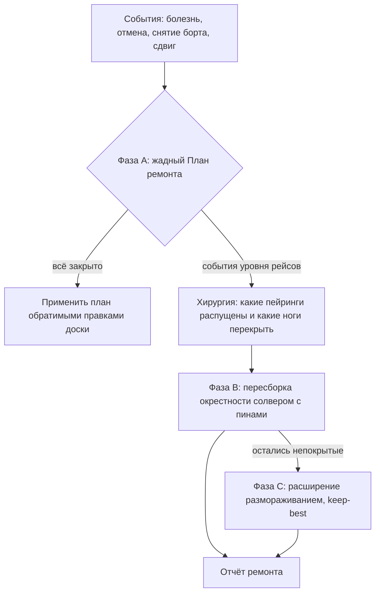

# COSMOS — Руководство. Часть 6. Режим «Сбой» и ремонт ростера

| Поле | Значение |
|---|---|
| Версия приложения | `92d14a4` (2026-07-24) |
| Дата документа | 2026-07-20 |
| Аудитория | Планировщик (операционное восстановление) |
| Связанные части | [Часть 4 — Работа с готовым ростером](04-rabota-s-rosterom-RU.md), [Часть 5 — День операции](05-den-operacii-RU.md), [Часть 3 — Оптимизация](03-optimizaciya-RU.md) |

---

## 1. О чём эта часть

Что делать, когда реальность ломает ростер: заболел пилот, отменили рейсы, сняли борт, сдвинули вылеты. Режим «Сбой» живёт на «Доске» (кнопка «Сбой…», блок «Сбой: болезнь / срочная замена») и восстанавливает ростер тремя эшелонами: жадный ремонт (фаза A), пересборка окрестности солвером (фаза B), расширение окрестности размораживанием (фаза C).

## 2. Роли и ответственность

| Действие | Кто выполняет | Кто утверждает |
|---|---|---|
| Регистрация событий (болезнь, отмена, борт, сдвиг) | Планировщик (или генерация из фактов, [Часть 5](05-den-operacii-RU.md)) | — |
| «План ремонта» (фаза A) и «Применить план» | Планировщик | Планировщик — применение это отдельная явная кнопка |
| «Пересборка (план Б)» (фазы B/C) | Планировщик | Итог сертифицируется автоматически; ремонт авто-промотируется в активный ростер |
| Закреплённые назначения (пины) | Планировщик | Пины здоровых, незатронутых экипажей неприкосновенны; пин сломанного пейринга (его экипаж заболел) снимается — болезнь сильнее пина, и план явно помечает это как «пин снят». В фазе C соседние замороженные пейринги могут размораживаться раундами (это видно в отчёте) |

## 3. События сбоя: виды и регистрация

Блок открывается кнопкой «Сбой…» на «Доске». Выбор вида — список «Вид события»: «Болезнь», «Отмена рейсов», «Снятие борта», «Сдвиг рейсов».

| Вид | Поля формы | Действие |
|---|---|---|
| «Болезнь» | сотрудник, даты «с»/«по», «Заметка…» | Кнопка «Отметить болезнь». Дни становятся жёсткой недоступностью для доски и всех проверок |
| «Отмена рейсов» | «Рейсы через запятую» | Кнопка «Отменить рейсы» |
| «Снятие борта» | «Бортовой номер…», даты «с»/«по» | Кнопка «Снять борт». Отменяются рейсы этого борта в окне дат (нужно поле `tailNumber` в данных) |
| «Сдвиг рейсов» | «Рейсы через запятую», «+мин» | Кнопка «Сдвинуть» (допустим и отрицательный сдвиг) |

### 3.1 Адресация вхождений (повторные номера)

Если номер рейса летает в наборе несколько раз, событие обязано указывать **конкретное вхождение**:

- голый повторный номер отклоняется с ошибкой вида «номер летает несколько раз — укажите конкретное вхождение (flightLegId)»;
- в списке событий и подсказках вхождения показываются как «номер · дата время», адрес — `flightLegId`;
- отмена одного вхождения **не** гасит остальные вылеты этого номера (историческая ошибка «отмена F100 гасила оба вхождения» закрыта именно этой адресацией);
- если события были созданы до изменения данных и адреса устарели, система просит пересоздать события (защита от «тихого» применения к не тем рейсам).

## 4. Фаза A — жадный «План ремонта»

Из описания экрана: «„План ремонта“ жадно закрывает сломанные пейринги минимальным числом изменений: сначала свободные резервы, затем легальные переносы и обмены. План применяется обратимыми правками доски; непокрытое честно показывается красным.»

1. Зарегистрируйте события (обычно болезнь).
2. Нажмите «План ремонта». Система предложит: прямые переназначения на свободных (в приоритете — резервисты) и обмены глубины 1 (кандидата освобождают, легально передав один из его пейрингов третьему сотруднику, а на освободившееся место ставят сломанный пейринг), все — только легальные по правилам доски.
3. Изучите план: каждая строка — конкретное изменение; непокрываемое жадным способом отмечено красным.
4. Нажмите «Применить план» — изменения лягут **обратимыми правками доски** (их видно и можно сбросить, как обычные правки, см. [Часть 4](04-rabota-s-rosterom-RU.md)).

**Ремонт по местам (исправлено 2026-07-20).** Единица ремонта — не пейринг целиком, а **место экипажа**. Болезнь обнаруживается на ЛЮБОМ месте пейринга (командир, второй пилот, любое место со-локационного экипажа), а не только на первом; чинится ровно то место, чей исполнитель заболел или пусто, — здоровые соседи по экипажу остаются на своих местах. Кандидат на место обязан владеть **требуемой ролью этого места** и не может уже занимать другое место того же пейринга. В таблице плана у пейрингов с несколькими местами показано, какое именно место переэкипируется («Место 1» и т. п.).

Фаза A не трогает солвер и структуру пейрингов — только перераспределяет людей по местам.

**Что записывается при применении плана (с 2026-07-20).** Планировщик ремонта считает по каждому сломанному месту **полный ранжированный список** законных замен и ставит первого из него. Раньше остальные кандидаты тут же выбрасывались — а это единственное место, где видно, что предлагалось помимо принятого, и восстановить это задним числом невозможно: список зависит от состояния ростера в момент ремонта. Теперь при нажатии «Применить план» в журнал эпизодов ремонта попадают: ситуация (устойчивый ключ по содержимому пейринга и экземпляру), место, с кого сняли и кого поставили, до пяти отвергнутых вариантов и сколько их было всего, способ (прямая замена или обмен), кто и когда применил.

Записывается **только применённая часть** плана: если применение оборвалось на середине, в журнал уйдёт ровно применённый префикс, а план, отвергнутый целиком, наблюдением не считается — человек его не выбирал. Сбой журнала не может помешать ремонту: ремонт уже произошёл и обратим сбросом правок доски.

Пока это только **запись наблюдения** — отдельного контура с метрикой и предложениями у неё нет. Причина названа честно: чтобы делать выводы о повторяющихся ситуациях, нужны десятки ремонтов, а их пока не было. Записывать начали сейчас именно потому, что каждый выполненный без записи ремонт — безвозвратно потерянное наблюдение. См. [Часть 7](07-samousovershenstvovanie-RU.md).

## 5. Хирургия и фаза B — «Пересборка (план Б)»

События уровня рейсов (отмена, снятие борта, сдвиг) меняют саму структуру полётов — здесь жадного ремонта мало.

**Хирургия (предпросмотр).** После регистрации таких событий система показывает строку вида: «Хирургия рейсов: отменено {c}, сдвинуто {d} → распущено пейрингов: {b}, ног к перекрытию: {r}.» — какие пейринги распускаются и сколько ног (рейсов-участков) надо перекрыть заново.

**Пересборка.** Кнопка «Пересборка (план Б)»; подтверждение: «Запустить пересборку? Будет создан ремонтный экземпляр: нетронутые пейринги заморозятся с экипажем, окрестность пересоберётся и доназначится солвером (1–3 минуты).»

Что происходит внутри:

1. Создаётся **ремонтный (производный) экземпляр** с изменённой полётной программой.
2. Нетронутые пейринги **замораживаются вместе с экипажем** — солвер получает их как закреплённые (пины Timefold) и не имеет права менять.
3. **Окрестность** (рейсы распущенных пейрингов) пересобирается генерацией колонок — строятся новые кандидаты-пейринги только для затронутых ног.
4. Слитый каталог (замороженные + новые колонки) доназначается солвером этапа 2.
5. Статус в интерфейсе: «Пересборка идёт: генерация колонок окрестности → слитый каталог с пинами → переназначение…»; задача видна на «Прогонах».

При повторных номерах вся механика оперирует адресами вхождений; в отчётах вы видите настоящие номера рейсов.

## 6. Фаза C — расширение размораживанием

Если часть ног непокрываема в узкой окрестности, включается расширение (из описания экрана): «соседние нетронутые пейринги (тот же тип борта, стыковка рядом) размораживаются раундами, и колонки строятся заново.»

- Раунды идут с лимитами (числом раундов и размером размораживания).
- Действует правило **keep-best** (сохранение лучшего): между раундами сохраняется раунд с наименьшим **числом непокрытых ног** по итогам генерации колонок; при равенстве побеждает более ранний раунд — у него меньше размороженных пейрингов и меньше изменений. Стоимость решения, нарушения и число неназначенных в сравнении раундов не участвуют: они появляются только на этапе 2, который выполняется один раз — для лучшего раунда.
- Доказанно невозможные к покрытию ноги помечаются отдельно: «непокрыто» и «доказанно невозможно» — разные категории в отчёте. «Доказанно невозможно» — это строгий математический сертификат того, что легальную цепочку нельзя собрать **из ног ограниченного пула ремонта**: ног распущенных пейрингов плюс размороженных за ограниченное число раундов соседей. Это свойство узкой окрестности, а не всего расписания — при более широкой пересборке такая нога может оказаться покрываемой.

Есть и аварийный запасной путь без солвера — жадное доназначение (greedy fallback), если пересборка недоступна; отчёт честно указывает использованный путь.

## 7. Отчёт ремонта и активный ростер

По завершении пересборки блок отчёта показывает:

- кто из сотрудников потерял и получил пейринги (изменения к исходному ростеру);
- перечень непокрытых ног и отдельно — доказанно невозможных;
- итоговый вердикт сертификации (те же проверки, что у обычного этапа 2 — [Часть 3](03-optimizaciya-RU.md)).

**Гейт вердикта (исправлено 2026-07-20):** результат ремонта промотируется в активный ростер автоматически только при вердикте `OK`. Жадное доназначение (`REPAIR_GREEDY`) и прогоны с непокрытыми ногами сохраняются диагностическими записями без подмены активного ростера: их итог виден в отчёте ремонта и в предупреждении «последний прогон не-OK — активен предыдущий ростер» в «Результатах». Прежний годный ростер при неудачном ремонте остаётся целым и активным. Если пересборка не удалась: «Пересборка не удалась — подробности в журнале задания» — смотрите журнал на «Прогонах».

## 8. Частые ошибки и что они означают

| Симптом | Причина | Действие |
|---|---|---|
| «номер летает несколько раз — укажите конкретное вхождение (flightLegId)» | Событие адресовано голым повторным номером | Укажите вхождение (подсказка перечисляет «номер · дата время») |
| Просьба пересоздать события | События созданы до изменения данных — адреса устарели | Удалите и заведите события заново на актуальном экземпляре |
| «План ремонта» оставляет красные строки | Жадным способом закрыть всё нельзя | Это честный итог фазы A; переходите к «Пересборка (план Б)» |
| «Не удалось запустить пересборку» | Нет годного ростера/каталога или события пусты | Проверьте, что этап 2 посчитан и события зарегистрированы |
| Пересборка закончилась с непокрытыми ногами | Узкая окрестность не имеет решения | Смотрите отчёт: «доказанно невозможно» — предел ограниченной окрестности ремонта, а не всего расписания; расширение уже пробовало соседей в заданных лимитах |
| Ремонт «пропал» после пересчёта обычного этапа 2 | Новый этап 2 перепромотировал активный ростер | Это ожидаемое поведение манифеста активного ростера ([Часть 3](03-optimizaciya-RU.md), раздел 8) |

## 9. Как проверить

1. На экземпляре с готовым ростером откройте «Доска» → «Сбой…», выберите «Болезнь», отметьте сотрудника на 2–3 дня с пейрингом. Ожидаемо: его дни подсвечены недоступностью, сломанный пейринг виден.
2. Нажмите «План ремонта». Ожидаемо: список конкретных переназначений/обменов (резервисты в приоритете) либо честные красные строки.
3. Нажмите «Применить план». Ожидаемо: правки легли на доску, нарушений нет; «Сбросить правки» их откатывает.
4. Выберите «Отмена рейсов», отмените один рейс из середины пейринга. Ожидаемо: строка «Хирургия рейсов: отменено 1 … распущено пейрингов: 1, ног к перекрытию: N».
5. Нажмите «Пересборка (план Б)» и подтвердите. Ожидаемо: сообщение «Пересборка запущена — идёт фоновое задание», задача на «Прогонах», через 1–3 минуты — отчёт ремонта; активный ростер обновился на ремонтный.
6. Для набора с повторным номером попробуйте отменить голый номер. Ожидаемо: отказ с просьбой указать конкретное вхождение; в подсказке — список вхождений с датами.

## 10. Связанные части

- [Часть 5 — День операции](05-den-operacii-RU.md) (генерация событий из фактов)
- [Часть 4 — Работа с готовым ростером](04-rabota-s-rosterom-RU.md) (правки доски, пины)
- [Часть 3 — Оптимизация](03-optimizaciya-RU.md) (сертификаты, активный ростер)
