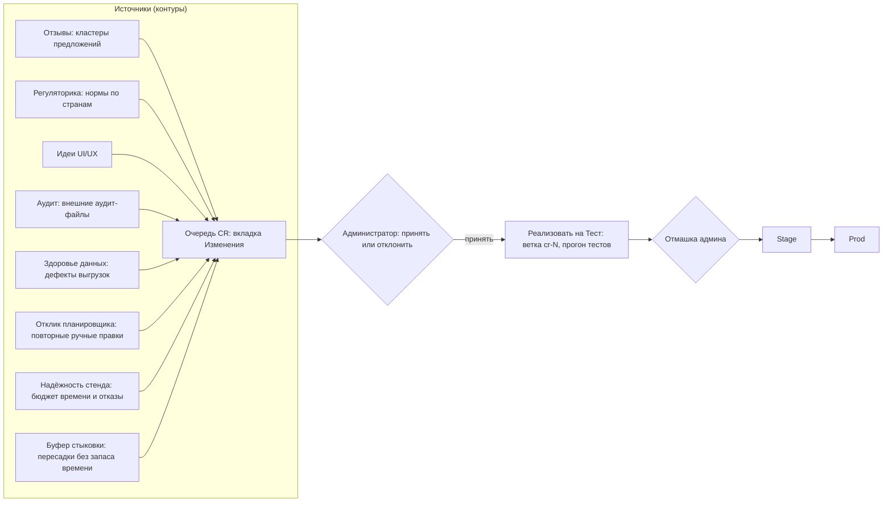
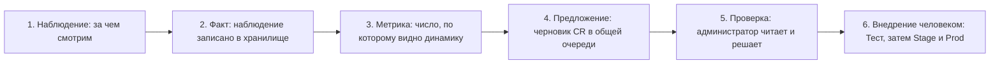

# COSMOS — Руководство. Часть 7. Самоусовершенствование приложения

| Поле | Значение |
|---|---|
| Версия приложения | `92d14a4` (2026-07-24) |
| Дата документа | 2026-07-20 |
| Аудитория | Администратор (весь раздел скрыт от прочих ролей) |
| Связанные части | [Часть 1 — Введение](01-vvedenie-i-ustrojstvo-RU.md), [Часть 8 — Администрирование](08-administrirovanie-RU.md) |

---

## 1. О чём эта часть

Раздел «Автоулучшение» — воплощение главной идеи COSMOS: **приложение улучшает само себя, а человек утверждает каждый шаг**. Здесь описаны четыре страницы раздела («Контуры», «Изменения», «Алгоритмы», «База знаний»), контуры-источники улучшений, путь изменения от идеи до продакшна и правила безопасности контуров.

Пять направлений самоусовершенствования (красная нить всех демонстраций): Алгоритмы, UI/UX (интерфейс), Регуляторика, Отзывы, База знаний. С 2026-07-20 к ним добавлены четыре **детерминированных** контура (Здоровье данных, Отклик планировщика, Надёжность стенда, Буфер стыковки) — раздел 5.



## 2. Что такое «контур наблюдения» и как он устроен

**Контур наблюдения** (loop) — замкнутый цикл наблюдения: часть приложения, которая постоянно смотрит на одну сторону работы системы и превращает замеченное в предложение о доработке.

> Не путайте с **контуром установки** — так в этом руководстве называются три площадки приложения (Test, Stage, Prod) и правила работы с данными на них (раздел 10). Слово одно, смысл разный: контур наблюдения — это цикл улучшения, контур установки — это площадка.

Все контуры наблюдения, сколь угодно разные внутри, устроены по одной и той же схеме из шести шагов:



1. **Наблюдение** — контур смотрит на свой предмет: тексты предложений пользователей, нормы страны, данные экземпляра, ручные правки доски, поведение расчётного стенда.
2. **Факт** — увиденное записывается как отдельная запись (снимок, эпизод, наблюдение прогона). Пока факт не записан, «стало хуже» сказать не с чем: сравнивать нужно с прошлым.
3. **Метрика** — из накопленных фактов считается число: сколько дефектов, сколько повторов, какая доля отказов. Именно метрика, а не ощущение, решает, есть ли повод.
4. **Предложение** — при выходе метрики за порог контур складывает **черновик** запроса на изменение (CR) в ту же самую очередь на вкладке «Изменения». Своей очереди контуры не заводят. Исключение — два контура с собственным хранилищем и собственным экраном, «Алгоритмы» и «База знаний» (раздел 4.1): их находки в очередь CR не попадают, но и они остаются черновиками до решения человека.
5. **Проверка** — администратор читает карточку, соглашается или отклоняет с причиной.
6. **Внедрение человеком** — принятое реализуется на Test и продвигается на Stage и Prod по процедуре [Части 8](08-administrirovanie-RU.md). Ни один контур ничего не внедряет сам.

Три ограничения, общие для всех контуров и особенно жёсткие для детерминированных:

- **контур ничего не чинит** — он описывает проблему, а не исправляет её;
- **контур не пишет в рабочие настройки** — ни в параметры авиакомпании, ни в ставки, ни в параметры оплаты, ни в данные экземпляра;
- **единственный выход контура наружу — черновик CR** со статусом «черновик», который ждёт человека.

## 3. Роли и ответственность

| Действие | Кто выполняет | Кто утверждает |
|---|---|---|
| Запуск контуров-источников («Запустить агента») | Администратор | — |
| Снятие снимка («Снять снимок») — здоровье данных и буфер стыковки | Администратор | — |
| Указание причины при ручной правке доски | Планировщик (обязательно, [Часть 4](04-rabota-s-rosterom-RU.md)) | — |
| Приём/отклонение запросов на изменение (CR) | Администратор | Администратор |
| Реализация CR кодом | Агент-исполнитель на Test (изолированная ветка) | Администратор — по результатам тестов |
| Продвижение Test → Stage → Prod | Администратор (процедура деплоя — [Часть 8](08-administrirovanie-RU.md)) | Администратор, явная отмашка на каждый контур |
| Ночные исследования алгоритмов | Агент-исследователь (по расписанию) | Администратор — кнопками «Алгоритмов» или в Telegram |
| Перестройка Базы знаний | Администратор («Перестроить (Test)») | Человек подтверждает применение рекомендаций |

## 4. Страница «Контуры» — обзор наблюдений **[Администратор]**

Первая страница раздела «Автоулучшение». Это **обзорный экран только для чтения**: он показывает все контуры разом и отвечает по каждому на одни и те же четыре вопроса. Ничего в системе он не меняет.

Из описания экрана: «Каждый контур что-то наблюдает и превращает замеченное в предложение об изменении (CR) — сам он ничего не чинит и в рабочие настройки не пишет.»

Таблица «Контуры наблюдения», шесть колонок и **десять строк — все контуры раздела**:

| Колонка | Что показывает |
|---|---|
| «Контур» | Название: «Отзывы», «Регуляторика», «Идеи UI/UX», «Аудит», «Здоровье данных», «Отклик планировщика», «Надёжность стенда», «Буфер стыковки», «Алгоритмы», «База знаний» |
| «Что наблюдает» | Одной строкой — предмет наблюдения контура |
| «Последнее наблюдение» | Дата и время последнего факта. У четырёх детерминированных контуров это время их собственного снимка, эпизода или наблюдения прогона; у «Алгоритмов» — окончание последнего **удавшегося** исследовательского скана (ночного или запущенного вручную, в том числе не нашедшего ничего нового); скан, оборвавшийся по тайм-ауту или вернувший неразборчивый ответ, отметку не обновляет — иначе сломанный контур выглядел бы свежим; у «Базы знаний» — время последней перестройки; у остальных — время последнего созданного предложения |
| «Метрика сейчас» | Текущее число контура: свежих предложений, стран в наблюдении, дефектов в последних снимках, эпизодов переделок, наблюдений прогонов, тесных стыковок, находок в базе, версии базы знаний |
| «Открытых предложений» | Сколько сущностей контура ещё ждут решения человека: для восьми контуров это CR в статусах «черновик» и «принят», для «Алгоритмов» — находки вне терминальных статусов («внедрена», «отклонена»); прочерк «—» у «Базы знаний» означает, что ожидающих решения сущностей у неё нет **в принципе** (это справочник, а не очередь), и читать его как ноль неверно |
| «Действие» | Кнопка: «Запустить агента» — у большинства; «Снять снимок» — у «Здоровья данных»; «Открыть приёмник аудита» — у «Аудита» (у него нет запускаемого агента, отчёты приносит приёмник); «Открыть „Алгоритмы“» и «Открыть „Базу знаний“» — переход на собственный экран контура |

**Клик по строке** (мимо кнопки) разворачивает подробности контура под таблицей; повторный клик сворачивает. Подробности есть у четырёх детерминированных контуров (раздел 5); у остальных в развороте — поясняющий текст.

### 4.1 Два контура со своим хранилищем

«Алгоритмы» и «База знаний» стоят в таблице последними и отличаются от прочих одним: их находки живут **не в очереди «Изменения»**, а в собственных хранилищах, и решения по ним принимаются на их собственных экранах — для «Алгоритмов» это кнопки «Обновить Тест» → «На Stage» → «В Prod» (или те же решения в Telegram), для «Базы знаний» — перестройка и подтверждение рекомендаций человеком.

Это отличие в способе хранения, а не в природе контура: оба наблюдают внешний мир (публикации и релизы по методам оптимизации; публичные бенчмарки решателей), у обоих есть отметка последнего наблюдения и своя метрика, и оба ничего не применяют без человека. Поэтому они присутствуют в обзоре наравне с остальными — до 2026-07-20 их в таблице не было, и обзорный экран показывал семь контуров из девяти.

Обе строки — единственные, где предложения контура **не** попадают в очередь «Изменения»; всё остальное на странице про очередь CR к ним не относится.

## 5. Четыре детерминированных контура (с 2026-07-20)

Эти контуры **не обращаются к языковой модели вообще** — ни на одном контуре установки. Причина простая и жёсткая: они смотрят на данные, где есть **фамилии, имена и табельные номера сотрудников**, а такие данные наружу не уходят. Поэтому вместо «понимания смысла» они группируют наблюдения по **точным совпадениям ключей**, а тексты предложений собирают из шаблонов и чисел самих наблюдений — ничего не додумывая.

Общее для всех:

- **никакой автоматики над настройками**: контур не меняет ни параметров авиакомпании, ни ставок, ни параметров оплаты, ни данных экземпляра;
- **выход только в очередь «Изменения»** — тот же список CR, что у остальных контуров, со статусом «черновик»;
- **воспроизводимость**: одно и то же состояние наблюдений всегда даёт один и тот же список черновиков в одном и том же порядке.

### 5.1 «Здоровье данных» — дефекты выгрузок в динамике

**Что наблюдает.** Дефекты данных загруженных экземпляров. Экран «Аномалии» ([Часть 2](02-podgotovka-dannyh-RU.md)) уже считает их на лету, но нигде не сохраняет: владелец данных видит «сейчас плохо» и не видит, **стало ли хуже**. Контур снимает периодические **снимки** и хранит их историю.

Виды дефектов в снимке: рейсы вне основного месяца, дубликаты табельных номеров, полные тёзки в экипаже, сотрудники без назначений, выбросы налёта, аномально низкий налёт, почти полностью недоступные сотрудники, прочие аномалии истории, ошибки валидации, нарушения формата времени (время вылета/прилёта обязано быть вида `ГГГГ-ММ-ДДTЧЧ:ММ:СС` **без указания часового пояса**), места экипажа без рейса (позиция на рейсе ссылается на рейс, которого в выгрузке нет).

**Что считается успехом.** Число дефектов каждого вида не растёт от снимка к снимку. Предложение появляется только при **ухудшении**: вид дефекта возник впервые или его счётчик вырос. Первый снимок экземпляра предложений не даёт никогда — это база сравнения, а не повод.

Одно исключение, о котором стоит знать: если счётчик вида упёрся в собственный потолок отчёта (список ошибок валидации обрезается), такой вид становится **насыщенным** — его число есть нижняя оценка и с обеих сторон, и разница между двумя оценками снизу ничего не значит. По насыщенным видам предложение не создаётся вовсе, пока счётчик не выйдет из-под потолка. Это защита от ложной тревоги и от ложного «стало лучше».

**Что корректируется.** Ничего автоматически. Черновик CR называет вид дефекта, числа «было → стало» и до пяти примеров строк из отчёта, и предлагает **человеку** проверить источник выгрузки на стороне владельца данных.

**Подробности на странице «Контуры»:** выбор экземпляра, таблица «Вид дефекта / Было / Стало / Изменение» и счётчик «Снимков в истории». Кнопка «Снять снимок» снимает срез по всем экземплярам сразу — и только его: черновики предложений создаёт отдельно кнопка «Запустить агента» на строке контура, чтобы снимок не наполнял очередь изменений молча.

### 5.2 «Отклик планировщика» — повторяющиеся ручные правки доски

**Что наблюдает.** Ручные переделки ростера на доске планирования — но только те, где планировщик **указал причину** (см. [Часть 4](04-rabota-s-rosterom-RU.md), раздел 3.1). Каждая такая правка становится **эпизодом**: экземпляр, пейринг, место, с кого сняли, кого поставили, код причины, свободный комментарий, кто и когда.

Автоматические перестановки (fair-share, ремонт при сбое) причины не имеют и в журнал откликов не попадают — это не отклик человека.

**Что считается успехом.** Отсутствие **повторов**. Одна правка — частный случай; сигналом считается только одна и та же переделка, повторённая с одной и той же причиной. Группировка идёт по точным ключам в **трёх срезах**. Свободный комментарий в группировке не участвует никогда — он попадает в выборку как есть.

| Срез | По чему группирует | Область | Порог показа / предложения |
|---|---|---|---|
| «Сотрудник» | причина + конкретный сотрудник — кого раз за разом снимают или ставят | внутри экземпляра | 3 / 5 |
| «Пейринг» | причина + конкретный пейринг | внутри экземпляра | 3 / 5 |
| «Системный» | **только причина**, безотносительно людей и пейрингов | **поверх всех экземпляров** | 9 / 15 |

Зачем понадобился третий срез: проверка на живом стенде показала, что самый частый случай был невидим. Девять переделок с одной причиной по разным пейрингам и разным людям не давали ни одного кластера — а это и есть самый сильный сигнал: правило не хватает не кому-то одному, а всем сразу. Порог у него втрое выше именно потому, что он широкий: слабый разброс причин есть всегда, тревожить очередь стоит только устойчивым.

Два адресных среза считаются **внутри экземпляра**: табельные номера у разных авиакомпаний совпадают сплошь, и без этого кластер склеил бы однофамильцев из разных наборов. Системный срез, наоборот, считается **поверх всех экземпляров** осознанно — и его карточка CR это прямо оговаривает.

**Что корректируется.** Ничего автоматически. Черновик CR честно перечисляет три возможных объяснения повтора и **не выбирает между ними**: (1) в модели не хватает правила, которое планировщик держит в голове; (2) правило есть, но его цена или приоритет заданы неверно; (3) правило и цена верны, а неудобен интерфейс, и переделка обходит неудачный шаг работы. Отдельно оговаривается: повтор **не доказывает правоту оператора** — его решение тоже может быть ошибкой или привычкой, и тогда правильный ответ — разбор с планировщиком, а не правка настроек.

**Подробности на странице «Контуры»:** счётчик «Эпизодов переделок в журнале» и таблица кластеров «Причина / Срез / Повторов / Экземпляры».

### 5.3 «Надёжность стенда» — как ведёт себя сама расчётная программа

**Что наблюдает.** Не качество ростера, а поведение расчётного стенда: по каждой завершённой задаче записываются тип задачи, метка, отведённый **бюджет времени**, фактически потраченное время, исход (успешно / ошибка / остановлена человеком) и код выхода. Запись наблюдения никогда не может уронить саму задачу: её исход фиксируется раньше, а сбор статистики молча пропускается при любой ошибке.

Сознательное ограничение: собирается только то, что уже известно о прогоне. Ни памяти, ни загрузки процессора контур не измеряет.

**Что считается успехом.** Два порога по каждому типу задач (учитываются типы, набравшие не менее 10 прогонов): доля прогонов, уложившихся в бюджет времени, — **не ниже 80 %**; доля отказов — **не выше 10 %**. Остановка человеком отказом не считается, но и об укладываемости в бюджет ничего не говорит.

**Что корректируется.** Ничего автоматически. При проседании укладываемости черновик предлагает **поднять бюджет времени по умолчанию** для этого типа задач до уровня 90-го перцентиля фактического времени (то есть до значения, которое перекрывает 9 прогонов из 10). При превышении доли отказов — **разобрать коды выхода и журналы** отказавших прогонов. Каждый черновик несёт фактические числа выборки и оговорку: это статистика хвоста наблюдений, а не воспроизведённый эксперимент; один прогон ничего не доказывает.

**Подробности на странице «Контуры»:** таблица «Тип задачи / Прогонов / В бюджет / Медиана, с / 90-й перцентиль, с / Доля отказов».

### 5.4 «Буфер стыковки» — пересадки с нулевым запасом времени (с 2026-07-20)

**Что наблюдает.** Пересадки экипажа **внутри одной смены**: сколько времени по плану проходит между прилётом одного рейса и вылетом следующего. Считаются только стыковки внутри смены — промежуток между сменами это отдых, а не пересадка, и попади он в перепись, ночёвка выглядела бы стыковкой с огромным запасом и размыла бы всю статистику. Границу смены определяет то же правило минимального отдыха, по которому считается оплата и работает солвер.

Стыковка считается **тесной**, если плановый интервал не дотягивает 15 минут до минимально допустимого — то есть лежит в диапазоне от минимума до минимума плюс четверть часа. Такая пересадка **полностью легальна**, и потому её не покажет ни одна проверка: она именно что проходит. Но запаса у неё нет, и первой же задержки прилёта хватает, чтобы она стала невыполнимой.

**Почему перепись плановая, а не по факту.** Считать «сколько стыковок реально сорвалось» честнее, но такой контур молчал бы до первого импорта фактического дня операции, а журнала фактов на большинстве установок нет вовсе. Плановая теснота считается по одному готовому ростеру и даёт число сразу. Когда факты появятся, к ней добавится доля реально сорванных — уже накопленная история при этом не пропадёт.

**Когда контур отказывается считать.** Если ростер посчитан по **другому набору правил** (страница «Результаты» помечает такой ростер как устаревший), перепись не делается вовсе. Цифра получилась бы, но теснота в ней была бы наведена сменой правил, а не решением солвера. То же при отсутствии ростера: экземпляр без ростера снимка не получает — ряд нулей в истории неотличим от «стало идеально», и тренд соврал бы улучшением.

**Что считается успехом.** Число тесных стыковок не растёт от снимка к снимку. Абсолютного порога здесь нет намеренно: у каждой авиакомпании своя норма плотности расписания, и объявлять её со стороны было бы самоуверенно. Сигналом считается только **ухудшение относительно собственной истории экземпляра**. Первый снимок предложений не даёт никогда — это база сравнения.

**Что корректируется.** Ничего автоматически. Черновик перечисляет конкретные пересадки (аэропорт, пара рейсов, время, интервал) и предлагает их разобрать. Отдельно и вслух называется цена изменения самого правила: минимальное время стыковки входит в **отпечаток задачи**, поэтому новое значение обесценивает все продвинутые каталоги и делает каждый посчитанный ростер «посчитанным по другим правилам» — это решение человека, и контур не вправе назначать такую цену молча.

**Чего этот контур не предлагает никогда** — и это важнее того, что он предлагает:

| Параметр | Почему не трогаем |
|---|---|
| Время в пути (продолжительность рейса) | Такого параметра просто **нет**: длительность выводится вычитанием времени вылета из времени прилёта. «Откалибровать» её означает переписать сами данные экземпляра, сменив отпечаток задачи и обесценив все продвинутые каталоги |
| Время руления | Поле в модели объявлено, но его **не читает ни одна часть системы**. Предложение изменить его было бы пустышкой, выглядящей как исправление, — а это хуже, чем не предлагать ничего |

**Подробности на странице «Контуры»:** число стыковок и тесных среди них, изменение против прошлого снимка, таблица примеров «Аэропорт / Прилёт → вылет / Когда / Интервал, мин» и запас сверх минимума (медиана и 10-й перцентиль).

## 6. Страница «Изменения» — конвейер запросов на доработку

Из описания экрана: «Единая очередь запросов на изменение (CR). Их формируют агенты Автоулучшения: „Отзывы“ (кластеры предложений пользователей), „Регуляторика“ (изменения норм по странам экземпляров), „Идеи UI/UX“. Приоритет отзывов = число сходных предложений; трудоёмкость 1–10. Администратор принимает или отклоняет CR; „Реализовать на Тест“ запускает агента-исполнителя в изолированном тест-контуре (отдельная ветка cr-…, прогон тестов).»

CR (change request) — запрос на изменение: карточка с описанием проблемы/идеи, источником, приоритетом, оценкой трудоёмкости и датой создания заявки («создана …» — когда агент её сформировал; симметрично колонке «Найдена» на «Алгоритмах»).

### 6.1 Контуры-источники

Верхний ряд под-вкладок страницы переключает интерфейсы агентов; кнопка «Запустить агента» запускает выбранного (у вида «Аудит» вместо неё свои кнопки — «Проверить наличие аудита» и «Обработать»). Ту же кнопку даёт строка контура на странице «Контуры».

| Контур | Откуда берёт материал | Что производит | Языковая модель |
|---|---|---|---|
| «Отзывы» | «Помощь» → «Предложения» (свободные тексты пользователей) | Кластеризует сходные предложения в CR; приоритет = размер кластера | Да |
| «Регуляторика» | Публичные нормы стран, атрибут «страна» экземпляров | Дайджест изменений норм по стране экземпляра; CR по тому, что затрагивает приложение (параметры правил, валидаторы, новые атрибуты) | Да |
| «Идеи UI/UX» | Само приложение (эвристики удобства) | CR по интерфейсу | Да |
| «Аудит» | Приёмник внешних аудит-файлов (раздел 7) | CR по находкам стороннего аудита | Да |
| «Здоровье данных» | Снимки дефектов экземпляров (раздел 5.1) | CR по каждому виду дефекта, число которого выросло | **Нет** |
| «Отклик планировщика» | Журнал ручных правок доски с причинами (раздел 5.2) | CR по каждому устойчивому кластеру повторных переделок | **Нет** |
| «Надёжность стенда» | Наблюдения расчётных прогонов (раздел 5.3) | CR по выходу за пороги бюджета времени и доли отказов | **Нет** |
| «Каталог шаблонов» | Принятые владельцем заявки каталога шаблонов ([Часть 13](13-katalog-shablonov-RU.md), раздел 13.10) | CR с ключом записи каталога: реализовать названные виды исполнителей у названной записи | Да (у агента-исполнителя) |

«Каталог шаблонов» — источник CR, но не контур наблюдения: строки на
странице «Контуры» у него нет и кнопки «Запустить агента» тоже. CR
здесь рождает не агент, а СВЕРКА заявок каталога с очередью: решение
по заявке принимает владелец на экране службы каталога, и очередь лишь
отражает это решение.

### 6.2 Жизненный цикл CR

1. Агент создаёт CR → карточка в очереди со статусом «черновик».
2. Администратор читает и решает: принять или отклонить (с причиной).
3. У принятого CR доступна кнопка **«Реализовать на Тест»**: агент-исполнитель получает CR, создаёт **отдельную ветку `cr-N`** в изолированном контуре Test, пишет код, прогоняет тесты и прикладывает результат к карточке. Модель агента названа заранее: настройка «coding» на странице «Настройки → Модели», без неё — умолчание claude-opus-5 (решение владельца 09.09.2026); имя модели видно в записи результата на карточке (`agent_model`).
4. Действует **суточная квота реализаций** (строка квоты видна на странице; по умолчанию 3 в день) — защита от неконтролируемого потока изменений. Рабочее место владельца, где за день через конвейер пополнения каталога проходит больше строк, задаёт свою квоту переменной `CREW_CR_IMPL_DAILY_LIMIT` (целое число; пусто или не число — умолчание 3; ноль — реализация выключена). Квота считается по календарным суткам UTC.
5. Убедившись в результате на Test, администратор продвигает изменение на Stage и затем на Prod — по процедуре деплоя из [Части 8](08-administrirovanie-RU.md). Никакое изменение не попадает во внутренний контур без явной отмашки человека.

Исполнителей ЛЮБОГО вида — и на Python, и на решателе (`kotlin_*`) —
пишет агент контура автоулучшения; человек в кодовую базу не входит.
Различаются только судьи: у видов на Python это стенд, генератор и
гейт привязок, тесты и проверка каталога; у видов решателя к ним
добавляются сборка решателя из коммита ветки, тесты решателя, живой
стенд на решателе из собранного артефакта и свидетельство с
отпечатками. Человек даёт отмашку по заявке в каталоге и принимает
свидетельство. Порядок исполнения по шагам, перечень судей и разбор
свидетельства — в [Части 13](13-katalog-shablonov-RU.md), раздел 13.10
«Шаг 6: конвейер пополнения».

**Особенности CR каталога шаблонов** (`kind` = `catalog-executor`):

1. Такой CR рождается СРАЗУ ПРИНЯТЫМ: решение по заявке владелец уже
   принял в каталоге, и второй отмашки в очереди не спрашивают.
   Отклонить его администратор не может — отказ словами: закрывается
   он только решением владельца по заявке (в том числе пересмотром
   отклонённой заявки).
2. Ключ строки вычисляется из номера заявки, поэтому один и тот же CR
   открывается в любом экземпляре COSMOS без переноса очереди.
3. Ветка `cr-<ключ>` берётся от свежей головы удалённого репозитория,
   если у клона Test он есть; клона без него честно называют словами.
   Перед началом сверяется отпечаток каталога в клоне с тем, по
   которому CR открыт: расхождение — отказ с двумя возможными
   причинами.
4. Агент правит только код исполнителей, посев привязок и файл-кандидат
   записи; команд git он не выполняет. Его работа коммитится ДО
   гейтов содержания — красный гейт не стирает сделанного. После
   агента идут гейты каталога: стенд, генератор и гейт привязок,
   проверка каталога с записью кандидата на временной папке; вторым
   коммитом ложится свидетельство гейтов.
5. Исполнителей решателя (виды `kotlin_*`) пишет ТОТ ЖЕ АГЕНТ ТЕМ ЖЕ
   CR — как и исполнителей на Python (слово владельца от 08.09.2026;
   прежний порядок «пишет человек» отменён). Судей у таких видов
   больше: конвейер собирает решатель из коммита ветки, при правках
   его исходников прогоняет его тесты, поднимает собранный решатель
   на время проверки, судит запись живым стендом на временном
   каталоге и останавливает решатель; свидетельство несёт команды
   сборки, число тестов, отпечатки артефактов, адрес и пределы
   решателя, строки стенда по видам. Человек в код не входит: он даёт
   отмашку по заявке и принимает свидетельство. Пятый гейт — ЗАКОН
   ПАРИТЕТА на временном каталоге «живой ⊕ запись кандидата»
   (`catalog/tools/parity.py`, руководство 13.13): рост таблиц
   решателя (новая ручка, метрика, семья истории, мягкая семья)
   законен, если его объявила запись кандидата, и такая строка доходит
   до «реализовано». Статус «нужен человек» здесь — только честный
   исход красного гейта (рост, который запись не объявила; красная
   сборка; красный живой стенд), и причина названа словами в
   карточке. Кнопка «Реализовать на Тест» гаснет не по виду
   исполнителя, а когда заявка не называет ни одного вида либо служба
   смотрит в другой каталог.
6. Перенос на Stage и Prod — вручную, как у всех CR; запись каталога
   появляется не в ветке, а у владельца: «Перевести в записи» с
   кандидатом и сборка черновика в службе каталога.

#### Предполётная проверка задания — до агента (с 10.09.2026)

Место в контуре: **заявка → строка CR → ПРЕДПОЛЁТНАЯ ПРОВЕРКА → агент →
судьи → кандидат → выпуск**.

Зачем этот шаг заведён. 09.09.2026 первая новая семья каталога дошла до
записи с ПЯТОЙ попытки агента, и четыре сорванные попытки сорвались не о
шаблон, а о скрытые допущения судей: судья был написан на каталог,
который не растёт (жёсткое число записей, рукописный перечень семей,
копия каталога без заявки-свидетеля). Каждая такая попытка — одна
реализация дня и полчаса машинного времени; находится всё это ДО агента
и за минуту.

Что происходит при нажатии «Реализовать на Тест» у CR каталога:

1. По строке CR строится ЗАГОТОВКА записи — то же, что напишет агент, но
   БЕЗ исполнителей: параметры с единицами и объявленные виды
   исполнителей есть, самих исполнителей и стендовых задач нет.
2. Собирается временный каталог «живой каталог клона ⊕ заготовка», и по
   нему идут дешёвые судьи: читатель и его правила, чтение записи
   деревом, генератор и гейт привязок, снятие отметок ожидания в посеве,
   перечень судей стенда и набор тестов копий каталога в режиме роста с
   этой заготовкой.
3. Находка судьи, НАЗВАВШАЯ запись по имени, — ожидаемый пробел
   («исполнителя нет», «стендовых задач нет»); его закрывает агент.
   Находка, записи не назвавшая, либо поломка судьи — допущение «каталог
   не растёт».

Три исхода:

* **`ok`** — судьи возражений не нашли, реализация идёт как обычно.
* **`expected-gaps`** — судьи назвали только пробелы заготовки:
  реализация идёт, а перечень пробелов вкладывается в задание агенту
  разделом «ЧТО ОБЯЗАНО ЗАКРЫТЬСЯ». Те же судьи обязаны молчать после
  его работы.
* **`judge-assumption`** — строка уходит в «нужен человек» ДО агента, с
  перечнем находок в карточке. Облачная модель не зовётся, суточная
  квота реализаций не тратится. Чинится КОРЕНЬ в коде судьи, а не число
  в тесте.

Итог виден в карточке строки CR (поле `preflight`: момент, вердикт,
находки словами, перечень ожидаемых пробелов). В карточке это отдельный
блок **«Предполётная проверка»** перед итогом работы агента: чип
вердикта и момент, таблица находок «Судья · Вид · Слова» и короткий
перечень «Что обязано закрыться» (у строк прежних версий поля нет — блок
им не рисуется). Устройство, перечень судей и режим роста каталога в
наборе тестов — в [Части 13](13-katalog-shablonov-RU.md), раздел 13.14.

## 7. Приёмник внешних аудитов (вид «Аудит»)

Сторонние аудиторы могут поставлять отчёты прямо в конвейер:

1. Аудитор кладёт файл с именем по маске `hh_mm_dd_mm_yyyy_audit.md` (часы_минуты_день_месяц_год) в согласованный каталог приёмника на сервере.
2. На Test работает поллер (периодическая проверка каталога; включается переменной окружения `CREW_AUDIT_POLL=1`); вручную — кнопка «Проверить наличие аудита» в виде «Аудит».
3. Найденный файл разбирается языковой моделью на отдельные находки; каждая находка становится CR с источником «audit» и попадает в общую очередь со всей дисциплиной раздела 6.2.
4. Файлы обрабатываются один раз (защита от повторного разбора и от гонок за один файл).

## 8. Страница «Алгоритмы» — Лаборатория улучшений

Из описания экрана: «Находки ночного агента-исследователя и их путь Test → Stage → Prod; решения принимаются кнопками ниже или в Telegram. Агент и стенд Test работают только с публичными данными (внешний контур); Stage и Prod — внутренний контур без внешних ИИ-вызовов.»

- Кнопка «Начать R&D» (research and development — исследования и разработки) запускает исследование вручную; во время работы виден живой блок «Идёт исследование…» с лентой шагов, блоком «Итоги по тестам» и кнопкой «Остановить».
- Таблица находок: «ID / Публикации / Статус / Источник / Оценка / Публикация / Найдена / Действия»; заголовки центрированы, сетка фиксированная — все столбцы помещаются в один экран. «Публикация» — дата выхода первоисточника (прочерк, если неизвестна), «Найдена» — дата, когда публикацию нашёл агент-исследователь. Название публикации живёт в узкой колонке; обрезанное имя при наведении курсора медленно прокручивается по кругу, пока читается целиком. Действия ведут находку по пути Test → Stage → Prod.
- **Оценка эффективности (0–100).** Кнопка «Оценить эффективность» запускает батч: советник по решателям (его база знаний и его модель назначения «Советник») оценивает каждую находку — насколько её применение способно улучшить наш конвейер пейринга и ростеринга. Во время оценки виден баннер с прогресс-полосой и счётчиком; готовые оценки появляются в колонке «Оценка» по ходу. Число — потенциал улучшения (0–100), в подсказке — обоснование и уверенность модели. Если оценка не получена (модель недоступна, ответ не разобран) — в колонке знак «⚠» с причиной в подсказке, а не немой прочерк. Оценки кэшируются по содержимому находки и версии базы знаний: повторный запуск пересчитывает только новое.
- **Колонка «Публикация»** — дата публикации ПЕРВОИСТОЧНИКА (не дата, когда агент нашёл ссылку): для arXiv она берётся из самого идентификатора статьи, для остальных источников её называет модель при оценке. Пока дата публикации неизвестна, приглушённо показывается дата находки агентом (пояснение — в подсказке).
- **Сортировка** (обособленный блок между кнопками действий) — три признака: «Эффективность» (по оценке; неоценённые — всегда в конце), «Дата публикации» (колонка «Публикация»; находки без известной даты — всегда в конце), «Дата нахождения» (когда публикацию нашёл агент). Активный признак подсвечен и несёт стрелку направления: ↓ — по убыванию (умолчание), ↑ — по возрастанию; повторный щелчок по активному признаку разворачивает порядок.

**Продвижение — только с контрподписью человека (пакет C, 2026-08-07).** Кнопки «Stage» и «Prod» спрашивают токен подтверждения. Токен выписывает оператор на сервере командой `python tools/countersign.py --id <номер> --sha <срез> --phase <stage|prod>` по секрету, которого нет ни в репозитории, ни у автоматики; подпись привязана к тройке «правка, срез, фаза» — подтверждение одного среза не подходит другому и не открывает боевой контур, если выписано для внутреннего. Без токена действие отклоняется, статус находки не меняется.

**Проверка кандидата — в материализованной ревизии (пакет C, 2026-08-07).** Юнит-тесты и быстрый замер кандидата исполняются в одноразовой копии ровно его ревизии БЕЗ каталога `.git` (перехватчики и фильтры недостижимы по построению), с доверенной батареей из базовой ревизии; при настроенном посреднике — под отдельной учётной записью агента, а не под записью приложения. Способ запуска записывается в подписанное свидетельство фазы, и Stage принимает только изолированные свидетельства.

**Контракт агента-исполнителя (ужесточён 2026-07-23).** Кнопка «Тестировать» запускает агента, который реализует находку в изолированной копии Test. У его работы ровно два законных конца: **git-коммит** либо явный отказ с причиной. Правило «сначала коммит готового»: работающая интеграция с фолбэком на прежнее поведение коммитится сразу, до любых длинных экспериментов — сессия агента одноразовая, «доделать потом» в ней не существует, а инструменты фонового ожидания ему отключены. Урок находки 27: агент дважды делал рабочую интеграцию, запускал многочасовой обучающий свип и уходил «ждать» — сессия завершалась, коммита не оставалось. Если фаза всё же кончилась без коммита и без отказа, в ошибке находки сохраняется финальный ответ агента — по нему видно, что он думал.

### 8.1 Evolution: бенчмарк-битва кандидата с базой

Прежде чем алгоритмическая находка двинется дальше, она проходит **Evolution** — воспроизводимое сравнение кандидата с текущей базой на канонических экземплярах:

- прогоняются оба варианта, собираются метрики этапов (целевая функция, покрытие, зазор и т. д.);
- **вердикт**: `improved` (есть улучшения, нет ухудшений), `no_gain` (без изменений), `regressed` (есть ухудшения или ошибки кандидата);
- правило жёсткое: кандидат считается регрессом при **любом** ухудшении **жёсткой** метрики (worse = 0 обязателен), при ошибках кандидата и при **дырах в метриках** (кандидат обязан отдать полную схему метрик — отсутствие числа не прощается);
- **тайминги исключены из вердикта**: время стены (wall-время) шумит от нагрузки машины и учитывается отдельной справочной категорией, чтобы случайное замедление стенда не блокировало годное улучшение;
- **мягкие метрики этапа 2 тоже исключены из вердикта (с 2026-07-24)**: нарушения отпусков и попадания в предпочтения — стохастические. Этап 2 останавливается по времени, а не по сходимости, поэтому их значения гуляют от зерна к зерну: проверка находки 27 показала размах в 88 нарушений отпусков на **одном и том же каталоге** только от смены зерна. Сравнивать их на одном зерне у двух разных каталогов бессмысленно, и жёсткое «любое ухудшение = регресс» ложно браковало годную находку (её покрытие при этом улучшалось на каждом зерне). Теперь мягкие метрики показываются с пометкой «совещательно», но вердикт не валят; гейтить их по-настоящему можно только по нескольким зёрнам. **Жёсткие метрики этапа 2 — покрытие (непокрытые/неназначенные места), легальность траекторий, вердикт этапа — в гейте остаются**: их ухудшение — настоящий регресс;
- гейт продвижения на Stage требует вердикта без ухудшений и без дыр.

Так закрыт классический риск самоулучшающихся систем: «улучшение по среднему, ухудшение по краю» не проходит.

## 9. Страница «База знаний»

«База знаний по выбору решателей»: документ-«скилл» с рекомендациями, какие решатели и подходы использовать для пейринга и ростеринга. Из описания: «Строится на этапе Test из публичных бенчмарков облачной моделью (внешний контур). На Stage/Prod используется как советник — выбор подтверждает человек.»

- «Перестроить (Test)» — пересборка документа (доступна только там, где облако разрешено);
- документ читается на всех контурах и питает «Советника по решателям» на странице «Расчёты» ([Часть 3](03-optimizaciya-RU.md)).

## 10. Контуры установки (Test, Stage, Prod) и данные заказчика

Правила безопасности (см. также [Часть 1](01-vvedenie-i-ustrojstvo-RU.md), раздел 4):

- агенты, работающие на Prod/Stage, принудительно используют **локальную** модель (контур-гард в коде агентов);
- прямые облачные вызовы (агент-исполнитель CR, «Алгоритмы», перестройка Базы знаний) разрешены **только на Test** и работают только с публичными данными;
- честная оговорка: на Test агенты «Отзывы» и разбора аудитов отправляют в облачную модель **сырые тексты** — предложения пользователей и содержимое аудит-файлов целиком. Это назначение Test как внешнего контура, а не сбой; но само правило «на Test только публичные данные» — **организационная политика, а не программный гейт**: сервер доверяет декларации «Области данных» и людям, которые наполняют Test. Практический вывод: не вносите на Test данные заказчиков — ни в «Предложения», ни в аудит-файлы. Смягчения в коде при этом есть: безопасный дефолт «Только локально» у всех загрузок и маскирование значений образца при облачном импорт-маппинге;
- четыре детерминированных контура (раздел 5) в этих правилах не участвуют вовсе: они **не вызывают модель ни на одной площадке**, и потому одинаково работают на Test, Stage и Prod. Наблюдения, где есть фамилии и табельные номера (снимки данных, журнал ручных правок, наблюдения прогонов, перепись стыковок, журнал эпизодов ремонта), никуда не отправляются и остаются на сервере установки;
- полный реестр точек вызова моделей — «Админ» → «ИИ-контур». Реестр охраняется автотестом, но сторож этот **модульно-гранулярный**: тест гарантирует, что модуль, впервые вызывающий модель через стандартные примитивы, обязан иметь запись в реестре, и что записи без реальных вызовов удаляются. Отдельные новые вызовы внутри уже зарегистрированного модуля тест не различает — их полноту обеспечивает код-ревью.

## 10-бис. Изоляция агента внедрения (с 2026-07-26)

Агент внедрения исполняет план, составленный по тексту находки, а текст находки приходит из веба. Поэтому ограничивают не текст, а исполнителя.

**Что сделано.** Из окружения агента убраны служебные токены доступа, ключи облачных моделей и телеграм-бота; остаётся только токен запуска самого агента. Состав его изменений проверяется по списку запретных путей **до** того, как что-либо из них будет исполнено: батарея тестов, конвейер продвижения, доступ и зависимости кандидату недоступны. Проверяют кандидата **доверенной батареей** — сбор тестов, измерительный прибор и список зависимостей возвращаются из базовой ревизии, так что подменить то, чем его меряют, он не может. Собственные тесты на свою правку кандидат добавлять по-прежнему обязан и может.

**Что требуется от администратора.** Если машина не укреплена, кнопка «Реализовать» не отказывает, а показывает предупреждение с перечнем препятствий и просит подтверждение; в Telegram приходит то же предупреждение с кнопкой «Запустить всё равно». Запуск идёт только по осознанному подтверждению, и факт неизолированной среды попадает в журнал, в ленту фазы и в журнал действий администратора. Чтобы предупреждение перестало появляться, нужна отдельная непривилегированная учётная запись и сужённые права на секреты и пусковые файлы. Порядок и скрипт — в документе [docs/ops/agent-isolation-RU.md](../ops/agent-isolation-RU.md). Проверить состояние:

```
.venv\Scripts\python.exe -X utf8 -c "from webapp import evolution_runner as e; print(e.isolation_problems() or 'izolyaciya v poryadke')"
```

Для безголовых запусков (сценарий, планировщик), где спросить некого, отказ снимается переменной `COSMOS_EVOLUTION_ALLOW_UNISOLATED=1` — с той же записью в журнал.

**Запуск под отдельной учётной записью (с 2026-07-27).** Объявить запись мало — под ней должен кто-то запускаться. Работу выполняет зарегистрированная задача планировщика: её заводит человек с правами администратора один раз, а приложение может её только запустить, но не создать и не переписать. После старта посредник сверяет **удостоверение фактически запущенного процесса** с объявленной записью; не совпало или не прочиталось — процесс снимается, запуск отменяется. Пока задача не зарегистрирована, посредник называет причину, и работает прежний путь с подтверждением. Порядок регистрации — в [docs/ops/agent-isolation-RU.md](../ops/agent-isolation-RU.md).

**Свидетельство проверки (с 2026-07-27).** Раньше Stage и Prod верили фазе Test на слово: следом проверки была строка состояния в базе, до которой агент дотягивается. Теперь Test выписывает подписанную запись «базовая ревизия, ревизия кандидата, отпечаток состава изменений, какие проверки пройдены»; ключ подписи лежит вне дерева, где работает агент. Stage и Prod **пересчитывают отпечаток у себя** и сверяют с подписанным — и только потом начинают работу. Нет записи, не сходится подпись, переписана ветка, изменился состав — фаза не начинается; на Prod отказ происходит **до слияния**, поэтому откатывать нечего.

**Чего это не даёт.** Полной изоляции без одноразовой среды и белого списка сети нет — это инфраструктура, а не правка кода. Перенос в Prod при этом никогда не был автоматическим: каждый переход Test → Stage → Prod требует нажатия администратора.

## 11. Частые ошибки и что они означают

| Симптом | Причина | Действие |
|---|---|---|
| «Реализовать на Тест» недоступна | Исчерпана суточная квота реализаций либо CR не принят | Дождитесь следующего дня или примите CR сначала |
| Агент «Отзывы» не создал CR | Нет новых предложений или все уже кластеризованы | Проверьте «Помощь» → «Предложения» |
| «Проверить наличие аудита» ничего не находит | Файл не по маске `hh_mm_dd_mm_yyyy_audit.md` или уже обработан | Проверьте имя файла и журнал обработки |
| Находка Evolution не идёт на Stage | Вердикт `regressed`: есть ухудшение, ошибка кандидата или дыра в метриках | Это защита; смотрите отчёт битвы — что именно ухудшилось |
| «Свидетельство фазы Test не принято» | Записи нет, подпись не сходится либо ветку переписали после проверки | Повторите фазу Test: продвигать можно только то, что проверено в этом же виде |
| «Состав изменений на Stage не совпадает с проверенным на Test» | Ревизия та же, а содержимое другое — ветку переписали | Повторите фазу Test на текущем состоянии ветки |
| Кнопка «Перестроить (Test)» отказывает на Prod/Stage | Перестройка требует облака — внутренний контур её запрещает | Перестройте на Test, документ доедет продвижением |
| «Здоровье данных»: сняли снимок, а предложений не появилось | Снимок и предложения — разные действия. К тому же первый снимок экземпляра предложений не даёт никогда, и дефекты могли не вырасти | Нажмите «Запустить агента» на строке контура; сравните колонки «Было» и «Стало» в подробностях |
| В подробностях «Здоровья данных» надпись «Это первый снимок: базы для сравнения пока нет» | В истории один снимок | Снимите второй снимок позже — динамика появится со второго |
| «Отклик планировщика»: правок много, а кластеров нет | Правки делались без указания причины (например, автоматической перебалансировкой) либо повторов меньше порога | Правьте доску с причиной. Пороги зависят от среза: адресные («сотрудник», «пейринг») — от 3 повторов на экране и от 5 для предложения; системный («только причина») — втрое выше, от 9 и от 15 (раздел 5.2) |
| «Надёжность стенда» не даёт предложений при явно долгих прогонах | По типу задач меньше 10 наблюдений, либо бюджет времени задаче не задавался (сравнивать факт не с чем) | Накопите прогоны; задавайте бюджет времени в параметрах задачи |
| Строка контура пуста, «Последнее наблюдение» — прочерк | Контур ещё ни разу не наблюдал | Нажмите «Снять снимок» или «Запустить агента» |

## 12. Как проверить

1. Оставьте предложение в «Помощь» → «Предложения» (например, «хочу экспорт доски в Excel»). Затем на «Изменениях» запустите агента «Отзывы». Ожидаемо: появился CR с вашим предложением (или кластером сходных), приоритет = размер кластера.
2. Примите CR и нажмите «Реализовать на Тест» (на контуре Test). Ожидаемо: статус меняется, у карточки появляется ветка `cr-N` и итог прогона тестов; строка квоты уменьшилась на единицу.
3. На «Алгоритмах» нажмите «Начать R&D». Ожидаемо: блок «Идёт исследование…» с живой лентой; по завершении — находка в таблице со статусом и действиями.
4. Откройте «Базу знаний». Ожидаемо: документ с датой сборки; на Test доступна «Перестроить (Test)».
5. Откройте «Автоулучшение» → «Контуры». Ожидаемо: таблица из **десяти** строк — восемь контуров, питающих очередь «Изменения», и последними «Алгоритмы» и «База знаний». У каждой строки заполнены «Что наблюдает» и «Метрика сейчас»; кнопка действия соответствует контуру («Снять снимок» у «Здоровья данных» и «Буфера стыковки», «Открыть приёмник аудита» у «Аудита», «Открыть „Алгоритмы“» и «Открыть „Базу знаний“» у двух последних, «Запустить агента» у остальных). В колонке «Открытых предложений» у «Базы знаний» стоит прочерк «—», а не ноль.
5.1. Нажмите «Открыть „Алгоритмы“» в строке «Алгоритмы». Ожидаемо: открылась вкладка «Алгоритмы»; число находок в её таблице совпадает с метрикой «Находок в базе», а «Открытых предложений» равно числу находок, не имеющих статуса «внедрена» или «отклонена». Вернитесь на «Контуры» и нажмите «Открыть „Базу знаний“» — открылась вкладка «База знаний», дата сборки документа совпадает со значением в колонке «Последнее наблюдение».
6. Нажмите «Снять снимок» на строке «Здоровье данных». Ожидаемо: сообщение «Снимков снято: N» по числу экземпляров; в колонке «Последнее наблюдение» появилось текущее время. Разверните строку кликом — видна таблица «Вид дефекта / Было / Стало / Изменение» и счётчик снимков в истории.
7. Испортите копию тестовой выгрузки (например, впишите время вылета со смещением зоны вида `2026-03-01T08:00:00+03:00`), загрузите её как новый экземпляр и снимите два снимка подряд — до и после порчи. Затем «Запустить агента» на строке «Здоровье данных». Ожидаемо: в очереди «Изменения» появился CR вида «Здоровье данных: нарушения формата времени появились 0 → N» с примерами строк.
8. На доске планирования ([Часть 4](04-rabota-s-rosterom-RU.md)) сделайте пять раз одну и ту же переделку **одного и того же пейринга** с причиной «Правило не учтено», затем разверните на «Контурах» строку «Отклик планировщика». Ожидаемо: счётчик «Эпизодов переделок в журнале» вырос, в таблице кластеров есть строка со срезом «Пейринг» и 5 повторами; «Запустить агента» создаёт по ней CR, где перечислены три возможных объяснения и оговорка о возможной ошибке оператора. Если делать переделки по РАЗНЫМ пейрингам, кластер появится только на девятой — это системный срез с втрое большим порогом (раздел 5.2).
9. Разверните строку «Надёжность стенда» после нескольких расчётов. Ожидаемо: таблица по типам задач со столбцами «Прогонов», «В бюджет», «Медиана, с», «90-й перцентиль, с», «Доля отказов».
9.1. Разверните строку «Буфер стыковки» и выберите экземпляр с посчитанным ростером. Ожидаемо: число стыковок внутри смен и тесных среди них, таблица примеров «Аэропорт / Прилёт → вылет / Когда / Интервал, мин» и запас сверх минимума. Нажмите «Снять снимок» — в колонке «Последнее наблюдение» появилось текущее время. У экземпляра без ростера контур честно говорит «мерить нечего», а не показывает ноль.
10. Убедитесь, что ни один контур ничего не поменял сам: откройте «Данные» → «Формат и правила» и сравните параметры до и после запуска контуров. Ожидаемо: значения не изменились — все изменения только в виде карточек в очереди «Изменения».
11. Предполётная проверка задания у CR каталога (раздел 6.2). Нажмите «Реализовать на Тест» у строки каталога. Ожидаемо: в карточке появился блок «Предполётная проверка» с чипом вердикта `ok` (зелёный) либо `expected-gaps` (жёлтый), таблицей находок и перечнем пробелов словами («исполнителя нет», «стендовых задач нет»), а задание агенту несёт раздел «ЧТО ОБЯЗАНО ЗАКРЫТЬСЯ». Если вердикт `judge-assumption` — строка ушла в «нужен человек» ДО агента, квота дня не тронута, и в находках названо, какой судья споткнулся о рост каталога.

## 13. Связанные части

- [Часть 8 — Администрирование](08-administrirovanie-RU.md) (деплой, контуры, Установки)
- [Часть 1 — Введение и устройство](01-vvedenie-i-ustrojstvo-RU.md) (контуры и типы данных)
- [Часть 3 — Оптимизация](03-optimizaciya-RU.md) (советник по решателям)
